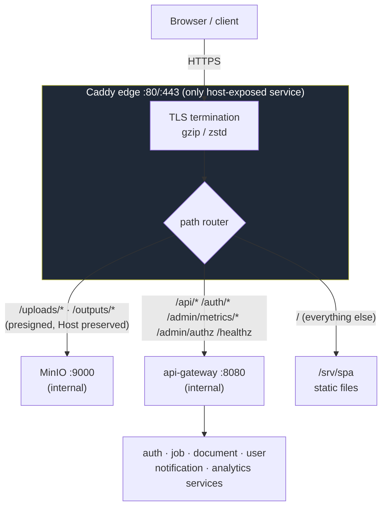
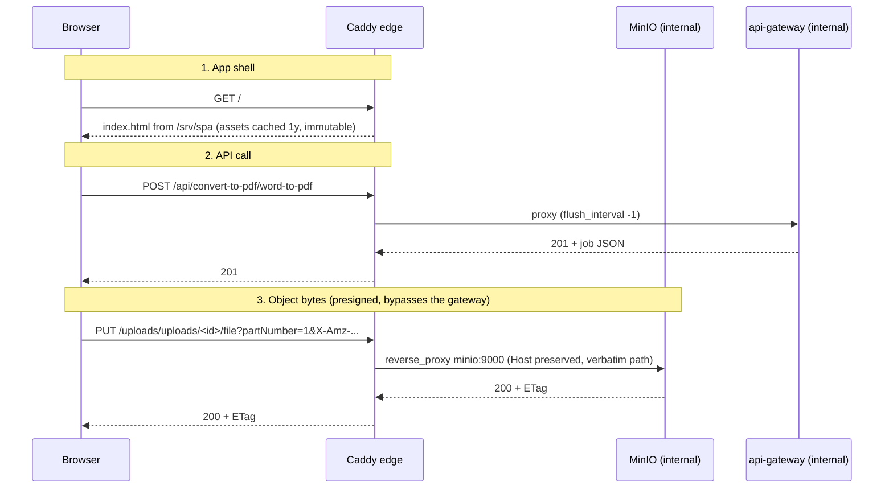

# Caddy Edge

The Caddy edge is the stack's **only host-exposed component** (ports 80/443) and
the public entrypoint for everything. It absorbs two responsibilities the
api-gateway used to carry in-process — serving the SPA and relaying object bytes
to MinIO — so file bandwidth no longer competes with API routing for the
gateway's CPU. Config: [`deployment/caddy/Caddyfile`](../../../deployment/caddy/Caddyfile); service: the `caddy` block in [`deployment/docker-compose.yml`](../../../deployment/docker-compose.yml).

## Responsibilities

1. **TLS termination** — plain HTTP on `:80` for local/dev; automatic HTTPS via
   Let's Encrypt in production (see [TLS modes](#tls-modes)).
2. **SPA static hosting** — serves the built frontend from `/srv/spa` with
   client-side-routing fallback.
3. **Object-byte routing** — proxies `/uploads/* /outputs/*` straight to
   `minio:9000` for presigned uploads/downloads (bytes never touch the gateway).
4. **API proxying** — forwards `/api/* /auth/* /admin/metrics/* /admin/authz /healthz`
   to `api-gateway:8080` on the internal network. Other `/admin/*` paths are the
   SPA's admin pages and must reach the fallback (see the route table).

### Why this is a separate container, not part of api-gateway

The recurring cost-cutting question is whether the edge can be folded into
`api-gateway`, since both are reverse proxies. It cannot, and there is nothing to
gain by trying:

- **Object bytes must not share the gateway's CPU.** Responsibility 3 streams
  presigned uploads and downloads — multi-MB bodies, constantly, for a PDF service.
  `api-gateway` deliberately never sees them (see the comment above its `mux`
  construction in `api-gateway/main.go`); merging would put file bandwidth in direct
  contention with API routing in one process and one cgroup.
- **It is the only container publishing host ports.** `80`/`443` terminate here and
  nothing else declares `ports:` at all — the port-exposure invariant in
  [compose-files.md](./compose-files.md#port-exposure-invariant). Merging would move
  a public listener into a service that currently has none.
- **TLS/ACME and static file serving** would become the Go gateway's problem, both of
  which Caddy does for free.
- **There is no memory to reclaim.** Measured steady state is **~16 MiB.**

### Memory footprint

`CADDY_MEM_LIMIT` defaults to **128M** — roughly 8× the observed idle figure. It is
not trimmed closer because idle is the wrong number to size against: `reverse_proxy`
streams rather than buffering whole bodies, so usage does not scale with file *size*,
but it does scale with **concurrent transfers**, which is precisely this service's
traffic pattern. Raise `CADDY_MEM_LIMIT` on a busier edge rather than editing compose.

Caddy sits in `deploy.sh`'s **reserved OS/edge headroom**, not the
`RESOURCE_BUDGET_PCT` project budget that covers the other services — so it does not
appear in the budget table's `TOTAL`. That is intentional, and
`./deployment/deploy.sh --dry-run` now prints it explicitly so the figures reconcile:

```
  TOTAL                       3126m     6.31   (Σ ≤ budget)

  Reserved (outside the 80% cap):    784m
    caddy                      128m   edge: TLS, SPA, object-byte streaming
    OS / page cache            656m   burst headroom
```

`TOTAL` + `Reserved` equals `Host available`. Before that line existed, summing the
table against `docker stats` left an unexplained ~256 MB gap with no indication it was
deliberate.

## Topology



`/metrics` is **intentionally not routed** — Prometheus scrapes services on the
internal network, so metrics are not internet-reachable.

Likewise the **NATS monitoring endpoint** (`nats:8222`, enabled via `-m 8222`)
is not exposed at the edge. The admin NATS dashboard tab (`/admin/metrics/nats`)
does not reach NATS directly — it goes through Caddy → api-gateway →
analytics-service, which scrapes `http://nats:8222` from inside `fyredocs_net`
and shapes the JSON. NATS itself stays internal-only.

## Request routing (sequence)



## Route rules (from the Caddyfile)

| Matcher | Paths | Upstream / action | Notes |
|---------|-------|-------------------|-------|
| `@objects` | `/{$S3_BUCKET_UPLOADS}/*`, `/{$S3_BUCKET_OUTPUTS}/*` (default `uploads`/`outputs`) | `reverse_proxy {$MINIO_UPSTREAM}` (default `minio:9000`) | `header_up Host {host}` (SigV4), `flush_interval -1`, no auth middleware — the presigned signature is the credential |
| `@api` | `/api/*`, `/auth/*`, `/admin/metrics/*`, `/admin/authz`, `/healthz` | `reverse_proxy` → `{$API_GATEWAY_UPSTREAMS}` (default `api-gateway:8080`) | Load balanced (`lb_policy least_conn`) across every listed gateway, with active `/healthz` probes; `flush_interval -1` for SSE streams. See [Scaling the gateway](#scaling-the-gateway) |
| `@grafana` | `/grafana`, `/grafana/*` | `forward_auth` → `{$AUTHZ_UPSTREAM}` `/admin/authz`, then `reverse_proxy {$GRAFANA_UPSTREAM}` | Serves the embedded observability dashboards. `forward_auth` enforces super-admin (this path bypasses the gateway proxy). Only present when the `observability` compose profile is up. See [observability.md](./observability.md#in-app-embedding-admin-observability-tab) |
| (fallback) | everything else | `file_server` from `/srv/spa` | `/assets/*`: `file_server` only, `Cache-Control: public, max-age=31536000, immutable`, a missing asset is a real **404**. Everything else: `try_files {path} /index.html` with `Cache-Control: no-cache`. **Security headers** on both (see below) |

### Why `/admin/*` is not proxied, and the SPA cache rules

- **Admin pages vs. admin API.** The SPA's admin pages live at `/admin/growth`,
  `/admin/activity`, and so on. When `@api` matched all of `/admin/*`, a refresh
  or deep link on those pages went to the gateway, which returned analytics-service's
  `404 page not found`, or a `401` JSON body where an API route shares the path
  (`GET /admin/activity`). Web and mobile call the admin API only through
  `/api/v1/admin/*`. The root paths kept on `@api` are the legacy unversioned
  `/admin/metrics/*` and the `/admin/authz` probe.
- **Stale chunks after a deploy.** Each frontend build deletes the previous build's
  hashed `/assets/*` files. `index.html` is served `no-cache`, so the browser
  revalidates it (ETag, usually a 304) instead of heuristically caching it and
  requesting deleted chunk names. A missing asset returns a 404 rather than
  falling through to `index.html`: an HTML 200 for a `.js` import fails as an
  opaque MIME/module error. A tab opened before the deploy still asks for old
  chunks; the SPA's `lazyWithReload` (`fyredocs_frontend/src/lib/lazyWithReload.ts`)
  reloads once to pick up the new `index.html`.

### Security headers (finding A1 / production-readiness S8)

The api-gateway sets response security headers only on the routes it proxies
(`/api /auth /admin /healthz`). The SPA document and the object routes are served
by Caddy directly, so they previously carried none. Caddy now sets them at the edge:

- **SPA `handle`** — `X-Frame-Options: DENY`, `X-Content-Type-Options: nosniff`,
  `Referrer-Policy: strict-origin-when-cross-origin`, and a
  `Content-Security-Policy`:
  `default-src 'self'; script-src 'self' https://plausible.io; style-src 'self' 'unsafe-inline'; img-src 'self' data: blob:; font-src 'self' data:; connect-src 'self' https://plausible.io; object-src 'none'; frame-ancestors 'none'; base-uri 'self'; form-action 'self'`.
  `style-src 'unsafe-inline'` is required for Tailwind/Radix inline styles, the
  chart `<style>`, and inline Mermaid SVG; `default-src 'self'` still permits the
  same-origin Grafana iframe.

  **Third-party origins the SPA actually uses must be listed here or they fail
  SILENTLY** — no user-visible error, just a missing feature. Two were previously
  broken this way:
  - *Google Fonts* — `index.html` loaded Inter from `fonts.googleapis.com` while
    `style-src`/`font-src` were `'self'`, so the app quietly rendered in a system
    font. Fixed by **bundling** Inter (`@fontsource/inter`, imported in
    `src/main.tsx`); fonts are now same-origin and no CSP exception is needed.
  - *Plausible analytics* — the script and its beacon were both blocked, so
    analytics recorded nothing. Fixed by allowlisting `https://plausible.io` in
    `script-src` (the snippet) and `connect-src` (the beacon).

  **Validate the CSP against the running SPA** (open the docs page with Mermaid +
  charts, confirm Inter renders and the Plausible beacon fires, and watch the
  browser console) before treating it as final — relax a single directive only
  for a legitimately-blocked resource.
- **HSTS** — `Strict-Transport-Security: max-age=31536000; includeSubDomains` is
  set at the site level, so it covers the SPA, the API routes, and the object
  routes. Browsers ignore it over plain HTTP, so it is inert for the local `:80`
  setup and takes effect only behind the automatic TLS a `PUBLIC_DOMAIN` deploy
  gets. `preload` is deliberately omitted — it is a one-way, hard-to-reverse
  commitment; add it only once the domain is final.
- **`@objects`** — `X-Content-Type-Options: nosniff` so object bytes can't be
  MIME-sniffed into an executable type on this origin (downloads also force
  attachment disposition via the presigned `response-content-disposition`).

#### Allowing ad networks — `CSP_AD_DOMAINS`

The CSP is strict (same-origin) by default, which blocks third-party ads. To run
one or more ad networks without editing the Caddyfile, set `CSP_AD_DOMAINS` in the
root `.env` to the networks' hosts (space-separated). The value is substituted into
the `script-src`, `img-src`, `connect-src`, and `frame-src` directives via
`{$CSP_AD_DOMAINS}` (empty by default → strict, no ads). Compose passes it to the
caddy container (`CSP_AD_DOMAINS: ${CSP_AD_DOMAINS:-}`).

```dotenv
# several networks can share one line; 'unsafe-inline' covers most ad init snippets
CSP_AD_DOMAINS='unsafe-inline' https://pagead2.googlesyndication.com https://*.doubleclick.net https://*.google.com
```

One knob feeds all four directives (ad hosts span every type; a host landing in a
directive it doesn't need is ignored by the browser). `'unsafe-inline'` is only
meaningful in `script-src`. `frame-ancestors 'none'` is unaffected — it controls
who may frame *our* site, not the ad iframes *we* embed.

> **Security tradeoff:** allowing external ad scripts (and `'unsafe-inline'`)
> measurably weakens the CSP's XSS protection. This is unavoidable for ad-supported
> sites; the strict default protects everything until ads are enabled. After
> setting the var, load the site and clear any remaining console CSP errors by
> adding the exact hosts they name.

> **CSP allows, consent decides.** `CSP_AD_DOMAINS` only makes the ad host
> *permitted* by the browser; whether ads actually load is gated by the user's
> cookie-consent choice. The SPA ships a GDPR consent banner
> (`fyredocs_frontend/src/components/common/CookieConsent.tsx`) backed by
> `fyredocs_frontend/src/lib/consent.ts`. When wiring an ad network, inject its
> `<script>` only when `hasMarketingConsent()` is true (and re-check on the
> `fyredocs:consent-change` event), or use Google Consent Mode. The app's own
> analytics (Plausible) is cookieless and needs no consent.
>
> **Regional default:** before an explicit choice, marketing consent defaults **ON
> outside the EU/EEA/UK** (opt-out) and **OFF inside it** (opt-in, GDPR/UK-PECR).
> Region is currently inferred from the **browser timezone** (`isConsentRequiredRegion()`
> in `consent.ts`) — dependency-free and guest-covering, but a heuristic. For higher
> accuracy, inject a country header at this edge (a Caddy GeoIP build, or a CDN such
> as Cloudflare's `CF-IPCountry`) and prefer it in `isConsentRequiredRegion()`.
>
> **Banner visibility:** the consent banner **auto-shows only in consent-required
> regions** (EU/EEA/UK). Elsewhere it stays hidden (ads default on), but the footer
> **"Cookie settings"** link opens the preferences dialog everywhere so any visitor
> can still opt out. A country header (above) automatically tightens this too.

### Why Host preservation is load-bearing

Presigned SigV4 URLs are signed against the **public origin the browser uses**
(`PUBLIC_ORIGIN`, i.e. this edge), and the signature covers the `Host` header
and the canonical path. Caddy forwards the **original** `Host` (`header_up Host
{host}`) and the path **verbatim** to `minio:9000`; MinIO recomputes the
signature against what it receives. Rewriting the Host (or stripping the bucket
prefix) would invalidate every presigned URL. See
[object-storage.md](./object-storage.md#presigned-flow-through-the-caddy-edge-same-origin).

## Scaling the gateway

The `@api` route load balances across the addresses in `API_GATEWAY_UPSTREAMS`, a
space-separated list of `host:port`. Compose defaults it to
`api-gateway:${API_GATEWAY_PORT:-8080}`, so the single-host stack needs no
configuration.

```bash
# Single host (default) — nothing to set.
# Multi-host: enumerate each app server's gateway.
API_GATEWAY_UPSTREAMS="app1.internal:8080 app2.internal:8080"
```

> **Gateway port is configurable.** `API_GATEWAY_PORT` (default `8080`, set in the
> root `.env`) drives the gateway container's `PORT`/`expose`/healthcheck, the
> analytics dashboard's gateway-scrape URLs, and the default upstream above, so
> they always agree. The gateway is **internal-only** (never host-published — only
> Caddy's 80/443 are), so this port is not reachable from outside; choosing a
> non-obvious value is defense-in-depth on the internal network. The `.env` ships
> a non-default value (e.g. `47821`).

### Why not dynamic DNS upstreams

This route previously used Caddy's `dynamic a` upstreams, re-resolving the
Compose service name against Docker's embedded DNS (`127.0.0.11`) every 5s. That
auto-discovered replicas, so `docker compose up -d --scale api-gateway=3` needed
no Caddyfile edit.

**That resolver only ever sees containers on the same host.** Once Caddy moves to
its own edge host — the topology in
[horizontal-scaling.md §4](./horizontal-scaling.md) — it cannot discover an app
server's gateway at all, so the dynamic form is not an option there. Replicas are
now enumerated explicitly instead.

What that buys back: **active health checks work on static upstreams** but are
unsupported for dynamic ones. A dead gateway is now caught by probe rather than
only after real requests fail into it.

The `api-gateway` service intentionally has **no `container_name`** so Compose can
still run multiple instances behind one address; keep it that way.

Balancing and resilience settings on the route:

- `lb_policy least_conn` — send each request to the replica with the fewest
  active connections.
- `lb_try_duration 5s` / `lb_try_interval 250ms` — a failed request is
  transparently retried against another upstream.
- Active health (`health_uri /healthz`, `health_interval 10s`,
  `health_timeout 5s`) — probes each upstream directly. `/healthz` is routed to
  the gateway by this same matcher, so the probe exercises the real path.
- Passive health (`max_fails 3`, `fail_duration 30s`, `unhealthy_status 5xx`) —
  an upstream returning 5xx is ejected temporarily. Kept alongside the active
  probe because it catches failures a 200 on `/healthz` would not reveal.

### Upstream addresses are all configurable

Every proxy target in the Caddyfile reads an env var so the edge can sit on its
own host. Compose supplies concrete defaults for all of them — required, because
compose always defines the variable in the container and Caddy's `{$VAR:default}`
fallback ignores a defined-but-empty value (same trap as `PUBLIC_DOMAIN` below).

| Var | Default | Multi-host value |
|---|---|---|
| `API_GATEWAY_UPSTREAMS` | `api-gateway:8080` | every app host's gateway, space-separated |
| `AUTHZ_UPSTREAM` | `api-gateway:8080` | one app host — the `/grafana` `forward_auth` probe needs a single address, not a list |
| `MINIO_UPSTREAM` | `minio:9000` | the data host's private address |
| `GRAFANA_UPSTREAM` | `grafana:3000` | the data host (where the `observability` profile runs) |

**`TRUSTED_PROXIES` must be widened when Caddy moves off-host.** Its source IP
then falls outside the default `172.18.0.0/16`, Gin stops trusting
`X-Forwarded-For`, and every request appears to originate from the proxy —
collapsing all rate-limit and guest buckets into a single shared key. Add the edge
host's private address.

## TLS modes

The site address is `{$PUBLIC_DOMAIN::80}`:

- **`PUBLIC_DOMAIN` unset** → the container receives the compose default `:80`
  (`PUBLIC_DOMAIN: ${PUBLIC_DOMAIN:-:80}`) → **plain HTTP on :80** for local/dev.
  > The default is supplied by compose, not by Caddy's `{$VAR:default}` — compose
  > always defines the variable in the container, and Caddy's fallback only
  > applies to an *unset* variable, not a defined-but-empty one.
- **`PUBLIC_DOMAIN=docs.example.com`** → Caddy obtains and renews a certificate
  automatically (Let's Encrypt) and serves **HTTPS on :443** (with :80 redirect).
  Certificates persist in the `caddy_data` volume.

## Deployment

```yaml
caddy:
  image: caddy:2-alpine
  ports: ["80:80", "443:443"]        # the only published ports in the stack
  environment:
    PUBLIC_DOMAIN: ${PUBLIC_DOMAIN:-:80}
    S3_BUCKET_UPLOADS: ${S3_BUCKET_UPLOADS:-uploads}
    S3_BUCKET_OUTPUTS: ${S3_BUCKET_OUTPUTS:-outputs}
  volumes:
    - ./caddy/Caddyfile:/etc/caddy/Caddyfile:ro
    - ../../fyredocs_frontend/dist:/srv/spa:ro   # SPA build output
    - caddy_data:/data                            # certificates persist here
    - caddy_config:/config
  healthcheck:
    test: ["CMD", "wget", "-qO-", "http://localhost/healthz"]
  depends_on: [api-gateway, minio]
```

- The SPA build (`fyredocs_frontend/dist`) is bind-mounted read-only; rebuild the
  frontend and Caddy serves the new assets (immutable-cached under `/assets/*`).
- `S3_BUCKET_*` are passed so the `@objects` matcher tracks any non-default
  bucket names.
- Health: the edge's own `/healthz` proxies through to the gateway, so a healthy
  Caddy container also implies the gateway is reachable.

## Operational notes

- **Adapt errors are fatal & crash-loop.** Caddy validates the whole Caddyfile
  at startup; a bad global option or an empty site address makes it exit and
  restart. Check `docker compose logs caddy` for `adapting config … error`.
- **Local HTTPS**: leave `PUBLIC_DOMAIN` unset (plain HTTP) — Let's Encrypt
  can't issue for `localhost`.
- **Metrics**: not exposed at the edge by design; scrape services internally.

## Related documentation

- [Object Storage](./object-storage.md) — presigned flow, buckets, SigV4 Host preservation
- [API Gateway](../services/api-gateway.md) — the internal service behind the edge
- [Compose files layout](./compose-files.md) — where the edge fits in the stack
- [System overview diagram](../mermaid/system-overview.md)
