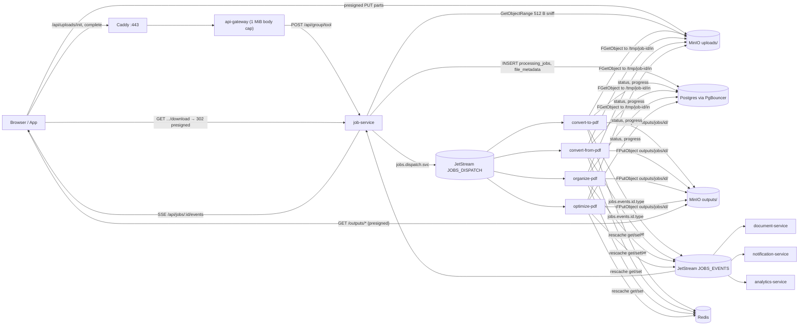

# 01 — Existing System Audit

> Part of the Next-Generation Document Engine analysis (2026-11). Status: ANALYSIS — no code changed.

## 1. Purpose and scope

This document is the architecture map of the document pipeline as it exists at HEAD on 2026-11-07: how a
file enters, where it is validated, which process touches it, where temporary copies live, how output
leaves, and what fails. It is the baseline every sibling document argues against. Paths are relative to
`fyredocs_backend/`; every current-state claim cites `file:line`. Numbers come from committed result files
or are marked "to be measured" with the command that will produce them (fresh image and timing numbers land
in `benchmarks/baseline-2026-11.md`, produced by `benchmarks/measure-images.sh`).

Out of scope: auth, billing, analytics internals. In scope: job-service, the four PDF workers,
document-service and ai-service document features, the shared packages they depend on, and the web/app
surfaces that drive them. Feature inventory per tool is in `02-document-capability-matrix.md`; native
dependency analysis is in `03-heavy-dependency-analysis.md`.

## 2. Current state

### 2.1 Platform shape

Go 1.26 workspace (`go.work`) of 13 modules; every service `replace fyredocs/shared => ../shared`. Single
host, `deployment/docker-compose.yml` (1809 lines). Caddy is the only published port
(`deployment/caddy/Caddyfile:25-42` proxies `/uploads/*` and `/outputs/*` straight to MinIO with Host
preserved for SigV4; `:54-88` sends `/api/*`, `/auth/*`, `/admin/*`, `/healthz` to api-gateway).
api-gateway (`api-gateway/main.go:122-259` route table, `:442-457` middleware order) caps bodies at 1 MiB
(`:61`, `:808`) except 4 MiB on `/api/ai/extract` and `/api/ai/transcribe` (`:230`, `:237`). File bytes
therefore never pass through the gateway on the primary path — they go browser → MinIO via presigned
multipart URLs.

### 2.2 Request-to-output trace (common to every tool)

| Step | Where | What happens | Evidence |
|---|---|---|---|
| 1. Upload init | job-service `POST /api/uploads/init` | S3 multipart created, 8 MiB parts, ≤1000 parts, Redis hash `upload:{id}` 30 min TTL | `job-service/handlers/uploads.go:79-165`; routes `job-service/routes/upload_routes.go:55-99` |
| 2. Parts | browser → MinIO | presigned PUT per part (public-endpoint client) | `shared/storage/storage.go:296-302`, `shared/storage/multipart.go:14-63` |
| 3. Complete | `POST /api/uploads/:id/complete` | CompleteMultipart; size re-checked with StatObject | `uploads.go:224-300` |
| 4. Create job | `POST /api/<group>/<tool>` → `CreateJobFromTool` | tool slug normalised and routed (`routing.ServiceForTool`); Idempotency-Key reserved via SetNX 10 min; uploads claimed in Redis; first 512 B read with `GetObjectRange` and sniffed with `http.DetectContentType` against a per-tool allowlist; options validated; DB tx inserts `processing_jobs` + `file_metadata`; JetStream publish to `jobs.dispatch.<svc>` | `job-service/handlers/jobs.go:97-107` (route), `:116-153` (idempotency), `:731` (`consumeUpload`), `:793` + `:944` (512 B sniff), `:1358-1385` (`validateMIMEHead`, fail-open when a tool has no category), `job-service/handlers/tool_options.go:130-160` (per-tool option validation), `jobs.go:388-406` (tx), `:419-425` (publish) |
| 4b. Multipart fallback | same handler | Gin buffers up to 50 MiB to disk then copies to MinIO | `jobs.go:273-352`; `job-service/main.go:142` |
| 5. Queue | NATS JetStream | `JOBS_DISPATCH` WorkQueue, 24 h, 1 GiB, 64 KiB msg (payload = object keys, never bytes) | `shared/natsconn/natsconn.go:69-80` |
| 6. Worker | durable pull consumer per service | see §2.3 | `convert-to-pdf/internal/worker/worker.go:319-327` (identical in the other three) |
| 7. Stage inputs | worker scratch | `os.MkdirTemp("", "job-<id>-")` on tmpfs `/tmp` (1 GiB), `FGetObject` into `<scratch>/in/`, removed by `defer` | `worker.go:500-505`; `shared/storage/storage.go:306-314`; compose tmpfs `deployment/docker-compose.yml:825-826,903-904,981-982,1059-1060` |
| 8. Transform | worker `processing/` | exec of native binary or pdfcpu in-process under a 10-min job context | `convert-to-pdf/internal/worker/worker.go:546`; `convert-from-pdf/internal/worker/worker.go:441`; `optimize-pdf/internal/worker/worker.go:439`; `organize-pdf/internal/worker/worker.go:439` |
| 9. Output | worker → MinIO | `FPutObject` to `outputs/jobs/{jobID}/{basename}`; `file_metadata` output row; metadata merged into job jsonb | `shared/storage/storage.go:317-323`; `convert-from-pdf/internal/worker/worker.go:475-489` |
| 10. Events | NATS `JOBS_EVENTS` (Interest, 1 h, 256 MiB) | `jobs.events.<jobId>.<EventType>` consumed by job-service SSE, document-service, notification-service, analytics-service | `natsconn.go:81-88`; `shared/queue/events.go:147`; `job-service/handlers/sse.go:51-158` (temp consumer, keepalive 15 s, 5-min cap); `document-service/subscriber/subscriber.go:57-64`; `notification-service/subscriber/subscriber.go:57,120-130`; `analytics-service/subscriber/subscriber.go:100,121` |
| 11. Download | `GET /api/<group>/<tool>/:id/download` | 302 to a 5-min presigned GET with `attachment` disposition | `jobs.go:608-671`; `storage.go:286-292` |
| 12. Retention | job-service cleanup under Redis lock | GUEST 30 m, FREE 7 d, PRO 30 d, batches of 100 | `job-service/internal/cleanup/cleanup.go`; `shared/config/defaults.go:14-27` |



### 2.3 Worker job lifecycle (identical skeleton in all four workers)

| Concern | Value | Evidence |
|---|---|---|
| Consumer | durable `<service>`, filter `jobs.dispatch.<service>`, AckExplicit, MaxDeliver 4, AckWait 30 min, MaxAckPending 2×concurrency, BackOff 10 s/30 s/2 min | `convert-to-pdf/internal/worker/worker.go:319-327` |
| Fetch | `Fetch(maxConcurrency, FetchMaxWait 5s)`; goroutine per message gated by semaphore; panic recovered → job marked failed → `Term` | `worker.go:344`, `:362-366`, `:369-384` |
| Duplicate guard | skip (Ack) if DB status already `processing` or `completed` | `worker.go:456-464` |
| Result cache | key `rescache:v1:<svc>:sha256(tool, canonical options, input ETags)`, TTL `RESULT_CACHE_TTL_SECONDS` (compose 3600); hit = server-side `CopyObject` into the new job's output key | `worker.go:476-496`, `:623-660`; `storage.go:329-336` |
| Scratch guard | reject if `input × (1 + TMPFS_OUTPUT_FACTOR_PCT/100)` > `TMPFS_BUDGET_MB` (900 MiB); inputs > `LARGE_JOB_THRESHOLD_MB` (100) serialise on a size-1 semaphore | `convert-to-pdf/internal/worker/tmpfs.go:23,28-30,34-36,42-48`; `worker.go:516-528` |
| Job context | `context.WithTimeout(ctx, 10*time.Minute)` passed to `exec.CommandContext`; pdfcpu calls do not take a ctx | `worker.go:546`; e.g. `organize-pdf/processing/processing_free.go:24,134` |
| Progress | convert-to-pdf/optimize/organize: timer-based sqrt ease-out 20→90 % every 10 s; convert-from-pdf: `runWithProgressTicking` 30→80 % every 10 s | `convert-to-pdf/internal/worker/worker.go:151-176`; `convert-from-pdf/processing/processing_free.go:427-456`; `convert-from-pdf/internal/worker/progress.go` |
| Failure | `handleFailure` is the only NAK site: `NakWithDelay` only if `isRecoverable` (explicit wrapper, storage 5xx/429, net timeout) and deliveries < 4; otherwise mark failed with a friendly message, publish `jobs.dlq.<svc>`, then Ack | `worker.go:682-720`, `:858-874`, error map `:88-113` |
| Shutdown | SIGTERM stops fetching; in-flight jobs run on `procCtx` until `WORKER_DRAIN_TIMEOUT` (120 s) then cancelled → nak → redelivery; compose `stop_grace_period 3m` | `worker.go:244-248`, `:304-310` |

```mermaid
sequenceDiagram
  participant N as JetStream JOBS_DISPATCH
  participant W as worker goroutine
  participant P as Postgres
  participant R as Redis
  participant S as MinIO
  participant X as native binary or pdfcpu
  N->>W: Fetch(concurrency) message
  W->>P: duplicate guard (processing or completed → Ack)
  W->>P: status=processing, progress 20
  W->>R: rescache GET sha256(tool, options, ETags)
  alt cache hit and output still exists
    W->>S: CopyObject cached → outputs/jobs/id
    W->>P: output row, completed 100
    W->>N: Ack
  else miss
    W->>W: MkdirTemp /tmp/job-id-; tmpfs budget; largeJobSem
    W->>S: FGetObject inputs → scratch/in
    W->>X: exec.CommandContext(jobCtx 10 min) or in-process pdfcpu
    X-->>W: output file in scratch/out (or error)
    W->>S: FPutObject → outputs/jobs/id/basename
    W->>P: file_metadata output, metadata jsonb, completed 100
    W->>R: rescache SET (TTL 1 h)
    W->>N: Ack
  end
  opt failure
    W->>W: isRecoverable and deliveries < 4 ?
    W-->>N: NakWithDelay 10s/30s/2m
    W-->>N: else publish jobs.dlq.svc, mark failed, Ack
  end
  Note over W: defer os.RemoveAll(scratch) — tmpfs freed on return
```

### 2.4 Per-worker trace tables

Workers trust job-service for MIME/extension checks and perform none themselves; each has a tool allowlist
(`convert-to-pdf/main.go:93-103`, `convert-from-pdf/main.go:89-100`, `optimize-pdf/main.go:89-94`,
`organize-pdf/main.go:100-115`).

#### convert-to-pdf (concurrency 2, 1 G / 2 CPU, replicas `${CONVERT_TO_PDF_REPLICAS:-1}`)

| Tool(s) | Path | Process | Temp files | Output | Evidence |
|---|---|---|---|---|---|
| word/excel/powerpoint/html/odt/ods/odp-to-pdf | `officeToPDF` → `tryUnoconvert` → fallback `libreoffice --headless` | `unoconvert --host H --port P --convert-to pdf IN OUT` with a **fixed 30 s timeout**; on failure port is released by `defer` then `libreoffice --headless --convert-to pdf --outdir DIR IN` under the 10-min ctx (shared profile, no `-env:UserInstallation`) | LibreOffice writes `<outdir>/<base>.pdf` then rename | PDF | `convert-to-pdf/processing/processing_free.go:30-51` (30 s at `:38`), `:59-81`, `:69` |
| word-to-odt, excel-to-ods, powerpoint-to-odp | `officeToOffice` | same two-tier path with `--convert-to odt/ods/odp` | same | ODF | `processing_free.go:85-107` |
| image-to-pdf | `imageToPDF` | pdfcpu `api.ImportImagesFile(inputs, out, nil, nil)` in-process; **options are not passed** | none | PDF | `processing_free.go:112-115`; dispatch `convert-to-pdf/processing/processing.go:61-63` |
| daemon pool | `unoserverPool` | buffered channel of ports; `UNOSERVER_INSTANCES` unset → Go assumes `WORKER_CONCURRENCY+1`, `entrypoint.sh` starts 2 | — | — | `convert-to-pdf/processing/unopool.go:29-37,54-75`; `convert-to-pdf/entrypoint.sh:15-25,30,39-46` |
| readiness | entrypoint | waits ≤30 s for the **first** daemon only (`unoconvert … /dev/null /dev/null`) | `/tmp/uno-profile-<port>` | — | `entrypoint.sh:51-71` |

#### convert-from-pdf (concurrency 2, 1 G / 2 CPU, python:3.11-slim-bookworm)

| Tool(s) | Process | Temp files | Output | Evidence |
|---|---|---|---|---|
| pdf-to-word/docx | `pdf2docx convert IN OUT` (PyMuPDF); on error fall back to `libreoffice --headless --infilter=writer_pdf_import --convert-to docx` | none / LO outdir | DOCX | `convert-from-pdf/processing/processing.go:48-58`; `processing_free.go:463-481`, `:239-277` |
| pdf-to-excel/xlsx | `python3 /app/scripts/pdf_to_xlsx.py IN OUT` (pdfplumber + openpyxl) | none | XLSX | `processing_free.go:330-352`; `convert-from-pdf/scripts/pdf_to_xlsx.py` |
| pdf-to-powerpoint/ppt/pptx | `pdftoppm -png IN TMP/page` (all pages, default DPI) → hand-written PPTX zip | `pdf-ppt-images-*` | PPTX of image slides | `processing_free.go:282-319`, `:304`; `convert-from-pdf/processing/pptx_builder.go:16` |
| pdf-to-image/img | `pdfinfo` (page size → DPI cap 10 000 px) → `pdftoppm {-png,-jpeg,-tiff} -r DPI` all pages → single image or zip | `pdf-images-*` | PNG/JPG/TIFF or ZIP | `processing_free.go:125-148`, `:154-202`, `:181` |
| pdf-to-html | `pdftohtml -s -noframes` → zip | `pdf-html-*` | ZIP | `:493-512` |
| pdf-to-text/txt | `pdftotext -layout` | none | TXT | `:517-530` |
| pdf-to-pdfa | `gs -dPDFA=2 -dBATCH -dNOPAUSE -dNOOUTERSAVE -sProcessColorModel=DeviceRGB -sDEVICE=pdfwrite -sPDFACompatibilityPolicy=1` — no `PDFA_def.ps`, no ICC OutputIntent, no explicit `-dSAFER` | none | PDF | `:209-232` |
| pdf-to-odt | LibreOffice `writer_pdf_import --convert-to odt` | LO outdir | ODT | `processing.go:74-76`; `:239-277` |
| pdf-to-ods | pdf_to_xlsx.py → `libreoffice --convert-to ods` | `pdf2ods_*.xlsx` | ODS | `:368-376`, `:401-420` |
| pdf-to-odp | image-slide PPTX → `libreoffice --convert-to odp` | `pdf2odp_*.pptx` | ODP | `:389-397` |

Note the worker uploads the output with `ctx` rather than `jobCtx` (`convert-from-pdf/internal/worker/worker.go:475`) and treats a `recordOutput` DB failure as permanent (`:483-486`).

#### organize-pdf (concurrency 4, 1 G / 2 CPU, alpine + tesseract only)

| Tool | pdfcpu / Go call | Notes | Evidence |
|---|---|---|---|
| merge-pdf | `api.MergeCreateFile` | in-process | `organize-pdf/processing/processing_free.go:19-24` |
| split-pdf | `ReadContextFile` → `CollectFile`/`SplitFile`/`ExtractPagesFile` → zip | modes all/range/every-N/into-N | `:29-110` |
| remove-pages / extract-pages / organize-pdf (reorder) | `RemovePagesFile` / `CollectFile` / `CollectFile` | page lists parsed leniently | `:115-134`, `:139-158`, `:164-183` |
| rotate-pdf | `RotateFile` | 90/180/270; all/odd/even | `:188-201`; `processing.go:85` |
| watermark-pdf | `ParseTextWatermarkDetails` + `AddWatermarksFile`; image: data-URL decoded to file (no size cap, no sniff) | text uses core Helvetica | `processing_edit.go:211-284`, `:295-315`, `:317-353` |
| protect-pdf / unlock-pdf | `EncryptFile` (AES-256/128, RC4-128) / `DecryptFile` | password length check | `:183-191`, `:197-206`, `:106` |
| sign-pdf | image watermark (`ParseImageWatermarkDetails`) | visual stamp only, not PAdES | `:475-545` |
| edit-pdf | one `AddWatermarksFile` per annotation, in place on the output | Helvetica; fontSize/count unbounded | `:551-619` |
| add-page-numbers | `ReadContextFile` then one `AddWatermarksFile` per page, in place | N rewrites for N pages | `:381-460`, `:454` |
| pdf-metadata | `AddPropertiesFile` | app-only tool | `processing_metadata.go:63-68` |
| scan-to-pdf | pure-Go `internal/imaging` (DecodeConfig guard, 50 MP cap, perspective warp, cleanup, threshold) → `ImportImagesFile`; OCR: `tesseract IMG BASE -l LANG pdf txt` **sequentially**, per-image fallback to `ImportImagesFile`, `MergeCreateFile` | OCR text capped 512 KB | `processing_scan.go:337-395`, `:415-429`, `:444-490`, `:498-551`; `organize-pdf/internal/imaging/decode.go:17,48-60` |
| detect-edges | internal HTTP `POST /internal/v1/detect-edges`, objects ≤30 MiB | pure Go | `organize-pdf/internal/httpapi/detect.go:23,60-71` |

`pdfcpuapi.DisableConfigDir()` is called here only (`organize-pdf/main.go:57`); the comment names the
other three workers as sharing the hazard.

#### optimize-pdf (concurrency 2, 1 G / 2 CPU, alpine + poppler + gs + tesseract)

| Tool | Process | Evidence |
|---|---|---|
| compress-pdf | `gs -dNOPAUSE -dBATCH -dSAFER -sDEVICE=pdfwrite -dCompatibilityLevel=1.4 -dPDFSETTINGS=/{printer,ebook,screen} … -d*ImageResolution={300,150,72,36}` (+gray for `extreme`, `setdistillerparams` QFactor for high/extreme) | `optimize-pdf/processing/processing_free.go:54-103`, `:106-165` |
| repair-pdf | gs pdfwrite `/prepress` re-distill | `:174-211` |
| flatten-pdf | gs pdfwrite `-dPreserveAnnots=false -dPrinted` | `:218-266` |
| ocr-pdf | `pdfinfo` → DPI cap → `pdftoppm -png -r DPI` **all pages up front** → `tesseract … pdf txt` in an errgroup of `OCR_MAX_WORKERS` = min(NumCPU,4) → per-page fallback `ImportImagesFile` → `MergeCreateFile`; text ≤512 KB into job metadata | `:474-632`, `:27-44`, `:531-540`, `:565-598`, `:637` |

### 2.5 Native binary and runtime inventory

| Image | Base | Packages (install line) | Versions (distro package, accessed 2026-11-07) |
|---|---|---|---|
| convert-to-pdf | `fyredocs-base:latest` = alpine:3.19 | `poppler-utils libreoffice ttf-liberation python3 py3-pip`; `pip3 install unoserver` (unpinned) | LibreOffice 7.6.7.2-r0, poppler 23.10.0-r0 ([pkgs.alpinelinux.org](https://pkgs.alpinelinux.org/packages?branch=v3.19)); unoserver resolves to PyPI latest (3.7 on 2026-06-10) — `deployment/base-alpine-libreoffice.Dockerfile:14-24`; `convert-to-pdf/Dockerfile:23` |
| convert-from-pdf | python:3.11-slim-bookworm | `libreoffice-core/-writer/-calc/-impress poppler-utils ghostscript fonts-liberation`; `pip3 install pdf2docx==0.5.8 pdfplumber==0.11.4 openpyxl==3.1.5` (pdf2docx pulls PyMuPDF + opencv-python-headless) | LibreOffice 4:7.4.7-1+deb12u14, ghostscript 10.0.0~dfsg-11+deb12u8, poppler 22.12.0-2+deb12u3 ([packages.debian.org](https://packages.debian.org/bookworm/)) — `convert-from-pdf/Dockerfile:28-40` |
| optimize-pdf | alpine:3.19 | `poppler-utils ghostscript tesseract-ocr tesseract-ocr-data-eng tesseract-ocr-data-hin` | ghostscript 10.05.1-r0, tesseract 5.3.3-r1, poppler 23.10.0-r0 — `optimize-pdf/Dockerfile:24-33` |
| organize-pdf | alpine:3.19 | `tesseract-ocr tesseract-ocr-data-eng tesseract-ocr-data-hin` (comment at `:26-27` claims eng/deu/fra/spa/hin — stale) | tesseract 5.3.3-r1 — `organize-pdf/Dockerfile:24-33` |
| all other services | scratch (+CA, zoneinfo, passwd, healthcheck) | — | — |
| test-binaries | — | adds `tesseract-ocr-data-deu`, `libreoffice`, `unoserver`; **not** pdf2docx/pdfplumber | `deployment/test-binaries.Dockerfile:5-6,22-27` |

Not installed anywhere: qpdf, ImageMagick, libvips, pandoc, wkhtmltopdf, chromium, veraPDF. All worker
binaries are `CGO_ENABLED=0 -trimpath -ldflags="-s -w"` from `fyredocs-go-builder:latest`
(`convert-to-pdf/Dockerfile:19-20` and siblings). Pre-existing local image sizes (three months old, stale —
fresh numbers in `benchmarks/baseline-2026-11.md`): convert-from-pdf 1.54 GB, convert-to-pdf 1.17 GB,
fyredocs-base 1.07 GB, optimize-pdf 325 MB, organize-pdf 287 MB, scratch services 43–60 MB.

### 2.6 Concurrency, queues and timeouts

| Layer | Setting | Evidence |
|---|---|---|
| Gateway | upstream dial 3 s, response-header 5 min, idle 90 s, `FlushInterval -1` (SSE), per-upstream circuit breaker | `api-gateway/main.go:490-501`, `:627`, `:513-519` |
| Rate limit | Redis sliding window on `/api/*`: guest 30, free 120, pro 600 per min; fail-open with `rate_limit_fail_open_total` | `api-gateway/internal/ratelimit/ratelimit.go:184-194`; `main.go:430-437`, `:152-154` |
| job-service | per-IP/min upload 30, job-create 20, detect 60, share-redeem 30; DB tx 10 s; trusts `X-User-Plan-Max-File-MB` header; MAX_UPLOAD_MB hard ceiling 500 (guest 20 MB / 5 files) | `jobs.go:388`, `:1181-1200`; `shared/config/defaults.go:51-54` |
| Workers | WORKER_CONCURRENCY 2/2/4/2 (to/from/organize/optimize); 10-min job ctx; AckWait 30 min; drain 120 s; `largeJobSem` size 1 above 100 MiB | compose lines ~786-1060; §2.3 |
| unoconvert | fixed 30 s; with LO ≈ 2 s + 1.5 s/MB (`docs/developer/architecture/production-readiness.md:104`) any office input above ≈18 MB always times out and falls to cold LibreOffice while the daemon keeps converting the abandoned document on a port already handed back to the pool | `convert-to-pdf/processing/processing_free.go:35-38` |
| Office size ceiling | 500 MB × 1.5 s/MB = 750 s > 600 s job ctx: a plan-max upload can never finish | `shared/config/defaults.go:54` vs `worker.go:546` |
| Process groups | no `Setpgid`, `Pdeathsig`, `WaitDelay` or `cmd.Cancel` anywhere (grep verified 2026-11-07); `CommandContext` kills only the direct child (`unoconvert`, `python3`, `libreoffice` launcher) — `soffice.bin`, `python→MuPDF`, `pdf_to_xlsx.py` survive cancellation; `CombinedOutput` can block on inherited pipes | all exec sites in §2.4 |
| Measured capacity | sustained 9 jobs/min on the dev host (k6 co-located → lower bound): 3/min p95 21.6 s, 6/min 15.6 s, 9/min 24.6 s, 12/min fails on success 97.3 % | `scripts/k6/results/capacity-jobs-20260727-234123.md` |
| Estimated need | ~30 concurrent conversions at peak vs 8 total slots (2 LibreOffice) | `production-readiness.md:257` |

### 2.7 Temporary files and scratch

Every worker: one `job-<id>-` directory on tmpfs `/tmp` (1 GiB) holding `in/` and `out/`; nested
`MkdirTemp` dirs inside processing (`pdf-images-*`, `pdf-ppt-images-*`, `pdf-html-*`, `pdf-ocr-*`), all
`defer os.RemoveAll`. LibreOffice additionally writes its user profile (`/tmp/uno-profile-<port>` for
daemons; the default profile for the cold fallback, shared across concurrent fallbacks because no
`-env:UserInstallation` is passed, `processing_free.go:69`). The tmpfs budget check happens **after** the
upload succeeded, so inputs above ≈300 MiB (900 MiB ÷ 3) fail at the worker, not at upload
(`tmpfs.go:42-48`). All worker Dockerfiles still declare unused `/app/uploads` and `/app/outputs` volumes.

### 2.8 Error handling

Worker errors are classified by substring (`timeout`/`deadline exceeded` → `TIMEOUT`, else
`CONVERSION_FAILED`, `convert-to-pdf/internal/worker/worker.go:88-97`) and mapped to a friendly string
(`:102-113`); raw stderr is logged, never returned. Unknown errors are permanent by design (`:854-858`).
Retries therefore only cover storage/network faults; a LibreOffice crash on a specific file is not retried
(correct) but a transient `unoserver` hiccup is also not retried — it silently takes the cold path.
`job-service` has no `cancelled` state (`job-service/internal/migrations/00001_baseline.sql:50`);
`DeleteJobByID` removes rows and objects but the worker keeps running (`jobs.go:553-603`).

### 2.9 Fonts

`ttf-liberation` (convert-to-pdf base) and `fonts-liberation` (convert-from-pdf) only. No `fc-cache`, no
Noto, no DejaVu, no Devanagari font in any image. pdfcpu text stamps use core Helvetica
(`organize-pdf/processing/processing_edit.go:279,448,606`) so watermark/page-number/edit text cannot draw
Hindi. The web reader replaces non-WinAnsi characters with `?` in annotations
(`fyredocs_frontend/src/lib/annotate/pdfAnnots.ts:101-115`). Ghostscript ships only its bundled fonts.

### 2.10 Observability

slog JSON with `trace_id`/`span_id`/`request_id` (`shared/logger/logger.go:53-60`) → Alloy → Loki; `/metrics`
on every service with `http_request_duration_seconds`, `jobs_processed_total`, `jobs_failed_total`,
`job_duration_seconds`, `rate_limit_fail_open_total` (`shared/metrics/metrics.go:23-62`); OTel OTLP/HTTP
(`shared/telemetry/tracer.go:52`) with trace propagation over NATS headers (`shared/queue/trace.go`);
Prometheus alert rules `deployment/prometheus/rules/fyredocs-alerts.yml` (ServiceDown,
HighJobFailureRate, JobLatencyP95High, DLQBacklog, …). **Gaps:** no per-engine metric (which binary ran,
how long, exit code), no "fell back to cold LibreOffice" counter, no per-tool duration histogram, no
subprocess RSS, no tmpfs usage gauge.

### 2.11 Document features outside the workers

- document-service: library CRUD; consumes `jobs.events.>` (durable `document-job-events`,
  `document-service/subscriber/subscriber.go:57-64`); only processing is an async SHA-256 of the stored
  object (`document-service/handlers/hashing.go:25-50`). `thumbnail_path` exists but is never populated
  (`document-service/internal/models/document.go:39`). No page count, no text extraction server-side.
- ai-service: OpenAI-compatible chat (`ai-service/internal/llm/llm.go`); ops summarize/explain/ask/
  translate/rewrite/keyPoints/actionItems/notes/flashcards (`ai-service/internal/ops/ops.go:71-81`, limits
  50 pages / 250 k chars `:26-34`); `/extract` vision ≤2 images 1.5 MB (`ai-service/handlers/extract.go:22-29,51,106`);
  `/transcribe` handwriting eng+hin. Never reads MinIO — text arrives from the client.
- Web: pdf.js reader (`fyredocs_frontend/src/pages/ReaderPage.tsx`), browser-side pdf-lib processing for
  rotate/reorder/remove-pages/extract-pages/merge/image-to-pdf (`fyredocs_frontend/src/lib/localTools.ts:18`,
  `WRITER_MAX_BYTES` cap). App: camera scanner, Skia annotation editor, local FTS, native viewer.

## 3. Requirements

The audit implies the baseline the new engine must not regress (see `02-document-capability-matrix.md` §3 for
per-tool detail):

- **Functional:** every one of the 47 routed slugs (`job-service/internal/routing/routing.go:20-73`) keeps
  producing the same output type with the same options; nothing is removed.
- **Performance:** a job must finish inside the 10-min context; the k6 ladder
  (`scripts/k6/results/capacity-jobs-20260727-234123.md`) is the only committed job-throughput number
  (9 jobs/min lower bound, p95 24.6 s); UI caps 50 MB per file (`fyredocs_frontend/src/config/tools.ts:24`),
  20 MB for images (`:111`); fixtures small ≈0.8 MB / medium ≈8 MB / large ≈40 MB
  (`scripts/k6/fixtures/gen.py:8,22`).
- **Compatibility:** inputs are whatever the 512 B sniff admits (`jobs.go:57-84`); outputs must open in
  Word/Excel/PowerPoint/LibreOffice/Acrobat as today — no compatibility claim beyond that is proven by any
  committed test.
- **Security:** untrusted input only ever reaches a binary by path argument (no shell), language and
  format options are allowlisted (`optimize-pdf/processing/processing_free.go:367-402`,
  `convert-from-pdf/processing/processing_free.go:28-34`); non-root UID 10001; no egress policy on workers
  (to be verified in compose — not configured today).

## 4. Options evaluated

This document maps the system; it evaluates no engine. Options per capability are in
`02-document-capability-matrix.md` §4, per dependency in `03-heavy-dependency-analysis.md` §4, and the
LibreOffice question in `04-libreoffice-replacement-strategy.md`.

## 5. Recommendation

Fix the correctness and lifecycle defects in §8.1 before any engine work (they are the Stage 1 quick wins
Q1–Q8, Q12, Q13 of the roadmap): size-scaled unoconvert timeout with daemon kill/respawn, a `shared/procexec`
utility (process group, `cmd.Cancel`, `WaitDelay`, stderr capture) adopted at all 20 exec sites,
`DisableConfigDir` in three mains, the PDF/A invocation, fonts, per-page OCR rendering, and the fidelity
harness. Every one of these is Go-only; none needs a new engine or language.

## 6. Classification

Not applicable to the audit; see `02-document-capability-matrix.md` §6.

## 7. Acceptance criteria and gates

The baseline that later stages are measured against must be produced, not estimated:

| Measurement | Command / artefact |
|---|---|
| Image sizes and layers per worker | `bash docs/developer/architecture/next-generation-document-engine/benchmarks/measure-images.sh` → `benchmarks/raw/image-sizes.tsv` |
| Tool versions inside images | same script → `benchmarks/raw/tool-versions.txt` |
| Idle RSS per worker; unoserver cold start | same script → `benchmarks/raw/idle-rss.tsv`, `raw/cold-start.tsv` |
| Warm vs cold LibreOffice, gs compress, tesseract OCR timings and peak RSS on small/medium/large fixtures (median of 3) | same script → `benchmarks/raw/conversions.tsv`; summarised in `benchmarks/baseline-2026-11.md` |
| Job throughput ladder | `scripts/k6/run.sh` capacity scenario, generator **off-box** (current file is a lower bound) |
| Orphan processes after cancellation | `docker exec <worker> ps -o pid,ppid,etime,cmd` after 100 forced cancels — expected today: orphans present |

## 8. Risks and open questions

### 8.1 Defects and risks observed (pre-existing, none fixed here)

| # | Defect | Evidence | Impact |
|---|---|---|---|
| D1 | Fixed 30 s unoconvert timeout; port released before fallback; daemon keeps working on the abandoned file | `convert-to-pdf/processing/processing_free.go:35-45` | office files > ≈18 MB always take cold LibreOffice (10-min ctx); next job on that port queues behind ghost work; likely dominant p95 tail |
| D2 | No process-group handling at any exec site | grep for `Setpgid|Pdeathsig|WaitDelay|cmd.Cancel` empty (2026-11-07) | `soffice.bin`, python/MuPDF, `pdf_to_xlsx.py` survive cancellation; `CombinedOutput` may hang on inherited pipes |
| D3 | PDF/A: `-dPDFA=2` without `PDFA_def.ps`, ICC OutputIntent, `-sColorConversionStrategy`, `-dEmbedAllFonts`; no explicit `-dSAFER` | `convert-from-pdf/processing/processing_free.go:212-222` | output almost certainly fails veraPDF; marketed "PDF/A-2b" is unproven |
| D4 | `pdfcpuapi.DisableConfigDir()` only in organize-pdf | `organize-pdf/main.go:57`; absent in `convert-to-pdf/main.go`, `convert-from-pdf/main.go`, `optimize-pdf/main.go` | pdfcpu may write `config.yml` under the user config dir and `os.Exit(1)` inside a job |
| D5 | UNOSERVER_INSTANCES default mismatch (entrypoint 2 vs Go concurrency+1); readiness probes only the first port | `convert-to-pdf/entrypoint.sh:15-25,30,51-65`; `unopool.go:54-66`; compose line 897 passes `${UNOSERVER_INSTANCES:-}` | one pool slot points at nothing → silent cold-path conversions |
| D6 | Cold fallback shares one LibreOffice profile across concurrent jobs | `processing_free.go:69,95` (no `-env:UserInstallation`) | profile lock contention; second concurrent fallback can fail or serialise |
| D7 | Office upload ceiling vs job context: 500 MB × 1.5 s/MB > 600 s | `shared/config/defaults.go:54`; `worker.go:546`; `production-readiness.md:104` | guaranteed timeout for large pro uploads |
| D8 | tmpfs budget checked after upload completed | `tmpfs.go:42-48`; `worker.go:516-519` | > ≈300 MiB inputs fail late with a confusing message |
| D9 | OCR renders every page to PNG before any tesseract run | `optimize-pdf/processing/processing_free.go:531-551` | tmpfs peak ∝ pages × DPI²; 300-page scan at 300 DPI can exhaust the 1 GiB tmpfs |
| D10 | scan-to-pdf OCR is sequential (no pool) | `organize-pdf/processing/processing_scan.go:515-538` | 4× slower than optimize-pdf's errgroup on multi-page scans |
| D11 | **ctx part fixed 2026-11-08** (pdfcpu v0.16.4 takes and checks ctx; the per-page rewrite remains). pdfcpu ignores ctx; `add-page-numbers`/`edit-pdf` rewrite the file once per page/annotation | `processing_edit.go:454,612` | O(pages × file size) I/O; uncancellable |
| D12 | Watermark/sign image is a base64 data-URL in job options with no size cap or sniff | `processing_edit.go:295-315` | options jsonb bloat; decoder bombs reach pdfcpu |
| D13 | Core-Helvetica-only text stamps | `processing_edit.go:279,448,606` | Hindi/Unicode watermarks, page numbers and edits render as tofu or fail |
| D14 | No Devanagari or Noto fonts in any image; no `fc-cache` | `deployment/base-alpine-libreoffice.Dockerfile:14-20`; `convert-from-pdf/Dockerfile:30-36` | Hindi DOCX→PDF substitutes glyphs silently |
| D15 | convert-from-pdf uploads output with `ctx`, not `jobCtx`; `recordOutput` failure is permanent | `convert-from-pdf/internal/worker/worker.go:475,483-486` | upload not bounded by the job budget; a transient DB error dead-letters a finished conversion |
| D16 | `hasRealProgress` in convert-to-pdf lists organize-pdf tools | `convert-to-pdf/internal/worker/worker.go:233-238` | dead branch; harmless but misleading |
| D17 | image-to-pdf options (pageSize/margin/orientation/quality) sent by the app are ignored server-side | `fyredocs_app/src/config/tools.ts:383`; `convert-to-pdf/processing/processing.go:61-63`; `processing_free.go:112-115` | UI promises a layout it does not get |
| D18 | Stale Dockerfile comment claims five OCR languages | `organize-pdf/Dockerfile:26-27` vs `processing_scan.go:225` | documentation drift |
| D19 | **unoserver pinned and pdfcpu at v0.16.4 as of 2026-11-08.** unoserver installed unpinned; pdf2docx pinned 0.5.8 (latest 0.5.13), pdfcpu v0.9.1 (latest v0.16.4) | `base-alpine-libreoffice.Dockerfile:24`; `convert-from-pdf/Dockerfile:40`; `convert-from-pdf/go.mod` | non-reproducible base image; see `03-heavy-dependency-analysis.md` |
| D20 | `validateMIMEHead` fails open for uncategorised tools | `jobs.go:1358-1368` | a new slug without a `mimeCategory` case accepts any bytes |
| D21 | No job cancellation; `DELETE` removes rows while the worker runs | `00001_baseline.sql:50`; `jobs.go:553-603` | wasted CPU; orphan outputs; user sees "deleted" while gs still runs |
| D22 | `worker.go.orig` committed | `organize-pdf/internal/worker/worker.go.orig` | hygiene |
| D23 | **The unoserver pool has never started** (measured 2026-11-07 on the fresh image): `entrypoint.sh` passes `--user-installation file:///tmp/uno-profile-<port>`; every unoserver 3.x release (3.0–3.7 checked) runs `Path(arg).as_uri()` and dies with `relative path can't be expressed as a file URI`; the entrypoint logs a WARNING and starts the Go binary anyway | `convert-to-pdf/entrypoint.sh:43`; `benchmarks/raw/startlog-convert-to-pdf.txt` | every Office/HTML conversion since 2026-06-19 ran on cold `libreoffice --headless` (one fresh `soffice` per job, 250–470 MB peak, ≈ 3–5× slower than warm on fixtures — `benchmarks/baseline-2026-11.md` §7); the July k6 figures were measured in this state; `/readyz` stayed green |
| D23b | Second shipped-config defect: unoserver 3.x defaults `--uno-port` to 2002 and raises `RuntimeError: --port and --uno-port must be different`; the entrypoint starts the first daemon on `--port 2002` without `--uno-port`, so that daemon (the one readiness gates on) cannot start even after D23 is fixed | `convert-to-pdf/entrypoint.sh:43`; `benchmarks/raw/unoserver-corrected-2002.log` | Q0 must pass a distinct `--uno-port` per daemon (or start ports at 2003+), pin unoserver, and make readiness fail when the pool is dead |

### 8.2 Memory / CPU hot-spot table

All "to be measured" entries are produced by `benchmarks/measure-images.sh` step 6 (`/usr/bin/time -v`
inside the worker image) and recorded in `benchmarks/baseline-2026-11.md`.

| Hot spot | Where | Why it is expensive | Known number | Bounded by |
|---|---|---|---|---|
| LibreOffice cold start | `processing_free.go:69,95,244,403` | full soffice.bin init + profile creation per job | ≈2 s + 1.5 s/MB (`production-readiness.md:104`); entrypoint comment "2–5 s" init (`entrypoint.sh:48`); RSS to be measured | 10-min ctx only; no RSS cap below the 1 G container |
| LibreOffice daemon (unoserver) | `entrypoint.sh:43` | resident soffice per port; grows with conversions; never recycled | RSS to be measured (`raw/idle-rss.tsv`) | container 1 G |
| Ghostscript pdfwrite | `optimize-pdf/processing/processing_free.go:73,196,251`; `convert-from-pdf/...:212` | re-interprets every page, re-encodes every image; `-dDetectDuplicateImages` holds image hashes | to be measured | `-dSAFER` yes; no `-dMaxBitmap`/`-c "<< /BufferSpace … >>"`; ctx only |
| pdftoppm all pages up front | `optimize-pdf/...:531`; `convert-from-pdf/...:181,304` | writes every page PNG to tmpfs before the next stage | to be measured; DPI ≤600 and ≤10 000 px edge (`convert-from-pdf/...:38-42,90-98`) | tmpfs 1 GiB |
| tesseract per page | `optimize-pdf/...:579` (≤4 parallel); `organize-pdf/...:526` (sequential) | LSTM per page, full page bitmap resident per process | to be measured | `OCR_MAX_WORKERS` |
| pdf2docx / PyMuPDF | `convert-from-pdf/...:466` | Python + MuPDF loads whole document, opencv table detection | to be measured | ctx only; no RSS cap |
| pdfplumber script | `convert-from-pdf/...:342` | pure-Python pdfminer; pathological on dense vector pages | to be measured | ctx only |
| pdfcpu in-memory contexts | `ReadContextFile`/`*File` calls throughout organize-pdf; `convert-from-pdf/...:173,291` | whole xref + object cache in memory; per-page rewrites for stamps | to be measured on the 40 MB fixture | none (no ctx) |
| Go image preprocessing | `organize-pdf/internal/imaging` | RGBA working copies, perspective warp | ≤50 MP per image (`decode.go:17`) | `MaxDecodePixels` |

### 8.3 Open questions

1. What is the real production office-file size distribution? (decides the unoconvert timeout curve and the
   office input cap — D1/D7).
2. Is the convert-to-pdf fallback rate observable today? No metric exists; log grep for
   `"unoconvert failed, falling back"` (`processing_free.go:48`) is the only signal.
3. Does any customer rely on PDF/A output validating? D3 means nobody has verified it.
4. Can workers have egress blocked without breaking anything? Nothing in the workers calls out except
   MinIO/NATS/Postgres/Redis; LibreOffice link updates are the only known risk.

## Sources

- Repository files cited inline (read 2026-11-07).
- `scripts/k6/results/capacity-jobs-20260727-234123.md`, `capacity-api-20260728-000715.md` — k6 results.
- `docs/developer/architecture/production-readiness.md:104,257` — LibreOffice cost model and capacity math.
- `docs/developer/architecture/base-image-setup.md:16` — LibreOffice install ≈500 MB claim (unmeasured).
- Alpine 3.19 package versions: https://pkgs.alpinelinux.org/packages?branch=v3.19 (accessed 2026-11-07).
- Debian bookworm package versions: https://packages.debian.org/bookworm/libreoffice-core,
  https://packages.debian.org/bookworm/ghostscript, https://packages.debian.org/bookworm/poppler-utils
  (accessed 2026-11-07).
- unoserver on PyPI: https://pypi.org/project/unoserver/ (3.7, 2026-06-10; accessed 2026-11-07).
