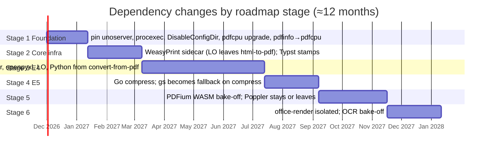

# 03 — Heavy Dependency Analysis

> Part of the Next-Generation Document Engine analysis (2026-11). Status: ANALYSIS — no code changed.

## 1. Purpose and scope

Every native binary, Python package and heavyweight Go module the document pipeline depends on, with: who
calls it (file:line), what it costs in image size, start-up and memory, its licence and the obligation that
licence creates for Fyredocs, its upstream maintenance status (web-checked 2026-11-07), its security posture
against untrusted input, and the keep / replace-in-Stage-N / isolate decision taken by the architecture
brief. Image sizes quoted as "before" are the three-month-old local images and are stale; fresh numbers are
produced by `benchmarks/measure-images.sh` and land in `benchmarks/baseline-2026-11.md`. Unmeasured
start-up and memory figures are "to be measured" with the command given.

Licence statements below are engineering analysis, not legal advice; §5 recommends a review of the AGPL items
by counsel before the next commercial contract.

## 2. Current state

### 2.1 Where each dependency is installed and called

| Dependency | Image(s) | Install | Call sites |
|---|---|---|---|
| LibreOffice (soffice) | convert-to-pdf (`fyredocs-base`), convert-from-pdf | `deployment/base-alpine-libreoffice.Dockerfile:14-20` (full `libreoffice`); `convert-from-pdf/Dockerfile:30-36` (`-core -writer -calc -impress`) | `convert-to-pdf/processing/processing_free.go:69,95` (cold fallback); `convert-from-pdf/processing/processing_free.go:244,403` |
| unoserver / unoconvert | convert-to-pdf | `base-alpine-libreoffice.Dockerfile:24` (`pip3 install unoserver`, unpinned) | `convert-to-pdf/entrypoint.sh:43,56`; `processing_free.go:40` |
| Ghostscript (`gs`) | optimize-pdf, convert-from-pdf | `optimize-pdf/Dockerfile:29`; `convert-from-pdf/Dockerfile:34` | `optimize-pdf/processing/processing_free.go:73,196,251` (+`findGhostscript :276`); `convert-from-pdf/processing/processing_free.go:212` |
| Poppler `pdftoppm` | optimize-pdf, convert-from-pdf, convert-to-pdf (installed, unused) | `optimize-pdf/Dockerfile:28`; `convert-from-pdf/Dockerfile:33`; `base-alpine-libreoffice.Dockerfile:16` | `optimize-pdf/...:531`; `convert-from-pdf/...:181,304` |
| Poppler `pdfinfo` | optimize-pdf, convert-from-pdf | same | `optimize-pdf/...:331`; `convert-from-pdf/...:126` |
| Poppler `pdftotext` | convert-from-pdf | same | `convert-from-pdf/...:520` |
| Poppler `pdftohtml` | convert-from-pdf | same | `convert-from-pdf/...:503` |
| Poppler `pdfimages`, `pdfseparate`, `pdfunite`, `pdfsig` | installed with the package | — | not called anywhere (grep 2026-11-07) |
| Tesseract + `eng`, `hin` tessdata | optimize-pdf, organize-pdf | `optimize-pdf/Dockerfile:30-32`; `organize-pdf/Dockerfile:30-32` | `optimize-pdf/...:444,480,579`; `organize-pdf/processing/processing_scan.go:501,526` |
| pdf2docx → PyMuPDF (MuPDF) + opencv-python-headless + python-docx + numpy | convert-from-pdf | `convert-from-pdf/Dockerfile:40` (`pdf2docx==0.5.8`) | `convert-from-pdf/...:466` (`pdf2docx convert`) |
| pdfplumber → pdfminer.six | convert-from-pdf | `Dockerfile:40` (`pdfplumber==0.11.4`) | `convert-from-pdf/scripts/pdf_to_xlsx.py` via `processing_free.go:342` |
| openpyxl | convert-from-pdf | `Dockerfile:40` (`openpyxl==3.1.5`) | same script |
| Python runtime | convert-from-pdf (`python:3.11-slim-bookworm`, `Dockerfile:28`); convert-to-pdf (`python3 py3-pip` for unoserver, `base-alpine-libreoffice.Dockerfile:19-20`) | — | interpreter for pdf2docx, pdf_to_xlsx.py, unoserver |
| pdfcpu v0.9.1 | all four workers (Go module) | `*/go.mod` | `pkg/api` in all; `pkg/pdfcpu`, `/model`, `/types` in organize-pdf (`processing_edit.go:279,348`, `processing_scan.go:415-429`, `processing_metadata.go:68`) |
| quic-go v0.54.0, grpc v1.82.1, otel v1.44.0 | all services (via `shared`) | `shared/go.mod:18-21,69-70,95`; `convert-to-pdf/go.mod:71-72,100` | otel used directly (`shared/telemetry/tracer.go:52`); quic-go and grpc are transitive of the OTLP/HTTP exporter and net/http3 paths — never imported by Fyredocs code |
| gorm v1.31.1 + gorm.io/datatypes v1.2.7 → gorm.io/driver/mysql + go-sql-driver/mysql v1.10.0 | all four workers, job-service, document-service | `convert-to-pdf/go.mod:13,35` | `datatypes.JSON` for job metadata (`job-service/handlers/jobs.go:384`); MySQL driver is a transitive requirement of `datatypes` and is never used |

### 2.2 Per-dependency profile

Image contributions are "before" numbers from the stale local images (`01-existing-system-audit.md` §2.5):
convert-from-pdf 1.54 GB, convert-to-pdf 1.17 GB (base 1.07 GB), optimize-pdf 325 MB, organize-pdf 287 MB,
scratch services 43–60 MB. Fresh per-layer attribution: `benchmarks/raw/layers-<image>.txt`.

#### LibreOffice + unoserver

| Attribute | Finding |
|---|---|
| Image | ≈500 MB claimed (`docs/developer/architecture/base-image-setup.md:16`, unmeasured); Debian `libreoffice-core` alone 117 MB installed on amd64 ([packages.debian.org](https://packages.debian.org/bookworm/libreoffice-core)) before writer/calc/impress; dominates both convert images |
| Start-up | daemon: "2–5 s" init per `convert-to-pdf/entrypoint.sh:48` comment, 30 s readiness wait `:54`; cold `libreoffice --headless` per job: ≈2 s + 1.5 s/MB (`docs/developer/architecture/production-readiness.md:104`); measured by `measure-images.sh` step 5/6 → `raw/cold-start.tsv`, `raw/conversions.tsv` |
| Memory | one resident `soffice.bin` per unoserver port (default 2, `entrypoint.sh:30`); never recycled; RSS to be measured: `docker stats --no-stream convert-to-pdf` idle, and `/usr/bin/time -v unoconvert …` per fixture (step 6) |
| Versions | Alpine 3.19: 7.6.7.2-r0; Debian bookworm: 4:7.4.7-1+deb12u14; upstream latest branch 26.2.5 (2026-07-24) per the cached release-notes page, 26.8.x reported by third parties (unverified) — both images are two to three major lines behind |
| Licence | LibreOffice MPL-2.0 (with LGPL/GPL secondary licences for some parts); unoserver MIT ([PyPI](https://pypi.org/project/unoserver/)). Exec'd unmodified → no copyleft obligation; keep notices |
| Maintenance | unoserver 3.7 released 2026-06-10, maintainer Lennart Regebro, active; installed **unpinned** so the base image is not reproducible |
| Security | untrusted DOCX/XLSX/PPTX/HTML parsed by a 10M-line C++ codebase; daemons bind 127.0.0.1 (`entrypoint.sh:28`); non-root UID 10001 (`convert-to-pdf/Dockerfile:25,37`); macro execution: headless conversion does not run document macros under LibreOffice's default *High* macro security, but nothing in the image pins that setting — to be verified by inspecting `/tmp/uno-profile-*/user/registrymodifications.xcu`; HTML/DOCX link fields can trigger outbound fetches — worker egress is not restricted in compose (to be verified and closed) |
| Decision | **keep** for the whole roadmap in convert-to-pdf (office→PDF, office→ODF); **remove from convert-from-pdf in Stage 3** (E4 replaces pdf-to-docx fallback and pdf-to-odt/ods/odp); **isolate** into an `office-render` container with daemon lifecycle in Go (Stage 1 Q1/Q2, Stage 6 autoscaling). html-to-pdf leaves LibreOffice for a WeasyPrint sidecar in Stage 2 |

#### Ghostscript

| Attribute | Finding |
|---|---|
| Image | Alpine package 10.05.1-r0 plus fonts; Debian 10.0.0~dfsg-11+deb12u8; size per layer to be read from `raw/layers-optimize-pdf.txt` |
| Start-up | per invocation interpreter init; to be measured: `docker run --rm fyredocs-optimize-pdf:baseline-2026-11 sh -c 'time gs -dNOPAUSE -dBATCH -sDEVICE=nullpage'` |
| Memory | pdfwrite holds the output object tree and image hashes (`-dDetectDuplicateImages`); to be measured on the 40 MB fixture with `/usr/bin/time -v` (step 6) |
| Versions | upstream 10.08.0 (2026-09-08), 10.07.1 (2026-05-19) ([release dates](https://ghostscript.readthedocs.io/en/latest/ReleaseDates.html)); images ship 10.05.1 (Alpine) and 10.0.0 (Debian, security-patched by distro) |
| Licence | AGPL-3.0 (Artifex), commercial licence available. Fyredocs executes an unmodified distribution package as a separate process with argv only (`optimize-pdf/processing/processing_free.go:73`). AGPL §13's network-source obligation attaches to *modified* versions conveyed or run for network interaction; running an unmodified program as a subprocess creates no obligation to release Fyredocs source, but §4–§6 require that the licence text and notices accompany any distribution of the binary (container images handed to customers would count). Artifex's public position is that integrating Ghostscript into a commercial SaaS *may* require a commercial licence depending on how "derivative" the integration is; a CLI boundary with no linking is the conservative side of that line |
| Maintenance | active, regular CVE fixes; distro packages lag upstream by 1–3 minor versions |
| Security | `-dSAFER` explicit in optimize-pdf (`:139,185,222`) and the default since 9.50; **not** passed in convert-from-pdf PDF/A (`:212-222`) — relies on the default; long CVE history (PostScript interpreter on untrusted input); runs as UID 10001; no seccomp profile; no `-dMaxBitmap` memory bound |
| Decision | **keep, fewer calls**: compress → Go E5 in Stage 4 with gs fallback for SMask/ICC/CMYK and `extreme`; repair → pdfcpu tier-1 then gs; flatten and PDF/A stay on gs (no Go alternative can bake appearance streams or produce conformant PDF/A). Add a licence notice now (§5) |

#### Poppler (per tool)

| Tool | Used for | Replacement path | Decision |
|---|---|---|---|
| `pdftoppm` | OCR rendering (`optimize-pdf/...:531`), pdf-to-image (`convert-from-pdf/...:181`), pdf-to-pptx (`:304`), future thumbnails | go-pdfium WASM after the Stage 5 bake-off (≥0.7× throughput, identical page counts, no cross-job crash); if it fails, Poppler stays — the builder stays `CGO_ENABLED=0` either way | keep until Stage 5 |
| `pdfinfo` | page size for DPI capping (`optimize-pdf/...:331`; `convert-from-pdf/...:126`) | `pdfcpu api.ReadContextFile` MediaBox (0.1 EM, Q8) | replace Stage 1 |
| `pdftotext` | pdf-to-text (`:520`); interim E4 extractor with `-bbox-layout` | E4 TXT writer (Stage 3), PDFium text extraction (Stage 5) | keep as interim |
| `pdftohtml` | pdf-to-html (`:503`) | E4 HTML writer | replace Stage 3 |
| `pdfimages` | unused today; candidate E4/E5 image extractor | pdfcpu `ExtractImagesFile` | — |

Common: upstream 26.11.0 (2026-11-05) ([poppler.freedesktop.org](https://poppler.freedesktop.org/)); images
ship 23.10.0 (Alpine 3.19) and 22.12.0 (bookworm). Licence GPL-2.0/GPL-3.0 (xpdf lineage) — exec'd
unmodified, no copyleft obligation on Go code; keep notices. Memory bounded only by the DPI clamps
(`convert-from-pdf/...:77-82,90-98`); to be measured per fixture (step 6). Security: xpdf-derived parsers
with a long CVE history; argv only; UID 10001.

#### Tesseract + language data

| Attribute | Finding |
|---|---|
| Image | `tesseract-ocr` 5.3.3-r1 + `tessdata` eng, hin (Alpine "fast" models); sizes from `raw/layers-optimize-pdf.txt` / `raw/layers-organize-pdf.txt` |
| Start-up | per page process spawn + model load; to be measured: `time tesseract page-1.png out -l hin pdf txt` inside the image |
| Memory | one LSTM engine + full page bitmap per concurrent process; ≤4 parallel (`optimize-pdf/...:27-44`), sequential in organize-pdf (`processing_scan.go:515`); to be measured |
| Versions | upstream 5.5.4 (2026-10-28), 5.5.3 (2026-07-24) ([releases](https://github.com/tesseract-ocr/tesseract/releases)); image ships 5.3.3 |
| Licence | Apache-2.0 (engine and tessdata) — no obligation beyond notice |
| Maintenance | active |
| Security | input is a PNG the worker rendered itself (optimize-pdf) or a user image already decoded/re-encoded by `internal/imaging` (organize-pdf, `processing_scan.go:337`); language string rebuilt from an allowlist (`optimize-pdf/...:379-402`); `--list-langs` probe per job (`:444`) |
| Decision | **keep** (no Go OCR engine exists); Stage 1 tuning (per-page render inside the errgroup, 300 DPI for Hindi, `--oem 1`, `tessdata_best hin`); Stage 6 bake-off against a PaddleOCR-Devanagari sidecar, adopted only on ≥30 % relative CER gain |

#### pdf2docx → PyMuPDF (MuPDF), opencv-python-headless

| Attribute | Finding |
|---|---|
| Image | the reason convert-from-pdf is Debian + Python (`convert-from-pdf/Dockerfile:23-27`: PyMuPDF/opencv publish no musllinux aarch64 wheels); opencv-headless and MuPDF wheels are the largest pip layers — attribution from `raw/layers-convert-from-pdf.txt` |
| Start-up | Python interpreter + MuPDF + opencv import per job; to be measured: `time pdf2docx convert small.pdf out.docx` inside the image |
| Memory | MuPDF loads the document, opencv runs table-line detection on rendered pages; to be measured on the 40 MB fixture |
| Versions | pinned 0.5.8; PyPI latest 0.5.13 (2026-05-01) ([PyPI](https://pypi.org/project/pdf2docx/)); GitHub README states the project is "no longer actively maintained by Artifex" and was "relicensed under the MIT License" ([repo](https://github.com/ArtifexSoftware/pdf2docx), accessed 2026-11-07); PyMuPDF GitHub lists GNU AGPL v3 with commercial licences from Artifex, current major v2.0 ([repo](https://github.com/pymupdf/PyMuPDF), accessed 2026-11-07) |
| Licence | **pdf2docx itself: MIT** (this contradicts the research lead that called it dual AGPL/commercial — the licence page now shows MIT, copyright Artifex 2026). **PyMuPDF/MuPDF: AGPL-3.0 or commercial.** The AGPL exposure therefore comes through the dependency, not pdf2docx. As with Ghostscript, Fyredocs runs an unmodified `pdf2docx` CLI as a subprocess (`processing_free.go:466`); the Python process links MuPDF in-process, but that linking is between two AGPL-compatible parts (MIT + AGPL) and Fyredocs code is on the other side of an argv boundary. Obligation today: ship the AGPL text and MuPDF notice with the image; do not modify; do not expose MuPDF over the network. Artifex is the exclusive commercial agent, which makes this a commercial-risk item if the integration ever tightens |
| Maintenance | pdf2docx effectively unmaintained upstream; PyMuPDF active |
| Security | MuPDF parses untrusted PDFs in-process with Python; no process-group kill (grandchild survives cancel — D2 in `01-existing-system-audit.md`); no RSS cap below the container |
| Decision | **replace in Stage 3** by E4 (Go page-model reconstruction); add a licence notice now; add no new PyMuPDF code paths; pin to 0.5.13 only if a security need arises before Stage 3 |

#### pdfplumber (+pdfminer.six) and openpyxl

| Attribute | Finding |
|---|---|
| Use | `convert-from-pdf/scripts/pdf_to_xlsx.py` (67 lines) called at `processing_free.go:342`; also first stage of pdf-to-ods (`:368-376`) |
| Versions | pdfplumber pinned 0.11.4, latest 0.11.10 (2026-06-15); openpyxl 3.1.5 = latest (2024-06-28) ([PyPI](https://pypi.org/project/pdfplumber/), [PyPI](https://pypi.org/project/openpyxl/)) |
| Licence | MIT (both; pdfminer.six MIT) — no obligation beyond notice |
| Start-up / memory | pure Python; interpreter start + per-page object parsing; to be measured: `time python3 /app/scripts/pdf_to_xlsx.py medium.pdf out.xlsx` |
| Security | pure-Python parser — memory-safe but can be made pathologically slow by dense vector pages; bounded only by the 10-min ctx |
| Decision | **replace in Stage 3** (E4 table detection + excelize writer); until then unchanged |

#### Python runtime

Present only to host the three items above and unoserver. In convert-from-pdf it forces the Debian base
(`Dockerfile:23-28`), the second LibreOffice installation and two interpreters per image. In convert-to-pdf it
hosts unoserver (`base-alpine-libreoffice.Dockerfile:19-24`). Licence PSF-2.0. Decision: **leaves
convert-from-pdf in Stage 3** (image target ≤150 MB); **stays in convert-to-pdf** as long as unoserver is
the daemon protocol — a Go UNO client is not on the roadmap, so Python remains in the office-render image.

#### pdfcpu (Go)

| Attribute | Finding |
|---|---|
| Use | every organize-pdf tool, image-to-pdf, OCR merge/fallback, page counts in convert-from-pdf (`:173,291`) |
| Versions | **upgraded to v0.16.4 in all four `go.mod` on 2026-11-08** (see `20-…` status). As audited: pinned v0.9.1 in all four `go.mod`; upstream v0.16.4 (2026-10-27), v0.16.3 (2026-10-19), v0.16.2 (2026-10-11, "requires Go 1.26 or later") ([releases](https://github.com/pdfcpu/pdfcpu/releases)) — seven minor versions behind; upgrade must be gated by the organize-pdf test suite and fuzz targets (`organize-pdf/processing/fuzz_test.go`) |
| Licence | Apache-2.0 |
| Memory | whole cross-reference table and touched objects in memory per `ReadContextFile`; per-page rewrites for stamps (`processing_edit.go:454,612`); no ctx awareness; to be measured on the 40 MB fixture (`go test -bench` in organize-pdf or step 6) |
| Security | pure Go, memory-safe; config-dir side effect unless `DisableConfigDir()` (`organize-pdf/main.go:57` only); fuzzed in-repo |
| Decision | **keep and extend** (E1); upgrade in Stage 1 behind the harness; check ctx between stages rather than forking |

#### quic-go, grpc, otel (via shared)

Transitive of the OTLP/HTTP exporter and `golang.org/x/net`; none imported by Fyredocs code. Cost is binary
size and SBOM surface only (binary sizes: `raw/binary-sizes.tsv`). Licences MIT (quic-go), Apache-2.0
(grpc, otel). Decision: **keep**; evaluate dropping grpc by confirming the exporter's module graph after the
next otel bump — not a document-engine concern.

#### gorm + MySQL driver (via gorm.io/datatypes)

`gorm.io/datatypes` requires `gorm.io/driver/mysql` and `go-sql-driver/mysql` (MPL-2.0); neither is used.
Cost: binary size and SBOM noise. Decision: **keep** now; a later clean-up could replace `datatypes.JSON`
with a local `json.RawMessage` wrapper per service (CLAUDE.md §1 forbids a shared model) — optional, not on
the engine roadmap.

## 3. Requirements

- **Reproducibility:** every native dependency pinned (unoserver is not; pdf2docx/pdfplumber are; apk/apt
  packages float within the distro branch). The baseline image tags must be built from a pinned manifest.
- **Licence hygiene:** a `THIRD-PARTY-LICENCES` notice in each worker image naming Ghostscript (AGPL-3.0),
  MuPDF/PyMuPDF (AGPL-3.0), Poppler (GPL), LibreOffice (MPL-2.0), Tesseract/pdfcpu (Apache-2.0), and the MIT
  items; no AGPL component in the SBOM after Stage 3 except Ghostscript (and that only in optimize-pdf and
  the PDF/A path).
- **Security:** no dependency ever receives untrusted bytes via a shell; every subprocess is killed as a
  process group on cancel; interpreter-level parsers (gs, MuPDF, Poppler, LibreOffice) run as UID 10001 with
  no egress; memory bounded per process where the tool supports it.
- **Size and start-up:** convert-from-pdf ≤150 MB after Stage 3; convert-to-pdf unchanged in size but with
  measured daemon RSS and recycling; no dependency adds cold-start latency to a job that a warm pool could
  absorb.

## 4. Options evaluated

| Option | Language | Licence | Maturity (version, last release, maintainer) | Fidelity / coverage | Integration | Effort (EM) | Verdict |
|---|---|---|---|---|---|---|---|
| Keep LibreOffice via unoserver | C++ / Python | MPL-2.0 / MIT | LO 7.6.7 / 7.4.7 in images, upstream 26.x; unoserver 3.7 (2026-06-10, L. Regebro) | reference for office layout | daemon pool → isolated container | 1 + 2 | keep (whole roadmap) |
| Custom Go DOCX→PDF layout | Go | — | none | simple-document subset only | in-process | 4–6 | optional Stage 6+, gated |
| WeasyPrint sidecar for HTML | Python | BSD-3 | active | CSS Paged Media, no JS | HTTP sidecar | 0.5–1 | adopt Stage 2 (replaces LO for html-to-pdf) |
| Headless Chromium for HTML | C++ | BSD | active | JS + modern CSS | exec/sidecar, +250 MB, sandbox work | 1–1.5 | only if JS rendering becomes a requirement (E) |
| Keep Ghostscript | C | AGPL-3.0 / commercial | 10.08.0 (2026-09-08, Artifex) | reference distiller, PDF/A, flatten | exec | 0 | keep for flatten/PDF-A/extreme/fallback |
| Go optimiser E5 (pdfcpu + x/image) | Go | Apache-2.0 / BSD | pdfcpu v0.16.4 | image downsampling, dedupe; no SMask/ICC first cut | in-process | 2 | build Stage 4 |
| qpdf for repair/linearise | C++ | Apache-2.0 | active | structural repair only | exec (+ new binary) | 0.3 | not adopted — pdfcpu relaxed read covers tier 1; avoid a fourth native parser |
| Keep Poppler CLIs | C++ | GPL-2/3 | 26.11.0 (2026-11-05, freedesktop) | fast batched rendering, text | exec | 0 | keep until Stage 5 |
| go-pdfium (WASM mode) | Go + PDFium | MIT / Apache-2.0 | v1.19.7 (2026-04, klippa-app) | PDFium rendering/text | in-process WASM, no cgo | 1 (bake-off) | Stage 5 decision |
| go-fitz (MuPDF) | Go + cgo | AGPL-3.0 | — | MuPDF | cgo (breaks static build) + AGPL | — | rejected |
| Keep Tesseract | C++ | Apache-2.0 | 5.5.4 (2026-10-28) | eng/hin | exec | 0.5 tuning | keep |
| PaddleOCR-Devanagari sidecar | Python/C++ | Apache-2.0 | active (vendor accuracy claims unverified) | to be measured (CER) | HTTP sidecar | 1 | E, only on ≥30 % CER gain |
| Keep pdf2docx + PyMuPDF | Python / C | MIT / AGPL-3.0 | pdf2docx 0.5.13 (2026-05-01), unmaintained upstream | current pdf→docx quality | exec | 0 | replace Stage 3 |
| E4 page-model + writers (hand-written OOXML, excelize, ODF) | Go | — / BSD (excelize) | excelize active | target: pdf2docx parity | in-process | 4–5 | build Stage 3 |
| Keep pdfplumber script | Python | MIT | 0.11.10 (2026-06-15) | heuristic tables | exec | 0 | replace Stage 3 (E4) |
| Keep pdfcpu, upgrade | Go | Apache-2.0 | v0.16.4 (2026-10-27) | — | in-process | 0.5 | keep, upgrade Stage 1 |
| Typst static binary for Unicode stamps | Rust (tool only) | Apache-2.0 | active | HarfBuzz-grade shaping incl. Devanagari | exec | 0.5 | adopt Stage 2; Go alternative go-text/typesetting → PNG stamp (raster) documented as the fallback |
| digitorus/pdfsign | Go | BSD-2-Clause | PAdES B-B/B-T, no LTV (`08-…` §4) | PAdES-B-B/B-T | in-process | 1 | Stage 5 |

## 5. Recommendation

1. **Licence notices now (0 code risk):** add `THIRD-PARTY-LICENCES.md` to each worker image with the
   Ghostscript and MuPDF AGPL texts and the exact statement "executed unmodified as a separate process; not
   linked; not modified". Ask counsel to confirm the subprocess boundary is sufficient for the SaaS model;
   if not, the Stage 3/4 replacements shrink the exposure to Ghostscript-only.
2. **Pin everything:** `unoserver==3.7` in `base-alpine-libreoffice.Dockerfile:24`; record apk/apt versions in
   `benchmarks/raw/tool-versions.txt` and fail the build if they drift unexpectedly.
3. **Stage 1:** `shared/procexec` at all 20 exec sites; `DisableConfigDir()` in three mains; pdfcpu upgrade
   to v0.16.x behind the harness; `pdfinfo` → pdfcpu; daemon lifecycle into Go.
4. **Stage 2:** WeasyPrint sidecar (LibreOffice leaves html-to-pdf); Typst for stamps.
5. **Stage 3:** E4 ships; `pdf2docx`, PyMuPDF, opencv, pdfplumber, openpyxl, LibreOffice and Python leave
   convert-from-pdf; image becomes alpine + poppler-utils + ghostscript (PDF/A only) + Go binary.
6. **Stage 4:** E5 Go compression; Ghostscript calls on compress drop ≥70 % in production metrics.
7. **Stage 5:** PDFium WASM bake-off; if it passes, Poppler leaves convert-from-pdf and optimize-pdf.
8. **Stage 6:** office-render container isolated and autoscaled; OCR bake-off.

Go alternative for every Rust/native item: Typst → go-text/typesetting raster stamp; PDFium WASM → keep
Poppler; PaddleOCR → keep Tesseract. None requires the team to write Rust or enable cgo.

### 5.1 Dependency-removal sequence

| Stage | Leaves | Arrives | Stays | Gate before removal |
|---|---|---|---|---|
| 1 | `pdfinfo` calls (2 sites) | pinned unoserver; pdfcpu v0.16.x | everything else | harness green; Q1–Q8 acceptance in `01-existing-system-audit.md` §5 |
| 2 | LibreOffice on html-to-pdf | WeasyPrint sidecar (~150 MB image, separate container); Typst binary (~40 MB in organize-pdf) | LibreOffice for office rows | 30 HTML fixtures SSIM ≥0.9 vs Chrome; Devanagari stamp selectable |
| 3 | pdf2docx, PyMuPDF, opencv, python-docx, numpy, pdfplumber, pdfminer.six, openpyxl, LibreOffice, Python, Debian base — all from convert-from-pdf | E4 (Go) + excelize | Poppler, Ghostscript (PDF/A) in convert-from-pdf | E4 gates (text recall ≥99 %, table F1 ≥ pdfplumber, round-trip SSIM ≥ pdf2docx on 90 %, image ≤150 MB, no AGPL in SBOM) |
| 4 | — (gs stays installed) | E5 | Ghostscript | ≥80 % of gs reduction, ≤50 % wall time, SSIM ≥0.9 |
| 5 | Poppler from convert-from-pdf and optimize-pdf **if** PDFium gate passes | go-pdfium WASM | Poppler otherwise | ≥0.7× pdftoppm throughput, identical page counts, no cross-job crash |
| 6 | — | office-render service; optional PaddleOCR sidecar | LibreOffice, Tesseract | linear scaling with replicas; ≥30 % CER gain for OCR switch |

### 5.2 Expected image composition after Stage 3 (qualitative; sizes to be measured)

| Image | Base | Native packages | Interpreters | Go binary | What left |
|---|---|---|---|---|---|
| convert-from-pdf | alpine 3.19/3.20 | `poppler-utils` (until Stage 5), `ghostscript` (PDF/A only), `font-noto` + `font-noto-devanagari` (for E4 rendering checks only if needed) | none | convert-from-pdf + E4 | python:3.11 base, LibreOffice core/writer/calc/impress, fonts-liberation, pdf2docx, PyMuPDF, opencv, python-docx, numpy, pdfplumber, pdfminer.six, openpyxl, `/app/scripts/` |
| convert-to-pdf | `fyredocs-base` (alpine + LibreOffice + unoserver) | `libreoffice`, `font-noto*`, `fontconfig`, `poppler-utils` (drop if still unused) | python3 (unoserver) | convert-to-pdf (daemon lifecycle in Go) | nothing yet; html-to-pdf traffic moved to the WeasyPrint sidecar in Stage 2 |
| office-render (Stage 6) | split of the above | LibreOffice + fonts + unoserver | python3 | thin Go supervisor | — |
| weasyprint-sidecar (Stage 2) | python:3.x-slim | Pango/Cairo/HarfBuzz, `fonts-noto-core` | python3 (WeasyPrint) | none | — |
| optimize-pdf | alpine | `ghostscript` (fallback/flatten/PDF-A), `poppler-utils` (until Stage 5), `tesseract-ocr` + eng/hin (`tessdata_best hin` added) | none | optimize-pdf + E5 | nothing removed; gs call volume drops |
| organize-pdf | alpine | `tesseract-ocr` + eng/hin, Typst static binary | none | organize-pdf | nothing removed |

Net: one Python runtime (convert-to-pdf) instead of two; one LibreOffice installation instead of two; zero
AGPL components in convert-from-pdf other than Ghostscript's PDF/A path; convert-from-pdf drops from the
largest image (stale 1.54 GB) to the ≤150 MB target.

## 6. Classification

| Dependency | Class | Reason |
|---|---|---|
| pdfcpu, x/image, excelize (future) | A | lightweight libraries in-process |
| E4 page model, E5 optimiser | B | custom engines the team owns |
| Tesseract, PDFium WASM (future) | C | specialised engines for one task |
| LibreOffice/unoserver, Ghostscript, Poppler, WeasyPrint (future), Typst (future) | D | mature external programs exec'd unmodified |
| PaddleOCR sidecar, Chromium, simple-DOCX fast path | E | optional, gated plugins |
| pdf2docx/PyMuPDF/opencv, pdfplumber/openpyxl, Python in convert-from-pdf | D → removed at Stage 3 | replaced by B |
| quic-go/grpc/otel, gorm+MySQL driver | — | infrastructure transitive deps; not document-engine components |

## 7. Acceptance criteria and gates

| Criterion | Measured by |
|---|---|
| Baseline recorded before any change: image sizes, tool versions, idle RSS, cold start, per-fixture timings and peak RSS for LibreOffice warm/cold, gs compress, tesseract OCR (median of 3) | `benchmarks/measure-images.sh` → `benchmarks/raw/*.tsv`, summarised in `benchmarks/baseline-2026-11.md` |
| SBOM per image lists licences; AGPL items limited to Ghostscript after Stage 3 | `syft <image> -o spdx-json` in CI (to add); fail on AGPL outside the allowlist |
| No unpinned package in any Dockerfile | grep in `scripts/ci/02-static.sh` (to add) |
| Zero orphan subprocesses after 100 forced cancels | `ps` sweep in the harness |
| convert-from-pdf image ≤150 MB after Stage 3 | `docker image inspect --format '{{.Size}}'` |
| gs invocations on compress −≥70 % after Stage 4 | new metric `engine_invocations_total{engine="gs",tool}` |
| Poppler removal only if PDFium gate passes | bake-off report in `benchmarks/` |

## 8. Risks and open questions

1. **AGPL interpretation.** The subprocess boundary is the common-practice reading, not a court-tested one;
   Artifex sells licences on the stricter reading. Counsel review is the mitigation; Stage 3 removes the
   MuPDF half regardless.
2. **pdf2docx is unmaintained upstream** and pinned four patch versions back; any security issue in it or
   its opencv/numpy tree between now and Stage 3 has no upstream fix path except bumping pins.
3. **pdfcpu v0.9.1 → v0.16.x upgrade** crosses seven minor versions with API churn in `pkg/pdfcpu`
   (watermark/import parsers used by organize-pdf); must be done under the harness in Stage 1, not bundled
   with E4.
4. **Distro lag.** Alpine 3.19 and bookworm ship Ghostscript/Poppler/Tesseract 1–3 minor versions behind
   upstream; security fixes arrive via distro backports — acceptable, but the base images should move to a
   current Alpine branch when the base image is next rebuilt.
5. **LibreOffice macro and link behaviour** inside the daemon profile is unverified; must be checked and
   pinned (`MacroSecurityLevel`, `UpdateLinks` off) before the office-render container is exposed to more
   tenants.
6. **WeasyPrint font coverage** for Devanagari/RTL depends on `fonts-noto-core` being installed in the
   sidecar — part of its gate.
7. **PyMuPDF licence page could not be fetched directly** (PyPI page returned an error); the AGPL/commercial
   statement is taken from the GitHub README on 2026-11-07.

## Sources

- Repository files cited inline (read 2026-11-07).
- `docs/developer/architecture/production-readiness.md:104` — LibreOffice cost model.
- `docs/developer/architecture/base-image-setup.md:16` — LibreOffice ≈500 MB claim (unmeasured).
- unoserver: https://pypi.org/project/unoserver/ — 3.7, 2026-06-10, MIT, L. Regebro (accessed 2026-11-07).
- pdf2docx: https://pypi.org/project/pdf2docx/ — 0.5.13, 2026-05-01, MIT;
  https://github.com/ArtifexSoftware/pdf2docx — "relicensed under the MIT License", "no longer actively
  maintained by Artifex"; https://pdf2docx.readthedocs.io/en/latest/license.html — MIT text (accessed
  2026-11-07).
- PyMuPDF: https://github.com/pymupdf/PyMuPDF — GNU AGPL v3, commercial licences from Artifex, v2.0 (accessed
  2026-11-07; PyPI page failed to load).
- pdfplumber: https://pypi.org/project/pdfplumber/ — 0.11.10, 2026-06-15, MIT. openpyxl:
  https://pypi.org/project/openpyxl/ — 3.1.5, 2024-06-28, MIT (accessed 2026-11-07).
- pdfcpu: https://github.com/pdfcpu/pdfcpu/releases — v0.16.4 (2026-10-27), v0.16.3 (2026-10-19), v0.16.2
  (2026-10-11) (accessed 2026-11-07).
- Ghostscript: https://ghostscript.readthedocs.io/en/latest/ReleaseDates.html — 10.08.0 (2026-09-08),
  10.07.1 (2026-05-19), 10.07.0 (2026-03-16) (accessed 2026-11-07). Licence: AGPL-3.0 per upstream
  LICENSE; commercial licensing via Artifex (vendor statement).
- Tesseract: https://github.com/tesseract-ocr/tesseract/releases — 5.5.4 (2026-10-28), 5.5.3 (2026-07-24)
  (accessed 2026-11-07).
- Poppler: https://poppler.freedesktop.org/ — 26.11.0 (2026-11-05) (accessed 2026-11-07).
- LibreOffice: https://www.libreoffice.org/download/release-notes/ — 26.2.5 (2026-07-24) on the cached page;
  26.8.x reported by third-party trackers, unverified (accessed 2026-11-07).
- Alpine 3.19 packages: https://pkgs.alpinelinux.org/packages?branch=v3.19 — libreoffice 7.6.7.2-r0,
  ghostscript 10.05.1-r0, poppler-utils 23.10.0-r0, tesseract-ocr 5.3.3-r1 (accessed 2026-11-07).
- Debian bookworm packages: https://packages.debian.org/bookworm/libreoffice-core (4:7.4.7-1+deb12u14,
  117 MB installed amd64), https://packages.debian.org/bookworm/ghostscript (10.0.0~dfsg-11+deb12u8),
  https://packages.debian.org/bookworm/poppler-utils (22.12.0-2+deb12u3) (accessed 2026-11-07).
- go-pdfium: https://pkg.go.dev/github.com/klippa-app/go-pdfium — v1.19.7 (2026-04), MIT; PDFium
  Apache-2.0 (accessed 2026-11-07).
- WeasyPrint, Typst, digitorus/pdfsign, excelize, PaddleOCR: versions and claims not re-verified in this
  pass — marked "to verify" / "unverified" where used.
