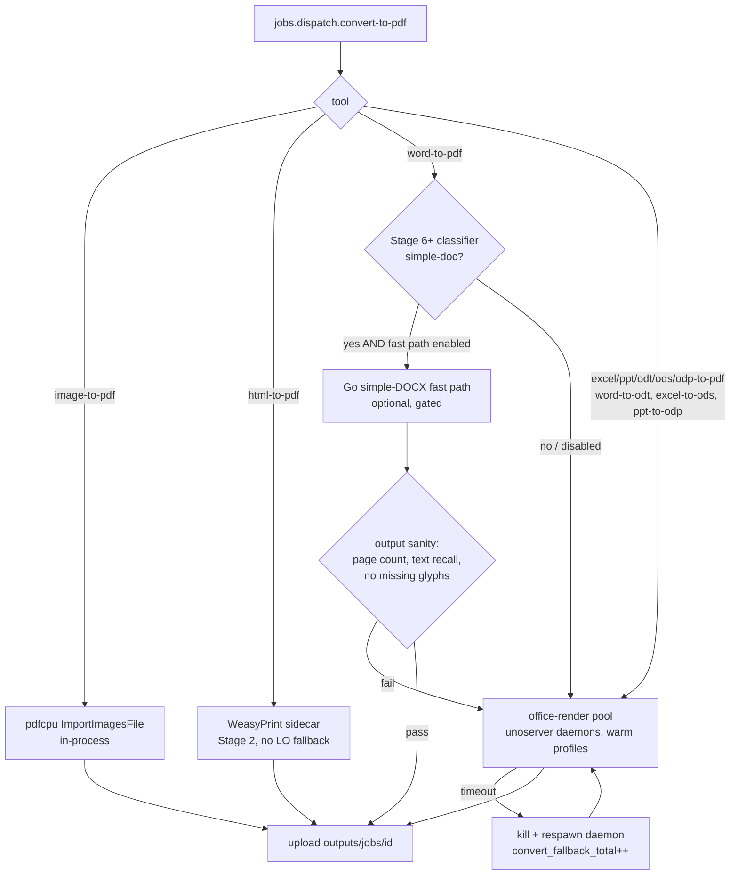
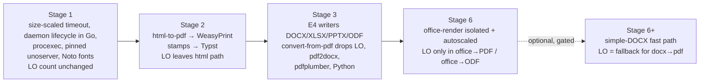

# 04 — LibreOffice Replacement Strategy

> Part of the Next-Generation Document Engine analysis (2026-11). Status: ANALYSIS — no code changed.

## 1. Purpose and scope

LibreOffice (LO) is the largest runtime dependency in the platform (≈500 MB per image per
`docs/developer/architecture/base-image-setup.md`) and the engine behind every office-format tool. This
document answers four questions the brief asks: can LO be **completely removed**, **partially replaced**,
kept as an **optional fallback**, or moved into an **isolated render worker**; which of the 14 operations
below can leave LO, with what library, effort and fidelity; what is wrong with the unoserver pool today;
and which differential-testing gate an operation must pass before it bypasses LO. The engine decomposition
(E1–E9) and stage numbering follow `EXECUTIVE-SUMMARY.md` and `20-implementation-roadmap.md`; the canonical document
model and the per-format engines are designed in `05`–`10`; language choice is in
`13-language-and-technology-selection.md`.

Operations covered: docx→pdf, xlsx→pdf, pptx→pdf, docx parse, docx generate, xlsx parse/generate, pptx
parse/generate, formula calculation, templating, font rendering, html→pdf, PDF conversion/manipulation,
office→ODF (docx→odt, xlsx→ods, pptx→odp, odt/ods/odp→pdf), pdf→odt/ods/odp.

## 2. Current state

### 2.1 Every LibreOffice call site (re-read 2026-11-07)

| Site | Command | Notes |
|---|---|---|
| `convert-to-pdf/processing/processing_free.go:30-51` `tryUnoconvert` | `unoconvert --host H --port P --convert-to {pdf\|odt\|ods\|odp} IN OUT` | fixed `30*time.Second` timeout at :38; `defer pool.release(port)` at :35 runs **before** the fallback; `CombinedOutput` at :44 |
| `:59-81` `officeToPDF` | fallback `libreoffice --headless --convert-to pdf --outdir DIR IN` at :69 | no `-env:UserInstallation` → concurrent fallbacks share one profile; runs under the 10-min job ctx (`convert-to-pdf/internal/worker/worker.go:546`) |
| `:85-107` `officeToOffice` | fallback `libreoffice --headless --convert-to FMT` at :95 | same profile issue |
| `convert-to-pdf/processing/processing.go:49-81` | dispatch: word/ppt/excel/html/odt/ods/odp→pdf all call `officeToPDF`; word-to-odt, excel-to-ods, powerpoint-to-odp call `officeToOffice` | **html-to-pdf goes through LO Writer** (`:58-60`) |
| `convert-from-pdf/processing/processing_free.go:239-277` `pdfToOffice` | `libreoffice --headless --infilter=writer_pdf_import --convert-to FMT` at :244-250 | pdf→odt (`processing.go:74-76`) and pdf→docx fallback after pdf2docx (`processing.go:48-59`) |
| `:368-376` `pdfToOds`, `:389-397` `pdfToOdp`, `:401-420` `officeConvertTo` | `libreoffice --headless --convert-to {ods\|odp}` at :403 | second hop after pdfplumber XLSX / image-slide PPTX (`pptx_builder.go:16`) |
| `convert-to-pdf/entrypoint.sh:39-46,54-65` | `unoserver --interface H --port P --user-installation file:///tmp/uno-profile-P`; readiness probe `unoconvert … /dev/null /dev/null` on the **first** port only | `UNOSERVER_INSTANCES` default 2 at :30 |
| `convert-to-pdf/processing/unopool.go:29-37,65-75` | port pool built at init, default `WORKER_CONCURRENCY+1`; comment at :60-64 documents the mismatch | `main.go:171` derives the health-check port list from the same function |

No `Setpgid`, `Pdeathsig`, `WaitDelay` or `cmd.Cancel` exists anywhere (audit §"Every exec.Command"), so
`soffice.bin` outlives a cancelled `unoconvert`/`libreoffice` parent.

### 2.2 Images and versions

- `deployment/base-alpine-libreoffice.Dockerfile:14-24`: `alpine:3.19` + full `libreoffice` + `ttf-liberation` +
  `pip3 install unoserver` **unpinned** (`:24`). Alpine 3.19 ships **LibreOffice 7.6.7.2** (pkgs.alpinelinux.org,
  accessed 2026-11-07) — the runtime version is dictated by the base OS, not chosen.
- `convert-from-pdf/Dockerfile:28-40`: `python:3.11-slim-bookworm` + `libreoffice-core/-writer/-calc/-impress`;
  Debian bookworm ships **LibreOffice 7.4.7** (packages.debian.org, 2026-11-07). Upstream current releases are
  26.8.2 (2026-10-29) and 26.2.7 (2026-11-03) (libreoffice.org release notes, 2026-11-07). Both images are
  therefore ≥3 major years behind upstream OOXML import fixes.
- Fonts: Liberation only; no Noto, no Devanagari, no `fc-cache` (audit §Images). Any Hindi DOCX renders tofu
  today regardless of engine.
- Capacity: production-readiness.md:104,257 gives LO ≈ 2 s + 1.5 s/MB; k6 ladder sustained 9 jobs/min
  (`scripts/k6/results/capacity-jobs-20260727-234123.md`).

### 2.3 What is already **not** LibreOffice

image→pdf (`processing_free.go:112-114`, pdfcpu), pdf→pptx (`pdfToPptImages` :282-319 + hand-written OOXML
`pptx_builder.go`), pdf→xlsx (pdfplumber script :340-352), pdf→docx primary (pdf2docx :463-481), pdf→image/
html/text (Poppler), pdf→pdfa (Ghostscript). These are covered by `08-pdf-engine-design.md` and E4/E5, not here.

## 3. Requirements

- **Functional**: every existing slug keeps working (`job-service/internal/routing/routing.go:20-73`, 47 slugs);
  no tool removed; office→ODF and ODF→PDF stay.
- **Performance**: Stage 1 acceptance (`20-implementation-roadmap.md`): ≥1.5× sustained office jobs/min on the same hardware,
  large-office e2e p95 −40 %, zero cold-LO fallbacks in a mixed-realistic k6 run.
- **Compatibility**: no claim of Office fidelity without the §7 gate; Devanagari/Unicode must shape correctly;
  unknown XML parts preserved on any round-trip writer.
- **Security**: html→pdf must not fetch arbitrary network resources from the worker (SSRF); LO daemons bind
  127.0.0.1 only (unoserver docs: ports have no auth).
- **Build**: all Go binaries stay `CGO_ENABLED=0` (`deployment/base-go-builder.Dockerfile:64-65`).

## 4. Options evaluated

### 4.1 Candidate inventory (web-verified 2026-11-07)

| Option | Language | Licence | Maturity (version, last release, maintainer) | Fidelity / coverage | Integration | Effort (EM) | Verdict |
|---|---|---|---|---|---|---|---|
| unoserver / unoconvert | Python | MIT | 3.7, 2026-06-10, L. Regebro (unoconv org); has `--conversion-timeout`, `--stop-after N`, `--libreoffice-pid-file`, `unoping` | = LibreOffice | daemon (XML-RPC) | 0 (in use) | **keep**; pin version; use the lifecycle flags (§5.2) |
| LibreOffice headless | C++ | MPL-2.0 | upstream 26.8.2 / 26.2.7 (2026-10/11); images ship 7.6.7 (Alpine 3.19) and 7.4.7 (bookworm) | reference engine | daemon / exec | 0.3 to bump base OS | **keep** as E3; move to isolated `office-render` (Stage 6) |
| Gotenberg | Go wrapper | MIT | v9.1.0 (release page dated 06 Nov, year not shown), wraps Chromium + LibreOffice | = LO + Chromium | HTTP container | — | **packaging reference only** (its LO worker pool/health design); not adopted — it would add a second product-scope service and Chromium |
| office2pdf | Rust | Apache-2.0 | 0.10.0, 2026-10-28, single owner (developer0hye); layout via Typst 0.15 | DOCX/XLSX/PPTX; README lists gaps: approximate pagination in mixed sections, no complex-script language tags, no art borders, altChunk skipped | exec'd static binary | 0.5 to evaluate | **watch**; candidate for the optional Stage 6+ fast path **only if** it beats LO on the §7 gate; not now (young, single maintainer, Indic unverified) |
| dxpdf | Rust (Skia) | MIT | 0.8.1, 2026-09-14, nerdy-pro; needs clang/Skia build | DOCX only; **"Indic reordering: not supported"**, no SmartArt/charts/tracked changes | exec | — | **reject** (Indic gap is disqualifying for Fyredocs) |
| docx4j | Java | Apache-2.0 | 17.3.5, 2026-11-01, Plutext | DOCX→PDF via XSL-FO; vendor fidelity claim | JVM sidecar | 2+ | **reject** (adds JVM; fidelity unproven; comparison only) |
| excelize | Go | BSD-3 | v2.11.1, 2026-11-02, xuri/qax-os; `CalcCellValue` fixes 16 functions in 2.11.1; needs Go ≥1.26 | read/write XLSX; formula eval subset; **no print layout** | in-process | 0 (lib) | **adopt** for xlsx parse/generate (E4 writer) |
| docxgo (go-docx v2) | Go | MIT | v2.16.0, 2026-11-04, mmonterroca; "unknown elements preserved … whenever possible" (hedged) | read/modify/write DOCX | in-process | 0.3 to verify round-trip | **candidate** for DOCX generate/modify; verify unknown-part fidelity before adopting (§7) |
| unioffice | Go | AGPL / commercial EULA | unidoc; SaaS use requires commercial licence | DOCX/XLSX/PPTX | in-process | — | **reject** (licence) |
| WeasyPrint | Python | BSD | 70.0, 2026-09-08, CourtBouillon; Python ≥3.10; CVE-2025-68616 (68.0), CVE-2026-49452 (69.0), CVE-2026-55073 untriaged (Debian tracker) | HTML+CSS paged media, no JS | HTTP sidecar | 0.5–1 | **adopt** for html→pdf (Stage 2) with egress blocked and pinned version |
| headless Chromium via chromedp / rod | Go + C++ | MIT (chromedp v0.23.0, 2026-11-05); rod pkg.go.dev page showed v0.116.2 (2024-07), search results inconsistent — verify | full web | exec (+250 MB image) | +0.5 over WeasyPrint | **fallback option** only if JS-rendered HTML becomes a product requirement |
| Typst | Rust CLI | Apache-2.0 | 0.15.1, 2026-07-17, typst org; musl archives 17.5 MB (x86_64) / 16.2 MB (aarch64) compressed | typesetting, not Office | exec'd static binary | 0 (binary) | **adopt** for E7 (stamps, page numbers, templates); not an Office engine |

Not evaluated as replacements (reasons): pdf2docx (MIT) / PyMuPDF (AGPL-3.0; Artifex exclusive commercial agent for MuPDF — leaving
in Stage 3), krilla/hayro (graphics output / experimental renderer, no layout), Aspose (commercial, .NET/Java).

### 4.2 Per-operation investigation

Legend: **EM** = engineer-months (analyst estimate unless cited); **V** value, **F** feasibility 1–5 from
`EXECUTIVE-SUMMARY.md` where given, otherwise analyst estimate; perf numbers are "to be measured" with the
command in §7.

| # | Operation | Current path | Lightweight library options (Go first, then Rust → Go alternative) | Custom engine feasibility | EM | Fidelity | Compatibility risk | Performance implication |
|---|---|---|---|---|---|---|---|---|
| 1 | docx→pdf | LO via unoserver `processing_free.go:30-51`, fallback :69 | Go: none renders DOCX to PDF (unioffice rejected). Rust: office2pdf (Typst-based) → Go alt: none; exec'd binary only | Full WordprocessingML layout (ECMA-376 §17: tables, floats, sections, fields, footnotes, numbering, Indic shaping) is 8+ EM; a **simple-document subset** (single column, inline images, simple tables) is 4–6 EM | 4–6 (subset) | subset only; LO remains reference | high: silent mis-layout on complex docs; classifier must reject them | fast path would avoid 2 s LO floor; unmeasured |
| 2 | xlsx→pdf | LO (`processing.go:55-57`) | Go: excelize reads cells/styles but has no print-layout (page breaks, print areas, scaling, charts). Rust: office2pdf XLSX | print-layout engine 8+ EM | 8+ | — | very high (charts, conditional formats, merged ranges) | — |
| 3 | pptx→pdf | LO (`processing.go:52-54`) | Go: none. Rust: office2pdf PPTX | DrawingML (§20) renderer 8+ EM | 8+ | — | very high (SmartArt, themes, effects) | — |
| 4 | docx parse | not a tool today; needed by E4 writers only for generate, by a fast path for layout | Go: docxgo v2 (read + preserve), `encoding/xml` hand parser (as `pptx_builder.go` does for write). Rust: none needed | parse-to-model 1 EM for the subset the fast path needs | 1 | n/a | moderate (unknown parts) | in-process, negligible |
| 5 | docx generate | E4 writer target (Stage 3) | Go: hand-written OOXML (proven pattern `pptx_builder.go`) or docxgo v2 | yes, Stage 3 | inside E4 4–5 | pdf2docx parity target | low (we own the XML) | in-process |
| 6 | xlsx parse/generate | pdfplumber script (`:340-352`) → E4 writer | Go: excelize v2.11.1 (parse + generate, streaming writer) | not needed | 0.3 inside E4 | cell/text parity with pdfplumber | low | removes Python exec |
| 7 | pptx parse/generate | generate exists: `pptx_builder.go` (image slides) | Go: extend hand-written OOXML with text boxes; parse via `encoding/xml` if ever needed | yes | 0.5 inside E4 | image+text slides | low | in-process |
| 8 | formula calculation | none (LO recalcs on load when converting xlsx) | Go: excelize `CalcCellValue` (~200 functions; 2.11.1 fixed SUM/VLOOKUP/XLOOKUP/IF results; no full-column performance) | full Excel engine out of scope | 0 (lib) | partial | high if cached values missing; only matters for a future xlsx fast path | n/a |
| 9 | templating | none | Go: `text/template` for data; Typst (exec) for typeset output (E7) | n/a | 0.5 (Stage 2 stamps; certificates later) | Typst quality | low | +~binary start, to be measured |
| 10 | font rendering | LO's own (Liberation only, no Devanagari) ; pdfcpu core Helvetica for stamps | Go: go-text/typesetting (Indic + USE shapers present, see `13-…` §4) → PNG stamp; Typst for vector text | shaping engine exists in Go; no custom work | Q6 1 d + E7 | Typst = vector + selectable | low | none |
| 11 | html→pdf | **LO Writer** (`processing.go:58-60`) | Python: WeasyPrint sidecar. Go: none with CSS paged media. Chromium (chromedp) if JS required | not sensible | 0.5–1 | CSS paged media ≫ LO Writer HTML import | low (no JS by design) | removes a LO load per HTML job |
| 12 | PDF conversion/manipulation | pdfcpu, Poppler, Ghostscript (never LO) | Go: pdfcpu (E1), go-pdfium WASM (E2 candidate) | covered in `08-pdf-engine-design.md` | — | — | — | — |
| 13 | office→ODF (docx→odt, xlsx→ods, pptx→odp) and odt/ods/odp→pdf | LO `officeToOffice` :85-107; `officeToPDF` for ODF inputs | Go: none converts OOXML↔ODF with styles; ODF writers from E4 model only cover reconstructed content | OOXML→ODF style mapping 4+ EM | 4+ | — | high | — |
| 14 | pdf→odt/ods/odp | LO `pdfToOffice` :244 (odt), `officeConvertTo` :403 (ods/odp second hop) | Go: ODF writers (OASIS ODF 1.3) from the E4 page model; `odfvalidator` gate | yes after E4 | 1 | = E4 model fidelity | low (we own XML) | removes LO from convert-from-pdf entirely |

### 4.3 Verdict table (ranked by V×F÷EM; higher = do first)

| Rank | Operation | V | F | EM | V×F÷EM | Verdict |
|---|---|---|---|---|---|---|
| 1 | html→pdf | 3 | 5 | 0.75 | 20 | **Replace** with WeasyPrint sidecar, Stage 2; no LO fallback |
| 2 | pdf→docx LO fallback | 2 | 5 | 0 | n/a | **Removed** by E4 (Stage 3); falls out, no separate work |
| 3 | xlsx parse/generate, pptx generate, docx generate (E4 writers) | 4 | 5 | inside E4 | n/a | **Go in-process**, Stage 3 |
| 4 | pdf→odt/ods/odp | 2 | 4 | 1 | 8 | **Replace** with ODF writers after E4; gate: odfvalidator + LO round-trip |
| 5 | font rendering / templating | 3 | 4 | 0.5 | 24* | **Replace** stamping path with Typst + go-text (E7, Stage 2) — *not an LO op; listed for completeness |
| 6 | docx→pdf (simple-doc subset) | 5 | 2 | 5 | 2 | **Optional gated Stage 6+ fast path**; LO fallback indefinitely |
| 7 | office→ODF / ODF→pdf | 1 | 2 | 4 | 0.5 | **LO stays** |
| 8 | pptx→pdf | 4 | 1 | 8 | 0.5 | **LO stays**; not attempted |
| 9 | xlsx→pdf | 4 | 1 | 8 | 0.5 | **LO stays**; not attempted |
| — | formula calculation | — | — | 0 | — | excelize when needed; no LO replacement question |
| — | PDF manipulation | — | — | — | — | never LO; see `08-pdf-engine-design.md` |

## 5. Recommendation

### 5.1 Decision: can LibreOffice be removed?

| Mode | Answer | Reason |
|---|---|---|
| Completely removed | **No** | Three of the highest-value tools (docx/xlsx/pptx→pdf) have no Go engine and no Rust engine with proven fidelity (§4.1); building one is 8+ EM per format with unbounded fidelity liability. The brief's premise of a custom office layout engine as a core deliverable is unrealistic (also stated in `EXECUTIVE-SUMMARY.md`). |
| Partially replaced | **Yes — PARTIAL** | html→pdf (Stage 2), every pdf→office path (Stage 3), pdf→ODF (Stage 3) leave LO. After Stage 3 LO exists only in `convert-to-pdf` for office→PDF and office→ODF; `convert-from-pdf` drops LO, pdf2docx, pdfplumber and Python (image ≈ −400 MB, to be measured with `docker image ls`). |
| Optional fallback | **Yes, for the fast path only** | If the Stage 6+ simple-DOCX fast path ships, LO is the fallback for every document the classifier rejects or that fails the output sanity check. For xlsx/pptx LO is primary, not fallback. |
| Isolated render worker | **Yes — ISOLATED** | LO capacity is a horizontal-scaling problem. A dedicated `office-render` container (§5.3) scales independently of the Go worker, isolates crashes and memory, and makes daemon recycling and warm profiles operable. |

**Verdict: PARTIAL + ISOLATED.** The custom office layout engine is an **optional, gated Stage 6+ "simple-document
fast path"** (4–6 EM) that is only started if LO throughput is still the ceiling after `office-render`
autoscaling, and only ships behind the §7 gate.

### 5.2 unoserver pool defects today and fix sketches (no code changes now)

| # | Defect | Evidence | Consequence | Fix sketch |
|---|---|---|---|---|
| D1 | Fixed 30 s unoconvert timeout | `processing_free.go:37-45` | With LO ≈ 2 s + 1.5 s/MB, any office input over ~18 MB **always** times out on the warm daemon, drops to cold `libreoffice --headless` (10-min ctx), and the daemon keeps converting the abandoned document (**ghost work**) while its port was already released by `defer pool.release` at :35 → the next job on that port queues behind it. Likely dominant cause of the p95 tail on large office files. | Size-scaled timeout `max(30s, 2s + 1.5s/MB)` capped by `jobCtx`; on timeout do **not** fall back blindly: kill that daemon's `soffice.bin` (pid from `unoserver --libreoffice-pid-file`), respawn it, and only then return the port to the pool; set `unoserver --conversion-timeout` as a daemon-side belt-and-braces; emit `convert_fallback_total{reason="timeout"}`. |
| D2 | Instance-count mismatch | `entrypoint.sh:30` default 2 vs `unopool.go:74` default `WORKER_CONCURRENCY+1`; compose passes `UNOSERVER_INSTANCES="${UNOSERVER_INSTANCES:-}"` (docker-compose.yml ≈897) so plain `docker compose up` diverges; readiness gates only the first port (`entrypoint.sh:51-65`); `unopool.go:28` "a port in the pool is a claim … not a verified connection" | Pool hands out a port nobody listens on → silent cold fallback | Single source of truth: Go spawns and supervises the daemons (lifecycle moves from `entrypoint.sh` into the worker, entrypoint path kept behind a flag for one release); startup probe **every** port with `unoping`; drop dead ports; `/healthz` fails if fewer than `min(1, instances)` daemons are up. |
| D3 | **Fixed 2026-11-09.** Shared profile in fallback | `:69` and `:95` run `libreoffice --headless` without `-env:UserInstallation` | Two concurrent fallbacks contend on one profile lock; second may hang or fail | Per-invocation `-env:UserInstallation=file:///tmp/lo-fallback-<jobID>` (removed with the scratch dir); better: route the fallback to a freshly respawned daemon so the cold path is the daemon restart, not a parallel `soffice`. |
| D4 | No process group | no `Setpgid`/`cmd.Cancel`/`WaitDelay` anywhere (audit) | Cancel kills `unoconvert`/`libreoffice` only; `soffice.bin` survives; `CombinedOutput` can block on inherited pipes | `shared/procexec` (contract in `13-…` §5.3): `SysProcAttr{Setpgid:true}`, `cmd.Cancel = kill(-pgid, SIGKILL)`, `WaitDelay`, bounded stderr capture. Acceptance: 0 orphan `soffice.bin` after 100 forced cancels. |
| D5 | **Fixed 2026-11-09** (Go supervisor restarts on crash; recycle by conversions or RSS, port held until ready). No daemon recycling | `entrypoint.sh` starts daemons once; nothing restarts a crashed or bloated one (unoserver docs: it "doesn't restart LibreOffice after a crash") | RSS growth and state leaks across thousands of conversions; a dead daemon = permanent cold fallback on that port | `unoserver --stop-after N` + Go supervisor loop that respawns on exit; RSS watch from `/proc/<pid>/status` with recycle above `UNO_DAEMON_MAX_RSS_MB`; metric `office_render_daemon_restarts_total{reason}`. |
| D6 | Unpinned unoserver | `base-alpine-libreoffice.Dockerfile:24` | Build drift | Pin `unoserver==3.7` (current, 2026-06-10). |
| D7 | Office upload cap vs job ctx | 500 MB × 1.5 s/MB = 750 s > 600 s `worker.go:546` | Guaranteed timeout on the largest allowed inputs | Cap office inputs (~150 MB) or scale ctx by size (Q12). |

### 5.3 `office-render` isolated worker design (Stage 6; Stage 1 fixes apply inside convert-to-pdf first)

- **Ownership**: `convert-to-pdf` remains the tool owner (routing, job state, result cache). `office-render` is
  an internal render service with no business logic; it is called over REST (CLAUDE.md §4) and is independently
  buildable/deployable (§1). It is **not** a shared library.
- **Image**: `fyredocs-base` lineage (Alpine + LibreOffice + pinned unoserver + Noto/Devanagari fonts + `fc-cache`)
  plus a small Go shim (static, `CGO_ENABLED=0`) that supervises daemons and serves the contract below.
  Bumping the base OS (Alpine 3.19 → current) to get a newer LO is a separate, gated change.
- **Daemons**: N `unoserver` per replica (N = `OFFICE_RENDER_DAEMONS`, default `nproc/2`, to be tuned by the k6
  office ladder); each with its own `--user-installation`; **warm profiles** pre-created at image build
  (first-run initialisation done once, profile directory copied per daemon at start) — cold start to be measured
  with `time unoping --port P`.
- **Recycling**: after `OFFICE_RENDER_MAX_JOBS` conversions (`--stop-after`) or RSS > `OFFICE_RENDER_MAX_RSS_MB`,
  or on any conversion timeout; respawn with backoff; never more than one daemon restarting per replica at a time.
- **Contract** (`POST /v1/convert`, multipart or octet-stream body + `X-Convert-To`, `X-Job-ID`,
  `X-Deadline-Seconds`; 200 with the output bytes and `X-Pages`; 408 on deadline; 413 over `OFFICE_RENDER_MAX_MB`;
  503 when no daemon is healthy). Full sidecar contract fields in `13-…` §5.4. Alternative: pass MinIO object
  keys instead of bodies (saves one copy of ≤150 MB); defer until measured.
- **Health**: `/healthz` = `unoping` on every daemon, degraded if any is down, failing if all are; `/readyz` only
  after warm profiles loaded.
- **Scaling**: `deploy: replicas: ${OFFICE_RENDER_REPLICAS}` independent of `CONVERT_TO_PDF_REPLICAS`; the Go
  worker's pool becomes an HTTP client with per-replica concurrency = daemons; convert-to-pdf's
  `WORKER_CONCURRENCY` can rise because it no longer hosts LO memory.
- **Metrics** (Prometheus, `shared/metrics` pattern): `convert_fallback_total{reason=timeout|connect|crash}`,
  `office_render_jobs_total{format,outcome}`, `office_render_duration_seconds{format}` (buckets to 600 s),
  `office_render_daemon_restarts_total{reason}`, `office_render_daemons_healthy`, `office_render_queue_wait_seconds`.
  Alert: `convert_fallback_total` rate > 0 for 10 min.
- **Acceptance** (Stage 6): office jobs/min scales linearly with replicas on the k6 convert-to-pdf ladder; zero
  cold fallbacks in mixed-realistic; 0 orphan `soffice.bin` after 100 forced cancels.

### 5.4 Capability-aware routing

### 5.5 Dependency-removal order by stage

| After stage | Images containing LibreOffice | LO-backed operations |
|---|---|---|
| today | convert-to-pdf, convert-from-pdf, test-binaries | 1,2,3,11,13,14 + pdf→docx fallback |
| 2 | convert-to-pdf, convert-from-pdf, test-binaries | 1,2,3,13,14 + pdf→docx fallback |
| 3 | convert-to-pdf, test-binaries (reference) | 1,2,3,13 |
| 6 | office-render, test-binaries (reference) | 1,2,3,13 (docx→pdf partially fast-pathed if 6+ ships) |

### 5.6 Go alternatives for every Rust item named here

office2pdf → no Go equivalent; alternative is LO via `office-render` (chosen). dxpdf → rejected on Indic.
Typst → Go alternative go-text/typesetting → PNG → pdfcpu image stamp (raster; lower quality; kept as the
documented fallback if the Typst binary is ever unavailable on a platform).

## 6. Classification

| Feature | Class | Engine |
|---|---|---|
| docx/xlsx/pptx→pdf, office↔ODF, ODF→pdf | **D** mature external (LibreOffice in `office-render`) | E3 |
| simple-DOCX→pdf fast path | **E** optional plugin, gated, Stage 6+ | E3-fast |
| html→pdf | **D** mature external (WeasyPrint sidecar); Chromium = **E** optional | — |
| xlsx parse/generate, docx/pptx/ODF generate | **A** lightweight lib (excelize, hand-written OOXML/ODF, docxgo candidate) | E4 writers |
| formula calculation | **A** (excelize `CalcCellValue`), only when a consumer exists | E4 |
| templating / font rendering | **C** specialised engine (Typst exec; go-text shaping) | E7 |
| pdf→odt/ods/odp | **B** custom (ODF writers over the E4 model) | E4 |
| PDF manipulation | **A** pdfcpu / **D** Poppler, Ghostscript | E1/E2/E5 |

## 7. Acceptance criteria and gates

Harness: `make bench-engine` (Q13, Stage 1) over a ≥200-file corpus; office subset must include real-world
DOCX/XLSX/PPTX, Hindi (Devanagari) documents, RTL, files with tracked changes, embedded fonts, charts, and
the k6 fixtures (`scripts/k6/fixtures/gen.py`). Reference renders come from LO in `office-render` at the
pinned version. All numbers below are thresholds; current values are **to be measured** with the harness.

| Gate | Operation | Corpus | Checks | Pass threshold |
|---|---|---|---|---|
| G-HTML | html→pdf (WeasyPrint) | 30 HTML fixtures (flex, grid, images, Devanagari, RTL, long tables) | SSIM vs Chrome reference at 150 DPI; text recall vs `pdftotext`; page count; egress attempt must fail | SSIM ≥ 0.90 on 100 %; recall ≥ 99 %; 0 network calls |
| G-ODF | pdf→odt/ods/odp | 100 PDFs (text, tables, scans) | `odfvalidator` (ODF 1.0–1.3 jar) 0 errors; LO opens 100 %; LO round-trip to PDF, SSIM vs E4's DOCX→PDF | validator 100 %; round-trip SSIM ≥ 0.90 on 90 % |
| G-DOCXW | docx generate (E4 writer / docxgo) | 200 labelled PDFs | opens in LO + Word (manual sample 20); unknown-part preservation test: open→save→`diff` of untouched parts | 100 % open; 0 byte diff on untouched parts |
| G-FAST | simple-DOCX fast path (Stage 6+) | 500-doc corpus + 200 complex docs | SSIM vs LO at 150 DPI; page count equal; text recall; word bbox IoU on sampled lines; `veraPDF` if PDF/A requested; classifier false-positive rate on the 200 complex docs | SSIM ≥ 0.95 on 95 % of simple-class docs; page count 100 %; recall ≥ 99.5 %; bbox IoU ≥ 0.9 median; **0** false positives |
| G-POOL | unoserver lifecycle (Stage 1) | k6 `convert-to-pdf` ladder, mixed-realistic | `convert_fallback_total` = 0; orphan check `pgrep soffice.bin` after 100 forced cancels; large-office p95 | ≥1.5× sustained jobs/min; p95 −40 % on >18 MB inputs; 0 orphans |
| G-FONT | Hindi DOCX→PDF | 20 Devanagari docs | `pdffonts` shows embedded Noto; no `.notdef`; SSIM vs desktop LO with same fonts | no tofu; SSIM ≥ 0.95 |

Commands (to be scripted by the harness): `pdftoppm -r 150 -png`, SSIM via a Go implementation in the harness
(`golang.org/x/image` decode + per-channel SSIM), `pdftotext -layout`, `pdfinfo` page counts, `pdftotext -bbox-layout`
for word boxes, `verapdf --flavour 2b`, `java -jar odfvalidator-<ver>-jar-with-dependencies.jar`.

## 8. Risks and open questions

- **LO version drift**: images ship 7.4/7.6 while upstream is 26.x; newer OOXML import fixes are unavailable.
  Base-OS bump is itself a fidelity change and must run the §7 corpus before/after.
- **Rust fast-path temptation**: office2pdf is attractive (Apache-2, static binary) but young and single-maintainer;
  its Indic handling is unverified. Policy: evaluate only inside the G-FAST gate, never as primary.
- **WeasyPrint CVE cadence**: three CVEs in 2026; the sidecar must be pinned, egress-blocked, run as non-root,
  and rebuilt on advisories (`13-…` §5.4 versioning header).
- **Classifier liability** for the fast path: a false positive produces a wrong-looking PDF silently; hence the
  0-false-positive gate and the output sanity check in §5.4.
- **Open**: does the product require JS-rendered HTML (decides WeasyPrint vs Chromium)? What is the office upload
  cap (D7)? Is a base-OS bump acceptable in Stage 1 or Stage 6?
- **Measurement debt**: no office throughput number exists per format; first harness run must produce
  per-format jobs/min and p95 at 1/8/40 MB.

## Sources

(accessed 2026-11-07 unless noted)

- unoserver on PyPI — https://pypi.org/project/unoserver/ (3.7, 2026-06-10, MIT); repo — https://github.com/unoconv/unoserver
- LibreOffice release notes index — https://www.libreoffice.org/download/release-notes/ (26.8.2, 26.2.7)
- Alpine 3.19 libreoffice package — https://pkgs.alpinelinux.org/package/v3.19/community/x86_64/libreoffice (7.6.7.2)
- Debian bookworm libreoffice-core — https://packages.debian.org/bookworm/libreoffice-core (7.4.7)
- Gotenberg — https://github.com/gotenberg/gotenberg ; release v9.1.0 — https://github.com/gotenberg/gotenberg/releases/latest
- office2pdf — https://docs.rs/crate/office2pdf/latest (0.10.0, 2026-10-28, Apache-2.0)
- dxpdf — https://docs.rs/crate/dxpdf/latest (0.8.1, 2026-09-14, MIT; "Indic reordering: not supported")
- docx4j — https://www.docx4java.org/ (17.3.5, 2026-11-01)
- excelize — https://pkg.go.dev/github.com/xuri/excelize/v2 (v2.11.1, 2026-11-02, BSD-3); release notes — https://dev.to/xuri/excelize-2111-released-powerful-open-source-library-for-spreadsheet-excel-document-1cbg
- docxgo v2 — https://pkg.go.dev/github.com/mmonterroca/docxgo/v2 (v2.16.0, 2026-11-04, MIT; round-trip claim is the author's, unverified)
- unioffice licence — https://cdn.jsdelivr.net/gh/unidoc/unioffice@master/README.md (EULA / AGPL dual)
- WeasyPrint — https://pypi.org/project/weasyprint/ (70.0, 2026-09-08, BSD); changelog — https://doc.courtbouillon.org/weasyprint/stable/changelog.html ; Debian tracker (CVE list) — https://tracker.debian.org/pkg/src:weasyprint
- chromedp — https://pkg.go.dev/github.com/chromedp/chromedp (v0.23.0, 2026-11-05); rod — https://pkg.go.dev/github.com/go-rod/rod (page showed v0.116.2, 2024-07; unverified latest)
- Typst release — https://api.github.com/repos/typst/typst/releases/latest (v0.15.1, 2026-07-17; musl asset sizes)
- pdf2docx licence — https://pdf2docx.readthedocs.io/en/latest/license.html (pdf2docx itself is MIT; its PyMuPDF/MuPDF dependency is AGPL-3.0 with Artifex as commercial agent — see `03-heavy-dependency-analysis.md` §5)
- odfvalidator — https://odftoolkit.org/conformance/ODFValidator.html ; veraPDF — https://verapdf.org/software/ (version not shown on page)
- Internal: `docs/developer/architecture/production-readiness.md:104,257`; `scripts/k6/results/capacity-jobs-20260727-234123.md`
