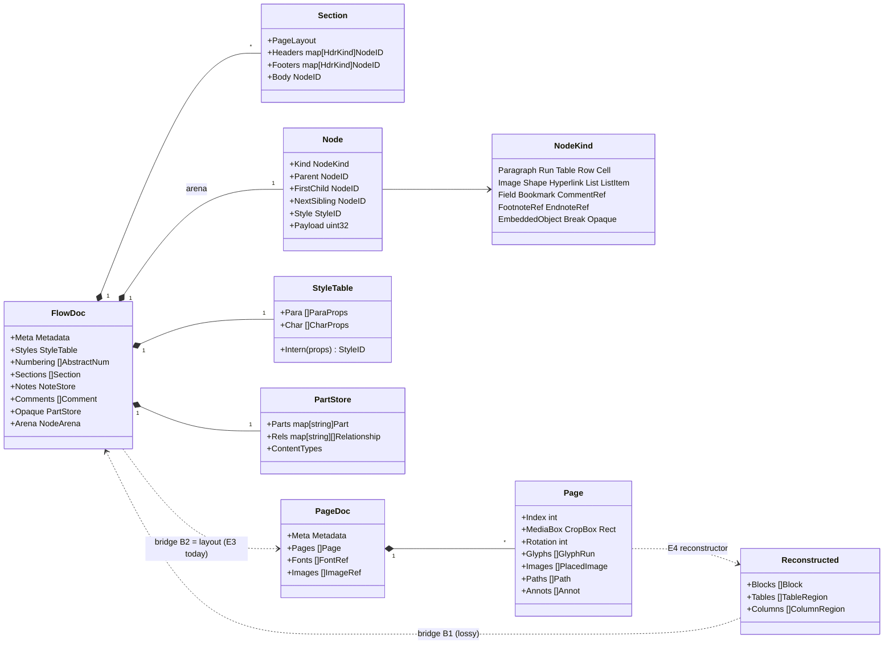

# 05 — Document Core Architecture

> Part of the Next-Generation Document Engine analysis (2026-11). Status: ANALYSIS — no code changed.

## 1. Purpose and scope

The brief asks for an "A. Document Core Engine": lifecycle, metadata, a document object model,
validation, a canonical internal representation (IR), transformation, serialization, versioning and
comparison, covering text blocks, paragraphs, runs, character/paragraph formatting, tables, images,
shapes, hyperlinks, headers/footers, page layout, sections, lists/numbering, fields, bookmarks, comments,
footnotes/endnotes and embedded objects.

This document designs that core for Fyredocs under the binding decisions in
`EXECUTIVE-SUMMARY.md` (Go-first, engine table E1–E9, E4 page model lives inside
`convert-from-pdf`, no shared business logic per `CLAUDE.md` §1). It answers four questions:

1. Can one unified IR serve DOCX, PDF, HTML and ODT? (§5.1: no — a layered design is required.)
2. What are the Go types, memory model, error model and validation levels? (§5.2–§5.6)
3. Where does the core live given `CLAUDE.md` §1, and which worker needs which IR? (§5.7)
4. How do versioning and comparison relate to what `document-service` already stores? (§5.8–§5.9)

Out of scope: parsers (`06-parsing-engine-design.md`), layout/pagination (`08-…`), the PDF engine
(`09-…`), spreadsheet/presentation specifics (`10-…`). Routing of capabilities is in doc 14.

## 2. Current state

There is no document model anywhere in the backend today. Every tool is a file-to-file transform:

- The only hand-written structured writer is the PPTX builder: `convert-from-pdf/processing/pptx_builder.go:16-85`
  streams a `zip.Writer`, emitting `[Content_Types].xml` (:145-161), `_rels/.rels` (:165-170),
  `presentation.xml` with the ordered `sldIdLst` (:174-193), one slide part per page image (:214-255) and
  a mandatory master/layout/theme chain (:269-351). It has no intermediate model: geometry is computed
  in EMU from the first PNG (:124-138) and written straight into `fmt.Sprintf` templates. `writeFile`
  reads each image fully into memory (:104-115).
- The scan pipeline is the closest thing to a per-page model: `organize-pdf/processing/processing_scan.go:112-117`
  (`ScanPage` directives), `preprocessScanImages` :337-391 (index-aligned page slice, ctx checked per
  page :341), `scanToPDF` :444-491 (pdfcpu `ImportImagesFile`), OCR text sidecar capped at 512 KB
  (:540-546, :557). Its DTOs are duplicated from job-service "by design, no shared DTOs across
  services" (:66-67) — the same rule this document must respect.
- PDF→DOCX/XLSX/HTML/TXT are exec'd third parties with no IR: pdf2docx (`convert-from-pdf/processing/processing_free.go:466`),
  `pdf_to_xlsx.py` (:342), `pdftohtml` (:503), `pdftotext -layout` (:520). PDF object access is pdfcpu
  `api.ReadContextFile` (`organize-pdf/processing/processing_free.go:32`); `go.mod` pins pdfcpu v0.9.1
  (`01-existing-system-audit.md` §go.mod) while upstream is at v0.16.4 (Sources S6).
- No `encoding/xml` import exists outside tests; `archive/zip` is used only to write outputs
  (`convert-from-pdf/processing/processing_free.go:4`, `organize-pdf/processing/processing_free.go:4`).
- `document-service` stores `content_sha256` (server-computed over the stored bytes,
  `document-service/internal/models/document.go:52-54`; streamed SHA-256 at
  `document-service/handlers/hashing.go:30-41`) and `simhash` (client-computed 64-bit text fingerprint,
  `document.go:55-57`). Nothing server-side extracts text, page count or structure
  (`01-existing-system-audit.md` §document-service).
- Each worker keeps its own copy of `ProcessingJob`/`FileMetadata` (`convert-to-pdf/internal/worker/worker.go:756-774`);
  `shared/` holds only infrastructure packages (`CLAUDE.md` §2 "Allowed shared utilities").

## 3. Requirements

Functional
- F1 Represent every node type in §1 for flow documents, plus pages/positioned content for PDF.
- F2 Writers for DOCX, XLSX, PPTX, ODT/ODS/ODP, HTML, TXT consume the IR (E4, Stage 3).
- F3 Editing an element never deletes unrelated features: unknown XML/relationships/parts survive a
  parse→serialize round trip verbatim (brief non-negotiable "preserve unknown XML/relationships").
- F4 Comparison of two documents at IR level (Stage 5 "compare" tool).
- F5 Metadata (title/author/dates/page count/word count) exposed uniformly.

Performance
- P1 Inputs up to `MAX_UPLOAD_MB` 500 (`shared/config/defaults.go:54`); worker tmpfs budget 900 MiB and
  large-job gate at 100 MiB (`convert-from-pdf/internal/worker/tmpfs.go:23-35`); worker containers 1 GB
  (`01-existing-system-audit.md` §Deployment). The IR must not require materialising a whole 40 MB XLSX
  (k6 `large` fixture, `scripts/k6/fixtures/gen.py:22`) as a tree of heap objects.
- P2 Cancellation: check `ctx` between pages/parts (pdfcpu ignores ctx; brief §Ghostscript/Poppler).

Compatibility
- C1 Output must open in Word/Excel/PowerPoint and LibreOffice; proven only by the fidelity harness
  (`make bench-engine`, Stage 1 Q13) — never claimed without a gate.
- C2 Unicode/Indic text is first-class: runs carry script/language, never assume WinAnsi.

Security
- S1 All limits in `06-parsing-engine-design.md` §7 apply before any IR node is allocated.
- S2 IR construction must be bounded: node count, text bytes, nesting depth, embedded-object bytes.

## 4. Options evaluated

| Option | Language | Licence | Maturity | Fidelity/coverage | Integration | Effort (EM, estimate) | Verdict |
|---|---|---|---|---|---|---|---|
| O1 Single unified IR for DOCX/PDF/HTML/ODT (one tree, every format mapped in and out) | Go | — | n/a (custom) | Lossy in both directions: PDF has no paragraphs/tables/sections; DOCX has no glyph positions. Every writer pays for the union. | in-process | 3–4 for the IR alone, then every converter | Rejected (§5.1) |
| O2 Layered: flow IR + fixed-page IR + explicit bridges + opaque parts | Go | — | custom; pattern used by pandoc (flow AST) and by every PDF→Office tool (page model) | Each IR is exact for its family; bridges are lossy by design and documented | in-process per worker | Fixed IR ≈1 (inside E4's 4–5); flow IR writer-side ≈0.5–1; opaque-part round-trip + editing ≈3–4 (Stage 6+) | **Adopted** |
| O3 Adopt a library model: `richdoc.Document` (go-odf/go-rtf's shared model, BSD-3) | Go | BSD-3 | young: go-odf 20 commits, 0 stars; go-rtf v0.4.0 2026-10 (S7, S8) | Flow only; keeps unknown ODF/RTF as RawInline/RawBlock — same idea as our opaque parts | in-process | 0.5 to adopt, unknown to extend | Not adopted as core (maturity); its RawBlock pattern is borrowed |
| O4 Reuse pdfcpu's object model as the fixed-page IR | Go | Apache-2 | v0.16.4 2026-10-27 (S6) | Object/content-stream level, no words/lines/blocks; it is the *input* to E4, not the page model | in-process | 0 | Used underneath E1/E4, not as IR |
| O5 Skip an IR; keep file→file exec pipelines | — | — | current | No compare, no round-trip, no E4 | — | 0 | Rejected for Stage 3+ (E4 needs a page model) |

## 5. Recommendation

### 5.1 One IR cannot serve DOCX, PDF, HTML and ODT — a layered design

DOCX, ODT, HTML, Markdown, EPUB and RTF are *flow* documents: an ordered tree of blocks (sections →
paragraphs/tables/lists) whose geometry is computed at layout time. PDF is a *fixed-page* document: pages
containing positioned glyph runs, images and paths with no intrinsic paragraph, table, list or section.
Mapping either into the other is reconstruction (PDF→flow: E4's job) or layout (flow→PDF: E3
LibreOffice's job, and the optional Stage 6 fast path). Pretending one tree holds both forces every
writer to handle fields it cannot use and every parser to invent data it does not have. Therefore:



- **Flow IR** (`FlowDoc`): DOCX/ODT/HTML/Markdown/EPUB/RTF-shaped. Writer-side only in Stage 3.
- **Fixed-page IR** (`PageDoc`): PDF-shaped; this *is* the E4 page model (words+bboxes+fonts+rules+
  images). Lives in `convert-from-pdf`. Its `Reconstructed` layer (blocks/columns/tables) is E4's
  output and the input to bridge B1.
- **Bridges are lossy by design and say so**: B1 (page→flow) drops absolute positions except for
  floating images/shapes anchored to the paragraph they overlap; B2 (flow→page) is layout and is
  LibreOffice (E3) for the whole roadmap, optionally a Go fast path in Stage 6+ (`08-…`, `04-…`).
  Neither bridge is a round trip; a document that enters as PDF and leaves as DOCX is a new document.
- **Opaque parts** (`PartStore`): every OPC/ODF part the parser does not model is kept as bytes plus
  its relationships, and re-emitted verbatim. This is what makes F3 true without modelling all of
  ECMA-376.

### 5.2 Go type sketches — flow IR

Sketches only; names and field sets are the contract, not the final code.

```go
// NodeID indexes FlowDoc.Arena. 0 is the nil node. Stable for the life of the document;
// never reused after deletion (deleted nodes are tombstoned, compaction renumbers via a map).
type NodeID uint32
type StyleID uint32 // index into StyleTable; 0 = inherit/default

type NodeKind uint8
const (
    KindParagraph NodeKind = iota + 1
    KindRun; KindTable; KindRow; KindCell; KindImage; KindShape; KindHyperlink
    KindList; KindListItem; KindField; KindBookmarkStart; KindBookmarkEnd
    KindCommentRangeStart; KindCommentRangeEnd; KindCommentRef
    KindFootnoteRef; KindEndnoteRef; KindEmbeddedObject; KindBreak; KindOpaque
)

// Node is 32 bytes and lives in a slice; children form a sibling list so insertion is O(1)
// and the arena never reallocates per node.
type Node struct {
    Kind        NodeKind
    Flags       uint8   // tombstone, dirty (touched since parse), synthetic (from bridge)
    Parent      NodeID
    FirstChild  NodeID
    LastChild   NodeID
    NextSibling NodeID
    Style       StyleID // paragraph or character props by Kind
    Payload     uint32  // index into the Kind-specific table below
    Origin      uint32  // index into Origins: source part + byte range, 0 if synthetic
}

// Kind-specific payload tables (struct-of-arrays; a Node with KindRun has Payload = index in Runs).
type RunData   struct{ Text TextRef; Lang LangTag; Script uint8 }   // TextRef = (off, len) into Text
type TableData struct{ Grid []Twips; Props TblProps; Rows int32 }
type CellData  struct{ GridSpan, VMerge uint16; Props CellProps }
type ImageData struct{ Media MediaID; Extent EMU2; Anchor AnchorKind; Alt TextRef; Opaque PartRef }
type ShapeData struct{ Geometry PresetGeom; Extent EMU2; Text NodeID; Opaque PartRef }
type HyperlinkData struct{ Target TextRef; Anchor TextRef; RelID string }
type FieldData struct{ Instr TextRef; Result NodeID; Kind FieldKind /*PAGE, NUMPAGES, REF, TOC, HYPERLINK, unknown*/ }
type BookmarkData struct{ Name TextRef; Pair NodeID }
type NoteData struct{ Kind NoteKind; Body NodeID }   // footnote/endnote body is a subtree
type CommentData struct{ ID int32; Author TextRef; Date time.Time; Body NodeID; Range [2]NodeID }
type EmbeddedData struct{ ProgID TextRef; Part PartRef; Preview MediaID }

type Section struct {
    Page    PageLayout            // size, orientation, margins, columns, page numbering
    Headers map[HdrKind]NodeID    // default/first/even
    Footers map[HdrKind]NodeID
    Body    NodeID                // KindParagraph/KindTable children
    Opaque  PartRef               // sectPr children we do not model (e.g. w:docGrid variants)
}

type ParaProps struct { // interned
    StyleName string; Align Align; Indent Indent; Spacing Spacing; KeepNext, PageBreakBefore bool
    NumID int32; NumLevel uint8; Borders Borders; Shading Shading; Tabs []Tab; OutlineLevel int8
    Unknown OpaqueXML            // unmodelled pPr children, re-emitted in place
}
type CharProps struct { // interned
    Font FontSpec /* ascii/hAnsi/cs/eastAsia faces + hint */; SizeHalfPt uint16
    Bold, Italic, Underline, Strike, SmallCaps, Caps uint8; Color RGBA; Highlight uint8
    VertAlign VertAlign; Lang LangTag; Unknown OpaqueXML
}

type FlowDoc struct {
    Meta      Metadata
    Styles    StyleTable          // named styles + interned direct formatting
    Numbering []AbstractNum       // list definitions; ListItem nodes reference (NumID, level)
    Sections  []Section
    Notes     NoteStore           // footnotes/endnotes by id → NodeID
    Comments  []CommentData
    Media     []Media             // images/embeddings: lazily opened part + sniffed type + dims
    Opaque    PartStore           // §5.4
    Arena     NodeArena           // §5.5
    Text      []byte              // all run text, UTF-8, append-only during parse
    Origins   []Origin            // part name + byte offset range for every parsed node
}
```

Coverage of the brief's list: text blocks/paragraphs/runs (Paragraph, Run, Break), character and
paragraph formatting (CharProps/ParaProps interned), tables/rows/cells, images, shapes, hyperlinks,
headers/footers (Section maps), page layout (PageLayout), sections, lists/numbering (Numbering +
ListItem), fields (FieldData with parsed instruction and cached result), bookmarks (paired start/end),
comments (range + body subtree), footnotes/endnotes (NoteStore), embedded objects (EmbeddedData +
opaque part). Anything else (content controls, math, tracked changes, VML, custom XML) is KindOpaque
at node level and PartStore at part level until a product need justifies modelling it.

### 5.3 Go type sketches — fixed-page IR (E4 page model)

```go
type PageDoc struct {
    Meta   Metadata
    Pages  []Page            // lazily populated: Page.Loaded false until the extractor runs
    Fonts  []FontRef         // name, embedded?, type (Type1/TrueType/CID), encoding, unicode-mappable?
    Images []ImageRef        // object id, w/h, colourspace, bpc, filter, bytes (lazy)
}
type Page struct {
    Index     int
    MediaBox, CropBox Rect   // points, PDF user space
    Rotation  int            // 0/90/180/270
    Glyphs    []GlyphRun     // positioned text; one run = same font/size/colour, monotone x
    Images    []PlacedImage  // ImageRef + CTM
    Paths     []Path         // rules/borders only: stroked/filled rects and lines (table detection)
    Annots    []Annot        // links, widgets (kept for compare and for HTML/DOCX hyperlink recovery)
    Loaded    bool
}
type GlyphRun struct {
    Text   string           // Unicode (post-ToUnicode); "" if font is not unicode-mappable
    BBox   Rect; Baseline float32; Font int32; Size float32; Color RGBA
    Chars  []CharBox        // per-glyph advance boxes (needed for word splitting and bbox diff)
    Flags  uint8            // rtl, vertical, synthetic-space, from-ocr
}

// Reconstructed is E4's output on top of Page; see 08-pdf-engine-design.md for the algorithms.
type Reconstructed struct {
    Blocks  []Block          // ordered reading-order blocks: paragraph candidates with lines
    Columns []ColumnRegion
    Tables  []TableRegion    // cell grid with bboxes and the glyph runs assigned to each cell
    Figures []FigureRegion   // image + caption
}
```

The extractor interface is the brief's: `pdftotext -bbox-layout` + `pdfimages` now (exec), PDFium
later (E2), both producing `Page`. pdfcpu (E1) supplies MediaBox/Rotation/Annots/Info.

### 5.4 Opaque parts and relationships (round-trip guarantee)

```go
type PartStore struct {
    ContentTypes ContentTypes               // [Content_Types].xml parsed, unknown entries kept
    Parts        map[string]*Part           // key = OPC part name ("/word/document.xml") or ODF path
    Rels         map[string][]Relationship  // source part → rels, order preserved
    Order        []string                   // original zip entry order, for byte-stable output
}
type Part struct {
    Name     string
    CType    string
    Method   uint16             // zip method (Store/Deflate) as in the source
    Status   PartStatus         // Untouched | Modelled | Modified
    raw      lazyBytes          // central-directory entry; inflated on first Bytes()
    Model    any                // non-nil only when Status != Untouched (e.g. *FlowDoc body)
}
type OpaqueXML struct {        // for unmodelled *children* inside a modelled element
    Raw []byte                  // exact source bytes, incl. namespace prefixes used in the part
    NS  map[string]string       // prefix → URI in force at that point (re-declared on emit if needed)
}
```

Rules:
1. Serialization writes `Untouched` parts with `zip.Writer.CreateRaw`/`File.OpenRaw` (Go ≥1.17,
   S5) — no inflate/deflate, byte-identical entry data.
2. A `Modelled` part is re-emitted from its model; its `OpaqueXML` children are written back at the
   same position among siblings (ECMA-376 schemas are sequence-ordered; position matters for Word).
3. Relationships are never regenerated wholesale. New rels get fresh `rIdN` above the source max;
   removed model elements leave their rel in place unless the target part is unreferenced *and* the
   caller asked for garbage collection (default off: orphan parts are cheaper than a broken file).
4. Content types are only ever appended.
5. The ODF analogue: `META-INF/manifest.xml` entries kept, unmodelled `content.xml`/`styles.xml`
   subtrees kept as `OpaqueXML` (go-odf applies the same RawBlock pattern, S7).

Acceptance (§7): parse→serialize of an untouched document yields a zip whose *every entry's
uncompressed bytes* are identical, and whose entry order is identical. Compressed bytes may differ
only for Modelled parts.

### 5.5 Memory model

- **Arena of nodes**: `NodeArena{ nodes []Node; free []NodeID }` — one contiguous slice, 32-byte
  nodes, sibling-linked children. A 1,000-page DOCX with ~1 M runs is ~32 MB of nodes plus text.
  No per-node heap object, no pointer-chasing GC cost (one slice header, not millions of pointers).
- **Text store**: one `[]byte` per document; runs hold `(offset, len)`. Edits append; compaction on
  serialize. Avoids a million small strings.
- **Style interning**: `StyleTable.Intern(CharProps)` hashes the props and returns an existing
  `StyleID` when equal. Real documents have thousands of runs and tens of distinct run properties;
  this mirrors how OOXML itself factors `w:rPr`. Comparison of two runs' formatting is an integer
  compare.
- **Lazy parts**: `Part.raw` keeps only the zip central-directory record (`archive/zip` reads the
  directory from the `io.ReaderAt`, S5) and inflates on demand. Media and embeddings are never loaded
  unless a writer needs them, and then are copied `OpenRaw → CreateRaw` when the format allows.
- **Streaming for big tables/sheets**: a `KindTable` whose source is larger than
  `StreamTableThresholdBytes` (proposed default 8 MiB of XML) is not materialised. Its node carries a
  `RowSource` (re-scannable `xml.Decoder` over the part) and writers iterate rows with a callback.
  XLSX sheets always take this path (excelize `Rows` iterator / `StreamWriter`, S3), as do big `w:tbl`
  in DOCX. Tree diff (§5.9) degrades to row-hash diff for streamed tables.
- **Budgets**: `Limits{MaxNodes, MaxTextBytes, MaxDepth, MaxMediaBytes}` are enforced during
  construction (defaults in `06-…` §7); exceeding one is a typed `LimitError`, never an OOM.
- **Per job**: the arena is allocated once per document and released with the job scratch dir
  (`worker.go:500-505`); no cross-job caches of IR (result cache stays at the object level,
  `rescache:v1:…`).

### 5.6 Lifecycle, error model, validation levels, transformation, serialization

Lifecycle (one job): `Open(limits) → Inspect (metadata only, no parts inflated) → Parse(parts needed)
→ Validate(level) → Transform (bridge / edit) → Validate(L2 on output) → Serialize → Close`. Each
step checks `ctx` (P2). `Inspect` must be enough for thumbnails/page count/metadata so Q9/Q10-style
features never pay for a full parse.

Error model:

```go
type ErrKind uint8 // Malformed | Unsupported | Limit | Encrypted | Internal
type DocError struct {
    Kind     ErrKind
    Part     string   // "/word/document.xml", "page 12", "" if whole file
    Path     string   // element path or node id, e.g. "w:body/w:tbl[3]/w:tr[41]"
    Offset   int64    // byte offset in the part when known
    Msg      string
    Fatal    bool     // false = recorded as warning, processing continued
    Err      error    // wrapped cause (xml.SyntaxError, zip.ErrFormat, LimitError)
}
```

Non-fatal errors accumulate in a `Diagnostics` list attached to the document and surfaced in job
result metadata (the way OCR `textTruncated` is today, `processing_scan.go:543-545`). Fatal kinds map
onto the worker's error-code → friendly-message table (`convert-to-pdf/internal/worker/worker.go:88-113`
pattern): `Malformed → "file appears corrupt"`, `Encrypted → "file is password protected"`,
`Limit → "file too large/complex"`, `Unsupported → "feature not supported"`. `Limit` and `Malformed` are
never retried (not `isRecoverable`, `worker.go:858`).

Validation levels:

| Level | Name | Checks | When |
|---|---|---|---|
| L0 | Structural | zip/OPC/ODF integrity: central directory parses, required parts present (`/_rels/.rels`, main part per content type; ODF `mimetype` first entry stored uncompressed, `manifest.xml`), every relationship target exists, no duplicate part names, limits (§S1) | always, before any part is inflated beyond rels/content types |
| L1 | Semantic | IR invariants: parent/child links consistent, bookmark/comment ranges paired and nested in one story, numbering references resolve, table rows have consistent grid spans, every `r:id` referenced by a modelled element resolves, every `MediaID` resolves | after parse; after every transform in tests; optional in prod (cost is O(nodes)) |
| L2 | Format conformance | Output-side: `[Content_Types].xml` covers every emitted part; no dangling `r:id`; element ordering per ECMA-376 sequence in modelled elements; ODF: manifest lists every file; PDF: pdfcpu `ValidateFile` relaxed; external validators in the harness (LibreOffice headless open, odfvalidator, veraPDF) | serialization in CI/harness; production emits only the cheap checks |

Transformation: a transform is a function `func(*FlowDoc) error` or `func(*PageDoc) error` with a
name and a declared capability (`Edit`, `Bridge`, `Normalise`). Bridges B1/B2 are transforms that
*produce a new document* (never mutate the source) and mark every produced node `synthetic`, so the
opaque-part rule (§5.4) can never be misapplied to a bridged document (it has no opaque parts).

Serialization: one writer per target; the writer receives the document and an `io.Writer`, and
streams. For OOXML/ODF targets the writer is a thin layer over `PartStore` (untouched parts raw,
modelled parts from model); this generalises `pptx_builder.go` rather than replacing its approach.

### 5.7 Where the core lives (CLAUDE.md §1) and mapping to E1–E9

`CLAUDE.md` §1 forbids shared business logic and cross-service imports; §2 allows `shared/` only for
infrastructure utilities. A document model is business logic. Therefore:

| Package | Worker | Contents | Why here |
|---|---|---|---|
| `convert-from-pdf/internal/pagemodel` | convert-from-pdf | `PageDoc`, `Page`, extractor interface, `Reconstructed` | E4 is "inside convert-from-pdf" by decision (brief E4 row) |
| `convert-from-pdf/internal/flowdoc` | convert-from-pdf | `FlowDoc`, arena, styles, bridge B1, validation L1 | Only consumer in Stages 3–5 is E4's writers |
| `convert-from-pdf/internal/writers/{docx,xlsx,pptx,odf,html,txt}` | convert-from-pdf | writers from `FlowDoc` (and `PageDoc` for PPTX image slides) | E4 deliverable; `pptx_builder.go` moves here |
| `convert-from-pdf/internal/opc`, `/odfpkg` | convert-from-pdf | OPC/ODF package reader+writer, `PartStore` | needed by writers (Stage 3) and later parsers |
| `shared/safearchive` (proposal) | shared | zip central-directory open with limits (entry count, ratio, name safety, max bytes) — pure I/O guard, no document semantics | Infrastructure in the same sense as `procexec`; every worker that opens a zip needs identical guards |
| *(no package)* | convert-to-pdf | nothing in Stages 1–5: office→PDF stays LibreOffice (E3). If the Stage 6 fast path is approved it gets **its own copy** of `flowdoc` + a DOCX *parser* (duplicated by design, like `ProcessingJob` in every worker, `convert-to-pdf/internal/worker/worker.go:756-774`) | §1: no cross-service import; the copies are allowed to diverge |
| *(no package)* | organize-pdf, optimize-pdf | none; they stay on pdfcpu/E1 objects and `internal/imaging` | no flow or page model needed |
| *(none)* | document-service | never imports an IR; receives digests/metadata via job events (§5.8) | §3 data ownership |

Which worker needs which IR: convert-from-pdf needs both (PDF in → flow out). The compare tool
(Stage 5) needs `PageDoc` for PDFs and `FlowDoc` for DOCX pairs; it is routed to convert-from-pdf
because that is where both IRs already are (routing in `job-service/internal/routing/routing.go:20-73`
would gain `compare-pdf → convert-from-pdf`; see doc 14). Intentional duplication: if a second worker
ever needs an IR, it copies the package; the brief explicitly names "a shared document engine
package" as unrealistic.

Mapping the brief's "A. Document Core Engine" responsibilities:

| Brief responsibility | Lands in | Engine |
|---|---|---|
| Lifecycle, metadata | `pagemodel`/`flowdoc` + pdfcpu Info/XMP (E1), OOXML core/app parts, ODF meta.xml (parsers, doc 06) | E1, E4 |
| Document object model / canonical IR | `flowdoc` (flow), `pagemodel` (fixed) | E4 |
| Validation | L0 in `opc`/`odfpkg`/`safearchive`; L1 in IR packages; L2 in writers + harness | E4; harness (cross-cutting) |
| Transformation | bridge B1 = E4 reconstructor; B2 = E3 (LibreOffice), optional Stage 6 fast path | E3, E4 |
| Serialization | writers; pdfcpu for PDF output (E1); Typst for typeset PDF fragments (E7) | E1, E4, E7 |
| Versioning | digests published in job result metadata; stored by document-service | — (events) |
| Comparison | `compare` tool in convert-from-pdf: IR diff + render diff (E2 raster, harness SSIM) | E2, E4 |

### 5.8 Versioning — relation to `content_sha256` and `simhash`

Today: `content_sha256` is the exact-bytes identity (server-computed, `document.go:52-54`,
`hashing.go:30-41`), `simhash` is a near-duplicate text fingerprint computed by the client
(`document.go:55-57`; `handlers/documents.go:391-393`). Neither says anything about structure.

Proposal (additive, no schema change required):
- Workers that build an IR publish three digests in the job's result metadata (same channel as
  `extractedText`, `processing_scan.go:540-546`): `content_sha256` of the output object (already
  implied by MinIO ETag for single-part uploads), `ir_text_sha256` (SHA-256 over the canonical text
  stream: reading order, paragraphs joined by `\n`, pages by `\f`, NFC-normalised), and `ir_struct_sha256`
  (SHA-256 over a canonical serialization of the node tree *without* text and *without* opaque parts:
  kinds, style ids, table grids). `document-service` stores them in its `metadata` jsonb
  (`document.go:45`) when it finalises a document from the job event (`document-service/subscriber/subscriber.go:94`), never by
  importing worker code.
- `simhash` stays client-computed for now; a server-side simhash over `ir_text` is a one-day addition
  once text extraction exists server-side (today it does not: `01-existing-system-audit.md` §document-service).
- Version semantics: two library documents are *byte-identical* if `content_sha256` matches,
  *textually identical* if `ir_text_sha256` matches, *structurally identical* if both IR digests match.
  Each is a cheap pre-check before running a compare job.

### 5.9 Comparison

Two levels, both inside the compare tool (Stage 5):

Flow IR tree diff (DOCX/ODT pairs, or two PDFs after E4):
1. Block alignment: sequence of top-level blocks per story (body, each header/footer, each note).
   Each block's key = `ir_text_sha256` of its subtree; Myers/LCS over keys gives moved/added/removed
   blocks. Streamed tables use row hashes.
2. Within matched-but-unequal paragraphs: run-level diff on the text (grapheme clusters, UAX #29) with
   formatting changes reported separately (interned `StyleID` compare).
3. Table diff: align rows by row hash, then cells positionally; report grid changes.
4. Output: a change list (`Insert|Delete|Replace|Move|FormatChange`, node ids, text ranges) and,
   optionally, a DOCX with `w:ins`/`w:del` (writer feature, later).

Fixed IR diff (two PDFs, no reconstruction needed):
1. Page alignment by index, then by text similarity to catch inserted/removed pages.
2. Per page: word sequence (from `GlyphRun.Chars` split on space/advance gaps) diffed by LCS; each
   change carries its `BBox` so the UI can highlight it. Position-only changes (same text, bbox moved
   > tolerance) are reported as `Moved`.
3. Render diff: E2 rasterises both pages (pdftoppm now), the harness SSIM routine scores them; pages
   under the threshold are flagged even when text matches (image/graphic changes).

Both are O(n log n) in nodes/words on the LCS step and bounded by the same `Limits`.

## 6. Classification

| Capability | Class | Notes |
|---|---|---|
| Flow IR (types, arena, interning, L1 validation) | B custom engine | small, but no library gives a Go flow model with opaque-part fidelity (O3 is too young) |
| Fixed-page IR / E4 page model | B custom engine | the one custom engine the brief decides to own |
| Opaque-part round-trip (`PartStore`) | B | required by the non-negotiable; ~0.5 EM once `opc` exists |
| OPC/ODF package read/write | A lightweight lib (stdlib `archive/zip`, `encoding/xml`) | custom code is thin |
| Safe archive guards | A | `shared/safearchive`, stdlib only |
| PDF object layer | D mature external (pdfcpu, Apache-2) | E1 |
| Bridge B2 (layout) | D (LibreOffice) now; B optional Stage 6+ | see `04-…`, `08-…` |
| Digests/versioning | A | SHA-256 + canonical serialization |
| Compare (tree diff + bbox diff) | B | ~1 EM inside Stage 5's 3 EM |
| Render diff | D (Poppler/PDFium) + harness SSIM | E2 |
| Tracked-changes output (`w:ins`/`w:del`) | E optional plugin | not scheduled |

## 7. Acceptance criteria and gates

| ID | Criterion | Proof |
|---|---|---|
| A1 Round-trip byte-equivalence | For every file in the corpus (`make bench-engine`, ≥200 files incl. the k6 `fixtures/out/{docx,xlsx,pptx,odt,ods,odp}`), `Open → Serialize` with no edits yields, per zip entry, identical uncompressed bytes and identical entry order; `Modelled` parts are XML-canonical-equal (c14n) when no edit touched them | new `go test ./internal/opc/... -run RoundTrip` over the corpus; CI runs the k6 fixtures subset |
| A2 Edit locality | Edit one run's text in a document containing comments, footnotes, tracked changes, content controls, charts, embedded XLSX, VML; all other parts byte-identical; Word and LibreOffice open the result | harness opens via `libreoffice --headless --convert-to pdf` (test-binaries image) and compares page count + SSIM ≥ 0.99 against the unedited original |
| A3 Fuzz | New fuzz targets (added to the existing 10: `organize-pdf/processing/fuzz_test.go:13,46,73`, `job-service/handlers/fuzz_test.go:13,41`, `shared/authverify/fuzz_test.go:12`, `shared/config/fuzz_test.go:12,35`, `analytics-service/handlers/fuzz_test.go:13,35`): `FuzzOPCOpen`, `FuzzFlowParseDocumentXML`, `FuzzPageModelFromBBoxXML`; no panic, no allocation beyond `Limits`, `make fuzz-short` green | `scripts/ci/05` fuzz-short |
| A4 Memory | 40 MB `xlsx/large.xlsx` and `docx/large.docx` fixtures parse with peak RSS to be measured (`/usr/bin/time -l go test -run TestLargeFixture -bench . -benchmem`); hard requirement: within the worker's 1 GB limit with 2 concurrent jobs, i.e. ≤ 400 MB per document | benchmark in `docs/developer/architecture/next-generation-document-engine/benchmarks/` |
| A5 Validation | L0 rejects every file in a malformed-corpus (truncated zip, missing `_rels/.rels`, dangling rel, zip-slip name) with a `DocError{Kind: Malformed}` and no panic; L1 passes on every corpus file after parse | unit tests |
| A6 Digests | `ir_text_sha256` is stable across two parses of the same file and across DOCX↔ODT conversion of a text-only fixture by LibreOffice | unit test |
| A7 Compare | On a 20-pair labelled set (hand-edited DOCX and PDF pairs), reported changes match the labels with precision/recall to be measured; gate ≥ 0.95 both before shipping the compare tool | harness `bench-compare` (to be added in Stage 5) |
| A8 Cancel | Parsing a 40 MB fixture stops ≤ 2 s after ctx cancel (Stage 2 Q11 metric) | integration test |

Roadmap placement: `pagemodel` + writers + minimal `flowdoc` + `opc` writer side — Stage 3 (E4, 4–5 EM
total per brief; IR share ≈ 1 EM estimate). `PartStore` round-trip, L0/L1 full, parsers — Stage 6+
"editing" (optional, ≈3–4 EM estimate; not in the 17 EM baseline). Digests — Stage 3 (free with E4).
Compare — Stage 5.

## 8. Risks and open questions

- R1 Flow-IR scope creep: ECMA-376 Part 1 is ~5,000 pages; the opaque mechanism is what keeps the
  modelled subset small. Rule: model an element only when a writer or the compare tool needs it.
- R2 Opaque children inside modelled elements must be re-emitted in schema order; getting the order
  wrong makes Word report corruption. Mitigation: keep `OpaqueXML` at the exact sibling position
  (§5.4 rule 2) and test with Word via the harness (A2); LibreOffice is more lenient and is not proof.
- R3 Duplicating `flowdoc` into convert-to-pdf for a Stage 6 fast path means two copies drift. Accepted
  by `CLAUDE.md` §1; mitigate with the same corpus tests in both modules.
- R4 Text digests depend on reading order, which E4 computes heuristically; two extractors (pdftotext
  vs PDFium) may order differently → `ir_text_sha256` changes across the E2 switch. Document the
  digest version (`ir_digest_v1`) in metadata.
- R5 Compare on scanned PDFs needs OCR first (E6); accuracy is bounded by OCR CER.
- Q1 Does product want tracked-changes DOCX output from compare, or only a change list + highlights?
  (Affects whether `w:ins`/`w:del` writer support is needed.)
- Q2 Which service owns "document versions" as a product concept (document-service library rows vs
  job history)? This document only supplies digests.
- Q3 `shared/safearchive` — confirm with the tech lead that archive guards count as infrastructure
  under `CLAUDE.md` §2; fallback is one copy per worker.
- Q4 pdfcpu upgrade v0.9.1 → v0.16.x is a prerequisite for relying on its API surface in E4; the
  changelog must be reviewed for `api.ReadContextFile` behaviour changes (see `09-…`).

## Sources

- S1 goldmark — https://pkg.go.dev/github.com/yuin/goldmark (v1.8.7, 2026-10-30; v2.1.15 2026-11-02 per releases page; MIT; CommonMark 0.31.2). Accessed 2026-11-07.
- S2 golang.org/x/net/html — https://pkg.go.dev/golang.org/x/net/html (v0.62.0, 2026-10-27; BSD-3; WHATWG algorithm; `Parse` rejects nesting > 512). Accessed 2026-11-07.
- S3 excelize — https://pkg.go.dev/github.com/xuri/excelize/v2 and https://xuri.me/excelize/en/workbook.html (v2.11.1, 2026-11-02; BSD-3; `Rows` iterator, `StreamWriter`; `UnzipSizeLimit` default 16 GB, `UnzipXMLSizeLimit` default 16 MB spills to temp dir). Accessed 2026-11-07.
- S4 encoding/xml — https://pkg.go.dev/encoding/xml (no DTD/external entity processing documented; `Entity` map; `Strict`; no documented size/depth limits; token buffers valid until next `Token`). Accessed 2026-11-07.
- S5 archive/zip — https://pkg.go.dev/archive/zip (`NewReader(io.ReaderAt, size)`; `OpenRaw` since go1.17; `ErrInsecurePath` with GODEBUG `zipinsecurepath=0`; Zip64; no decompression-bomb protection documented). Accessed 2026-11-07.
- S6 pdfcpu — https://pkg.go.dev/github.com/pdfcpu/pdfcpu and https://github.com/pdfcpu/pdfcpu/releases (v0.16.4, 2026-10-27; Apache-2; "PDF 2.0 validation support is basic"). Accessed 2026-11-07.
- S7 go-odf/odf — https://github.com/go-odf/odf (BSD-3; reads ODT/ODS/ODP/ODG, writes ODT/ODP; unmodelled elements kept as RawInline/RawBlock; 20 commits, 0 stars — young, unverified maintenance). Accessed 2026-11-07.
- S8 go-rtf/rtf — https://pkg.go.dev/github.com/go-rtf/rtf (v0.4.0, 2026-10-04; BSD-3; parses to `richdoc.Document`; colour tables/info blocks dropped). Accessed 2026-11-07.
- S9 ECMA-376 5th ed. Part 1 (WordprocessingML §17, SpreadsheetML §18, PresentationML §19, DrawingML §20) and Part 2 (OPC); OASIS ODF 1.3 — standards referenced in `README.md`.
- S10 Unicode UAX #29 (text segmentation) — https://unicode.org/reports/tr29/ — used for grapheme-level diff.
