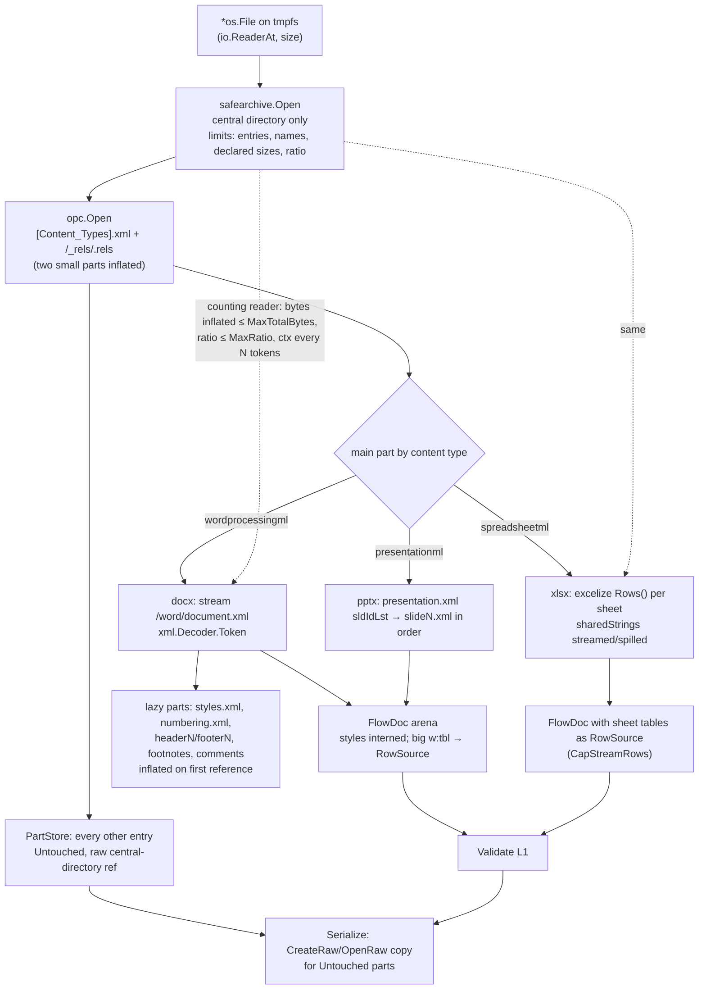

# 06 — Parsing Engine Design

> Part of the Next-Generation Document Engine analysis (2026-11). Status: ANALYSIS — no code changed.

## 1. Purpose and scope

Design a modular parser framework for DOCX, XLSX, PPTX (OOXML/OPC), ODT/ODS/ODP (ODF 1.3), RTF, HTML,
Markdown, PDF, TXT, XML and EPUB that produces the IRs defined in `05-document-core-architecture.md`
(flow IR for text-shaped formats, fixed-page IR for PDF), preserves unknown parts for round-trip, and
is safe against hostile archives and XML. It defines the common `Parser` contract, per-parser
capability flags, streaming/lazy strategy, security limits, metadata extraction and validation, and
places each parser on the roadmap. Capability-aware routing of parsers to tools is doc 14's subject;
this document only defines the contract routing consumes. Layout is `08-…`, PDF internals `09-…`,
spreadsheet/presentation engines `10-…`.

Binding context: E4's *writers* (DOCX/XLSX/PPTX/ODF/HTML/TXT) ship in Stage 3; *parsers* of office
formats are needed only for editing/round-trip/compare, which are later and partly optional
(`EXECUTIVE-SUMMARY.md` §Roadmap). The PDF object parser already exists (pdfcpu, E1).

## 2. Current state

- No structured parsing of any office/HTML/Markdown input exists. Office inputs go to LibreOffice
  (`convert-to-pdf/processing/processing_free.go:40,69,95`), PDF inputs to pdfcpu
  (`organize-pdf/processing/processing_free.go:32` `api.ReadContextFile`; `convert-from-pdf/processing/processing_free.go:173`)
  or Poppler/Ghostscript/Python execs (`01-existing-system-audit.md` §exec.Command table).
- `encoding/xml` is not imported in non-test code anywhere; `archive/zip` is used only to *write*
  outputs (`convert-from-pdf/processing/processing_free.go:4`, `pptx_builder.go:4`,
  `organize-pdf/processing/processing_free.go:4`).
- Input type checking is a 512-byte `http.DetectContentType` sniff in job-service
  (`job-service/handlers/jobs.go:942-944`, `validateMIMEHead` :1354-1382). Every zip-based format is
  accepted as `application/zip` (`allowedMIMETypes` :57-64), so a DOCX job may actually receive an
  XLSX, an EPUB or an arbitrary zip; the check is fail-open for tools without a category (:1361-1368).
  Workers do no MIME/extension checks (`01-existing-system-audit.md` §organize-pdf). Today LibreOffice absorbs
  the mismatch; a Go parser must detect it itself (§5.5).
- Inputs are downloaded whole to tmpfs scratch `<scratch>/in/<basename>`
  (`convert-from-pdf/internal/worker/storage.go:53-56`), so every parser has an `*os.File`, i.e. an
  `io.ReaderAt` with known size — the shape `archive/zip.NewReader` wants (S5).
- Size envelope: `MAX_UPLOAD_MB` 500 (`shared/config/defaults.go:54`), tmpfs 1 GiB with
  `TMPFS_BUDGET_MB` 900 and `LARGE_JOB_THRESHOLD_MB` 100 gating a size-1 semaphore
  (`convert-from-pdf/internal/worker/tmpfs.go:23-35`), worker memory limit 1 GB, concurrency 2
  (`01-existing-system-audit.md` §Deployment). k6 fixtures are small ~0.8 MB / medium ~8 MB / large ~40 MB
  (`scripts/k6/fixtures/gen.py:8,22`); ODF fixtures are fixed ~9–13 KB real LibreOffice files
  (:364-365). **No > 100 MB fixture exists in the k6 suite** — the 100 MB number in the codebase is the
  large-job threshold, not a fixture.
- Metadata: nothing server-side reads core.xml/app.xml/meta.xml/PDF Info; page count comes from
  `pdfinfo` exec (`convert-from-pdf/processing/processing_free.go:126`) or pdfcpu `ctx.PageCount`
  (`organize-pdf/processing/processing_free.go:37`).
- Fuzzing: 10 targets exist (`organize-pdf/processing/fuzz_test.go:13,46,73`,
  `job-service/handlers/fuzz_test.go:13,41`, `shared/authverify/fuzz_test.go:12`,
  `shared/config/fuzz_test.go:12,35`, `analytics-service/handlers/fuzz_test.go:13,35`), run by
  `make fuzz-short` / `scripts/ci/05`. None touches a document format.
- Dependencies already present that matter here: pdfcpu v0.9.1 (upstream v0.16.4, S6),
  `klauspost/compress` v1.19.1 indirect, `gabriel-vasile/mimetype` v1.4.8 indirect
  (`01-existing-system-audit.md` §go.mod) — the latter detects OOXML subtypes by inspecting zip entries and could
  replace the 512-byte sniff.

## 3. Requirements

Functional
- F1 One `Parser` contract for all formats; each parser declares what it can do (capability flags).
- F2 Produce `FlowDoc` or `PageDoc` (doc 05) plus `PartStore` for round-trip formats.
- F3 Metadata without full parse (`Inspect`): title/author/created/modified/page or slide or sheet
  count/word count where the format stores it.
- F4 Structural validation levels L0/L1 per doc 05 §5.6.
- F5 Preserve unknown parts/relationships verbatim (brief non-negotiable).

Performance
- P1 Never inflate the whole archive; read the central directory, then only the parts needed.
- P2 Stream the large parts (`word/document.xml`, `xl/worksheets/sheetN.xml`, `xl/sharedStrings.xml`,
  ODF `content.xml`) with `xml.Decoder.Token`; peak memory bounded by `Limits`, not by file size.
- P3 Cancellation observed at least every N tokens / every part.

Compatibility
- C1 Accept what Word/Excel/PowerPoint/LibreOffice write, including strict vs transitional OOXML
  namespaces, Zip64 archives, `mimetype`-first ODF, BOM-prefixed HTML, CRLF/LF/CR text.
- C2 Reject what they would reject *before* spending CPU (truncated zip, missing main part).

Security
- S1 Limits enforced before allocation: entry count, name safety, compression ratio, total
  uncompressed bytes, XML depth, token/attribute size, entity use, nested package depth (§7 table).
- S2 No network access during parse (HTML/EPUB/XML may reference external resources: never fetched).
- S3 No `exec` from parsers; parsers are pure Go.

## 4. Options evaluated

Per format, library candidates (web-verified 2026-11-07; see Sources) and what remains custom.

| Format | Option | Language | Licence | Maturity (version, date, maintainer) | Fidelity/coverage | Integration | Effort (EM, estimate) | Verdict |
|---|---|---|---|---|---|---|---|---|
| OPC container (DOCX/XLSX/PPTX zip + `[Content_Types].xml` + `.rels`) | stdlib `archive/zip` + `encoding/xml`, custom `opc` package | Go | BSD (Go) | stdlib; `OpenRaw`/`CreateRaw` since go1.17 (S5) | exact; raw copy of untouched entries | in-process | 0.5 | **Adopt** |
| DOCX | custom streaming parser over `opc` into `FlowDoc` | Go | — | custom | subset we model + opaque rest | in-process | 2 (parser), on top of Stage 3 writer | Adopt when editing/compare of DOCX is scheduled (Stage 5/6) |
| DOCX | unioffice | Go | commercial EULA, licence key required (S9) | 538 commits, no releases page entries; maintained | read/write/edit DOCX, XLSX; PPTX create | in-process | 0.5 | Rejected: commercial key, cannot vendor |
| DOCX | gooxml (baliance) | Go | AGPL-3 | predecessor of unioffice | — | in-process | — | Rejected: AGPL (brief: no AGPL in SBOM, Stage 3 gate) |
| DOCX | fumiama/go-docx | Go | AGPL-3 (S10) | 140 commits, no releases, "API likely to change" | parse+save; round-trip of unknown parts not stated | in-process | — | Rejected: AGPL |
| DOCX | mmonterroca/docxgo v2 | Go | MIT (S11) | v2.16.0, no release dates shown; 546 commits; "production-ready" self-claim | claims "round-trip style preservation"; nothing about unknown parts | in-process | 0.5 to evaluate | Candidate for *reading* only if A1 round-trip test passes; not for writing (we own writers) |
| XLSX | excelize v2 | Go | BSD-3 | v2.11.1 2026-11-02, qax-os (S3) | `Rows()` streaming iterator; `UnzipXMLSizeLimit` default 16 MB spills sheets to temp files; `StreamWriter` for output; unknown-part preservation not documented | in-process | 0.5 | **Adopt** for XLSX read (data) and write (E4); verify unknown-part fidelity with A1 before using it for edit round-trip |
| PPTX | custom over `opc` (extends `pptx_builder.go`) | Go | — | custom | slides, shapes, text bodies, pictures; charts/SmartArt opaque | in-process | 1.5 | Adopt (Stage 6, optional) |
| ODT/ODS/ODP | custom over `odfpkg` (zip + `content.xml`/`styles.xml`/`meta.xml`/`manifest.xml`) | Go | — | custom | text/table/frame subset + opaque rest | in-process | 1.5 (shares the XML streaming core with DOCX) | Adopt (Stage 6, optional) |
| ODT/ODS/ODP | go-odf/odf | Go | BSD-3 (S7) | 20 commits, 0 stars, no releases; CGO-free; unmodelled elements kept as RawBlock | reads ODT/ODS/ODP/ODG, writes ODT/ODP | in-process | 0.25 to evaluate | Too young to depend on; its RawBlock design is the right pattern |
| RTF | go-rtf/rtf | Go | BSD-3 (S8) | v0.4.0 2026-10-04 | parse to `richdoc.Document`; bold/italic/strike, lists, footnotes, fields; **drops** colour tables/info blocks | in-process | 0.25 | Candidate only; no RTF tool exists today → E optional |
| RTF | striprtf / J45k4/rtf | Go | MIT | text-only | plain text | in-process | 0.1 | For text extraction only |
| HTML | golang.org/x/net/html | Go | BSD-3 | v0.62.0 2026-10-27, Go team (S2) | WHATWG HTML5 parsing; streaming `Tokenizer`; `Parse` rejects depth > 512 | in-process | 0.5 (DOM → FlowDoc mapping, CSS subset) | **Adopt** for HTML→FlowDoc (text/structure). HTML→PDF rendering stays WeasyPrint (Stage 2) |
| Markdown | goldmark | Go | MIT | v1.8.7 2026-10-30; v2.1.15 2026-11-02 (S1) | CommonMark 0.31.2; GFM tables, footnotes extensions | in-process | 0.25 (AST → FlowDoc) | **Adopt** if a Markdown tool is added (none exists: `01-existing-system-audit.md` §Product surface) |
| PDF | pdfcpu | Go | Apache-2 | v0.16.4 2026-10-27 (S6); repo pins v0.9.1 | object parser, xref, streams, encryption; "PDF 2.0 validation basic" | in-process | 0 (exists) + upgrade | **Keep** (E1); text/positions come from the E4 extractor (Poppler now, PDFium later), see `09-…` |
| TXT | custom (`bufio`, `x/text/encoding` for charset, BOM) | Go | BSD | stdlib | paragraphs by blank line; charset detection heuristic | in-process | 0.1 | Adopt |
| XML (generic) | `encoding/xml` streaming to KindOpaque tree | Go | BSD | stdlib (S4) | element tree; no DTD/XSD | in-process | 0.1 | Adopt (generic, for metadata/custom XML parts) |
| EPUB (zip + `META-INF/container.xml` + OPF + XHTML) | custom over `opc`-like container reader + x/net/html for XHTML | Go | — | custom | spine order, metadata, chapters | in-process | 0.5 | Adopt if an EPUB tool is added; no reader lib is mature enough |
| EPUB | go-shiori/go-epub (fork of archived bmaupin/go-epub) | Go | MIT (S12) | writer only; bmaupin archived 2023-08-29 | EPUB 3.0 *writing* | in-process | 0.1 | Writer candidate only |
| EPUB | simp-lee/epub, LapisApple/go-epub (goreader fork), 88250/epub | Go | various | small, unverified maintenance (S13) | readers; LapisApple has `MaxFileSize` | in-process | — | Reference implementations; not adopted |
| Type detection | gabriel-vasile/mimetype | Go | MIT | v1.4.8 indirect dep already | detects docx/xlsx/pptx/odt/epub by zip content | in-process | 0.1 | **Adopt** at both job-service sniff and worker `Open` |

## 5. Recommendation

### 5.1 Parser contract

```go
// Parser is implemented once per format. Open never inflates more than the central directory,
// [Content_Types].xml, the root .rels (OPC) or mimetype+manifest.xml (ODF); everything else is lazy.
type Parser interface {
    Format() Format                      // e.g. FormatDOCX
    Caps() Caps                          // capability flags, §5.2
    Sniff(head []byte, r io.ReaderAt, size int64) (confidence uint8, err error) // cheap type check, ≤ 64 KiB read
    Open(ctx context.Context, r io.ReaderAt, size int64, lim Limits) (Document, error)
}

type Document interface {
    Metadata(ctx context.Context) (Metadata, error)   // Inspect-level; no body parse
    Parts() PartIndex                                 // names, sizes, content types, rels; nothing inflated
    Validate(ctx context.Context, level ValidationLevel) []DocError
    Flow(ctx context.Context) (*FlowDoc, error)       // ErrNotFlow for PDF
    Pages(ctx context.Context) (*PageDoc, error)      // ErrNotPaged for flow formats (layout is E3)
    Diagnostics() []DocError                          // non-fatal problems recorded so far
    Close() error                                     // releases temp spill files
}

type Limits struct {
    MaxEntries, MaxDepth, MaxNestedPackages   int
    MaxEntryBytes, MaxTotalBytes, MaxPartXML  int64
    MaxRatio                                  float64
    MaxXMLDepth, MaxTokenBytes, MaxAttrBytes  int
    MaxNodes, MaxTextBytes, MaxMediaBytes     int64
    TokenCtxCheckEvery                        int    // ctx.Err() cadence
}
```

`Open` takes `io.ReaderAt` + size because inputs are already files on tmpfs (§2) and
`archive/zip.NewReader` needs random access to the central directory (S5). No parser accepts an
`io.Reader` stream; a streaming front-end would have to spool to tmpfs first, which the worker already
does.

### 5.2 Capability flags and router contract

```go
type Caps uint16
const (
    CapParse      Caps = 1 << iota // can produce FlowDoc/PageDoc (possibly lossy)
    CapMetadata                    // Inspect-level metadata without body parse
    CapRoundTrip                   // untouched parts re-serialise byte-identical (A1 proven)
    CapEdit                        // modelled subset can be modified and written back
    CapRenderReady                 // output of Flow()/Pages() is sufficient for a writer without a layout pass
    CapStreamRows                  // tables/sheets exposed as row iterators (never materialised)
)
```

The capability-aware router (doc 14) only needs: `Registry.Lookup(format) (Parser, bool)` and
`Parser.Caps()`. A tool declares `needs Caps`; the router refuses a (parser, tool) pair whose caps are
insufficient at startup, not at job time, so a missing capability is a deploy-time error. Flags are
*earned* by the harness: `CapRoundTrip` is set only for parsers that pass A1 on the corpus;
`CapEdit` only after A2. A parser may ship with just `CapParse|CapMetadata`.

### 5.3 Package layout (CLAUDE.md §1)

All parser code is business logic and lives in the worker that owns the tools using it; today that is
`convert-from-pdf` (owner of E4 and the future compare tool), under
`convert-from-pdf/internal/parse/{opc,odfpkg,docx,xlsx,pptx,odf,html,markdown,rtf,txt,xmlgeneric,epub,pdf}`.
Only the archive guard (`shared/safearchive`, doc 05 §5.7, Q3 there) is proposed for `shared/`,
because it is pure I/O protection with no document semantics, like `procexec`. If convert-to-pdf ever
parses DOCX (Stage 6 fast path), it copies `parse/opc` and `parse/docx` — intentional duplication.

### 5.4 Streaming OOXML parse path



Per-part streaming rules:
- `xml.Decoder` is wrapped in a *counting, depth-tracking* reader: bytes inflated so far, current
  element depth (`MaxXMLDepth`), size of the current token/attribute (`MaxTokenBytes`/`MaxAttrBytes` —
  `encoding/xml` documents no limits of its own, S4), and `ctx.Err()` every `TokenCtxCheckEvery`
  tokens. The byte slices returned by `Token` are only valid until the next call (S4); text is copied
  into the arena's text store.
- `Decoder.Strict = true` (default) for OOXML/ODF; `Strict=false` + `HTMLEntity` only for the HTML
  fallback path, and HTML is normally parsed by x/net/html, not `encoding/xml`.
- Entities: `encoding/xml` has no DTD processing, so billion-laughs via internal entities does not
  expand (S4 documents only the five predefined entities plus the user `Entity` map). We still reject
  any `<!DOCTYPE` in OOXML/ODF parts (the specs do not use DTDs) and cap `MaxTokenBytes` so a
  single 500 MB text node cannot be buffered.
- Namespaces: accept both transitional (`…/wordprocessingml/2006/main`) and strict
  (`purl.oclc.org/ooxml/…`) URIs by mapping them to one internal namespace id; emit the one the
  source used. `mc:AlternateContent` is resolved by taking the first `mc:Choice` we understand, else
  `mc:Fallback`, and the whole element is kept opaque for round-trip.
- Lazy parts: styles, numbering, headers/footers, footnotes, comments, theme are inflated on first
  reference from the body (or on `Validate(L1)`), never eagerly.
- XLSX: never use `GetRows`; always `Rows()` (S3). `UnzipXMLSizeLimit` is set to our `MaxPartXML`
  so large sheets spill to the job scratch dir (`TmpDir` option pointed at `<scratch>/xlsx-spill`),
  which the worker already deletes (`worker.go:500-505`).
- PPTX: slide order comes from `p:sldIdLst` (exactly as the writer at `pptx_builder.go:172-193`
  encodes it), not from file names.

### 5.5 Malformed-file and type-mismatch detection

Order of checks in `Open` (each is cheap and fails fast):
1. Magic: `mimetype.Detect` on the first 3 KiB plus — for zips — the central directory names; a
   `word-to-pdf` job carrying an XLSX is rejected as `DocError{Kind: Malformed, Msg: "expected DOCX, got XLSX"}`
   (today job-service cannot tell them apart, §2).
2. Zip integrity: end-of-central-directory found, entry count ≤ limit, no duplicate names, every name
   `filepath.IsLocal` and backslash-free (Go only *reports* `ErrInsecurePath` when GODEBUG
   `zipinsecurepath=0` is set, S5 — we check unconditionally), declared uncompressed size ≤ limits,
   ratio ≤ limit (declared sizes are untrusted; the counting reader re-checks during inflate).
3. OPC: `[Content_Types].xml` parses; `/_rels/.rels` has exactly one `officeDocument` relationship
   whose target exists; the main part's content type matches the expected format.
   ODF: first entry is `mimetype`, stored (method 0), content equals the expected media type;
   `META-INF/manifest.xml` lists `content.xml`; encrypted ODF (manifest `encryption-data`) →
   `Kind: Encrypted`.
4. PDF: pdfcpu `ReadContext` relaxed mode; encrypted without password → `Encrypted`; xref rebuild
   recorded as a diagnostic, not a failure (repair tiers in `09-…`).
5. Body parse: `xml.SyntaxError` → `Malformed` with part, byte offset (`SyntaxError.Line` only; the
   counting reader supplies the byte offset) and element path from the decoder's open-element stack.
6. L1 validation on the resulting IR; dangling `r:id` on a modelled element downgrades that element
   to opaque with a diagnostic rather than failing the job (LibreOffice's behaviour; Word's is stricter
   and is checked in the harness).

### 5.6 Metadata extraction (`Inspect`)

| Format | Source parts | Fields | Cost |
|---|---|---|---|
| OOXML | `/docProps/core.xml` (Dublin Core: title, creator, created, modified, lastModifiedBy, revision), `/docProps/app.xml` (Pages, Words, Slides, Application, TitlesOfParts) | all; `Pages`/`Slides` are *advisory* (written by the last editor, often stale) and flagged `Approx: true` | two parts of a few KB |
| ODF | `meta.xml` (`meta:document-statistic` page-count/word-count, `dc:*`, `meta:generator`) | same, advisory | one part |
| PDF | pdfcpu `Info` dict + XMP `Metadata` stream (`dc:title`, `xmp:CreateDate`, `pdf:Producer`), `ctx.PageCount` (exact) | exact page count; Info vs XMP conflicts resolved XMP-first per ISO 32000-2 §14.3 | pdfcpu read (already paid, `organize-pdf/processing/processing_free.go:32-37`) |
| EPUB | OPF `<metadata>` (`dc:title`, `dc:creator`, `dc:language`, `dc:identifier`), spine length | exact chapter count | container.xml + OPF |
| HTML | `<title>`, `<meta name=author|description>`, `lang` | — | tokenizer until `</head>` |
| Markdown | optional YAML front matter (goldmark-meta extension) | — | first lines |
| RTF | `\info` group (`\title`, `\author`, `\creatim`) — note go-rtf drops it (S8); custom pre-scan needed | — | prefix scan |
| TXT/XML | none; byte length, line count, charset guess | — | — |

Exact page counts for office documents require layout (E3); `Inspect` never claims them. Q9 (page
count in every worker's result metadata, Stage 2) is served by pdfcpu for PDFs and by LibreOffice's
PDF output for office inputs.

### 5.7 Preservation of unknown parts

Implemented by `PartStore` (doc 05 §5.4). Parser obligations: (a) register every zip entry in
`Parts()` with `Status: Untouched` before parsing anything; (b) when modelling an element, keep every
child element it does not understand as `OpaqueXML` at its sibling position; (c) never rewrite a
relationship file it did not change; (d) record entry order and compression method so the writer can
reproduce them. XLSX via excelize cannot satisfy (b)/(c) by contract — its unknown-part behaviour is
undocumented (S3) — so XLSX `CapRoundTrip` is only granted if the A1 test passes on the corpus;
otherwise XLSX editing goes through our own `opc`-based parser later (Stage 6, optional).

### 5.8 Large-file strategy

Inputs over `LARGE_JOB_THRESHOLD_MB` already serialise through `largeJobSem`
(`convert-from-pdf/internal/worker/tmpfs.go:20-23`). Parsers add: (1) spill-to-scratch for any single
inflated XML part above `MaxPartXML` (excelize does this natively, S3; `docx` does it through
`RowSource` re-scans instead of materialising); (2) a per-document byte budget (`MaxTextBytes`,
`MaxMediaBytes`) so a 500 MB DOCX that is 495 MB of images costs ~5 MB of XML plus nothing for the
images until a writer copies them raw; (3) peak-RSS measurement is a Stage 3 deliverable
(`benchmarks/` folder; command in doc 05 A4). No parser holds more than one inflated part plus the
arena at a time.

## 6. Classification

| Parser | Class | Caps at first ship | Stage | Effort (EM, estimate) |
|---|---|---|---|---|
| OPC/ODF container + `safearchive` | A (stdlib) | — | Stage 3 (writers need the package writer side; reader side is small) | 0.5 |
| PDF object (pdfcpu) | D mature external | Parse, Metadata | exists (E1); upgrade in Stage 3/4 | 0.1 + upgrade testing |
| PDF page model extractor | B custom (E4) | Parse, RenderReady | Stage 3 | inside E4's 4–5 |
| DOCX | B custom | Parse, Metadata → RoundTrip, Edit after gates | Metadata: Stage 2 (cheap); full parser: Stage 5 (compare) / Stage 6 (edit, optional) | 2 |
| XLSX (excelize) | A/D | Parse, Metadata, StreamRows | Stage 3 (writer), reader when a tool needs it | 0.5 |
| PPTX | B custom | Parse, Metadata | Stage 6 (optional) | 1.5 |
| ODT/ODS/ODP | B custom | Parse, Metadata → RoundTrip | Stage 6 (optional); writers in Stage 3 (brief rank 3, 1 EM after E4) | 1.5 |
| HTML (x/net/html) | A | Parse, Metadata | when a tool needs HTML *structure* (html→pdf uses WeasyPrint, Stage 2, no parser) | 0.5 |
| Markdown (goldmark) | A | Parse, Metadata | E optional plugin (no tool) | 0.25 |
| RTF (go-rtf or custom) | E optional plugin | Parse | not scheduled | 0.25–1 |
| TXT | A | Parse, Metadata, RenderReady | Stage 3 (TXT writer exists via pdftotext today; reader trivial) | 0.1 |
| XML generic | A | Parse | with OPC (used for custom XML parts) | 0.1 |
| EPUB | B custom (thin) | Parse, Metadata | E optional plugin (no tool) | 0.5 |
| Type detection (mimetype) | A | — | Stage 2 (fix the `application/zip` ambiguity at job-service and worker) | 0.1 |

## 7. Acceptance criteria and gates

Security limits (proposed defaults; env-overridable per worker like `TMPFS_BUDGET_MB`):

| Limit | Proposed default | Rationale |
|---|---|---|
| `MaxEntries` | 10,000 | a 1,000-slide PPTX has ~3,000 entries; EPUBs rarely exceed 2,000 |
| `MaxEntryBytes` (single inflated entry) | 256 MiB | a single media part larger than this is not a document |
| `MaxTotalBytes` (sum inflated, counted while inflating) | min(4 × input size, 2 GiB) | OOXML XML compresses ~10:1; media ~1:1 |
| `MaxRatio` (uncompressed/compressed, per entry and total) | 100:1 | zip-bomb guard; legitimate XML is ≤ 30:1 |
| `MaxNestedPackages` (embedded docx/xlsx inside a package) | 1 level, each under the same limits | OLE/embedded packages are copied raw, never recursively parsed unless a tool asks |
| `MaxXMLDepth` | 256 | ECMA-376 trees are < 40 deep; x/net/html uses 512 (S2) |
| `MaxTokenBytes` / `MaxAttrBytes` | 16 MiB / 1 MiB | `w:t` text nodes are small; base64 `pkg:binaryData` in Flat OPC is not supported |
| `<!DOCTYPE` in OOXML/ODF parts | reject | spec does not use DTDs |
| `MaxPartXML` (in-memory before spill) | 16 MiB (matches excelize default, S3) | aligns with `UnzipXMLSizeLimit` |
| `MaxNodes` / `MaxTextBytes` | 5 M / 256 MiB | IR budget (doc 05 §5.5) |
| `MaxMediaBytes` | input size | media is copied raw, never decoded, unless a writer needs dimensions (then `image.DecodeConfig` only, as `organize-pdf/internal/imaging/decode.go:17,48-60` does) |
| Zip names | reject non-local, backslash, duplicate, > 1,024 bytes | zip-slip; Go reports only under GODEBUG (S5) |
| Encrypted inputs | `Kind: Encrypted` immediately | no password flow exists except unlock-pdf |
| `TokenCtxCheckEvery` | 4,096 tokens | cancel latency ≪ 2 s target (Stage 2) |

Gates:

| ID | Criterion | Proof |
|---|---|---|
| G1 Corpus parse | 100% of the `make bench-engine` corpus (≥ 200 real files incl. Hindi, scans, broken) plus k6 fixtures open without panic; files LibreOffice opens also parse here (L0+L1) with ≤ 1% producing `Malformed` | harness report per parser |
| G2 Round-trip byte-equivalence | parse→serialize with no edits: every untouched entry identical bytes and order; modelled parts c14n-equal (doc 05 A1) — required before `CapRoundTrip` | `go test ./internal/parse/... -run RoundTrip` |
| G3 Fuzz | per container and body parser: `FuzzSafeArchiveOpen`, `FuzzOPCOpen`, `FuzzODFOpen`, `FuzzDocxBody`, `FuzzXlsxSheet` (excelize wrapper), `FuzzPptxSlide`, `FuzzHTMLToFlow`, `FuzzMarkdownToFlow`, `FuzzEPUBContainer`; seed corpus = minimised real files + crafted bombs (nested zip 100:1, 10 M entries header, 10 k-deep XML, 1 GiB declared size); no panic, no limit bypass; runs in `make fuzz-short` alongside the existing 10 targets | `scripts/ci/05` |
| G4 Limits | each limit in the table has a test fixture that trips it and a test asserting `DocError{Kind: Limit}` within 100 ms and < 64 MiB allocation | unit tests with `testing.AllocsPerRun`/`runtime.MemStats` |
| G5 Large files | 40 MB k6 fixtures (`docx/large.docx`, `xlsx/large.xlsx`, `pptx/large.pptx`) parse with peak RSS to be measured; requirement ≤ 400 MB (doc 05 A4). A > 100 MB fixture must be *added* to `scripts/k6/fixtures/gen.py` (`TARGETS` at :22) before the claim "handles > 100 MB" is made | benchmark in `benchmarks/` |
| G6 Type mismatch | 100% of {docx, xlsx, pptx, odt, epub, plain zip} presented to the wrong parser rejected at step 1 of §5.5 | unit test |
| G7 Metadata | `Inspect` returns within 50 ms (to be measured) for every corpus file and never inflates a body part (asserted by the counting reader) | unit test |
| G8 Cancel | parse of a 40 MB fixture stops ≤ 2 s after ctx cancel | integration test |

## 8. Risks and open questions

- R1 Office-format parsers are 5–7 EM of optional work that only pays off if editing/compare of
  office files becomes a product goal; the brief schedules writers (Stage 3) first and parsers later.
  Risk of building parsers nobody routes to — mitigated by the router's deploy-time cap check (§5.2).
- R2 excelize's unknown-part behaviour is undocumented (S3); if A1 fails, XLSX round-trip needs our
  own parser (+1 EM).
- R3 Strict-vs-transitional OOXML and `mc:AlternateContent` handling are the classic sources of
  "Word says the file is corrupt"; LibreOffice tolerance must not be mistaken for conformance. Only the
  harness opening files in Word (manual or a Windows CI runner — not available today) proves it.
- R4 `encoding/xml` performance: it is a reflection-free token stream but allocates per token; for a
  40 MB `document.xml` the cost is to be measured. If too slow, a hand-rolled scanner for the hot
  elements (`w:p`, `w:r`, `w:t`) over `Decoder.RawToken` is the fallback — still stdlib.
- R5 Dependency drift: pdfcpu v0.9.1 → v0.16.4 and goldmark v1 → v2 both carry API changes; pin and
  review changelogs before Stage 3.
- Q1 Should job-service's sniff use `mimetype` to reject DOCX/XLSX mix-ups at upload (better UX,
  saves a worker round-trip) in addition to the worker-side check? (job-service change, outside this
  worker-scoped design; doc 14.)
- Q2 Is `shared/safearchive` acceptable under `CLAUDE.md` §2, or must each worker own a copy? (Same as
  doc 05 Q3.)
- Q3 Which tools will ever need RTF/EPUB/Markdown input? Without a product answer these stay
  E-class and unscheduled.
- Q4 Flat OPC (`.xml` single-file DOCX) and legacy binary `.doc/.xls/.ppt` are accepted by the MIME
  allowlist (`jobs.go:58-60` lists `application/msword`, `application/vnd.ms-excel`,
  `application/vnd.ms-powerpoint`) but are out of scope for Go parsers; they remain LibreOffice-only
  and the router must route them to E3.

## Sources

- S1 goldmark — https://pkg.go.dev/github.com/yuin/goldmark and https://github.com/yuin/goldmark/releases (v1.8.7 2026-10-30; v2.1.15 2026-11-02; MIT; CommonMark 0.31.2; `extension.Table`, `extension.Footnote`). Accessed 2026-11-07.
- S2 golang.org/x/net/html — https://pkg.go.dev/golang.org/x/net/html (v0.62.0 2026-10-27; BSD-3; WHATWG HTML5 parsing; `NewTokenizer`; `Parse` rejects nesting > 512). Accessed 2026-11-07.
- S3 excelize — https://pkg.go.dev/github.com/xuri/excelize/v2 and https://xuri.me/excelize/en/workbook.html (v2.11.1 2026-11-02; BSD-3; `Rows()`/`Cols()` iterators, `NewStreamWriter`; `UnzipSizeLimit` default 16 GB, `UnzipXMLSizeLimit` default 16 MB spills to `TmpDir`; unknown-part preservation not documented). Accessed 2026-11-07.
- S4 encoding/xml — https://pkg.go.dev/encoding/xml (predefined entities + `Entity` map only; `Strict`; no documented size/depth limits; `Token` slices valid until next call; `RawToken`). Accessed 2026-11-07.
- S5 archive/zip — https://pkg.go.dev/archive/zip (`NewReader(io.ReaderAt, size)`; `OpenRaw` go1.17; `ErrInsecurePath` only with GODEBUG `zipinsecurepath=0`; Zip64; no bomb protection). Accessed 2026-11-07.
- S6 pdfcpu — https://pkg.go.dev/github.com/pdfcpu/pdfcpu and https://github.com/pdfcpu/pdfcpu/releases (v0.16.4 2026-10-27, v0.16.3 2026-10-19; Apache-2; encryption; "PDF 2.0 validation support is basic"). Accessed 2026-11-07.
- S7 go-odf/odf — https://github.com/go-odf/odf (BSD-3; reads ODT/ODS/ODP/ODG, writes ODT/ODP; RawInline/RawBlock for unmodelled XML; 20 commits, 0 stars, no releases — maturity unverified). Accessed 2026-11-07.
- S8 go-rtf/rtf — https://pkg.go.dev/github.com/go-rtf/rtf (v0.4.0 2026-10-04; BSD-3; parse/write subset; colour tables and `\info` dropped). Accessed 2026-11-07.
- S9 unioffice — https://github.com/unidoc/unioffice ("commercial product and requires a license code"; 538 commits; DOCX/XLSX read-write, PPTX create). Accessed 2026-11-07.
- S10 fumiama/go-docx — https://github.com/fumiama/go-docx (AGPL-3; 140 commits; no releases; "API is likely to change"). Accessed 2026-11-07.
- S11 mmonterroca/docxgo — https://github.com/mmonterroca/docxgo (MIT; v2.16.0; "round-trip style preservation" self-claim, unverified; nothing on unknown parts). Accessed 2026-11-07.
- S12 go-epub — https://github.com/bmaupin/go-epub (MIT; writer only; archived 2023-08-29, unmaintained) and https://github.com/go-shiori/go-epub (MIT; writer only; EPUB 3.0). Accessed 2026-11-07.
- S13 EPUB readers (unverified maturity) — https://pkg.go.dev/github.com/simp-lee/epub, https://pkg.go.dev/github.com/LapisApple/go-epub, https://pkg.go.dev/github.com/88250/epub. Accessed 2026-11-07.
- S14 gooxml — https://github.com/baliance/gooxml (AGPL-3 per `README.md` leads; page fetch returned the unioffice README — treat as unverified beyond licence). Accessed 2026-11-07.
- S15 Standards: ECMA-376 5th ed. Part 2 (OPC: `[Content_Types].xml`, relationships), OASIS ODF 1.3 Part 3 (packages: `mimetype` first, `META-INF/manifest.xml`), EPUB 3.3 OCF (`META-INF/container.xml`), ISO 32000-2 §14.3 (metadata streams) — listed in `README.md`.
