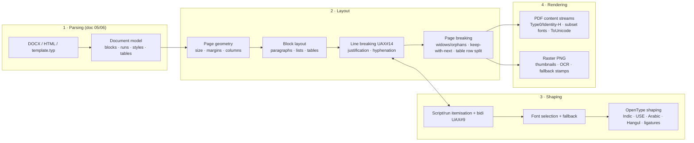
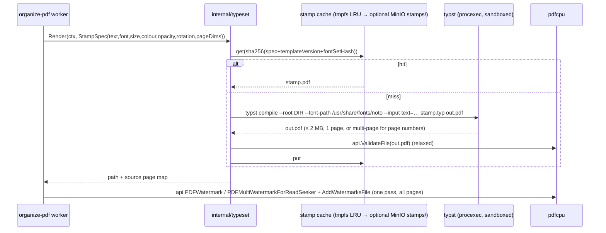
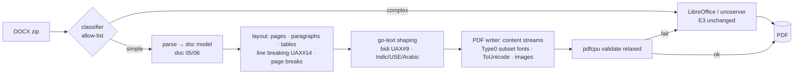

# 07 — Layout and Rendering Engine

> Part of the Next-Generation Document Engine analysis (2026-11). Status: ANALYSIS — no code changed.

Sibling docs: `05-*` (canonical document model), `06-*` (parsers), `08-pdf-engine-design.md` (PDF object engine, E1/E5/E9),
`04-libreoffice-replacement-strategy.md`, `09-…`/`10-…` (office engines), `16-benchmarking-and-testing.md` (fidelity harness), `20-implementation-roadmap.md`. Decisions E1–E9 are
binding (the approved decisions in `EXECUTIVE-SUMMARY.md`).

## 1. Purpose and scope

This document designs the *layout stack* of the platform — the part that turns structured text into positioned glyphs
and then into PDF content streams or pixels — and separates it into four stages that can be owned, tested and replaced
independently:

1. **Document parsing** (DOCX/HTML/template → document model, doc `05-*`/`06-*`)
2. **Layout calculation** (page geometry, paragraphs, tables, breaks)
3. **Text shaping** (Unicode → glyph IDs + positions: ligatures, Arabic joining, Indic reordering, bidi)
4. **Final rendering** (PDF content streams with embedded subset fonts, or raster for thumbnails/OCR)

It then specifies the only two deliverables this platform needs now:

- **(a) E7 — typesetting for stamps, page numbers, edit-text and future templates** via Typst → PDF → pdfcpu PDF-mode
  watermark (Stage 2, 0.5 EM), with a pure-Go alternative (go-text/typesetting → PNG → image stamp).
- **(b) a future, optional, gated Go "simple-document" layout engine** for the DOCX fast path (Stage 6+, 4–6 EM), with its
  classifier, gate and the measurement that must justify starting it.

Out of scope: office layout in general (LibreOffice stays, E3, doc `11-*`/`12-*`), HTML→PDF (WeasyPrint sidecar, doc `12-*`),
PDF raster/text extraction (E2/E4, doc `08-pdf-engine-design.md` §5.x).

## 2. Current state

Every claim cites a file re-read on 2026-11-07 (paths relative to `fyredocs_backend/`).

| Area | Fact | Citation |
|---|---|---|
| Text stamps | Watermark text is drawn with pdfcpu core **Helvetica** only: `desc := fmt.Sprintf("font:Helvetica, points:%d, …")` → `pdfcpu.ParseTextWatermarkDetails` → `api.AddWatermarksFile` | `organize-pdf/processing/processing_edit.go:276-284` |
| Page numbers | Same Helvetica desc; one `api.AddWatermarksFile(outputPath, "", pageSelection, …)` **per page**, i.e. N full read/validate/write cycles for an N-page PDF | `organize-pdf/processing/processing_edit.go:446-456` |
| Edit-text | Same Helvetica desc per annotation; annotation count and font size unbounded | `organize-pdf/processing/processing_edit.go:604-614` |
| Consequence | Helvetica (WinAnsi core font) cannot encode Devanagari, Arabic, CJK → Hindi stamps are impossible today | audit `01-existing-system-audit.md` §Images |
| pdfcpu user fonts | pdfcpu can install TrueType fonts (`api.InstallFonts`, `pkg/api/font.go:64`) and writes CIDFontType2/Identity-H with subsetting (`pkg/pdfcpu/font/fontDict.go:809,893`, `pkg/font/install.go:1022`), but it maps runes → GIDs through `cmap` only (`pkg/font/install.go:62,654`); **no GSUB/GPOS tables are parsed** (grep of `pdfcpu@v0.9.1` and `@v0.12.1` `pkg/` for `GSUB|GPOS`: zero hits). Devanagari conjuncts, matras and Arabic joining would render as unshaped isolated glyphs | module cache `github.com/pdfcpu/pdfcpu@v0.9.1` |
| Fonts in images | Only `ttf-liberation` (convert-to-pdf base) / `fonts-liberation` (convert-from-pdf); no Noto, no Devanagari, no `fc-cache`; organize-pdf and optimize-pdf images install no fonts at all | `deployment/base-alpine-libreoffice.Dockerfile:14-20`; audit §Images |
| Builder | `CGO_ENABLED=0 -trimpath -ldflags="-s -w"` from `fyredocs-go-builder` → any cgo library breaks the static-build pattern | audit §Images; brief 01 finding 5 |
| Office layout | All office→PDF layout is LibreOffice (`unoconvert`, cold `libreoffice --headless` fallback) | `convert-to-pdf/processing/processing_free.go:40,69,95` |
| PDF raster | `pdftoppm` (poppler) renders pages for images and OCR | `convert-from-pdf/processing/processing_free.go:181`; `optimize-pdf/processing/processing_free.go:531` |
| Browser annotate | Web reader replaces non-WinAnsi characters with `?` | audit §Product surface (`lib/annotate/pdfAnnots.ts:101`, frontend repo) |
| No shaping anywhere | No Go module in the workspace imports a shaper; `golang.org/x/image/font` is test-only in optimize/organize | audit §go.mod inventory |

## 3. Requirements

**Functional**
- F1 Stamps, page numbers and edit-text must render any Unicode text the UI accepts, at minimum Latin, Devanagari (Hindi),
  other Indic (Bengali, Gujarati, Tamil, Telugu, Kannada, Malayalam, Gurmukhi), Arabic/Urdu (joining + RTL), CJK — with
  correct shaping (conjuncts, matra reordering, ligatures, contextual forms) and selectable/searchable text in the output.
- F2 Output text must be real PDF text (Type0/CIDFontType2, ToUnicode) not raster, except in the explicitly degraded
  Go-only fallback.
- F3 The future simple-document engine must cover paragraphs, runs, basic tables, inline images, headers/footers, lists,
  page numbering; everything else routes to LibreOffice (explicit list in §5.3).
- F4 Fonts: deterministic fallback chain (requested family → Noto Sans script font → Noto Sans → Liberation), embedding
  and subsetting of every used font, variable-font instances resolved to static instances before embedding.

**Performance**
- P1 Stamp rendering adds ≤ 1 s p95 to a watermark/page-number job on the 12 vCPU target host (to be measured by
  `make bench-engine`, doc `15-*`); page numbers must not scale as N× full-file rewrites (current behaviour, §2).
- P2 Typst process start + compile for a one-line stamp: to be measured (`hyperfine 'typst compile stamp.typ'` in the
  organize-pdf image); roadmap assumption "~100 ms" in brief 01 is unsourced until then.

**Compatibility**
- C1 Output PDFs must pass `pdfcpu validate` (relaxed) and open in Acrobat, pdf.js (web reader), the native app viewer.
- C2 Page-number/stamp PDFs merged via pdfcpu PDF-mode watermark must keep the host document's version ≤ 1.7.

**Security**
- S1 Any exec'd typesetter runs under `shared/procexec` (process group, `WaitDelay`, size-scaled timeout), with no network,
  no package resolution, a read-only root, input length caps, and user text passed as data never as markup (§5.2).
- S2 Fonts are read from an image-baked directory only; user-uploaded fonts are out of scope.

## 4. Options evaluated

Web-verified 2026-11-07 unless marked. "USE" = OpenType Universal Shaping Engine.

| Option | Language | Licence | Maturity (version, last release, maintainer) | Fidelity / coverage | Integration | Effort (EM) | Verdict |
|---|---|---|---|---|---|---|---|
| **go-text/typesetting** (shaping + bidi + segmenter + font parsing) | Go (pure) | BSD-3 / MIT / Unlicense (pkg.go.dev) | harfbuzz pkg v0.3.5 published 2026-09-04; no GitHub releases, tags only; 3 maintainers (Fyne, Gio, independent), v0.x "breaking changes in minors" | Direct port of HarfBuzz's OT shaper: files `ot_shape_indic.go`, `ot_shape_use.go`, `ot_shape_arabic.go`, `ot_shape_khmer.go`, `ot_shape_myanmar.go`, `ot_shape_hangul.go`, `ot_shape_hebrew.go`, `ot_shape_thai.go` present; tracked HarfBuzz version not stated | in-process | 0.5 (stamp fallback) / part of 4–6 (engine) | **Adopt as the Go shaper** for the fallback and for deliverable (b); no raster → pair with `x/image/vector` |
| HarfBuzz via cgo | C | MIT | HarfBuzz is the reference (used by Chrome, LibreOffice, Typst's ports) | Reference quality | cgo in-process | — | **Ruled out**: all workers build `CGO_ENABLED=0` from `fyredocs-go-builder` (audit §Images); enabling cgo changes the builder, breaks `FROM scratch` images, adds glibc/musl matrix. Brief 01 finding 5 |
| HarfRust (ex-rustybuzz) | Rust | MIT | rustybuzz **archived 2026-07-26**, points to HarfRust; HarfRust 0.12.0 in Debian unstable 2026-07; claims <25 % slower than HarfBuzz; lacks Arabic fallback shaper, Graphite | HarfBuzz-level | WASM or sidecar only (no team Rust) | 1+ | Not adopted: no in-process path without Rust; Go port covers the same shaper set |
| cosmic-text | Rust | MIT / Apache-2 | pop-os; shaping by HarfRust, raster by swash, fonts via fontdb; UDHR Arabic/Hindi/Chinese screenshots | Full text layout (shaping, bidi, fallback) | sidecar/WASM only | 1.5+ | Not adopted now; candidate only if a measured need for a Rust layout sidecar appears |
| Parley (+ fontique, HarfRust, ICU4X) | Rust | MIT / Apache-2 | linebender; MSRV 1.88; WPT-based tests | Rich-text layout, bidi, fallback | sidecar/WASM only | 1.5+ | Same as cosmic-text |
| **Typst** (complete typesetter CLI) | Rust binary, zero team Rust | Apache-2.0 | v0.15.1, 2026-07-17; active | Full layout (paragraphs, tables, headers/footers, columns, lists, numbering), OpenType shaping with per-script `script`/`lang`/`dir`, `fallback: true` searches all fonts for missing glyphs, variable fonts (0.15.0), PDF 1.4–2.0, PDF/A-1b…A-4e, PDF/UA-1, tagged PDF by default | exec (static musl binary) | 0.5 | **Adopt for E7** (stamps, page numbers, edit-text, templates). Devanagari output quality to be proven by the Stage 2 fixture gate, not assumed |
| FreeType (cgo) | C | FTL/GPL | reference rasteriser | — | cgo | — | Ruled out (cgo); raster needs are met by Poppler/PDFium (E2) |
| `golang.org/x/image/font/sfnt` | Go | BSD-3 | v0.47.0, 2026-10-09 | Parses TTF/OTF/TTC, outlines, metrics, kerning; **no GSUB/GPOS shaping, no variable-font API documented, no encoder** | in-process | — | Use only for metrics/outline sanity checks; shaping needs go-text |
| go-text `font`/`opentype` packages | Go | BSD-3/MIT | same module as above | Own OpenType parser incl. GSUB/GPOS/GDEF (required by the shaper); variable-font support to be confirmed in code before relying on it | in-process | — | Use as the font parser of record for Go layout |
| fontdb equivalent in Go | Go | — | go-text `fontscan` subpackage (system font discovery + fallback by script; used by Gio) — **not web-verified this pass**, confirm before use | — | in-process | — | Candidate font database for deliverable (b); otherwise a 50-line directory scanner over our fixed font set suffices |
| LibreOffice (reference) | C++ | MPL-2 | kept, E3 | Full office layout | daemon | 0 | Reference renderer and fallback for everything the simple engine declines |

Notes on what was *not* confirmed: Typst's internal shaper (rustybuzz vs HarfRust migration), its Devanagari fidelity
versus HarfBuzz proper, and the decompressed musl binary size (release asset `typst-x86_64-unknown-linux-musl.tar.xz` is
17,462,992 bytes compressed). All three are gate items in §7, not assumptions.

## 5. Recommendation

### 5.1 Reference architecture of the layout stack

Stage 2 and 3 are deliberately bidirectional: line breaking needs shaped advance widths, and re-shaping across a break
is required for Arabic (joining changes at line ends). Typst implements all four stages internally; the Go path
implements 2–4 with go-text for 3.

What each concern means for this platform and who implements it:

| Concern | Typst (E7, now) | Go simple-document engine (b, future) |
|---|---|---|
| Page dimensions/margins | `#set page(width, height, margin)`; stamp pages use `width: auto, height: auto, margin: 0pt` | From `w:sectPr/w:pgSz`, `w:pgMar`; one section only (multi-section → LO) |
| Paragraph layout | built-in (`par`: leading, spacing, first-line indent, justify) | spacing before/after, line spacing rules (auto/exact/atLeast), indents, alignment |
| Line breaking (UAX #14) | built-in (`linebreak`, hyphenation by `lang`) | go-text `segmenter` (UAX #14/#29); no hyphenation in v1 |
| Shaping (HarfBuzz-class) | built-in OT shaper; `script: auto` per Unicode-script block | go-text `harfbuzz` package (Indic, USE, Arabic, Hangul, Hebrew, Thai, Khmer, Myanmar shapers present) |
| Bidi (UAX #9) | `dir: auto/ltr/rtl` | go-text `bidi` (UAX #9) — runs reordered per line after breaking |
| Font metrics | own parser | go-text `font` (hhea/OS/2 ascent/descent, advances via shaping) |
| Wrapping | built-in | greedy first-fit in v1; Knuth-Plass out of scope |
| Tables | `table` with `columns`, `colspan`/`rowspan`, header rows repeat (`table.header`), rows split across pages | fixed/auto column widths from `w:tblGrid`/`w:tcW`, `gridSpan`, `vMerge`; a row taller than the remaining page moves whole; rows never split in v1 (→ LO if `w:cantSplit` semantics would matter) |
| Page breaks / widows / orphans | `pagebreak()`, `par(…)`; widow/orphan control via `block(breakable)`; Typst's roadmap lists finer control — treat as "basic" | `w:widowControl` honoured with 2-line minimum; `w:keepNext`, `w:keepLines`, `w:pageBreakBefore` |
| Headers/footers | `page(header:, footer:)` with `counter(page)` | default/first/even-odd headers & footers; `PAGE`/`NUMPAGES` fields only; any other field → LO |
| Image placement | `image()` inline/`figure`; `place()` absolute | inline (`wp:inline`) only; `wp:anchor` (floating) → LO |
| Floats | `place(float: true)` | none → LO |
| Alignment/justification | `align`, `par(justify: true)` | left/center/right/both (inter-word only) |
| Lists/numbering | `enum`, `list`, custom `numbering` | `w:numPr` with `abstractNum` levels; decimal/bullet/lowerLetter/upperRoman; restart semantics basic |
| Multi-column | `columns(n)` | none → LO |
| Page numbering | `counter(page).display()` incl. "Page X of Y" | `PAGE`, `NUMPAGES` |
| Font fallback/substitution | font list order → `fallback: true` scans all fonts in `--font-path` + system | chain in §5.4; per-run script detection |
| Embedding/subsetting | automatic | Type0/CIDFontType2/Identity-H, GID subset via pdfcpu `font.Subset` (`pkg/font/install.go:1022`) or own; ToUnicode CMap |
| Variable fonts | supported since 0.15.0 | parse `fvar`; instantiate named instance or default axes; embed a **static** instance only (to be confirmed in go-text) |
| Hindi/Indic/Arabic | OT shaper + Noto Sans Devanagari/… in `--font-path` | go-text Indic/USE/Arabic shapers + same fonts |

### 5.2 Deliverable (a): E7 — Typst → PDF → pdfcpu PDF-mode watermark (Stage 2, 0.5 EM)

**Owner**: organize-pdf (it owns watermark-pdf, add-page-numbers, edit-pdf, sign-pdf; audit §organize-pdf). Code lives in
`organize-pdf/internal/typeset/` per CLAUDE.md §1; no shared business logic. The Typst binary is added to the
organize-pdf image only (`alpine:3.19`, audit §Images) — the musl asset is a single static file.

Design points:

1. **Template generation.** Templates are Go-embedded `.typ` files versioned by content hash. User text **never enters
   Typst markup**: it is passed with `--input text=…` and read as `sys.inputs.text` inside the template, so `#`, `*`,
   `[`, `$` etc. cannot be interpreted. Numeric parameters (size, colour, opacity, rotation) are validated and
   formatted by Go. Inputs are capped (stamp text ≤ 512 runes; edit-text ≤ 4 KB; ≤ 200 annotations per job — today
   unbounded, `processing_edit.go:551-614`).
2. **Stamp page geometry.** A watermark stamp is compiled as a single auto-sized page (`width: auto, height: auto,
   margin: 0pt`) and positioned by pdfcpu's description string (`pos`, `off`, `scale`, `rot`, `opacity`) through
   `api.PDFWatermark(fileName, desc, onTop, update, unit)` (`pdfcpu@v0.9.1/pkg/api/stamp.go:386`). Rotation and opacity
   stay in pdfcpu so the same desc grammar as today (`processing_edit.go:276`) is kept.
3. **Page numbers in one pass.** One Typst compile produces an N-page PDF whose page *i* holds "{n}/{total}" rendered for
   page *i* (page count from `api.PageCountFile`). It is applied with `api.PDFMultiWatermarkForReadSeeker(rs,
   startPageNrSrc=1, startPageNrDest=1, …)` (`stamp.go:416`) in a single `AddWatermarksFile` call — replacing the N
   read/write cycles at `processing_edit.go:446-456`.
4. **Fonts.** `--font-path /usr/share/fonts/noto` plus `--ignore-system-fonts` (flag presence to be confirmed against the
   installed Typst version; otherwise rely on an empty system font set). Font list in the template: requested family →
   `Noto Sans Devanagari` → `Noto Sans Arabic` → `Noto Sans` → `Liberation Sans`; `fallback: true` as last resort. §5.4.
5. **Cache.** Key = SHA-256(template version ‖ font-set hash ‖ canonical StampSpec ‖ page-count for multi-page). Tier 1:
   per-container LRU directory on tmpfs (cap 64 MB, within `TMPFS_BUDGET_MB` 900, audit §Worker); tier 2 (optional):
   MinIO `stamps/<key>.pdf`, reusing the result-cache CopyObject pattern (`worker.go:623`). Hit rate to be measured.
6. **Sandboxing.** Run via `shared/procexec` (Setpgid, `cmd.Cancel` → kill(-pgid), `WaitDelay`, stderr capture; brief 01
   Q3). Timeout 10 s fixed (stamp compiles are small; size-scaled only for templates). `--root` = per-job scratch dir;
   `TYPST_PACKAGE_PATH` and `TYPST_PACKAGE_CACHE_PATH` point at an empty read-only dir and templates contain no
   `#import "@…"`, so no network/package resolution; no outbound network in the container is already the compose
   posture for workers. Output size cap 8 MB; result must pass `api.ValidateFile` before use. Non-root user.
7. **Edit-text / future templates.** Same path with a text-box template (`block(width:…)`, wrapping, alignment). Templates
   (certificates, cover sheets) become a Stage 2+ product option: Typst documents with `sys.inputs` JSON — no new engine.

**Go alternative (binding pairing rule).** `go-text/typesetting` shaping + `x/image/vector` rasterisation → PNG at
3× the target point size (≈ 216 DPI equivalent) → `api.ImageWatermark` (`stamp.go:361`). Trade-off: raster stamps are not
selectable/searchable, anti-aliased edges differ from vector, file growth ≈ PNG size per distinct stamp, and page numbers
need one image per page. It is kept as the fallback when `typst` is absent (`exec.LookPath` fails) and as the
contingency if the Typst Devanagari gate (§7) fails. Why not pre-shaped GIDs into pdfcpu text watermarks: pdfcpu's text
watermark API takes runes and resolves GIDs via `cmap` (§2), so shaped glyph IDs cannot be injected without forking pdfcpu.

### 5.3 Deliverable (b): optional Go "simple-document" layout engine (Stage 6+, 4–6 EM, gated)

**Position (binding, brief 01):** fidelity is the product; LibreOffice capacity is a horizontal-scaling problem
(isolated `office-render` pool, Stage 6). This engine is started **only** if, after Stage 6 scaling, Stage 6 metrics show
LibreOffice is still the ceiling: `jobs_processed_total{tool=~"word-to-pdf|…"}` per replica no longer scales linearly
with replicas on the k6 `convert-to-pdf` ladder (`scripts/k6/results/capacity-jobs-*.md` style report), **and** the
share of simple-class documents in production (classifier metric `docx_class_total{class="simple"}` added in Stage 6)
is high enough that the fast path moves the p95. Both numbers are "to be measured"; no target is asserted here.

**Scope boundary.** Owner: convert-to-pdf (`convert-to-pdf/internal/simpledoc/`). Input: DOCX only (ECMA-376 Part 1 §17).

| In scope (simple class) | Routes to LibreOffice (complex class) |
|---|---|
| Body paragraphs and runs: fonts, size, bold/italic/underline/strike, colour, highlight, superscript/subscript, spacing, indents, alignment, tabs (left/center/right/decimal) | Text boxes (`w:txbxContent`), floating/anchored shapes (`wp:anchor`), DrawingML shapes, WordArt |
| Styles with inheritance (`w:styles.xml`, paragraph + character + table styles, `docDefaults`) | Fields other than `PAGE`/`NUMPAGES` (TOC, REF, DATE, MERGEFIELD…) |
| Basic tables: grid widths, `gridSpan`, `vMerge`, borders, shading, cell margins, header row repeat; rows do not split across pages | Nested tables, auto-fit-to-contents with mixed widths, `w:cantSplit` conflicts |
| Inline images (`wp:inline`; PNG/JPEG; EMF/WMF → LO) | SmartArt, charts (`c:chart`), OLE, equations (`m:oMath`) |
| Headers/footers (default/first/even) with `PAGE`/`NUMPAGES` | Footnotes/endnotes, comments, tracked changes (`w:ins`/`w:del`), content controls, bookmarks with cross-refs |
| Lists/numbering (`numbering.xml`) | Multi-column sections, multiple sections with differing page setup, landscape mixes |
| Single section, page size/margins/orientation | Vertical text, East-Asian layout (`w:eastAsianLayout`), kinsoku |
| Scripts: Latin, Devanagari, Arabic (RTL paragraphs) | Any script whose shaper gate (§7) has not passed |

**Classifier.** A streaming XML scan of `word/document.xml`, `header*.xml`, `footer*.xml`, `numbering.xml` with an
*allow-list* of elements; any element outside the allow-list, or any part type outside the known set (`[Content_Types].xml`),
marks the document complex. The classifier runs for every DOCX from Stage 6 (metric only) one release before the engine
exists, which gives the corpus share number above for free. Cost: ≤ 50 ms on a 5 MB DOCX — to be measured.

**Engine pipeline.**

Any error, unsupported construct found late, or validation failure falls back to LibreOffice — the engine never fails a job.
The PDF writer embeds subset TrueType as CIDFontType2/Identity-H using shaped GIDs; it may reuse pdfcpu's public
`pkg/pdfcpu/font` helpers (`CIDFontDict`, `toUnicodeCMap`, `Subset`) or carry its own 400-line writer — decision at design
review, after confirming those helpers accept externally supplied GID sets.

**Effort**: 4–6 EM (brief 01): parser + model 1, layout 1.5–2, shaping/fonts integration 0.5–1, PDF writer 0.5, classifier
+ harness + corpus labelling 0.5–1, hardening 0.5. **Not before Stage 6.**

### 5.4 Font strategy (all images, Stage 1 Q6 → Stage 2)

| Item | Decision |
|---|---|
| Packages (Alpine 3.19 images: organize-pdf, optimize-pdf, convert-to-pdf base) | `font-noto` 23.7.1-r0 (OFL-1.1, community), `font-noto-devanagari` 23.7.1-r0 (OFL-1.1), `fontconfig`; add `font-noto-arabic`, `font-noto-bengali`, `font-noto-tamil`, `font-noto-telugu`, `font-noto-gujarati`, `font-noto-kannada`, `font-noto-malayalam`, `font-noto-gurmukhi`, `font-noto-cjk` as product languages require (sizes to be measured per package; CJK is the large one). Keep `ttf-liberation` for metric-compatible Arial/Times/Courier substitution in LibreOffice |
| Packages (Debian bookworm, convert-from-pdf) | `fonts-noto-core` 20201225-1 (installed size 42,555 kB; includes Noto Sans/Serif Devanagari) — needed only while LibreOffice remains in that image (removed in Stage 3, brief 01) |
| `fc-cache` | Run `fc-cache -f` in the Dockerfile after font install so LibreOffice and Tesseract-adjacent tools find fonts without first-run cost; Typst uses its own scan of `--font-path`, Go code reads the directory directly |
| Directory | `/usr/share/fonts/noto` (package default) is the single `--font-path`; a build-time manifest (`fonts.sha256`) is hashed into the stamp cache key |
| Fallback chain (Go and Typst templates) | requested family (if present) → Noto Sans <script> → Noto Sans → Liberation Sans → tofu with a logged `font_fallback_total{script}` metric; never silent `?` substitution (contrast web `pdfAnnots.ts:101`) |
| Embedding | Always embed; never rely on viewer fonts. Core-14 Helvetica stays only for pure-ASCII legacy paths until E7 ships, then removed from new output |
| Subsetting | Always subset by used GIDs (pdfcpu does so for user fonts, `fontDict.go:158-159`; Typst does automatically); subset prefix tag per PDF 32000 §9.6.4 |
| Variable fonts | Noto packages ship static instances; if a variable font enters the set, instantiate a static instance before embedding (PDF viewers do not apply `fvar` axes) |
| Licence | Noto: SIL OFL 1.1 — permits embedding and redistribution in images and PDFs; keep the OFL text under `deployment/licenses/`. Liberation: OFL 1.1 (already shipped) |
| LibreOffice Hindi round-trip | Stage 1 acceptance "Hindi DOCX→PDF round-trips Devanagari, SSIM ≥ 0.95, no tofu" (brief 01 roadmap) depends only on this section, not on E7 |

## 6. Classification

A lightweight lib · B custom engine · C specialised engine · D mature external · E optional plugin.

| Feature | Class | Engine | Stage | EM |
|---|---|---|---|---|
| Unicode stamps / watermark text | D (Typst) + A (pdfcpu PDF watermark) | E7/E1 | 2 | 0.25 |
| Page numbers (single pass, Unicode formats) | D + A | E7/E1 | 2 | 0.1 |
| Edit-text annotations | D + A | E7/E1 | 2 | 0.1 |
| Stamp cache + sandbox + procexec adoption | A | infra | 2 | 0.1 |
| Go raster fallback (go-text → PNG → image stamp) | A | E7-alt | 2 | 0.15 (included in 0.5 total) |
| Fonts in images, fc-cache, fallback chain | A | — | 1 (Q6) | 0.05 |
| Templates/certificates via Typst `sys.inputs` | E | E7 | 2+ (product) | 0.5 |
| DOCX classifier (metric-only first) | A | — | 6 | 0.3 |
| Simple-document layout engine | B (gated) | E3 fast path | 6+ | 4–6 |
| HTML→PDF layout | D (WeasyPrint sidecar, doc `12-*`) | — | 2 | 0.5–1 |
| Office layout (general) | D (LibreOffice) | E3 | all | 0 |

## 7. Acceptance criteria and gates

All measured by the fidelity harness `make bench-engine` (brief 01 Q13; doc `15-*`) unless stated.

**E7 (Stage 2) — must all pass before Helvetica paths are retired**
1. Fixture set `stamps/` (≥ 40 strings): Hindi with conjuncts (क्ष, त्र, ज्ञ, द्ध), i-matra reordering (कि, लिखित),
   repha (कर्म), nukta; Bengali, Tamil, Gujarati samples; Arabic joined forms + Urdu; mixed LTR/RTL; emoji-free CJK; Latin
   ligatures (fi, ffl). Render via Typst and compare against a LibreOffice-rendered reference of the same string with the
   same Noto font: SSIM ≥ 0.95 on the stamp bitmap at 300 DPI, **zero tofu** (count of `.notdef` glyphs in the stamp PDF
   via `pdfcpu extract fonts` + glyph walk = 0).
2. Text is selectable: `pdftotext` of the stamped page returns the input string byte-exact (NFC) for every fixture.
3. Page numbers: an N-page PDF is stamped with **one** `AddWatermarksFile` call; wall time for N = 300 is ≤ 25 % of the
   current per-page loop on the same host (both to be measured; current loop at `processing_edit.go:446-456`).
4. Sandbox: 100 forced cancellations leave 0 orphan `typst` processes (same procedure as brief 01 Stage 1 acceptance);
   template fuzz (`FuzzStampSpec`) with markup-injection strings never produces a compile that reads outside `--root`
   (strace/open audit in CI) or exceeds 10 s.
5. Typst startup + compile of a one-line stamp p95 and decompressed binary size: measured and recorded in
   `benchmarks/` before merge (brief 01 assumption "~40 MB / ~100 ms" is replaced by the measurement).
6. Output passes `pdfcpu validate -mode relaxed` and opens in pdf.js (web reader) and the native app viewer.
7. Go fallback produces the same fixtures as PNG stamps with zero tofu (quality visibly lower — documented, not gated).

**Font strategy (Stage 1)**
8. `fc-list | grep -c Devanagari ≥ 1` in every image that runs LibreOffice or Typst; Hindi DOCX→PDF fixture SSIM ≥ 0.95 vs
   the reference and no tofu (brief 01 Stage 1).

**Simple-document engine (Stage 6+) — gate to *start* and gate to *ship***
9. Start gate: Stage 6 report shows office jobs/min no longer scaling linearly with `office-render` replicas **and** the
   classifier's simple-class share justifies it (both measured; brief 01 roadmap row 6).
10. Ship gate (brief 01): 500-doc corpus; SSIM ≥ 0.95 vs LibreOffice on ≥ 95 % of simple-class docs; classifier
    **0 false positives** on 200 labelled complex docs (a complex doc must never reach the engine); text recall 100 %
    vs `pdftotext` of the LO output; Hindi/Arabic subset of the corpus passes the same shaping fixtures as E7.
11. Any fallback-to-LO rate above 5 % of simple-class docs in production disables the fast path by flag.

## 8. Risks and open questions

| # | Risk / question | Mitigation |
|---|---|---|
| R1 | Typst's Devanagari/USE output differs from HarfBuzz on rare conjuncts; its shaper engine choice (rustybuzz, now archived, vs HarfRust) not verified | Gate 1 fixtures decide; Go fallback exists; pin the Typst version and re-run fixtures on upgrade |
| R2 | go-text/typesetting is v0.x with no release process (tags only) and three volunteer maintainers | Pin by commit; vendor-free but `go.sum`-locked; the engine (b) is optional, and E7's primary path does not depend on it |
| R3 | Typst binary adds ~17.5 MB compressed to the organize-pdf image (287 MB today, audit §Images) and a new attack surface | Static binary, sandboxed per §5.2; image growth measured in CI |
| R4 | Stamp cache poisoning or key collisions | Key includes template version and font-set hash; cache entries are validated PDFs; tier-2 MinIO prefix is write-once |
| R5 | pdfcpu PDF-watermark mode changes host PDF version or breaks on encrypted inputs | Watermark after decrypt as today (`processing_edit.go:197-206`); add version assertion to tests |
| R6 | Engine (b) fidelity liability: a "simple" document rendered subtly wrong is worse than a slow one | Zero-false-positive classifier gate; flag-controlled rollout; per-document fallback |
| Q1 | Does the installed Typst version expose `--ignore-system-fonts` and `--input`? | Confirm in the Stage 2 spike before writing the template loader |
| Q2 | Does go-text's `font` package instantiate variable fonts? | Confirm in code; otherwise ship static Noto only |
| Q3 | Product: which scripts beyond Hindi/English must the UI accept for stamps (drives font package list)? | Product decision before Stage 2 |
| Q4 | Will templates/certificates be a product feature (justifies 0.5 EM Typst template layer)? | Product decision; E7 design leaves the path open at no extra cost |

## Sources

Accessed 2026-11-07 unless noted.

- go-text/typesetting repository — https://github.com/go-text/typesetting (pure Go; maintainers Fyne/Gio/independent; v0.x policy)
- go-text/typesetting `harfbuzz` package (v0.3.5, 2026-09-04; `ot_shape_indic.go`, `ot_shape_use.go`, `ot_shape_arabic.go`, …; "direct port of the C/C++ library") — https://pkg.go.dev/github.com/go-text/typesetting/harfbuzz
- HarfRust (rustybuzz successor; coverage gaps; "<25 % slower" self-claim, unverified) — https://docs.rs/crate/harfrust/latest ; Debian 0.12.0 — https://tracker.debian.org/pkg/rust-harfrust ; rustybuzz archived 2026-07-26 — https://download.plaud.ai/harfbuzz/rustybuzz (mirror)
- cosmic-text (HarfRust, swash, fontdb; UDHR samples) — https://github.com/pop-os/cosmic-text
- Parley (HarfRust, fontique, ICU4X; MSRV 1.88) — https://github.com/linebender/parley
- Typst repository (Apache-2.0; `--font-path`, `TYPST_FONT_PATHS`, `typst fonts`) — https://github.com/typst/typst
- Typst v0.15.1 release (2026-07-17; asset sizes) — https://api.github.com/repos/typst/typst/releases/latest ; v0.15.0 notes (variable fonts, multiple PDF standards) — https://github.com/typst/typst/releases/tag/v0.15.0
- Typst PDF export standards (1.4–2.0, a-1b…a-4e, ua-1; tagged by default) — https://typst.app/docs/reference/pdf/
- Typst `text` function (`font` list order, `fallback`, `lang`, `script`, `dir`, `features`) — https://typst.app/docs/reference/text/text/
- Typst roadmap (font fallback warnings) — https://typst.app/docs/roadmap/
- `golang.org/x/image/font/sfnt` (v0.47.0, 2026-10-09; no shaping, no encoder) — https://pkg.go.dev/golang.org/x/image/font/sfnt
- Alpine 3.19 `font-noto` 23.7.1-r0 OFL-1.1 — https://pkgs.alpinelinux.org/packages?name=font-noto&branch=v3.19 ; `font-noto-devanagari` 23.7.1-r0 — https://pkgs.alpinelinux.org/packages?name=font-noto-devanagari&branch=v3.19
- Debian bookworm `fonts-noto-core` 20201225-1 (42,555 kB; Noto Sans/Serif Devanagari) — https://packages.debian.org/bookworm/fonts-noto-core
- Noto fonts licence OFL-1.1; current sources at notofonts.github.io — https://github.com/notofonts/noto-fonts
- pdfcpu v0.9.1 module source (font handling, watermark API) — `$GOMODCACHE/github.com/pdfcpu/pdfcpu@v0.9.1` (local, read 2026-11-07)
- Unicode UAX #9 (bidi), UAX #14 (line breaking), UAX #29 (segmentation); OpenType USE and Indic shaping models — https://docs.rs/crate/harfbuzz-sys/0.3.4/source/harfbuzz/docs/html/ch01s03.html (HarfBuzz docs mirror)
- Not verified this pass (marked in text): go-text `fontscan`, Typst `--ignore-system-fonts`, Typst internal shaper, decompressed Typst binary size.
