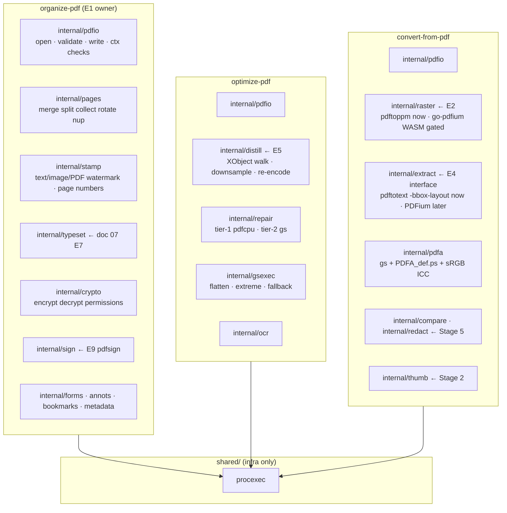

# 08 — PDF Engine Design

> Part of the Next-Generation Document Engine analysis (2026-11). Status: ANALYSIS — no code changed.

Sibling docs: `05-*` (document model), `06-*` (parsers; E4 page-model extractor interface), `07-layout-and-rendering-engine.md`
(E7 typesetting, fonts), `04-…` (LibreOffice strategy), `09-…`/`10-…` (office engines), `16-…` (fidelity harness), `20-…` (roadmap).
Binding decisions: E1 pdfcpu, E2 Poppler → go-pdfium WASM gated, E5 Go distiller, E9 pdfsign (the approved decisions in `EXECUTIVE-SUMMARY.md`).

## 1. Purpose and scope

Design the PDF subsystem as an *independent* capability built on pdfcpu (E1), module by module: what pdfcpu already does,
what it does not, which external tool stays for which gap, and how the code is laid out inside the owning workers under
CLAUDE.md §1 (no shared business logic; only infrastructure utilities in `shared/`). Covers object model, xref, page tree,
content streams, fonts, text extraction, graphics, images, transparency, metadata, annotations, bookmarks, forms, page
manipulation, compression (E5 in detail), encryption, signatures (E9), PDF/A, accessibility, repair, rendering (E2
bake-off), thumbnails, compare and redact (Stage 5). Out of scope: layout/typesetting (doc 07), office formats (docs 11/12).

## 2. Current state

Paths relative to `fyredocs_backend/`; pdfcpu facts from `$GOMODCACHE/github.com/pdfcpu/pdfcpu@v0.9.1` (the pinned version
in all four workers, audit §go.mod).

| Area | Fact | Citation |
|---|---|---|
| pdfcpu usage | Imported as `pkg/api` in convert-to-pdf, convert-from-pdf, optimize-pdf; organize-pdf also `pkg/pdfcpu`, `/model`, `/types` | audit §go.mod |
| organize-pdf ops | merge `MergeCreateFile`, split `SplitFile`/`ExtractPagesFile`, remove `RemovePagesFile`, collect/reorder `CollectFile`, rotate `RotateFile`, watermark text/image `AddWatermarksFile`, encrypt `EncryptFile` (AES-256/128, RC4-128), decrypt `DecryptFile`, page numbers (per-page loop), sign (image stamp only), edit (Helvetica text), metadata `AddPropertiesFile`, scan `ImportImagesFile` | audit §organize-pdf; `organize-pdf/processing/processing_edit.go:183-206,211-284,381-456,475-541,551-614` |
| Compress | Ghostscript `pdfwrite`; presets low→`/printer` 300 dpi, medium→`/ebook` 150, high→`/ebook` 72 dpi threshold 1.0 QFactor 0.76, extreme→`/screen` 36 dpi threshold 1.0 QFactor 2.4 + `-dColorConversionStrategy=/Gray -dProcessColorModel=/DeviceGray`; `-dCompatibilityLevel=1.4`, `-dDetectDuplicateImages=true`, `-dCompressFonts=true` | `optimize-pdf/processing/processing_free.go:106-162` |
| Repair / flatten | gs `/prepress` rewrite (`:183-210`); flatten = `-dPreserveAnnots=false -dPrinted` (`buildFlattenArgs :218-232`) | same file |
| OCR | `pdftoppm -png -r DPI` all pages up front (`:531`), tesseract per page in errgroup (`:579`), per-page failure → `api.ImportImagesFile` (`:588`), merge `api.MergeCreateFile` (`:609`) | same file |
| Raster / text | `pdfinfo` (`:126`), `pdftoppm` (`:181`), `pdftohtml -s -noframes` (`:503`), `pdftotext -layout` (`:520`) | `convert-from-pdf/processing/processing_free.go` |
| PDF/A | `gs -dPDFA=2 … -sPDFACompatibilityPolicy=1` with **no `PDFA_def.ps`, no ICC OutputIntent, no `-sColorConversionStrategy`, no `-dSAFER`**; `CombinedOutput` | `convert-from-pdf/processing/processing_free.go:212-221`; brief 01 finding 3 |
| Context | 10-min job ctx passed to `exec.CommandContext`; pdfcpu API has no ctx parameter (every `pkg/api` signature takes `*model.Configuration`, none takes `context.Context`) | audit §Worker; `pdfcpu@v0.9.1/pkg/api/*.go` |
| Config dir | `api.DisableConfigDir()` only in `organize-pdf/main.go:57` | brief 01 finding 4 |
| Process control | No Setpgid/Pdeathsig/WaitDelay/cmd.Cancel anywhere | audit §exec |
| Image decode | Pure-Go `organize-pdf/internal/imaging` with `DecodeConfig` guard and 50 MP cap | `internal/imaging/decode.go:17,48-60` (audit) |
| Fuzz | 10 fuzz targets across the workspace, incl. `organize-pdf/processing/fuzz_test.go` | audit §Measured numbers; `grep -rl 'func Fuzz'` |
| Test image | `deployment/test-binaries.Dockerfile:13-29`: poppler-utils, ghostscript, tesseract (+deu), libreoffice, unoserver — **no qpdf, no veraPDF** | re-read 2026-11-07 |

**pdfcpu v0.9.1 capability facts (read from source)**

| Capability | pdfcpu v0.9.1 | Citation |
|---|---|---|
| Read/validate/write | `ReadContext`, `ValidateContext`, `OptimizeContext`, `WriteContext`, `WriteIncrement`/`WriteIncr` (incremental update) | `pkg/api/api.go:70-221` |
| Validation modes | `ValidationStrict` (PDF 32000-1:2008) / `ValidationRelaxed` (default) | `pkg/pdfcpu/model/configuration.go:31-36,356` |
| xref/object streams | `Reader15: true`, `WriteObjectStream: true`, `WriteXRefStream: true`, `Optimize: true` defaults | `configuration.go:354-366` |
| PDF 2.0 | Reads; logs a disclaimer when `XRefTable.Version() == V20` before validation | `pkg/api/api.go:94-97` |
| Filters | ASCII85/Hex, RunLength, LZW, Flate, CCITTFax, DCT decode; **JBIG2 and JPX → `ErrUnsupportedFilter`** | `pkg/filter/filter.go:55-93` |
| Images | `ExtractImages`, `Images`, `UpdateImages`, `ImportImages`; DCT written as-is (`CreateDCTImageObject`), JPX extracted raw only | `pkg/api/extract.go:37-121`, `image.go:32-120`, `pkg/pdfcpu/model/image.go:149`, `writeImage.go:195-201,965` |
| Fonts for stamps | Core 14 + installed TrueType (`InstallFonts`, `ListFonts`); CIDFontType2/Identity-H, `CIDToGIDMap Identity`, subsetting, ToUnicode; **cmap only, no GSUB/GPOS** (doc 07 §2) | `pkg/api/font.go:38-64`, `pkg/pdfcpu/font/fontDict.go:158,809,850,893,596`, `pkg/font/install.go:62,654,1022` |
| Encryption | RC4 and AES (`AESV2`/`AESV3`), revision 6 (AES-256) via `crypto/aes`; permissions | `pkg/pdfcpu/crypto.go:133-166,250-251,432,680-681` |
| Forms | `FormFields`, `FillForm`, `MultiFillForm` (JSON/CSV), `Lock/Unlock/Reset/RemoveFormFields`, `ExportForm` — **no flatten API** (grep `Flatten` in `pkg/api`: none in v0.9.1 or v0.12.1) | `pkg/api/form.go:46-831` |
| Annotations / bookmarks / attachments | Add/remove/list annotations incl. incremental; bookmarks import/export JSON; attachments add/extract/remove | `pkg/api/annotation.go`, `bookmark.go`, `attach.go` |
| Page ops | Merge, split, collect, insert/remove pages, rotate, trim, nup/grid/booklet, resize, crop/boxes, poster/cut/ndown, zoom | `pkg/api/merge.go`, `split.go`, `nup.go`, `booklet.go`, `box.go`, `cut.go`, `resize.go`, `zoom.go` |
| Watermarks | text / image / **PDF** (`PDFWatermark`, `PDFMultiWatermarkForReadSeeker`), update/remove | `pkg/api/stamp.go:349-519` |
| Signatures | none in v0.9.1; v0.12.1 adds `ValidateSignatures`, `ImportCertificates` (pkcs7, validation only — no signing) | `pdfcpu@v0.12.1/pkg/api/sign.go:140`, `certificate.go:27` |
| Info | `PDFInfo`, `PageCount`, `PageDims`, `Properties`, `Keywords`, page layout/mode/viewer prefs | `pkg/api/info.go`, `page.go:194-242`, `property.go` |

Upstream today: pdfcpu **v0.16.4** (2026-10-27), Apache-2.0, requires Go ≥ 1.26 (we build Go 1.26.0, audit §Platform);
0.16.x notes are security/stability fixes (iterative object traversal, 1 GiB cumulative decode allowance, poster/tile
caps) with "no breaking Go API changes" (v0.16.2 notes). README: "supports PDF versions through PDF 2.0 (ISO 32000-2) …
PDF 2.0 validation support is basic and continuously improving"; features include signature validation/evidence/removal.
**Upgrading from v0.9.1 to v0.16.x is a Stage 1 prerequisite** for the security fixes alone; the API diff v0.9.1→v0.12.1
shows only named-return changes plus new signature/certificate/viewer-preference functions.

## 3. Requirements

- **Functional**: every tool in audit §Product surface keeps working; new capabilities (Unicode stamps, Go compress,
  pdfcpu-first repair, PAdES signing, compare, redact, thumbnails, page count at upload) are additive.
- **Performance**: no tool slower than today at p95 on the k6 ladder (`scripts/k6/results/capacity-jobs-20260727-234123.md`
  baseline: 9 jobs/min sustained); Go compress ≤ 50 % of gs wall time at `medium` (brief 01 gate); page count at upload
  ≤ 50 ms for a 100-page file (to be measured with `api.PageCountFile`).
- **Compatibility**: read PDF 1.0–2.0 (pdfcpu relaxed mode; 2.0 "basic"); write: preserve the input header version,
  raise to 1.5 only where object/xref streams are emitted (pdfcpu default config), 1.7 for newly created documents;
  never emit 2.0-only features. veraPDF-clean PDF/A-2b from the gs path.
- **Security**: no custom crypto (pdfcpu uses Go `crypto/aes`, `crypto/rc4`, `crypto/sha256`); untrusted PDFs are parsed
  with the upgraded pdfcpu's resource caps; every external binary under `shared/procexec`; `-dSAFER` on every gs call;
  per-job tmpfs budget (`TMPFS_BUDGET_MB` 900, audit §Worker) respected by page-at-a-time image work.

## 4. Options evaluated

| Option | Language | Licence | Maturity (version, last release, maintainer) | Fidelity/coverage | Integration | Effort (EM) | Verdict |
|---|---|---|---|---|---|---|---|
| **pdfcpu** | Go | Apache-2.0 | v0.16.4, 2026-10-27, hhrutter; 1,310 commits | Object model, xref/object streams, encryption AES-256 R6, forms fill, annots, bookmarks, attachments, nup/booklet, watermark text/image/PDF, optimize, validate (PDF 2.0 basic), signature validation (≥0.12) | in-process | 0 (upgrade 0.1) | **E1 — core** |
| Ghostscript `pdfwrite` | C | AGPL-3 (exec'd unmodified; keep notice) | shipped in optimize-pdf and convert-from-pdf images | Full re-distillation, PDF/A-1..3 level **b only**, flatten (`-dPreserveAnnots=false`), colour conversion, JPX/JBIG2 input | exec | 0 | **Retained** for flatten, PDF/A, `extreme`, tier-2 repair, distiller fallback |
| Poppler CLIs | C++ | GPL-2/3 (exec'd) | shipped (poppler-utils) | Render (Splash), `pdftotext -bbox-layout`, `pdfinfo`, `pdftohtml`, `pdfimages`, `pdfsig` | exec | 0 | **E2 today**; `pdfinfo` → pdfcpu (Q8) |
| **go-pdfium** (WASM via wazero) | Go + PDFium wasm | MIT; PDFium Apache-2.0; wazero Apache-2.0 | go-pdfium v1.21.4, 2026-10-21 (klippa-app); wazero v1.12.0, 2026-05-28 | Render to image at DPI, `GetPageTextStructured` (text + position + font), JPX/JBIG2 decode, forms rendering; README: WASM "about 2x slower than native CGO", memory not freed until instance close, 4 GB instance cap, bitmap ≤ 2 GB | in-process WASM, no cgo | 1 (bake-off + adapter) | **E2 candidate**, gated bake-off Stage 5 |
| go-fitz / MuPDF | C/Go | AGPL / commercial | — | — | cgo | — | Ruled out (AGPL + cgo; brief 01) |
| unipdf (unidoc) | Go | AGPL / commercial | — | JBIG2 etc. | in-process | — | Ruled out (AGPL) |
| **digitorus/pdfsign** | Go | BSD-2-Clause | v1.0.0 2026-10-06 (newer tag exists per pkg.go.dev); ML-DSA features need Go 1.27 | PAdES B-B and **B-T** (RFC 3161 TSA), certification + approval signatures, `DocumentTimestamp`, visible appearance (text via TrueType + images), verification with OCSP/CRL online; **no B-LT/B-LTA (no DSS embedding)** | in-process | 0.75 | **E9** |
| qpdf | C++ | Apache-2.0 | Alpine 3.19 community 11.6.3-r0 | `--check` structural check, content-preserving rewrite, QDF | exec (test image only) | 0.05 | Test oracle, not runtime |
| veraPDF | Java | GPLv3+ / MPLv2+ | `ghcr.io/verapdf/cli:latest`; Java 11–21 | PDF/A and PDF/UA conformance (`-f 2b`, `--format json`) | docker / test image | 0.05 | Test gate for PDF/A |
| gobig2 | Go | Apache-2.0 | v0.0.0-2026-05-13, pre-1.0, "API settling" | JBIG2 generic/refinement/halftone/MMR; embedded-stream + `/JBIG2Globals` API; T.88 TT2–TT8 corpus failures "shared with every open-source decoder" | in-process | 0.25 | Optional later for E5 decode of scanned JBIG2; not Stage 4 |
| Pure-Go JPX | Go | — | none found that is importable and pure Go (goopenjpeg = purego + native lib) | — | — | — | JPX stays pass-through in E5; render via gs/PDFium |
| hayro (Rust PDF renderer) | Rust | — | "experimental, work-in-progress" (brief 02) | — | — | — | Not on roadmap |

## 5. Recommendation

### 5.1 Ownership and package layout (CLAUDE.md §1)

Capability follows the tool that owns it; thin adapters are **intentionally duplicated** per worker (≤ 150 lines each:
open-with-ctx-checks, validate, write, page-dims) rather than shared, exactly like `pdfPageDimensions` is duplicated today
with a "duplicated by design" comment (`convert-from-pdf/processing/processing_free.go:122-125`). Only `shared/procexec`
(process groups, cancel, WaitDelay, stderr capture, size-scaled timeouts) is shared, as infrastructure.



### 5.2 Public API sketch (per worker, identical shape)

```go
// internal/pdfio — thin adapter; pdfcpu ignores ctx, so the adapter checks ctx between stages and never forks.
type OpenOptions struct {
    Password        string
    Relaxed         bool   // model.ValidationRelaxed (default true)
    MaxDecodeBytes  int64  // pdfcpu ≥0.16 cumulative allowance (default 1 GiB upstream; we set ≤ tmpfs budget)
}
func Open(ctx context.Context, path string, o OpenOptions) (*model.Context, error)       // read + validate, ctx checked before and after
func Write(ctx context.Context, pc *model.Context, path string, incremental bool) error     // WriteContextFile | WriteIncr
func ForEachPage(ctx context.Context, pc *model.Context, fn func(pageNr int, d types.Dict) error) error // ctx.Err() checked per page
func PageCount(ctx context.Context, path string) (int, error)                               // api.PageCountFile
func PageDims(ctx context.Context, path string) ([]types.Dim, error)                        // api.PageDimsFile (replaces pdfinfo)

// internal/distill (optimize-pdf)
type Preset string // "low" | "medium" | "high" | "extreme"
type Options struct {
    Preset         Preset
    TargetDPI      int     // 300 / 150 / 72 / 36 — same map as processing_free.go:113-135
    Threshold      float64 // 1.5 / 1.5 / 1.0 / 1.0 — downsample only if effective ppi > TargetDPI*Threshold
    JPEGQuality    int     // calibrated per preset by the harness (see §5.6)
    Grayscale      bool    // extreme only → gs
    MaxImagePixels int64   // decode bound (default 50 MP, like organize-pdf imaging)
}
type Result struct{ Original, Final int64; Images, Downsampled, Skipped, PassedThrough int; FellBackToGS bool; Reason string }
func Distill(ctx context.Context, in, out string, o Options) (Result, error)
```

Errors: typed sentinel errors (`ErrEncrypted`, `ErrUnsupportedFilter`, `ErrNeedsGS`, `ErrCancelled`) wrapped with `%w`;
the worker maps them to the existing error-code → friendly-message table (`worker.go:88-113`, audit §Worker). A
`NeedsGS` outcome is a normal, metered fallback (`distill_fallback_total{reason}`), not a job failure.

### 5.3 Module-by-module design

| Module | pdfcpu does | pdfcpu does not | Our design | Class | Stage | EM |
|---|---|---|---|---|---|---|
| Object parsing/writing | Full lexer/parser, indirect objects, streams, lazy object streams (≥0.16) | — | Use as-is; upgrade to 0.16.x; `DisableConfigDir()` in all mains (Q4) | D | 1 | 0.1 |
| xref tables/streams | Reads both, writes xref + object streams by default, incremental updates (`WriteIncr`) | — | Incremental writes for annotation/sign paths (keeps prior signatures valid) | D | 1 | — |
| Page tree | Inheritance of Resources/MediaBox/Rotate handled | — | `ForEachPage` adapter with ctx checks | D | 1 | — |
| Content streams | Parses for optimize (`OptimizeResourcesViaContentAnalysis`), extract (`ExtractContent`) | No general-purpose operator AST for editing | E5 needs only `Do` + `cm` tracking (§5.6); redaction uses raster (§5.12) | A | 4 | in E5 |
| Fonts | Core 14, TrueType/OTF user fonts, CIDFontType2 Identity-H subset, ToUnicode | Shaping (no GSUB/GPOS); Type1/CFF embedding for new text | All non-ASCII text via E7 PDF-watermark (doc 07); font extraction `ExtractFonts` for the harness | D + E7 | 2 | doc 07 |
| Text extraction (E2/E4) | `ExtractContent` raw operators only | Positioned Unicode text | Interim extractor `pdftotext -bbox-layout` (XHTML with word boxes) behind `internal/extract.Extractor` interface; PDFium `GetPageTextStructured` later; owner convert-from-pdf (doc 06 §E4) | D → B | 3 | in E4 |
| Vector graphics | Preserved verbatim on all ops | No rasteriser, no path editing | Render via E2 only | D | — | — |
| Images decode | DCT (image/jpeg), Flate/LZW/RunLength raw, CCITT (`ccittDecode`), extraction to PNG/JPEG/TIFF | JBIG2, JPX | Go decoders: `image/jpeg`, `x/image/ccitt` (decode), `x/image/webp`; JPX/JBIG2 **pass-through** in E5, rendered by gs/PDFium; gobig2 optional later | A | 4 | in E5 |
| Transparency | Preserved verbatim; SMask-bearing images extractable | No compositing | E5 downsamples SMask with the same factor or skips the image (§5.6); flatten stays gs | D | 4 | in E5 |
| Metadata / XMP | Info dict `Properties`, `Keywords`, `ExtractMetadata` (XMP stream) | XMP editing | Keep `AddPropertiesFile` (`processing_metadata.go:68`); XMP sync for PDF/A left to gs | D | — | — |
| Annotations | List/add/remove, incremental | Appearance-stream generation for arbitrary annots | Edit-text via E7 stamps (vector text); XFDF import from the web reader is a future E (pdfcpu `AddAnnotationsMap`) | D | 2 | 0.1 |
| Bookmarks | JSON import/export, add/remove | — | Expose "export outline" for the reader later (E) | D | — | — |
| Forms | Fill (JSON/CSV), lock/unlock/reset/remove, export | **Flatten** | Fill = new tool (E); flatten stays gs `-dPreserveAnnots=false` (`buildFlattenArgs :218`); NeedAppearances forms render nothing (known limit, `processing_free.go:238-241`) | D | 2+ | 0.3 |
| Page manipulation | merge/split/rotate/collect/nup/booklet/resize/crop | — | Already shipped; add nup/booklet tools as E | D | — | 0.2 |
| Compression (E5) | `Optimize` (dedupe fonts/resources, object streams) | Image downsampling/re-encode | §5.6 | B | 4 | 1.5 |
| Encryption | AES-128/256 (R5/R6), RC4, permissions, password change | — | As-is (`processing_edit.go:183-206`); password length check `:106`; never add custom crypto | D | — | — |
| Digital signatures (E9) | Validation (≥0.12) | Signing | §5.7 pdfsign | D | 5 | 0.75 |
| PDF/A | — | Conformance writer | §5.8 gs fix now (Q5); Go path scoped out | D | 1 | 0.15 |
| Accessibility (PDF/UA) | — | Tagging | §5.9 scope out; Typst-generated documents are tagged | — | — | — |
| Repair | Relaxed read + rewrite | Reconstruction of broken xref beyond relaxed mode | §5.10 tier-1 pdfcpu, tier-2 gs | D | 4 | 0.25 |
| Rendering (E2) | — | — | §5.11 bake-off | D | 5 | 1 |
| Thumbnails | — | — | §5.11 `pdftoppm -f 1 -l 1 -scale-to 320 -png` on `document.uploaded`, MinIO `thumbs/` (Q10) | D | 2 | 0.25 |
| Compare / redact | — | — | §5.12 | B | 5 | 1.0 |

### 5.4 Memory model

- pdfcpu holds the **whole object graph in memory** for one document; stream payloads are decoded on demand. The upgraded
  version adds a cumulative decode allowance (1 GiB default) — set it per job to `min(1 GiB, tmpfs budget − input size)`.
- **Page-at-a-time** for everything we add: E5 walks one page's XObjects, decodes one image at a time with a
  `DecodeConfig` pre-check and a pixel cap (reuse the 50 MP rule from `organize-pdf/internal/imaging/decode.go:48-60`),
  replaces the stream, and drops references before the next; OCR renders page N inside the errgroup instead of all pages
  up front (`processing_free.go:531`, Q7); thumbnails render one page.
- **tmpfs interplay**: the budget check `input × (1 + TMPFS_OUTPUT_FACTOR_PCT/100) ≤ TMPFS_BUDGET_MB` (`internal/worker/tmpfs.go`)
  stays the admission rule; E5 writes to a second file (no in-place rewrite), so factor 200 % remains correct; PDFium WASM
  instances hold memory until closed → pool with `MaxTotal = WORKER_CONCURRENCY` and recycle after N pages (to be tuned).
- No goroutine fan-out inside one pdfcpu context (pdfcpu's context is not safe for concurrent mutation); parallelism is
  per job, bounded by the existing semaphore (`worker.go:301,344,362`).

### 5.5 Error handling and cancellation

pdfcpu has no `context.Context`: **check `ctx.Err()` between stages (open → validate → per-page op → optimize → write)
and never fork the library** (brief 01). A cancelled job returns `ErrCancelled` after the current page; a 300-page
distill reacts within one page's work. External binaries react via procexec (kill(-pgid)). Panics inside pdfcpu are
recovered at the worker boundary already (`worker.go:369-384`) and terminated, not retried, since they are deterministic
for a given input — `isRecoverable` (`worker.go:858`) must classify `ErrUnsupportedFilter`/parse errors as permanent.

### 5.6 E5 distiller in detail (optimize-pdf, Stage 4)

Goal: match the Ghostscript presets used today (`processing_free.go:106-162`) for the common case (DCT/Flate RGB/Gray
images) in pure Go, fall back to gs for the rest. Ghostscript's own preset table (VectorDevices doc): `/screen` 72 dpi,
`/ebook` 150 dpi, `/printer` and `/prepress` 300 dpi colour/grey, mono 300/300/1200/1200, thresholds 1.5 everywhere;
our code overrides resolution and threshold explicitly, so the Go map below is what we match, not the preset names.

| Preset | Target dpi (colour/grey/mono) | Threshold | gs QFactor today | Go JPEG quality | Colour |
|---|---|---|---|---|---|
| low | 300 | 1.5 | preset default | q_low | keep |
| medium | 150 | 1.5 | preset default | q_med | keep |
| high | 72 | 1.0 | 0.76 | q_high | keep |
| extreme | 36 | 1.0 | 2.4 | — | **gs** (`/Gray` conversion; not reimplemented) |

`q_low/q_med/q_high` are **not asserted here**: they are calibrated by the harness so that, per preset, Go output size ≤
gs output size / 0.8 and SSIM ≥ 0.9 at `medium` on the image-heavy corpus (brief 01 gate). Starting points for the
calibration run: 85 / 75 / 60 (`image/jpeg` quality scale), recorded in `benchmarks/` with the corpus hash.

Algorithm (per page, per image XObject reachable from `/Resources/XObject`, including nested Form XObjects):
1. **Geometry**: walk the page content stream tracking the CTM for each `Do` (`cm` × `q/Q` stack; Form XObjects
   compose their `/Matrix`). Drawn width in inches = |CTM a,b| / 72. Effective ppi = `Width / drawn_in`. If the same
   XObject is drawn several times, use the **largest** drawn size (conservative). Images not referenced by any `Do` are
   left untouched (pdfcpu `Optimize` removes unreferenced ones).
2. **Eligibility** (otherwise pass-through, counted): filter chain ends in DCT or Flate/LZW/RunLength; `BitsPerComponent`
   8 (or 1 for mono); colour space DeviceRGB/DeviceGray/ICCBased N=1|3/Indexed→expanded; no `/Decode` array other than
   default; `/SMask` handled by applying the identical scale to the mask (else pass-through); DeviceCMYK, Separation,
   DeviceN, Lab, JPX, JBIG2, CCITT, `/ImageMask` with patterns → pass-through. If pass-through bytes exceed 50 % of image
   bytes on the file, **return `NeedsGS`** so the user still gets gs-level reduction.
3. **Decode** with a pixel cap; **downsample** with `x/image/draw` (`CatmullRom` for photos, `ApproxBiLinear` for speed —
   choose by harness), only if effective ppi > target × threshold; target pixel size = drawn_in × target dpi.
4. **Re-encode**: colour/grey → DCT (`image/jpeg`, quality from table; JPEG input with quality already below target is
   re-encoded only if downsampled); 1-bit mono → Flate 1-bit (CCITT G4 encoding has no Go encoder; `x/image/ccitt` is
   decode-only). Replace the stream dict via pdfcpu's stream APIs (`UpdateImages` shape, `pkg/api/image.go:58`), dropping
   `/DecodeParms`, updating `/Width /Height /Filter /ColorSpace`.
5. **Dedupe + structure**: SHA-256 of decoded samples → reuse one XObject for identical images (gs
   `-dDetectDuplicateImages=true` equivalent); `conf.Optimize = true`, `OptimizeDuplicateContentStreams`,
   `WriteObjectStream`/`WriteXRefStream` = true (defaults, `configuration.go:359-366`) to compact structure; fonts are
   already deduped by pdfcpu optimize.
6. **Guard**: if output ≥ input − 1 %, return the input unchanged with `compressionRatio 0` (today's metadata contract,
   `processing_free.go:85-99`) — "text-only never grows".
7. **Fallback to gs** when: open/validate fails (then tier-1 repair first, §5.10), `NeedsGS`, preset `extreme`,
   encrypted-with-owner-password-only inputs, or any error mid-walk. Metric `distill_fallback_total{reason}`; Stage 4
   acceptance: gs invocations on compress −≥ 70 % in production.

### 5.7 Digital signatures (E9, organize-pdf, Stage 5)

- Library: digitorus/pdfsign (BSD-2): **PAdES B-B / B-T**, RFC 3161 TSA (`Timestamp(tsaURL)`), certification or approval
  signatures, `DocumentTimestamp`, visible appearance with TrueType text and images (replaces today's image-only visual
  stamp, `processing_edit.go:475-541`, which is not a signature). **No B-LT/B-LTA**: the library states revocation data
  is "not embedded for offline long-term validation" — LTV is out of scope; document this in the UI copy.
- Certificate model (product decision, brief 01): (a) platform certificate (Fyredocs CA, self-signed → "unknown validity"
  in Acrobat unless users trust it), (b) per-user certificates issued by the platform, (c) user-uploaded PKCS#12 (key
  handling liability), (d) remote signer (pdfsign `signers/...` CSC/KMS/PKCS#11 — "best-effort" per README). The
  engineering design supports (a) first; keys live outside the image (secret mount), never in MinIO.
- Write path: pdfsign writes an incremental update so existing signatures remain valid; pdfcpu must not rewrite the file
  afterwards (ordering rule: sign is always the **last** op in a pipeline).
- Verification oracle: `pdfsig` (poppler-utils, already in images) and pdfcpu ≥0.12 `ValidateSignaturesFile`; Acrobat
  manual check in the release checklist.

### 5.8 PDF/A (convert-from-pdf, Stage 1 Q5)

Correct invocation (gs VectorDevices doc; replaces `processing_free.go:212-221`):

```
gs -dPDFA=2 -dBATCH -dNOPAUSE -dSAFER -dNOOUTERSAVE \
   -sDEVICE=pdfwrite -sColorConversionStrategy=RGB -sProcessColorModel=DeviceRGB \
   -dPDFACompatibilityPolicy=1 -dEmbedAllFonts=true \
   -sOutputFile=OUT /app/pdfa/PDFA_def.ps IN
```

with `/app/pdfa/PDFA_def.ps` copied from gs `lib/` and its `/ICCProfile` set to an absolute path of an sRGB profile
(`N=3`; gs ships `default_rgb.icc`; `sRGB2014.icc` from color.org is an alternative) and `/OutputConditionIdentifier (sRGB)`.
`-dPDFACompatibilityPolicy=1` drops non-conforming features with a warning (policy 0 would silently produce a
non-conformant file; 2 aborts). gs supports PDF/A-1..3 **level b only**; PDF/A-2u/2a and PDF/A-4 are not available from this
path. Gate: veraPDF `-f 2b --format json` `isCompliant=true` on the harness corpus (veraPDF runs from `ghcr.io/verapdf/cli`
in CI or the test-binaries image; GPL/MPL licence is fine for test tooling). A future Go conformance path would need:
XMP with `pdfaid` schema, OutputIntent with embedded ICC, all fonts embedded with CIDSet/Widths consistency, no
transparency (2b allows it), no JavaScript/encryption, colour-space rewrites — effectively a mini-distiller (≥ 2 EM,
not planned; Typst already produces PDF/A-2b/3b directly for documents it typesets, doc 07).

### 5.9 Accessibility (PDF/UA)

pdfcpu has no tagging support; Poppler/PDFium read tags only for extraction order. Typst emits Tagged PDF by default and
can target PDF/UA-1 for documents it generates (doc 07) — that covers templates/certificates. Retro-tagging existing PDFs
is **scoped out** (it is an AI/heuristic structure-recovery problem, 3+ EM, with no product request).

### 5.10 Repair

Tier 1 (pdfcpu, optimize-pdf `internal/repair`): `Open` with `ValidationRelaxed`, then `OptimizeContext` + full rewrite
(xref/object streams regenerated; dangling references dropped). Tier 2 (gs, today's path `:183-210`) only when tier 1
fails to open or validate, or when the rewritten file still fails `qpdf --check` in the harness. Expected to remove most
gs repair calls for the common "bad xref offset / truncated trailer" class — share to be measured on the harness's
`broken/` subset (brief 01 Q13 corpus includes broken files).

### 5.11 Rendering (E2) and thumbnails

Bake-off plan (convert-from-pdf `internal/raster`, Stage 5): interface `Renderer.RenderPage(ctx, doc, page, dpi) (image.Image, error)`
with two implementations — `popplerRenderer` (one `pdftoppm -f N -l N -r DPI` per page or batched, as today) and
`pdfiumWASM` (go-pdfium `webassembly` pool, `RenderPageInDPI`, `Cleanup()` per render). Gate (brief 01): at 150 DPI on the
harness corpus, WASM throughput ≥ 0.7× pdftoppm (pages/s, same host, 2 CPU limit as compose); identical page counts on
the fuzz corpus; a crash in one instance never affects another job (instance-per-job, pool recycle). Fail → keep Poppler;
**do not switch the builder to cgo**. Note README caveats: ~2× slower than native, memory retained until instance close.
If PDFium wins, `GetPageTextStructured` becomes the E4 extractor and JPX/JBIG2 rendering comes for free.

Thumbnails (Stage 2, Q10): a `pdf-thumbnail` internal tool in convert-from-pdf triggered by `document.uploaded`
(document-service subscriber, `subscriber.go:57-64`), `pdftoppm -f 1 -l 1 -scale-to 320 -png`, written to MinIO
`thumbs/<docId>.png`, `documents.thumbnail_path` populated (never populated today, audit §Databases).

### 5.12 Compare and redact (Stage 5, convert-from-pdf)

- **Compare**: (1) text diff on the E4 page model (words with boxes → paragraph strings → `diff` by line, with page/box
  anchors for highlighting); (2) render diff: both pages at 100 DPI via `Renderer`, per-page SSIM + XOR heat-map
  (`x/image/draw`), producing a report PDF via pdfcpu `ImportImages` + a JSON summary. Output = ZIP (report + JSON).
- **Redact (rasterise-region)**: for each redaction rectangle, render the page region at 300 DPI, paint the box black,
  and replace the **entire page** with the rendered image (`ImportImages` → `InsertPages`/`RemovePages`), then remove the
  page's text layer by construction; `pdftotext` must return nothing for the region. **Lossy trade-off, documented**: the
  whole page becomes raster (no text selection, larger size, OCR'able again by the user if wanted). True content-stream
  redaction (operator-level text removal, glyph-box geometry, inline images, annotations, XObject recursion, metadata
  leaks) is **deferred**: 2+ EM with liability if any leak remains (brief 01); revisit only with a product commitment.

### 5.13 Testing, benchmarks, compatibility target

| Layer | What | Tooling |
|---|---|---|
| Unit | adapters, distiller eligibility rules, CTM tracker, preset map, repair tiers | `go test` with the existing `TESTFLAGS -race -shuffle` |
| Fuzz | extend the 10 targets: `FuzzOpen` (pdfcpu open on mutated corpus), `FuzzDistill`, `FuzzStampSpec` (doc 07); seed corpus = harness `broken/` + fuzz findings; run in `scripts/ci/05-fuzz-short` | `make fuzz-short` |
| Differential | every op's output must (a) pass `pdfcpu validate` relaxed, (b) pass `qpdf --check` (add `qpdf` 11.6.3 to `test-binaries.Dockerfile`), (c) render identically (SSIM ≥ 0.99) via Poppler before/after for structure-only ops (merge/split/rotate/encrypt/stamp placement excluded), (d) PDF/A via veraPDF | test-binaries image, harness |
| Benchmarks (required before Stage 4/5 merges) | `BenchmarkDistill{low,medium,high}` vs gs on the image-heavy corpus (size, wall, SSIM); `BenchmarkRender150DPI` Poppler vs PDFium WASM; `BenchmarkPageCount` (pdfcpu vs pdfinfo); page-number single-pass vs loop; results committed under `benchmarks/` with host + corpus hash | `make bench` / `make bench-engine` |
| Compatibility corpus | ≥ 200 real files (brief 01 Q13): PDF 1.4–2.0, encrypted (R2–R6), xref streams, object streams, incremental updates, forms, JBIG2/JPX scans, CMYK, broken files | harness |
| Compatibility target | **Read** PDF 1.0–2.0 (2.0 features beyond pdfcpu's "basic" validation are preserved verbatim, not interpreted); **write** input version preserved, ≥1.5 when streams used, 1.7 for created docs; gs outputs stay `-dCompatibilityLevel=1.4` for compress/flatten as today | — |

## 6. Classification

See the Class column in §5.3. Summary: pdfcpu object engine **D**; distiller **B** (1.5 EM, Stage 4); signatures **D**
(pdfsign, 0.75 EM, Stage 5); PDF/A **D** (gs; 0.15 EM Stage 1 fix); rendering **D** (Poppler → PDFium gated, 1 EM Stage 5);
repair **D** (0.25 EM Stage 4); thumbnails **D** (0.25 EM Stage 2); compare/redact **B** (1.0 EM Stage 5); forms fill,
nup/booklet, bookmark export, XFDF import **E** (0.2–0.3 EM each, unscheduled); JBIG2 Go decode **E** (gobig2, later);
accessibility and content-stream redaction **scoped out**.

## 7. Acceptance criteria and gates

1. **Stage 1**: pdfcpu upgraded to ≥ v0.16.4 in all four workers with `DisableConfigDir()` in every main; all existing
   organize-pdf tests and the 16 real-binary exec tests pass; PDF/A output passes veraPDF 2b on the harness corpus
   (`isCompliant` for 100 % of files that gs converts without policy-1 elisions; elided-feature warnings logged);
   `pdfinfo` replaced by `api.PageDimsFile` with identical page sizes on the corpus.
2. **Stage 2**: thumbnails exist for 100 % of uploaded PDFs within 10 s (SSE-observed); page count present in every
   worker's result metadata; page numbers single-pass (doc 07 gate 3).
3. **Stage 4 (E5)**: on the image-heavy corpus, Go distiller achieves ≥ 80 % of gs's size reduction at the same preset,
   SSIM ≥ 0.9 at `medium`, ≤ 50 % of gs wall time, text-only files never grow; gs compress invocations −≥ 70 % in
   production after one release; tier-1 repair handles the harness `broken/` subset with a measured share.
4. **Stage 5**: PDFium gate (≥ 0.7× pdftoppm at 150 DPI, identical page counts on the fuzz corpus, no cross-job crash)
   or Poppler retained; signatures validate in Acrobat and `pdfsig` (B-T with TSA, visible appearance); compare and redact
   outputs validated in the harness (redacted region text = ∅ via `pdftotext`, SSIM of untouched areas ≥ 0.99).
5. **Always**: every new op passes `pdfcpu validate` + `qpdf --check`; no new AGPL/commercial dependency in the SBOM;
   zero orphan `gs`/`pdftoppm`/`typst` processes after 100 forced cancels.

## 8. Risks and open questions

| # | Risk / question | Mitigation |
|---|---|---|
| R1 | pdfcpu is effectively single-maintainer; 0.16.x shipped 8 security advisories at once | Upgrade promptly; fuzz corpus in CI; relaxed-mode parse failures fall back to gs paths that already exist |
| R2 | E5 CTM tracking misses images drawn inside patterns/Type3 glyphs → wrong effective ppi | Treat unknown contexts as "largest drawn size = page size" (never over-downsample); harness SSIM gate |
| R3 | JPX/JBIG2-heavy scans gain nothing from Go E5 | `NeedsGS` threshold routes them to gs; metric shows the share; gobig2 later if the share justifies it |
| R4 | PDFium WASM memory retention under 2-CPU/1 GB worker limits | Instance-per-job, pool recycle, 4 GB cap awareness; gate includes RSS |
| R5 | Signature trust: platform self-signed certificate shows "unknown validity" | Product decision on certificate model before Stage 5; UI copy states B-T, no LTV |
| R6 | Raster redaction misread as "secure" — residual risk from pass-through metadata/attachments/bookmarks | Redact tool also strips Info/XMP, attachments, bookmarks on the redacted output and says so in the result metadata |
| Q1 | Which pdfcpu version first exposed the decode allowance and lazy object streams, and do their defaults fit 1 GB workers? | Read release notes 0.13–0.16 at upgrade time; set per-job allowance explicitly |
| Q2 | Does pdfcpu's `UpdateImages` accept a replacement stream with different `/Width /Height` and filter in place, or do we build the stream dict ourselves? | Spike in Stage 4 week 1 |
| Q3 | Do we want forms fill / XFDF import as products? | Drives whether the E items in §6 get scheduled |

## Sources

Accessed 2026-11-07 unless noted.

- pdfcpu v0.9.1 and v0.12.1 module sources (`pkg/api`, `pkg/filter/filter.go`, `pkg/pdfcpu/crypto.go`, `pkg/pdfcpu/model/configuration.go`, `pkg/pdfcpu/font/fontDict.go`, `pkg/font/install.go`, `pkg/api/sign.go`) — `$GOMODCACHE/github.com/pdfcpu/pdfcpu@{v0.9.1,v0.12.1}` (local)
- pdfcpu repository README (Apache-2.0; "supports PDF versions through PDF 2.0 … validation support is basic"; signature validation) — https://github.com/pdfcpu/pdfcpu
- pdfcpu v0.16.4 release (2026-10-27; Go ≥ 1.26; 8 security fixes; decode allowance 1 GiB) — https://github.com/pdfcpu/pdfcpu/releases/latest ; v0.16.2 "no breaking Go API changes" — https://sourceforge.net/projects/pdfcpu.mirror/files/v0.16.2/ (mirror)
- Ghostscript VectorDevices (PDF/A switches, `PDFACompatibilityPolicy`, `PDFA_def.ps`, PDFSETTINGS table, font embedding) — https://ghostscript.readthedocs.io/en/latest/VectorDevices.html ; PDF/A OutputIntent profile pitfalls — https://bugs.ghostscript.com/show_bug.cgi?id=707450 , https://bugs.ghostscript.com/show_bug.cgi?id=693830
- digitorus/pdfsign (BSD-2; PAdES B-T, TSA, visible appearance, no B-LT/LTA, certification/approval) — https://github.com/digitorus/pdfsign ; v1.0.0 2026-10-06 — https://pkg.go.dev/github.com/digitorus/pdfsign
- go-pdfium (MIT; WASM via wazero, "about 2x slower than native CGO", memory/instance caps, `RenderPageInDPI`, `GetPageTextStructured`) — https://github.com/klippa-app/go-pdfium ; v1.21.4 2026-10-21 — https://pkg.go.dev/github.com/klippa-app/go-pdfium ; pdfium-cli WASM note — https://github.com/klippa-app/pdfium-cli
- wazero v1.12.0, 2026-05-28, Apache-2.0, no cgo — https://pkg.go.dev/github.com/tetratelabs/wazero
- qpdf (Apache-2.0; content-preserving transformations) — https://github.com/qpdf/qpdf ; Alpine 3.19 qpdf 11.6.3-r0 — https://pkgs.alpinelinux.org/packages?name=qpdf&branch=v3.19 ; CLI reference — https://qpdf.readthedocs.io/en/stable/cli.html
- veraPDF (GPLv3+/MPLv2+; Java 8–21; `ghcr.io/verapdf/cli`) — https://github.com/veraPDF/veraPDF-apps ; CLI flavours `-f 2b`, `--format json` — https://docs.verapdf.org/cli/validation/
- gobig2 (Apache-2.0; pre-1.0; JBIG2 embedded-stream API; TT2–TT8 caveat) — https://pkg.go.dev/github.com/dkrisman/gobig2
- JPX in Go: goopenjpeg is purego + native OpenJPEG, not pure Go — https://pkg.go.dev/github.com/godicom-dev/goopenjpeg
- `golang.org/x/image` (ccitt decode, draw scalers) — https://pkg.go.dev/golang.org/x/image
- Standards: ISO 32000-2:2020 (PDF 2.0), ISO 19005-2 (PDF/A-2), ETSI EN 319 142 (PAdES), ISO 14289-1 (PDF/UA-1), RFC 3161 (TSA)
- Repo measurements: `scripts/k6/results/capacity-jobs-20260727-234123.md` (9 jobs/min sustained); audit `01-existing-system-audit.md` (2026-11-07)
