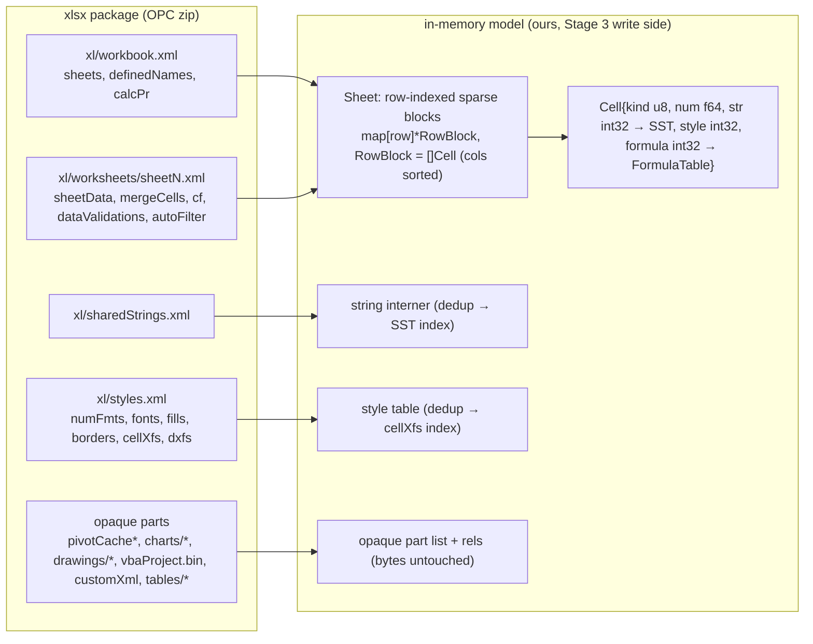
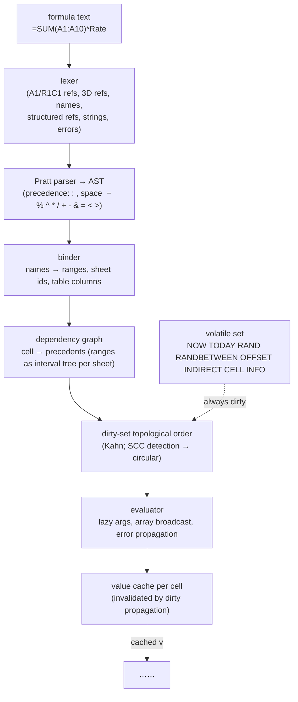

# 09 — Spreadsheet Engine Design

> Part of the Next-Generation Document Engine analysis (2026-11). Status: ANALYSIS — no code changed.

Sibling documents: `04-libreoffice-replacement-strategy.md` (why xlsx→pdf stays on LibreOffice),
`05-document-core-architecture.md` (page model that feeds the XLSX writer), `06-parsing-engine-design.md`
(OPC/zip parsing rules shared with DOCX/PPTX), `07-layout-and-rendering-engine.md` (why there is no Go
print-layout engine), `08-pdf-engine-design.md` (pdfcpu/Poppler extraction interface),
`10-presentation-engine-design.md` (same preservation strategy applied to PPTX).

## 1. Purpose and scope

Design the subsystem that owns everything "spreadsheet" in Fyredocs: reading and writing XLSX,
the in-memory cell model, shared strings, styles, formulas, named ranges, merged cells,
conditional formatting, data validation, charts, pivot tables, filters, sorting and workbook
metadata. It covers:

- Stage 3 (binding, `EXECUTIVE-SUMMARY.md` §Roadmap): the E4 page-model engine in
  `convert-from-pdf` writes XLSX through excelize, replacing `convert-from-pdf/scripts/pdf_to_xlsx.py`.
- A formula compatibility roadmap with per-tier gates, so a future formula engine is scoped
  before anyone writes it.
- What is explicitly **not** built: a Go print-layout engine for xlsx→pdf. That path stays on
  LibreOffice for the whole roadmap (binding decision; rationale in §5.6).

Out of scope: XLS (BIFF8), XLSB, ODS parsing (ODS output stays "XLSX then LibreOffice", see §2),
VBA execution, external links, RTD/DDE.

## 2. Current state

| Path | Implementation | Evidence |
|---|---|---|
| pdf→xlsx (`pdf-to-excel`, `pdf-to-xlsx`) | `exec python3 /app/scripts/pdf_to_xlsx.py IN OUT`; failure if output missing or empty | `convert-from-pdf/processing/processing_free.go:340-352`, dispatch `processing.go:60-64`, script path override `PDF_TO_XLSX_SCRIPT` `:330-335` |
| table extraction | pdfplumber `page.extract_tables()`; one sheet per table named `P{page}_T{n}`; every cell cast with `str(cell)` → **all cells are strings**, no number/date typing, no merged headers, no styles | `convert-from-pdf/scripts/pdf_to_xlsx.py:42-50` |
| text fallback | pages without a table → one row per text line in a `Page{n}` sheet; empty workbook gets `Sheet1` | `pdf_to_xlsx.py:51-60` |
| pdf→ods | builds the XLSX above, then `libreoffice --headless --convert-to ods` | `processing_free.go:368-376`, `:401-420` |
| xlsx→pdf (`excel-to-pdf`) | `unoconvert --convert-to pdf` on a pooled daemon with a fixed 30 s timeout, cold `libreoffice --headless` fallback | `convert-to-pdf/processing/processing_free.go:30-51`, `:59-81`; dispatch `processing.go:55-57` |
| xlsx→ods (`excel-to-ods`), ods→pdf | same daemon pool, `officeToOffice` | `convert-to-pdf/processing/processing_free.go:85-107`; `processing.go:67-69,76-78` |
| allowlists | `pdf-to-excel`/`pdf-to-xlsx`, `pdf-to-ods` | `convert-from-pdf/main.go:95,100`; `excel-to-pdf`, `excel-to-ods`, `ods-to-pdf` `convert-to-pdf/main.go:96,101-102` |
| image | `python:3.11-slim-bookworm` + `pdfplumber==0.11.4 openpyxl==3.1.5` (+ pdf2docx/PyMuPDF AGPL) | `convert-from-pdf/Dockerfile:28-40` |
| process control | `CommandContext` kills only `python3`; no Setpgid/WaitDelay anywhere | `01-existing-system-audit.md` §exec table, finding 2 in `EXECUTIVE-SUMMARY.md` |
| Go spreadsheet deps | none — `grep excelize|unioffice|gooxml` over every `go.mod` is empty (2026-11-07) | `01-existing-system-audit.md` §go.mod inventory |
| test fixtures | k6 `xlsx` fixture is a 50×5 inline-string sheet padded with an orphan part, not a real workbook | `scripts/k6/fixtures/gen.py:222-258`, `:177` |
| measured numbers | none for pdf→xlsx or xlsx→pdf specifically; only the mixed ladder (9 jobs/min sustained) in `scripts/k6/results/capacity-jobs-20260727-234123.md` | `01-existing-system-audit.md` §Measured numbers |

Consequences: the output of `pdf-to-excel` is a text grid. Numbers are strings (SUM over them is
0 in Excel), dates are strings, multi-line header cells are split or lost, and the Python runtime
exists in the image only for this script and pdf2docx. Nothing in the platform parses an uploaded
XLSX; `excel-to-pdf` is opaque to us (no page count, no sheet names, no formula awareness).

## 3. Requirements

Functional
- F1 pdf→xlsx: real tables from the page model (`05-document-core-architecture.md`), typed cells
  (number, date, boolean, text), merged header cells, one sheet per detected table, text fallback
  retained (do not remove features).
- F2 Formulas in source documents are preserved verbatim (`<f>` text and cached `<v>`), never
  evaluated by us in Stage 3.
- F3 Parse any XLSX we accept for upload at least to the level of: sheet list, dimensions, cell
  count, defined names, presence of charts/pivots/VBA/external links (for routing, limits and
  metadata; Q9 page-count analogue).
- F4 Round-trip: any part we do not understand is carried byte-identical (pivot caches, charts,
  `vbaProject.bin`, customXml, printerSettings, comments, threaded comments, slicers, tables).
- F5 Streaming write for large outputs (StreamWriter) and streaming read for large inputs
  (`Rows` iterator); never materialise a 1M-cell sheet as `[][]string`.

Performance (targets; measured by the benchmarks in §7 — nothing below is a measured value yet)
- P1 Open + stream 1,000,000 cells within the worker's 1 GiB container limit
  (`deployment/docker-compose.yml` convert-from-pdf limits, `01-existing-system-audit.md` §Deployment)
  leaving ≥ 400 MiB headroom for the rest of the job.
- P2 pdf→xlsx for the 200-PDF labelled set: wall time ≤ the pdfplumber script on the same page
  (to be measured by `make bench-engine`, Stage 1 harness Q13).
- P3 Future formula engine: recalc of 100k formulas in a chain-free workbook ≤ 1 s/100k on the
  target VPS class (12 vCPU, `01-existing-system-audit.md` §Measured numbers); to be measured.

Compatibility
- C1 Output opens without repair prompt in Excel 365, LibreOffice Calc (version in
  `fyredocs-base`, to be recorded with `libreoffice --version` in the test-binaries image) and
  Google Sheets import.
- C2 Formula values we ever compute must match LibreOffice Calc recalculation on the differential
  corpus (§5.4 gates). No Office-compatibility claim beyond a passed gate.

Security
- S1 Zip bombs, oversized shared-string tables, deep formula nesting, external-link and DDE
  payloads, XML entity expansion must be rejected before allocation (§5.8).
- S2 No execution of VBA, no following of external references, no network from the worker.

## 4. Options evaluated

| Option | Language | Licence | Maturity (verified 2026-11-07) | Fidelity / coverage | Integration | Effort (EM) | Verdict |
|---|---|---|---|---|---|---|---|
| excelize `github.com/xuri/excelize/v2` | Go | BSD-3-Clause (LICENSE at v2.11.1) | v2.11.1 released 02 Nov (year inferred 2026: Go ≥ 1.26.0 requirement, CVE-2026 ids); v2.11.0 06 Jul; v2.10.1 24 Feb; 21.1k stars; pushed 2026-11-02; requires Go 1.26.0 (`go.mod`) | read/write XLSX/XLSM/XLTX; StreamWriter; `Rows` streaming reader; 57 chart types (write/delete, no chart read API); AddPivotTable/GetPivotTables/DeletePivotTable (definition only); CalcCellValue with 454 functions listed in the calc.go doc comment (458 exported `formulaFuncs` methods, grep count) | in-process, CGO_ENABLED=0 compatible | 0 to adopt; ~1 EM to wrap for E4 writer | **Adopt** for writing (Stage 3) and structural reading |
| custom Go formula engine (parser/AST/dep-graph/incremental) | Go | ours | — | whatever the tiers in §5.4 gate | in-process | T0–T2 ≈ 3 EM, T3 +1.5, T4 +2 (estimates, §5.4) | **Defer**: Classification B/C, only after Stage 4 and only on a product need |
| umya-spreadsheet | Rust | MIT | 3.1.1 stable, 4.0.0-beta.1 2026-10-26; 492 stars; pushed 2026-11-01 | read/write xlsx; no formula evaluation claimed in crate description | would need a static binary or WASM; team writes no Rust (binding) | n/a | Not now: no measured benefit over excelize; Rust ownership rule |
| calamine | Rust | MIT | 0.38.0 2026-11-02; 2.46k stars; 17.5M downloads | **reader only** (xlsx/xls/xlsb/ods), no write, no eval | exec'd static binary at best | n/a | Not now: read-only; excelize `Rows` covers streaming read |
| formualizer | Rust | MIT OR Apache-2.0 | 0.13.0 2026-10-25; 211 stars; pushed 2026-10-25; README claims 320+ functions (self-claim, unverified) | formula engine with workbook mutation, Python/WASM targets | WASM via wazero would be the only cgo-free route | 0.5 EM to evaluate | Paired Rust alternative for the T2+ engine; re-evaluate when/if the Go engine is approved |
| LibreOffice Calc (headless, already installed) | C++ | MPL-2.0 | version in images to be recorded | full function set (help lists 11 categories, no count), recalculation, print layout | exec (daemon pool) | 0 | **Keep** as xlsx→pdf renderer and as the recalc reference oracle |
| pdfplumber + openpyxl (current) | Python | MIT / MIT | pinned 0.11.4 / 3.1.5 | tables as strings only | exec | 0 | Replace in Stage 3 (removes Python from the image together with pdf2docx) |
| unioffice | Go | commercial EULA, licence key required (README) | pushed 2026-09-21 | docx/xlsx/pptx | in-process | licence cost | Rejected: commercial; `baliance/gooxml` (the AGPL predecessor) now redirects to unioffice on GitHub |

## 5. Recommendation

### 5.1 Decision

1. **Stage 3**: `convert-from-pdf/internal/sheetwriter` (package inside the owning worker, per
   CLAUDE.md §1 — nothing spreadsheet-specific goes into `shared/`) takes `pagemodel.Document`
   (`05-document-core-architecture.md`) and writes XLSX with excelize. `convert-from-pdf/scripts/pdf_to_xlsx.py`,
   pdfplumber and openpyxl leave the image. `pdf-to-ods` keeps its "XLSX then LibreOffice" shape
   until the ODS writer in `04-libreoffice-replacement-strategy.md` item 3 lands.
2. **Stage 3**: `convert-to-pdf/internal/sheetinspect` (separate copy, duplicated by design) opens
   uploaded XLSX with excelize in read-only mode for metadata, limits and routing. LibreOffice
   still renders.
3. **Formulas**: preserved as strings. No evaluation in Stage 3 or 4.
4. **Go formula engine**: Classification B (T0–T2) escalating to C (T3–T4). Enters the roadmap
   only after Stage 4 and only if a product need appears (in-browser xlsx editing, server-side
   recalculation, "fill template and compute"). Until then excelize `CalcCellValue` is available
   for ad-hoc needs but is not on any job path.
5. **xlsx→pdf** stays LibreOffice (E3) for the whole roadmap. No Go print-layout engine.

### 5.2 Storage model



Choices, with the failure mode each avoids:

- **Row-indexed sparse blocks** (map of row → sorted slice of cells) rather than `map[(r,c)]Cell`:
  spreadsheets are row-dense/column-sparse; per-key map overhead for a million entries dominates
  memory and defeats the row-ordered write that `StreamWriter.SetRow` requires (rows must be set
  in ascending order; xuri.me/excelize stream docs). Dense `[][]Cell` is rejected: a stray cell
  at `XFD1048576` would allocate the full 17-billion-cell grid.
- **Cell is a fixed 24-byte value**: kind (1 B) + padding, `float64` payload, two `int32`
  indices into interned tables. Strings and formulas live once in interners. Derivation, not a
  measurement: 1,000,000 cells × 24 B = 24 MiB for the grid plus interned strings; excelize's
  own XML-mapped structs are larger per cell (to be measured, §7 B1).
- **Shared strings**: interner with a count cap (§5.8). Inline strings are used by StreamWriter
  only when the interner cap is hit.
- **Styles**: dedup table keyed by the canonical style tuple; `cellXfs` index assigned at write.
- **Lazy sheet loading** (read side): excelize already extracts worksheet XML larger than
  `UnzipXMLSizeLimit` (default 16 MB) to temp files and streams it through `Rows`; we never call
  `GetRows` on an untrusted sheet. Sheets are opened on demand by name, not all at open.
- **Opaque parts**: on the read/modify path every part not in the known-list is copied verbatim
  with its `.rels` and content-type entries (see `06-parsing-engine-design.md` for the OPC walker shared
  in shape, duplicated per worker in code).

### 5.3 Formula engine architecture (deferred; design so the roadmap is scoped)



Design rules (each one is a known failure mode in the excelize evaluator we would be replacing):

- **Parser → AST once, evaluate many**: excelize re-parses and re-walks ranges per
  `CalcCellValue` call; open issues #2223 ("Formula calc performance issue", SUMIFS over `$C:$C`)
  and #2139 (VLOOKUP over `$I:$J` > 1 s per cell on 2.9.1) are symptoms, and #2144 ("Add
  calculation cache to improve CalcCellValue performance") is open. Our graph stores ASTs and
  caches values.
- **Full-column references are clipped to the sheet's used range** at bind time, so `$C:$C` on a
  5,000-row sheet is a 5,000-cell interval, not 1,048,576.
- **Incremental recalculation**: a cell write marks dependents dirty through the reverse graph;
  only the dirty set is re-ordered and evaluated. Full recalc is the dirty set = all formulas.
- **Lazy evaluation**: `IF`, `IFS`, `CHOOSE`, `IFERROR`, `AND`/`OR` short-circuit evaluate
  arguments on demand so an unreachable branch cannot raise or cost.
- **Volatile functions** form a permanent dirty root; `INDIRECT`/`OFFSET` produce dynamic
  precedents recorded after each evaluation.
- **Circular references**: SCC in the dirty graph → `#CIRC!` internally, surfaced as Excel does
  (0 with a flag) unless `calcPr iterate="1"`, then bounded by `iterateCount`/`iterateDelta`
  (default 100 / 0.001) and the hard cap in §5.8.
- **Array / dynamic arrays**: values are `Value` = scalar | array(rows, cols) | error | blank;
  broadcasting follows Excel rules; spill writes `<f t="array" ref="…">` + `cm` metadata; `@`
  implicit intersection is applied where the workbook is pre-dynamic-array (`calcPr` /
  `xr:revision` heuristics as LibreOffice does).
- **Error values** are first-class: `#DIV/0! #N/A #NAME? #NULL! #NUM! #REF! #VALUE! #SPILL!
  #CALC!`; errors propagate unless caught.
- **Numbers**: IEEE 754 doubles with Excel's 15-significant-digit display rounding and the
  1900 leap-year bug honoured for date serials (reference: LibreOffice `tools::Date` behaviour on
  the differential corpus, not our own opinion).

### 5.4 Formula compatibility roadmap

Coverage by tier. "excelize" = present as an exported `formulaFuncs` method in calc.go at
v2.11.1 (grep on 2026-11-07, see Sources). "Custom" = must be written in the Go engine.

| Tier | Scope | excelize today | Custom need | Gate (differential test vs LibreOffice Calc) |
|---|---|---|---|---|
| T0 | arithmetic, comparison, `&`, `%`, unary minus, A1/R1C1/3D refs, ranges, union/intersection, named ranges, structured table refs, error literals | yes (except table formulas per docs; implicit intersection added v2.11.0) | parser, binder, graph (new) | 500 generated formulas × 50 random workbooks: 100 % exact match on numbers (after 15-digit rounding), strings, errors |
| T1 | core ~100 fns: SUM/AVERAGE/MIN/MAX/COUNT*/SUMIF(S)/COUNTIF(S)/MINIFS/MAXIFS; ROUND*/MOD/POWER/ABS/INT/TRUNC/SQRT/EXP/LN/LOG; IF/IFS/AND/OR/NOT/IFERROR/IFNA/CHOOSE; LEFT/RIGHT/MID/LEN/FIND/SEARCH/SUBSTITUTE/TRIM/UPPER/LOWER/PROPER/TEXT/VALUE/CONCAT/TEXTJOIN; DATE/TIME/TODAY/NOW/YEAR/MONTH/DAY/EOMONTH/EDATE/DATEDIF/NETWORKDAYS/WORKDAY/WEEKDAY | yes for every name checked (grep list in Sources) | port semantics, not names: criteria wildcards, date serials, locale `TEXT` codes | 100-workbook real corpus (k6 fixtures are not enough — they are synthetic) + 2,000 formula cases; tolerance: numbers \|a−b\| ≤ 1e-9·max(1,\|b\|); dates exact serial; text exact; errors exact kind |
| T2 | lookup/reference: VLOOKUP/HLOOKUP/XLOOKUP/INDEX/MATCH/XMATCH/OFFSET/INDIRECT/ROW(S)/COLUMN(S)/ADDRESS/HYPERLINK/CHOOSE/TRANSPOSE/SORT/SORTBY/UNIQUE/FILTER | VLOOKUP/HLOOKUP/XLOOKUP/INDEX/MATCH/INDIRECT/TRANSPOSE/SORTBY/UNIQUE yes; **XMATCH, OFFSET, SORT, FILTER absent** | full T2 incl. dynamic precedents for OFFSET/INDIRECT | corpus of 50 real lookup-heavy workbooks (finance/ops exports); 100 % match of non-volatile cells; bounded `$C:$C` performance ≤ 10 ms per cell on 100k rows (to be measured, B2) |
| T3 | statistical (STDEV*, VAR*, MEDIAN, PERCENTILE*, QUARTILE*, RANK*, FORECAST*, CORREL, NORM.*) and financial (PMT/PV/FV/NPER/RATE/NPV/IRR/XIRR/XNPV/SLN/DB/DDB/…) | present for every name checked | numerical methods must match LibreOffice to tolerance (IRR/RATE iterate) | tolerance 1e-7 relative; IRR/RATE/XIRR within 1e-6 of LibreOffice on 200 cash-flow cases |
| T4 | dynamic arrays + LAMBDA family: SEQUENCE, RANDARRAY, LET, LAMBDA, MAP/REDUCE/SCAN/BYROW/BYCOL/MAKEARRAY, VSTACK/HSTACK/TEXTSPLIT/TOCOL/TOROW, spill semantics, `#SPILL!` | **absent** (SEQUENCE, LET, LAMBDA, BYROW, VSTACK, TEXTSPLIT not in calc.go); docs list "array formula" as unsupported | full implementation; LibreOffice 24.8+ has LET/XLOOKUP-era functions, LAMBDA support must be checked per version before it can be the oracle | 300 hand-written cases + 30 real workbooks; where LibreOffice lacks a function, Excel-published examples are the oracle and the case is marked "vendor reference" |
| Never | VBA/macros, external workbook links (`[Book.xlsx]Sheet!A1`), RTD, DDE, `WEBSERVICE`, `CUBE*`, Python-in-Excel | excelize does not execute these either | — | rejected at parse time with `#NAME?` and a job warning; links stripped only on explicit option |

Effort estimates (engineer-months, this team, Go; not measured, derived from scope): T0 + graph +
evaluator core 1.5; T1 1.0; T2 0.5 (lookups are mostly graph work) → **B: ≈ 3 EM**; T3 1.5 (C:
numerical fidelity); T4 2.0 (C: spill engine and LAMBDA closures). Total ≈ 6.5 EM for parity
with LibreOffice on the gates above. Compared with excelize's 454 functions obtained for free,
the engine is justified only by the three things excelize does not give: cached incremental recalc,
dependency graph (what-if, cell-change propagation for an editor) and T4.

Differential test mechanics (one harness, every tier): workbook → `libreoffice --headless
--convert-to xlsx` (forces a full recalculation into cached values) → read both files with
excelize `RawCellValue: true` → compare per cell; report mismatches by function name extracted
from the AST. The corpus lives under `docs/developer/architecture/next-generation-document-engine/
benchmarks/corpus/` (exists; populate with real workbooks under a licence we can store), not in
`scripts/k6/fixtures` which are synthetic.

### 5.5 Stage 3 pdf→xlsx: table reconstruction from the page model

Input: `pagemodel.Page{Words[]{Text, BBox, Font, Size}, Rules[]{Line segments}, Images[],
Blocks[]}` from the E4 extractor (`pdftotext -bbox-layout` + `pdfimages -list` now; PDFium later,
`08-pdf-engine-design.md`). Output: `[]Table{Cells [][]Cell, MergedRanges, Header rows}` and a
fallback text block per page.

Algorithm (ruled and unruled tables, in order):

1. **Ruled grid**: cluster horizontal/vertical rule segments (snap tolerance 1.5 pt); grid
   intersections define cell boxes. A cell box with no rule on one side that spans ≥ 2 grid
   columns/rows becomes a merged range. This is pdfplumber's `lines` strategy, reimplemented.
2. **Unruled grid**: project word boxes onto the x-axis; gaps wider than `max(2 × median inter-word
   gap, 6 pt)` across ≥ 60 % of candidate rows define column boundaries; rows from y-clustering of
   baselines (tolerance 0.5 × median font size). Minimum table: 2 columns × 3 rows, ≥ 70 % of
   cells non-empty. This replaces pdfplumber's `text` strategy.
3. **Cell text**: words inside a cell box concatenated in reading order; line breaks preserved
   as `\n` when the cell has ≥ 2 baselines (so wrapped headers stay one cell — the current script
   splits them because `extract_tables` emits them as separate rows or loses them).
4. **Merged header detection**: top rows where (a) a cell's text box spans ≥ 2 column
   boundaries, or (b) a ruled box spans them, become merged ranges; rows above the first row whose
   cells are ≥ 50 % numeric are header rows and get a bold style and `autoFilter` on the header
   row of the sheet.
5. **Type inference per cell** (string stays the default; never guess silently when ambiguous):
   - number: `^[-+(]?\d{1,3}([,\s]\d{3})*(\.\d+)?%?\)?$` or plain decimal; parentheses →
     negative; `%` → number /100 with `0.00%` numFmt; currency symbols (`₹ $ € £`) stripped and
     remembered as numFmt `[$₹-4009]#,##0.00`.
   - date: ISO `YYYY-MM-DD`, `DD/MM/YYYY` and `DD-MM-YYYY` (India default; `MM/DD` only when
     day > 12 disambiguates, otherwise string + job warning), `DD Mon YYYY`, `Mon DD, YYYY` →
     Excel serial with `yyyy-mm-dd` numFmt. Devanagari digits (U+0966–096F) normalised to ASCII
     before matching.
   - boolean: `TRUE/FALSE/YES/NO` case-insensitive only when the whole column is boolean.
   - column vote: a column where ≥ 80 % of body cells parse as the same type coerces the rest
     where they parse, else leaves them text; no mixed-type column is silently coerced.
6. **Numeric columns right-aligned, header row frozen** (`SetPanes`), column widths from max text
   length capped at 60 characters.
7. **Fallback** unchanged in spirit: a page with no table yields a `Page{n}` sheet with one line per
   row (feature kept), but typed per rule 5.

Sheet naming keeps `P{page}_T{n}` (31-char limit, uniqueness) so existing users see the same
layout.

### 5.6 Why xlsx→pdf is not ported to Go

Rendering a workbook to pages needs: page-break computation from row heights (which depend on
wrapped-text layout, which depends on font metrics — no Devanagari-capable shaper/renderer in
pure Go is proven, see `07-layout-and-rendering-engine.md`), print areas and titles, fit-to-page
scaling, headers/footers with field codes, conditional-format evaluation (needs the formula
engine from §5.3 at T2 minimum), chart rendering (57 chart types in OOXML, none renderable
without a charting engine), sparklines, images/drawings, and number-format rendering for every
locale. The brief's ranking (`EXECUTIVE-SUMMARY.md` §LibreOffice verdict, item 6)
puts this at V4 F1 8+ EM. LibreOffice capacity is the horizontal-scaling problem solved by the
isolated `office-render` pool (Stage 6), not an engine problem.

### 5.7 Public API sketch (Go, inside the owning worker)

```go
// convert-from-pdf/internal/sheetwriter — write side (Stage 3)
type Writer struct{ /* excelize.File, interners, limits */ }
func New(limits Limits) *Writer
func (w *Writer) AddTableSheet(name string, t pagemodel.Table) error  // typed cells, merges, header
func (w *Writer) AddTextSheet(name string, lines []string) error
func (w *Writer) Save(ctx context.Context, path string) error       // StreamWriter per sheet, Flush

// convert-to-pdf/internal/sheetinspect — read side (Stage 3), duplicated by design (§1)
type Summary struct {
    Sheets        []SheetInfo // name, dims, cell count (from <dimension> + Rows scan)
    DefinedNames  int
    HasVBA, HasExternalLinks, HasPivot, HasCharts bool
    SharedStrings int
}
func Inspect(ctx context.Context, path string, limits Limits) (Summary, error) // OpenFile(UnzipSizeLimit, UnzipXMLSizeLimit), Rows iterator only

// future engine (deferred, placed after Stage 4): package formula inside the worker that needs it
type Engine interface {
    Load(wb *Workbook) error
    Set(ref CellRef, v Value) error        // marks dependents dirty
    Recalc(ctx context.Context) (Report, error) // dirty set only; Report lists circulars, unsupported fns
    Get(ref CellRef) Value
}
```

### 5.8 Security limits (proposed defaults; env-overridable per worker)

| Limit | Default | Enforced where | Why |
|---|---|---|---|
| `XLSX_MAX_UNZIP_BYTES` | 1 GiB (excelize default is 16 GB) | `excelize.OpenFile(Options{UnzipSizeLimit})` | zip bomb: 1 GiB fits the 1 GiB container only because sheets > 16 MB go to temp files; tmpfs is 1 GiB (`01-existing-system-audit.md` §Deployment) so pair with `TmpDir` on the job scratch dir and the tmpfs budget |
| `XLSX_MAX_XML_PART_BYTES` | 16 MiB in memory (excelize default) | `UnzipXMLSizeLimit` | larger parts stream from disk |
| `XLSX_MAX_CELLS` | 5,000,000 total; 1,048,576 × 16,384 per sheet (OOXML max) | `Rows` scan aborts | memory and time bound; counted before any model allocation |
| `XLSX_MAX_SHARED_STRINGS` | 2,000,000 entries, 256 MiB total | interner / `sharedStrings.xml` size check | SST is loaded eagerly by most libraries |
| `XLSX_MAX_FORMULA_LEN` | 8,192 chars (Excel's own limit) | parser | deep/huge formulas |
| `XLSX_MAX_FORMULA_DEPTH` | 64 nested calls, 256 AST depth | parser | stack exhaustion (excelize v2.11.1 fixed a stack overflow on circular ANCHORARRAY) |
| `XLSX_MAX_ITERATIONS` | 100 (Excel default) even if `calcPr` asks more | engine | runaway iterative calc |
| zip entries | ≤ 10,000 parts; path traversal (`..`, absolute) rejected | OPC walker (`06-parsing-engine-design.md`) | OPC spec and `archive/zip` safety |
| XML | Go `encoding/xml` has no DTD/entity expansion; still cap element depth 512 and attribute count | parser | billion-laughs variants |
| external links / DDE / RTD | detected (`externalLinks/`, `=…!`, `DDE(`) and reported; never followed | inspect | S2 |
| VBA | `vbaProject.bin` carried opaque, flagged in metadata, never executed | preserve | S2 |

### 5.9 Round-trip preservation of unsupported parts

Applies to any future modify path (not Stage 3 writes, which are fresh workbooks):

- The OPC walker (`06-parsing-engine-design.md`) loads `[Content_Types].xml` and every `.rels`; parts we
  model (workbook, sheets, sharedStrings, styles) are parsed; **every other part is kept as
  bytes** — pivot caches/definitions, charts and chart user shapes, drawings, `vbaProject.bin`,
  `customXml/`, `printerSettings/`, comments/threadedComments/persons, slicers/slicerCaches,
  tables, queryTables, connections, externalLinks, metadata.xml, calcChain (dropped if we touch
  formulas, Excel rebuilds it).
- Relationship ids are never renumbered; new parts get ids above the current max per source part.
- Content-type defaults/overrides are retained verbatim; new entries appended.
- Regression test: modify one cell in sheet 1 of each corpus workbook → every part except
  `xl/worksheets/sheet1.xml`, `sharedStrings.xml`, `calcChain.xml` is byte-identical to the input
  (`sha256` per entry). excelize re-serialises parsed parts, so this test must run against our
  walker, not against a plain `excelize.OpenFile`/`SaveAs` — excelize's `SaveAs` is permitted only
  for fresh files in Stage 3.

## 6. Classification

| Capability | Class | Implementation | Stage | EM |
|---|---|---|---|---|
| XLSX write (fresh workbooks) | A (excelize) | `sheetwriter` | 3 | 0.5 |
| Table reconstruction + type inference (§5.5) | B (part of E4) | `convert-from-pdf/internal/pagemodel` reconstructor | 3 | 1.0 (within E4's 4–5) |
| XLSX structural read / inspect | A (excelize `Rows`) | `sheetinspect` | 3 | 0.25 |
| Shared strings, styles, merged cells, filters, freeze panes, column widths | A (excelize) | writer | 3 | in above |
| Named ranges, data validation, conditional formatting (write) | A (excelize `SetDefinedName`, `AddDataValidation`, `SetConditionalFormat`) | writer, only when E4 has a source for them (none in pdf→xlsx; needed by templates later) | 5+ | 0.25 |
| Charts | D (LibreOffice renders) / A (excelize writes 57 types, no read) | preserve opaque; create only from templates | 5+ | — |
| Pivot tables | D preserve, do not compute | opaque parts; `GetPivotTables` for metadata | 3 (preserve) | — |
| Row/column insert/delete, sort | A (excelize adjusts refs) today; B when the engine owns the graph | deferred | after 4 | — |
| Formula parse/preserve | A (string passthrough) | writer/inspect | 3 | 0 |
| Formula engine T0–T2 | B | `formula` package in the worker that needs it | after 4, product-gated | ≈ 3 |
| Formula engine T3–T4 | C | same | after 4, product-gated | ≈ 3.5 |
| xlsx→pdf, xlsx→ods, ods→pdf | D (LibreOffice, E3) | `convert-to-pdf` daemon pool + Stage 6 office-render | all | 0 |
| VBA, external links, RTD | E (never executed; opaque) | — | — | — |

## 7. Acceptance criteria and gates

Stage 3 (pdf→xlsx via E4 + excelize)
- G1 Labelled 200-PDF set (Stage 3 acceptance in `EXECUTIVE-SUMMARY.md`): table cell
  F1 ≥ pdfplumber's on the same files (harness computes both; pdfplumber runs in the
  test-binaries image only).
- G2 Typed cells: on the 50 tables with ground-truth types, ≥ 95 % of numeric/date cells typed
  correctly, 0 wrong coercions of text to number (precision over recall).
- G3 Every output opens in LibreOffice Calc headless (`--convert-to pdf` succeeds) and passes an
  OOXML schema check (`xmllint --schema sml.xsd` on sheet parts in the test-binaries image).
- G4 No Python, pdfplumber, openpyxl, pdf2docx in the convert-from-pdf SBOM; image ≤ 150 MB
  (shared Stage 3 criterion).
- G5 `pdf-to-ods` output unchanged in behaviour (still XLSX→LibreOffice) and passes
  `odfvalidator`.

Benchmarks (files under `benchmarks/`, run by `make bench-engine`; all values "to be measured")
- B1 open + stream 1,000,000 cells (generated 100,000 × 10 numeric sheet, and a 1M-cell string
  sheet): `go test -bench BenchmarkOpenStream1M -benchmem ./convert-to-pdf/internal/sheetinspect/`
  → report allocs and peak RSS via `/usr/bin/time -v`; target P1 (≤ 600 MiB peak).
- B2 write 1,000,000 cells via StreamWriter: `BenchmarkWrite1M`; target: completes within the
  10-min job context with ≥ 5× margin (≤ 120 s) on the 2-CPU worker limit.
- B3 (engine, if approved) recalc 100k formulas (chain of SUMs over 10-cell ranges, 20 % lookups):
  `BenchmarkRecalc100k`; target P3; plus the §5.4 differential suite as a test, not a benchmark.
- B4 pdf→xlsx wall time per page vs the pdfplumber script on the 200-PDF set (harness Q13).

Fuzz: `FuzzInspect` (mutated XLSX zips from the corpus, go-fuzz corpus seeded with the k6 fixtures
and `gen.py` orphan-part variants) — no panic, no allocation above limits, run in CI
`scripts/ci/05-fuzz-short`-style for 60 s.

Formula engine gates: per tier in §5.4; a tier is "supported" only when its differential suite
passes at 100 % (T0–T2) or within tolerance (T3–T4) and the result is recorded in `benchmarks/`.

## 8. Risks and open questions

- R1 excelize requires Go 1.26.0 (v2.11.1 `go.mod`); the workspace is on Go 1.26.0 — fine today,
  but future excelize minor releases may track newer Go faster than our builder image.
- R2 excelize issue velocity: three performance issues (#2223, #2139, #2144) are open; their
  evaluator is not on our job path, so no exposure until the engine question returns.
- R3 Formula-oracle gap: LibreOffice's coverage of T4 (LAMBDA, spill) differs by version;
  record the Calc version in every differential run.
- R4 Type inference on Indian number formats (lakh/crore grouping `12,34,567`) — regex in §5.5
  handles 3-digit groups only; extend the grouping rule to `\d{1,2}(,\d{2})*,\d{3}` and add corpus
  cases before claiming support.
- R5 Round-trip via excelize is not byte-preserving (it re-serialises everything it parsed);
  the walker in §5.9 must own preservation. Until it exists, no "edit existing xlsx" feature.
- R6 Open question for product: is there any demand for server-side recalculation or xlsx editing?
  Without it the engine (≈ 6.5 EM) should not be scheduled.
- R7 Open question: `XLSX_MAX_UNZIP_BYTES` interacts with the tmpfs budget
  (`internal/worker/tmpfs.go`, 900 MB); the inspect step must count against it.

## Sources

Accessed 2026-11-07 unless noted.

- excelize LICENSE (BSD-3-Clause) and `go.mod` (go 1.26.0) at tag v2.11.1:
  https://raw.githubusercontent.com/qax-os/excelize/v2.11.1/LICENSE ,
  https://raw.githubusercontent.com/qax-os/excelize/v2.11.1/go.mod
- excelize releases: https://github.com/qax-os/excelize/releases (v2.11.1 02 Nov; v2.11.0 06 Jul;
  v2.10.1 24 Feb "CalcCellValue function now supports two formula functions: SORTBY and UNIQUE";
  year not shown on page, inferred 2026 from CVE-2026 ids and Go 1.26 requirement)
- excelize v2.11.1 notes: https://github.com/qax-os/excelize/releases/tag/v2.11.1 (Go 1.26.0
  required; CalcCellValue stack overflow on circular ANCHORARRAY fixed; AddChart corruption fix;
  GetPivotTables panic fix)
- Function count: `calc.go` at v2.11.1, 19,693 lines; 454 names in the `CalcCellValue` doc
  comment and 458 exported `formulaFuncs` methods (`grep -cE '^func \(fn \*formulaFuncs\) [A-Z]'`);
  present: XLOOKUP VLOOKUP INDEX MATCH UNIQUE SORTBY SUMIFS IFS TEXTJOIN NPV IRR XIRR PMT FORECAST
  MMULT TRANSPOSE INDIRECT NOW TODAY RAND MINIFS MAXIFS DATEDIF EOMONTH NETWORKDAYS; absent:
  OFFSET SORT FILTER LET LAMBDA SEQUENCE XMATCH TEXTSPLIT BYROW VSTACK.
- excelize docs: CalcCellValue limitations "Iterative calculation, implicit intersection, explicit
  intersection, array formula, table formula … not supported currently" https://xuri.me/excelize/en/cell.html ;
  StreamWriter (ascending rows, 16 MB temp-file spill, one table per writer, merged cells)
  https://xuri.me/excelize/en/stream.html ; `Rows` "streaming reading data for a worksheet with a
  large data" https://xuri.me/excelize/en/sheet.html ; `Options` (UnzipSizeLimit 16 GB,
  UnzipXMLSizeLimit 16 MB, MaxCalcIterations, TmpDir) https://xuri.me/excelize/en/workbook.html ;
  57 chart types, no chart read API https://xuri.me/excelize/en/chart.html ; pivot
  Add/Get/Delete, definition only https://xuri.me/excelize/en/pivot.html ; performance page gives
  only a 102400×50 matrix comparison on an Apple M4, no transcribed figures
  https://xuri.me/excelize/en/performance.html
- excelize issues: #2223 "Formula calc performance issue" (SUMIFS over `$C:$C`)
  https://github.com/qax-os/excelize/issues/2223 ; #2139 VLOOKUP over whole columns > 1 s/cell
  https://github.com/qax-os/excelize/issues/2139 ; #2144 "Add calculation cache to improve
  CalcCellValue performance" (listed via https://issues.ecosyste.ms/hosts/GitHub/repositories/qax-os%2Fexcelize/issues) ;
  #2165 "Support UNIQUE function" (superseded by v2.10.1) ; #1807 VLOOKUP empty-string result,
  maintainer states fixed on master https://github.com/xuri/excelize/issues/1807 (unverified that
  the fix covers every reported case)
- GitHub API metadata (licence, stars, pushed_at): qax-os/excelize BSD-3-Clause 21,112 stars
  pushed 2026-11-02; MathNya/umya-spreadsheet MIT 492 pushed 2026-11-01; tafia/calamine MIT 2,463
  pushed 2026-11-05; PSU3D0/formualizer Apache-2.0 (crates.io: MIT OR Apache-2.0) 211 pushed
  2026-10-25; unidoc/unioffice NOASSERTION pushed 2026-09-21; baliance/gooxml resolves to
  unidoc/unioffice.
- crates.io API: umya-spreadsheet 3.1.1 / 4.0.0-beta.1 (2026-10-26); calamine 0.38.0
  (2026-11-02, reader only); formualizer 0.13.0 (2026-10-25, "320+ functions" self-claim,
  unverified).
- unioffice README: "commercial product and requires a license code to operate"
  https://github.com/unidoc/unioffice
- LibreOffice Calc functions by category (11 categories, no total count)
  https://help.libreoffice.org/latest/en-US/text/scalc/01/04060100.html
- ECMA-376 Part 1 §18 SpreadsheetML, Part 2 OPC (standards list in `README.md`).
- Repository facts: `01-existing-system-audit.md` (2026-11-07) and files cited inline in §2.
