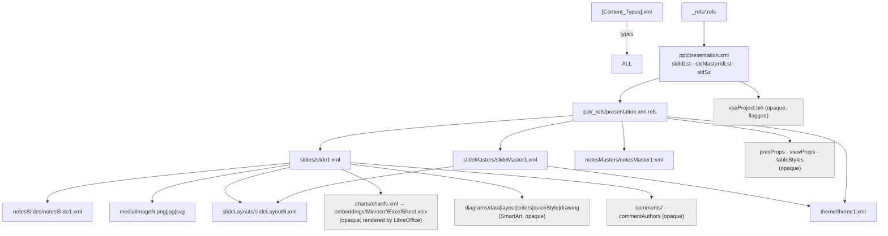
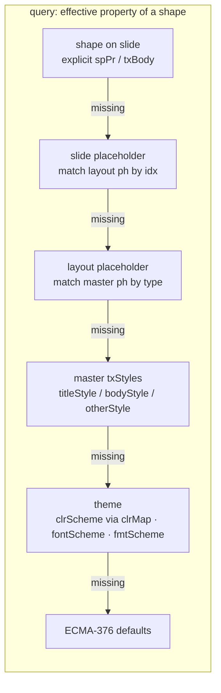

# 10 — Presentation Engine Design

> Part of the Next-Generation Document Engine analysis (2026-11). Status: ANALYSIS — no code changed.

Sibling documents: `04-libreoffice-replacement-strategy.md` (pptx→pdf stays on LibreOffice, item 5),
`05-document-core-architecture.md` (page model feeding slide reconstruction), `06-parsing-engine-design.md`
(OPC walker and preservation rules), `07-layout-and-rendering-engine.md` (text shaping, why no native
renderer), `08-pdf-engine-design.md` (page render/extraction interface), `09-spreadsheet-engine-design.md`
(embedded chart workbooks, same opaque-part rules).

## 1. Purpose and scope

Design the subsystem that owns PPTX: package parsing (presentation, slides, layouts, masters,
theme, notes, media relationships), slide management, inheritance resolution, text/shape/image/
table/chart/group handling, and the strict split between **structure parsing** (ours, Go) and
**slide rendering** (LibreOffice, isolated `office-render`, for the whole roadmap).

Binding inputs (`EXECUTIVE-SUMMARY.md`): pptx→pdf stays on LibreOffice; E4 Stage 3
upgrades pdf→pptx from image-only slides to text+image slides; Go-first; Typst available as an
exec'd static binary from Stage 2. Out of scope: PPT (binary), PPSX/POTX beyond opening as PPTX,
rendering animations/transitions, SmartArt layout, embedded OLE execution.

## 2. Current state

| Path | Implementation | Evidence |
|---|---|---|
| pdf→pptx (`pdf-to-ppt`, `pdf-to-powerpoint`, `pdf-to-pptx`) | `pdftoppm -png IN TMP/page` for every page, then a hand-written zip | `convert-from-pdf/processing/processing_free.go:282-319` (exec at `:304`), dispatch `processing.go:65-67` |
| PPTX builder | `buildPptxFromImages` writes `[Content_Types].xml`, `_rels/.rels`, `ppt/presentation.xml`, its rels, one master, one blank layout, one theme, then per page `slideN.xml` + rels + `media/imageN.png` | `convert-from-pdf/processing/pptx_builder.go:16-85` |
| slide geometry | default 10×7.5 in (9144000×6858000 EMU); first image's aspect sets slide height (`imageDimensionsEMU`) | `pptx_builder.go:117-138`, `:36-39` |
| slide content | one `<p:pic>` stretched to the full slide; `rImg%d` + `rLayout` rels; slide ids `255+i`, `rId%d` | `pptx_builder.go:214-264`, `:184-191`, `:198-209` |
| master/layout/theme | minimal master with `clrMap` and one layout id; blank layout `type="blank"`; Office theme with Calibri fonts | `pptx_builder.go:269-351` |
| media handling | `os.ReadFile` of each PNG into memory per slide ("acceptable only because these are single rendered pages") | `pptx_builder.go:104-115` |
| pdf→odp | image-slide PPTX then `libreoffice --headless --convert-to odp` | `processing_free.go:389-397`, `:401-420` |
| pptx→pdf (`ppt-to-pdf`, `powerpoint-to-pdf`) | `unoconvert --convert-to pdf` on the daemon pool, 30 s fixed timeout, cold `libreoffice --headless` fallback | `convert-to-pdf/processing/processing_free.go:30-51`, `:59-81`; dispatch `processing.go:52-54` |
| pptx→odp, odp→pdf | same pool via `officeToOffice` / `officeToPDF` | `processing_free.go:85-107`; `processing.go:70-72,79-81` |
| allowlists | `convert-from-pdf/main.go:96,101`; `convert-to-pdf/main.go:95,101-102` | |
| thumbnails | none anywhere (`thumbnail_path` never populated, `01-existing-system-audit.md` §Databases); Q10 adds PDF thumbnails only | |
| fonts | `ttf-liberation` only in `fyredocs-base`; no Noto, no Devanagari (`01-existing-system-audit.md` §Images); Q6 fixes | |
| fixtures | k6 `pptx` fixture is a minimal one-slide deck padded with an orphan part | `scripts/k6/fixtures/gen.py:261` |
| Go/Rust PPTX deps | none in any `go.mod`; no Rust toolchain (`01-existing-system-audit.md`) | |

Consequences: `pdf-to-ppt` output is a flipbook — no selectable text, no editable titles, PNG
size scales with page count (a 100-page PDF at pdftoppm's default 150 DPI is ~100 full-page
PNGs). The builder is correct OOXML (PowerPoint and LibreOffice open it, which is why `pdf-to-odp`
reuses it) and is the seed of the Stage 3 writer. Nothing in the platform parses an uploaded PPTX.

## 3. Requirements

Functional
- F1 Parse PPTX structure: `ppt/presentation.xml` (`sldIdLst`, `sldMasterIdLst`, `sldSz`,
  `notesSz`), slides, `slideLayouts/`, `slideMasters/`, `theme/`, `notesSlides/`,
  `notesMasters/`, `handoutMasters/`, `comments/`, media and chart rels, `[Content_Types].xml`.
- F2 Slide management on an opened deck: add (from a layout), remove, reorder, duplicate (deep
  copy of the slide part + its rels + media dedup) — needed for a future "split/merge/reorder
  PPTX" tool class, and by the Stage 3 writer for its own output.
- F3 Resolve inheritance slide → layout → master → theme for placeholders (position, size,
  fill, line, font) and for `clrMap`/scheme colours and `fontScheme` (`+mj-lt`, `+mn-lt`).
- F4 Text: DrawingML `a:p`/`a:r`/`a:pPr`/`a:rPr`/`a:lstStyle`, bullets, levels, autofit modes
  (`noAutofit`, `normAutofit fontScale/lnSpcReduction`, `spAutoFit`) — read and preserve; our
  writer emits `normAutofit` and leaves fitting to the consumer application.
- F5 Shapes: preset geometry (`a:prstGeom`) catalogue from the ECMA-376 Part 1 §20.1.10.56
  `ST_ShapeType` enumeration (count to be taken from the spec copy when the table is generated —
  not web-verified here); custom geometry (`a:custGeom`); groups (`p:grpSp` with child transforms);
  connectors; pictures (`p:pic` incl. crop `srcRect`, SVG + PNG fallback `asvg:svgBlip`); tables
  (`a:tbl` with `gridCol`, `tr`, `tc`, `gridSpan`/`rowSpan`/`hMerge`/`vMerge`); graphic frames
  for charts (`c:chart` r:id → `ppt/charts/chartN.xml` + embedded `embeddings/*.xlsx`), SmartArt
  (`dgm:*` data/layout/colors/quickStyle parts), OLE.
- F6 Transitions (`p:transition`), animations (`p:timing`), sections, comments, custom shows,
  VBA: parsed as opaque XML and preserved byte-identical; never rendered.
- F7 Stage 3 pdf→pptx: text+image slides from the page model with a per-page confidence rule
  and full-page-image fallback (§5.4). Image-only output remains available as an option.
- F8 Round-trip: editing one slide leaves every other part byte-identical (§5.6).

Performance (targets; no measured values exist yet)
- P1 Open a 200-slide, 300 MB deck with media streamed (never read into memory unless a
  thumbnail or dedup hash is requested) inside the 1 GiB worker limit.
- P2 Stage 3 pdf→pptx wall time per page ≤ current image-only path + text extraction cost (to be
  measured by `make bench-engine`).

Compatibility
- C1 Output opens in PowerPoint 365, LibreOffice Impress and Google Slides import without
  repair; LibreOffice `--convert-to pdf` of our output succeeds for 100 % of corpus files.
- C2 No rendering fidelity claim without the gate in §7.

Security
- S1 Zip/OPC limits, media size caps, XML depth caps, no external media (`r:link` to http),
  no OLE/VBA execution (§5.8).

## 4. Options evaluated

| Option | Language | Licence | Maturity (verified 2026-11-07) | Fidelity / coverage | Integration | Effort (EM) | Verdict |
|---|---|---|---|---|---|---|---|
| hand-written OOXML writer (extend `pptx_builder.go`) + own OPC walker | Go | ours | exists (351 lines), produces valid decks | write: what we emit; read: nothing yet | in-process, no deps | 1.0 (writer) + 1.0 (parser/walker, shared design with DOCX in `06-parsing-engine-design.md`) | **Adopt** — zero-dependency, exact control of preservation |
| unioffice `github.com/unidoc/unioffice/v2` | Go | commercial EULA, licence key ("requires a license code to operate") | pushed 2026-09-21; 4.9k stars; README status for PPTX: creation from templates, textboxes/shapes; no PPTX read/edit or chart claims | partial | in-process | licence cost | Rejected (commercial; PPTX read not claimed) |
| gooxml (`baliance/gooxml`, AGPL-3 predecessor) | Go | AGPL-3 historically | GitHub now redirects `baliance/gooxml` → `unidoc/unioffice`; no separate maintained AGPL tree | — | — | — | Rejected (gone; AGPL would also be unacceptable in-process) |
| Muprprpr/Go-pptx | Go | MIT | 6 stars, pushed 2026-04-02; no releases | create/read/modify claimed; zero deps | in-process | — | Not adopted: no release, single maintainer, no round-trip claim |
| hurtener/pptx-go (fork of Go-pptx) | Go | README MIT, GitHub shows Apache-2.0 + MIT (`LICENSE.upstream`) | 1 star, pushed 2026-08-12, 249 commits, no releases | OPC layer, lazy loading, master/layout parts, media dedup; no preservation claim | in-process | — | Reference design for our OPC layer only; no dependency |
| casibase/goppt | Go | README MIT vs repo Apache-2.0 (inconsistent) | 0 stars, 2 commits, pushed 2026-04-25 | reader/writer/PNG renderer claimed; layouts/masters undocumented | in-process | — | Rejected: 2 commits, no users |
| tsawler/tabula `pptx` pkg | Go | MIT | 30 stars, pushed 2026-06-29 | text extraction only | in-process | — | Not applicable (read-only text) |
| python-pptx | Python | MIT | 3.6k stars, pushed 2024-08-07 | mature object model; design notes on placeholders/autofit | reference design only (Python leaves the image in Stage 3) | 0 | **Reference** for API shape and inheritance semantics |
| Rust `pptx` (hidemi-ito/rust-pptx) | Rust | MIT | 0.1.0, 2026-02-25, 22.6k downloads | read/write/edit, HTML export; no PDF/image rendering | static binary/WASM only | — | Not mature (0.1.0, no renderer); Rust rule |
| Rust `ppt-rs` | Rust | (crates.io) | 0.2.37, 2026-10-24 | generation-focused (Markdown→PPTX) | — | — | Not applicable |
| Rust `office_oxide` | Rust | (crates.io) | 0.1.16, 2026-10-30 | multi-format read/convert; pre-1.0 | — | — | Not mature |
| LibreOffice Impress (headless) | C++ | MPL-2.0 | installed in `fyredocs-base` and convert-from-pdf images | full render incl. charts, SmartArt (via import), fonts via fontconfig | daemon pool / `office-render` | 0 | **Keep** as the only renderer and the fidelity oracle |
| Typst `typst/typst` | Rust (exec'd static binary) | Apache-2.0 | v0.15.1 2026-07-17; v0.15.0 2026-06-15 (multiple PDF standards at once; PDF/A, PDF/UA-1 since v0.14.0 2025-10-24); 57k stars | generates PDF decks from templates (Polylux-style); not a PPTX writer | exec (E7, Stage 2) | 0.25 for a deck template | **Adopt for generated PDF decks** (certificates, reports), not for PPTX |

Conclusion on Rust: no Rust PPTX crate is past 0.x, none renders slides, and the binding rule
forbids team-written Rust; there is nothing to pair against beyond Typst as an exec'd tool.

## 5. Recommendation

### 5.1 Decision

1. **Structure parsing is ours, in Go, inside the owning worker** (`convert-from-pdf/internal/
   deckwriter` for Stage 3 output; a `deck` reader package in whichever worker first needs to
   open PPTX — `convert-to-pdf/internal/deckinspect` for metadata/limits in Stage 3). No
   third-party PPTX dependency; the OPC walker is designed once in `06-parsing-engine-design.md` and
   implemented per worker (CLAUDE.md §1).
2. **Rendering is LibreOffice** (pptx→pdf, thumbnails, pdf of our own output for the harness)
   for the whole roadmap; Stage 6 moves it into the isolated, autoscaled `office-render` pool.
   No native renderer unless the gate in §7 is passed by a future proposal.
3. **Stage 3 pdf→pptx** becomes text+image slides with a confidence rule (§5.4); image-only
   stays as the fallback and as an explicit option.
4. **Typst** (Stage 2+) generates simple PDF decks from templates where the product needs a
   generated deck, bypassing PPTX entirely.

### 5.2 OPC part graph



Parsing rules: load `[Content_Types].xml` and every `.rels` first; walk from `_rels/.rels`
(`officeDocument` relationship) rather than by path, because real decks use arbitrary part
names. Slide order is `sldIdLst` order, not file names (the current builder already honours this,
`pptx_builder.go:172-192`). Every part reachable only through an unknown relationship type is
opaque and preserved.

### 5.3 Inheritance resolution



Rules, from the ECMA-376 placeholder model as documented by python-pptx ("A slide placeholder
inherits from the layout placeholder having the same idx value"; "A layout placeholder inherits
from the master placeholder sharing the same type"; inherited properties "include position and
size as well as fill, line, and font"):

- Placeholder match: `p:nvPr/p:ph` by `idx` (slide→layout), then by `type` (layout→master);
  `type` defaults to `body`; `idx` defaults to 0 (title). A slide `clrMapOvr` overrides the
  master `clrMap`.
- Text run property resolution: `a:rPr` → paragraph `a:pPr`/`a:lstStyle lvlNpPr` on the
  shape → layout placeholder `lstStyle` → master `p:txStyles` by placeholder kind → theme fonts
  (`+mj-lt`, `+mn-lt`, `+mj-cs` for complex scripts, which matters for Devanagari).
- Resolution is lazy and memoised per (slide, shape, property); the resolver never mutates
  the parts, so preservation (§5.6) is unaffected.
- Autofit: `normAutofit fontScale/lnSpcReduction` is a **stored result of PowerPoint's own fit**
  ("PowerPoint shrinks text in whole-number font sizes"; "always reduces line spacing by as much
  as 20%"); we read it and preserve it, never recompute it — computing it needs font metrics and
  the renderer we are not building (python-pptx's analysis makes the same point: the fit depends
  on the actual font file).

### 5.4 Stage 3 pdf→pptx: text+image slides

Input per page from the page model (`05-document-core-architecture.md`): `Blocks[]{Kind:
title|heading|paragraph|list|table|caption, BBox, Lines[]{Words[]{Text, Font, Size, Bold, Italic,
Color}}}`, `Images[]{BBox, Data (streamed path), DPI}`, `Rules[]`, `Tables[]`, page size in pt,
plus a page-level `VectorOps` count from the content stream (`pdfcpu` content parse, or PDFium
later) so vector drawings are detectable.

Slide construction (slide size = page aspect at 10 in width, as today):

1. **Title**: the top-most block classified `title`/`heading` with size ≥ 1.3 × page median
   font size becomes a `type="title"` placeholder-less text box (we keep the blank layout so
   nothing overlays; `idx` placeholders are a later refinement) positioned at its bbox.
2. **Body text boxes**: every remaining text block → one `p:sp` with `a:prstGeom rect`,
   `txBody` with `a:bodyPr wrap="square" anchor="t"` + `a:normAutofit`, one `a:p` per line
   group (paragraph), runs carrying font size (pt from the PDF), bold/italic, RGB colour; font
   name mapped from the PDF base font to a Latin/Devanagari family that the consumer can resolve
   (`Liberation Sans`/`Noto Sans`/`Noto Sans Devanagari`; the exact PDF font name is kept in
   `a:latin typeface` only when it is a common installed family, else the mapped one).
3. **Lists**: `list` blocks → `a:buChar`/`a:buAutoNum` with `marL`/`indent` from the detected
   indent level.
4. **Tables**: `Tables[]` from the §5.5 reconstruction in `09-spreadsheet-engine-design.md` →
   `a:tbl` with `gridCol` widths from column boundaries, merges via `gridSpan`/`rowSpan`.
5. **Images**: each raster image → `p:pic` at its bbox; media streamed from the extractor's
   file into the zip entry (`io.Copy`, not `os.ReadFile` — replaces `pptx_builder.go:104-115`);
   identical images (sha256 of bytes) are written once and shared via rels (logos on every page).
6. **Vector regions** (paths that are not table rules, not text): rasterised by `pdftoppm`
   with a crop (`-x -y -W -H` at 150 DPI) into a `p:pic` for that region's bbox.
7. **z-order**: images first, then vector rasters, then text boxes, so text stays editable on top.

**Confidence rule** (per page; thresholds are proposals to be calibrated on the labelled
200-PDF set before Stage 3 acceptance, and recorded in `benchmarks/`):

| Signal | Reconstructable when |
|---|---|
| word assignment | ≥ 90 % of words fall inside a detected block (unassigned words are the chief sign of a layout we did not understand) |
| rotation | 100 % of words have rotation 0 (vertical/rotated text is unsupported in Stage 3) |
| text area | text blocks cover ≥ 5 % of the page (else it is an image/graphic page) |
| block count | ≤ 40 blocks (posters and dense forms exceed this) |
| vector density | `VectorOps` outside table rules and image frames ≤ 200 per page, or ≤ 3 distinct vector regions after clustering |
| fonts | every text run's font has a mapped family (unknown symbol/Type3 fonts fail the rule) |
| overlap | no two text blocks overlap by > 5 % of either area after placement |

All signals pass → text+image slide. Any signal fails → **full-page image slide** (today's
behaviour, `pdfToPptImages`), and the job result metadata lists which pages fell back and
why (`slides.fallback[] = {page, reason}`), so the harness can count fallbacks. A job option
`mode: editable|image` (default `editable`) forces either path; a mixed deck is normal.

### 5.5 Public API sketch

```go
// convert-from-pdf/internal/deckwriter — Stage 3 write side (fresh decks only)
type Deck struct{ /* zip writer, part registry, rId allocator, media dedup */ }
func New(slideW, slideH EMU) *Deck
func (d *Deck) AddTextImageSlide(p pagemodel.Page, opts SlideOpts) (SlideReport, error)
func (d *Deck) AddImageSlide(pngPath string) error            // today's path, kept
func (d *Deck) SetNotes(slide int, text string) error         // page source + fallback reason
func (d *Deck) Save(ctx context.Context, w io.Writer) error   // streams media, writes CT + rels last

// deck reader (first consumer: convert-to-pdf/internal/deckinspect; duplicated per worker by design)
type Package struct{ /* OPC index: parts, rels, content types, opaque set */ }
func Open(ctx context.Context, path string, limits Limits) (*Package, error) // lazy: parses presentation.xml + rels only
func (p *Package) Slides() []SlideRef                          // order from sldIdLst
func (p *Package) Slide(i int) (*Slide, error)                 // parses on demand, cached
func (p *Package) Resolve(s *Slide, sh ShapeRef) EffectiveProps // §5.3
func (p *Package) Summary() Summary                             // slide count, size, media bytes, has charts/SmartArt/VBA/OLE/external media
// future slide management (same package): Insert(layout, at) · Remove(i) · Move(i, j) · Duplicate(i)
func (p *Package) Save(ctx context.Context, w io.Writer) error // copies untouched parts byte-for-byte
```

### 5.6 Round-trip preservation strategy

- **Opaque by default**: only `presentation.xml`, slide parts we edit, and the rels of parts we
  edit are re-serialised. Masters, layouts, theme, notes, charts, SmartArt, comments, VBA,
  `customXml`, `docProps`, `presProps`, `viewProps`, `tableStyles` are copied as raw zip entries
  with original compression method and bytes.
- **Content types**: `[Content_Types].xml` is parsed into an ordered list and written back in the
  same order; new `Override` entries append; `Default` entries are never removed.
- **Stable rId allocation**: per source part, new ids are `rId{max+1}`; existing ids are never
  renumbered (PowerPoint tolerates gaps; references in `p:sldId r:id` must keep their values).
  Slide ids (`p:sldId id`) start at 256 and new ids are `max+1`.
- **Media**: never re-encoded; duplicates on write are detected by hash before adding.
- **Namespaces**: re-serialised parts keep the original prefix set (`mc:Ignorable`, `p14`,
  `a16`, `p188`) by preserving the root element's attributes verbatim, so `mc:AlternateContent`
  blocks survive even inside parts we touch.
- **Regression test** (mandatory in CI for the reader): for each corpus deck, change the title
  text of slide 1 → every zip entry except `ppt/slides/slide1.xml` (and `docProps/core.xml` if
  we update `modified`) has the same sha256 as the input; `[Content_Types].xml` and all `.rels`
  are byte-identical; LibreOffice converts both input and output to PDF and page counts match.

### 5.7 Memory model

- Package open parses `[Content_Types].xml`, `_rels/.rels`, `presentation.xml` and its rels only;
  slides, layouts, masters and theme parse on first access and are cached by part name
  (lazy slide loading). A 500-slide deck costs one `zip.Reader` central-directory read plus the
  parts actually touched.
- Media is never loaded: `Package.Save` copies raw zip entries (`zip.Writer.CreateRaw`/`Copy`),
  thumbnails and dedup hashes read through `io.Reader` with a cap.
- Per-slide parsed XML is a tree of our own structs for shapes/text; unknown children are kept
  as raw `[]byte` spans (not `encoding/xml` generic nodes) so re-serialisation is exact.
- Stage 3 writer: text boxes are tiny; images streamed; peak memory is the extractor's page
  render (bounded by `IMAGE_MAX_IMAGE_DIM`, `processing_free.go:86-98`) not the deck.
- Numbers: nothing measured yet — B1/B2 in §7.

### 5.8 Security limits (proposed defaults; env-overridable)

| Limit | Default | Why |
|---|---|---|
| `PPTX_MAX_UNZIP_BYTES` | 1 GiB total, counted while reading central directory `UncompressedSize64` | zip bomb before any extraction |
| `PPTX_MAX_PARTS` | 20,000 entries | OPC walkers are O(parts) |
| `PPTX_MAX_PART_BYTES` (XML) | 64 MiB per XML part | a single slide XML of that size is hostile |
| `PPTX_MAX_SLIDES` | 2,000 | job time bound; LibreOffice render time scales with slides |
| `PPTX_MAX_MEDIA_BYTES` | 512 MiB per deck, 100 MiB per media part | tmpfs 1 GiB budget (`internal/worker/tmpfs.go`) |
| XML depth / attributes | 512 / 1,024 | `encoding/xml` has no entity expansion but no depth cap |
| external media / hyperlinks | `r:link` and `TargetMode="External"` on image/media rels are reported, never fetched | SSRF; the worker has no egress need |
| OLE / VBA / ActiveX | preserved opaque, flagged in `Summary`; never executed; LibreOffice daemon already runs headless without macros (`--headless`; macro security should additionally be forced via the user profile in Q2) | S1 |
| path safety | reject `..`, absolute names, duplicate entry names | OPC and `archive/zip` |
| Stage 3 writer | max text runs per slide 5,000; max images per slide 200; above → image fallback for that page | pathological PDFs |

### 5.9 Rendering (explicitly separate)

`pptx→pdf`, thumbnails and the harness oracle run on LibreOffice via the daemon pool now and the
`office-render` container in Stage 6. Quick wins Q1/Q2/Q6 (size-scaled timeout, daemon lifecycle,
Noto + Devanagari fonts + `fc-cache`) are the only rendering work in Stages 1–2. Deck thumbnails
(first slide → PNG) are `unoconvert --convert-to png` or pdf-then-`pdftoppm -f 1 -l 1
-scale-to 320` on the rendered PDF, reusing Q10's thumbnail path. Charts and SmartArt are
rendered by LibreOffice from the opaque parts we preserve; no chart engine is proposed.

**Fidelity gate for any future native renderer** (must be passed before replacing LibreOffice on
any pptx path, decks also feed `04-libreoffice-replacement-strategy.md` item 5):

- Corpus of 200 real decks (business templates, education, Hindi/Devanagari text, mixed scripts,
  charts, SmartArt, tables, gradients, transparency, grouped shapes, 16:9 and 4:3, embedded
  fonts, SVG + PNG fallbacks, slide numbers/footers).
- Per slide: SSIM ≥ 0.95 against LibreOffice's render at 150 DPI on ≥ 95 % of slides whose
  content is in the renderer's declared scope; slides with charts/SmartArt/OLE must be routed to
  LibreOffice by a classifier with 0 false negatives on the corpus (a slide wrongly kept native).
- Fonts: Devanagari conjuncts and matras shaped correctly (visual diff against LibreOffice on
  50 Hindi slides; no tofu; `07-layout-and-rendering-engine.md` shaping requirements); embedded fonts
  honoured; fallback chain documented.
- Text metrics: `normAutofit` results within one whole font size of PowerPoint's stored
  `fontScale` on the 100 decks that carry it.
- Throughput ≥ LibreOffice daemon on the same hardware for the in-scope subset, measured by
  `make bench-engine`; otherwise there is no reason to replace it.

## 6. Classification

| Capability | Class | Implementation | Stage | EM |
|---|---|---|---|---|
| PPTX write, fresh decks (text boxes, images, tables, notes) | B (own OOXML writer, grows from `pptx_builder.go`) | `deckwriter` | 3 | 1.0 (within E4's 4–5) |
| Page-model → slide reconstruction + confidence rule | B (E4) | `convert-from-pdf/internal/pagemodel` | 3 | 0.5 |
| OPC walker, structure parse, lazy slides, inspect summary | B (shared design, per-worker code) | `deckinspect` | 3 | 1.0 (shared with DOCX/XLSX walkers, `06-parsing-engine-design.md`) |
| Inheritance resolver (placeholders, txStyles, theme) | B | reader | 5 (needed by compare/thumbnail-metadata, not by Stage 3) | 0.5 |
| Slide add/remove/reorder/duplicate | B | reader + save | 5+ (if a PPTX organise tool class is approved) | 0.5 |
| Preset geometry catalogue (`ST_ShapeType` enumeration) | A (table generated from ECMA-376; no rendering) | reader | 5 | 0.1 |
| Charts (`c:chart`), SmartArt, OLE | D preserve; LibreOffice renders | opaque | all | 0 |
| Transitions, animations, sections, comments, VBA | E never rendered; preserved | opaque | all | 0 |
| Autofit computation | not built (needs renderer); values preserved | — | — | — |
| pptx→pdf, pptx→odp, odp→pdf, thumbnails | D LibreOffice (E3) + Stage 6 `office-render` | `convert-to-pdf` | all | 0 |
| Generated PDF decks from templates | D Typst exec (E7) | Stage 2 template | 2+ | 0.25 |
| Native slide renderer | not on roadmap; gate in §5.9 | — | — | 8+ (brief's estimate, item 5) |

## 7. Acceptance criteria and gates

Stage 3 (pdf→pptx text+image)
- G1 On the labelled 200-PDF set: ≥ 70 % of text pages produce text+image slides (fallback rate
  reported per reason); text recall on those slides ≥ 99 % of `pdftotext` words (shared Stage 3
  criterion); 0 pages where text is placed outside the slide.
- G2 LibreOffice renders our deck to PDF for 100 % of corpus outputs; page count equals the
  source PDF page count; SSIM of the rendered text+image slide vs the source page render ≥ 0.80
  at 150 DPI on 90 % of editable slides (editable output is allowed to differ in fonts; the
  threshold is to be calibrated on the first harness run and then frozen).
- G3 Output opens in PowerPoint 365 and Google Slides import without repair (manual check on a
  20-deck sample each release; automated via LibreOffice only).
- G4 Hindi PDFs: Devanagari text in text boxes survives round-trip to PDF via LibreOffice with
  no tofu once Q6 fonts are present.
- G5 Memory: the writer streams media; a 300-page scanned PDF produces a deck without reading
  more than one page image into memory at a time (asserted by a test with `runtime.MemStats`
  and a 150 MiB cap).
- G6 `pdf-to-odp` keeps working (deck → LibreOffice → ODP) and passes `odfvalidator`.

Reader / preservation
- G7 Round-trip regression (§5.6) passes on the 200-deck corpus; `[Content_Types].xml` and all
  `.rels` byte-identical.
- G8 Fuzz: `FuzzOpen` seeded with the corpus and the k6 fixture (`gen.py:261`) runs 60 s in CI
  with no panic and no allocation above `PPTX_MAX_*`.

Benchmarks (all "to be measured", files under `benchmarks/`)
- B1 `BenchmarkOpenLazy200Slides` on a 200-slide, 300 MB deck: open + `Summary()` ≤ 200 ms and
  ≤ 50 MiB allocated (media untouched); `go test -bench . -benchmem ./convert-to-pdf/internal/deckinspect/`.
- B2 `BenchmarkWriteDeck100Pages`: Stage 3 writer on a 100-page text PDF vs today's image-only
  path, wall time and output bytes.
- B3 LibreOffice render time per slide for our decks vs the source PDF's page count, in
  `make bench-engine`.

## 8. Risks and open questions

- R1 Layout classification quality is the whole risk of Stage 3; the confidence rule errs toward
  image fallback, which is today's output, so the worst case is "no better", never "worse".
- R2 Fonts: text+image slides expose font substitution in the consumer application. Mapping to
  Liberation/Noto families is honest but changes line breaks; Q6 is a prerequisite for the Hindi
  gate G4.
- R3 Editable text over a rasterised vector region can double-render if the vector region also
  contained text; rule 6 in §5.4 must subtract text bboxes before cropping.
- R4 The reader's preservation guarantee depends on our own XML re-serialisation of touched
  slides keeping `mc:AlternateContent`; test with PowerPoint-365-authored decks (they are the ones
  with `p188`/`a16` extensions).
- R5 Open question for product: is a PPTX organise tool class (split/merge/reorder decks) wanted?
  It is the only driver for slide management and the inheritance resolver before Stage 5.
- R6 Open question: Google Slides import tolerance is undocumented; manual checks only.
- R7 LibreOffice macro security for uploaded decks is not explicitly configured in the daemon
  profile (`convert-to-pdf/entrypoint.sh:30-45` sets only `--user-installation`); fold into Q2.

## Sources

Accessed 2026-11-07 unless noted.

- Repository: `convert-from-pdf/processing/pptx_builder.go` (lines cited in §2),
  `convert-from-pdf/processing/processing_free.go:282-319, 389-420`, `convert-to-pdf/processing/
  processing_free.go:30-107`, `convert-to-pdf/entrypoint.sh:30-45`, `scripts/k6/fixtures/gen.py:261`,
  `01-existing-system-audit.md` (2026-11-07).
- unioffice README: "This software package (unioffice) is a commercial product and requires a
  license code to operate"; PPTX status: creation from templates, textboxes/shapes
  https://github.com/unidoc/unioffice ; GitHub API: pushed 2026-09-21, licence NOASSERTION;
  `baliance/gooxml` resolves to `unidoc/unioffice`.
- Go PPTX candidates (GitHub API, 2026-11-07): Muprprpr/Go-pptx MIT, 6 stars, pushed 2026-04-02
  https://github.com/Muprprpr/Go-pptx ; hurtener/pptx-go (fork; README MIT, repo shows Apache-2.0
  + `LICENSE.upstream`; 249 commits, no releases, 1 star, pushed 2026-08-12)
  https://github.com/hurtener/pptx-go ; casibase/goppt (2 commits, 0 stars, README MIT vs
  Apache-2.0, pushed 2026-04-25) https://github.com/casibase/goppt ; tsawler/tabula MIT text
  extraction, pushed 2026-06-29 https://pkg.go.dev/github.com/tsawler/tabula@v1.6.4/pptx ;
  nathanstitt/doctaculous now `omnidoc` MIT, 5 stars https://pkg.go.dev/github.com/nathanstitt/doctaculous/pkg/render/pptxwrite
- python-pptx (MIT, 3,582 stars, pushed 2024-08-07): placeholder inheritance
  https://python-pptx.readthedocs.io/en/latest/user/placeholders-understanding.html ; autofit
  analysis (`normAutofit fontScale/lnSpcReduction`, whole-number shrink, 20 % line-spacing
  reduction, font file needed to compute) https://python-pptx.readthedocs.io/en/latest/dev/analysis/txt-autofit-text.html ;
  analysis index https://python-pptx.readthedocs.io/en/latest/dev/analysis/index.html
- Rust crates (crates.io API): `pptx` 0.1.0 MIT 2026-02-25, repo hidemi-ito/rust-pptx, features
  read/write/edit/HTML export, no PDF/image rendering https://docs.rs/crate/pptx/latest ;
  `ppt-rs` 0.2.37 2026-10-24 ; `office_oxide` 0.1.16 2026-10-30 (self-described, unverified).
- Typst releases: v0.15.1 2026-07-17, v0.15.0 2026-06-15 ("target multiple PDF standards at
  once"), PDF/A + PDF/UA-1 since v0.14.0 2025-10-24; Apache-2.0 (GitHub API)
  https://github.com/typst/typst/releases
- ECMA-376 5th ed. Part 1 §19 PresentationML, §20 DrawingML (`ST_ShapeType` preset list
  §20.1.10.56; section number from memory, confirm against the spec copy), Part 2 OPC —
  standards list in `README.md`.
