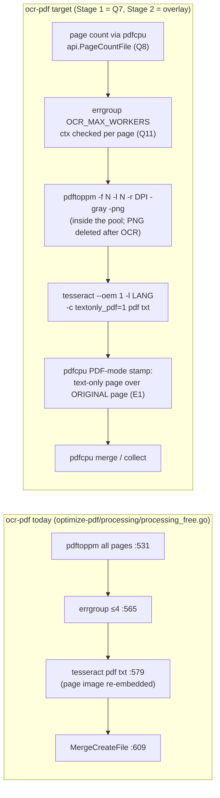

# 11 — Image and OCR subsystems (E8 imaging, E6 OCR and document intelligence)

> Part of the Next-Generation Document Engine analysis (2026-11). Status: ANALYSIS — no code changed.

## 1. Purpose and scope

Two engines from `01-decisions-and-architecture` are covered here because they share one fact: neither can be
"replaced by Go" in the sense the brief imagined. Imaging (E8) already *is* pure Go and the question is how to keep
it bounded and whether libvips ever earns a sidecar. OCR (E6) has no Go engine at all; the question is how to tune
Tesseract, how to make its output better than a page re-raster, and under what evidence a neural engine
(PaddleOCR-Devanagari) would be admitted as an optional sidecar.

In scope: decode/encode/resize/warp/cleanup for scan-to-pdf and image-to-pdf, edge detection, thumbnails, SVG;
OCR for `ocr-pdf` and `scan-to-pdf`, searchable-PDF creation, layout/table detection, document classification,
multi-language roadmap, the OCR bake-off protocol, and the `ocr` worker profile. Out of scope: PDF rasterisation
(E2, Stage 5 bake-off), typesetting of Devanagari stamps (E7, doc `14`), page-model reconstruction (E4, doc `08`).

## 2. Current state

### 2.1 E8 imaging — pure Go, one package, one worker

| Component | Where | Behaviour |
|---|---|---|
| Decode guard | `organize-pdf/internal/imaging/decode.go:17` `MaxDecodePixels = 50_000_000`; `:48-60` `DecodeConfig` before `Decode` | Header-only dimension check rejects decompression bombs before a pixel buffer is allocated. `DecodeReader` (`:22-29`) and `DecodeFile` (`:32-38`) buffer the whole encoded file first (`io.ReadAll` / `os.ReadFile`). |
| Formats | `decode.go:7-13` registers `image/jpeg`, `image/png`, `golang.org/x/image/webp` (decode only) | GIF/BMP/TIFF are not registered in this package; job-service's `image` MIME category admits only `image/png`, `image/jpeg`, `image/webp` (`job-service/handlers/jobs.go:61`), so the audit's "backend also gif/bmp" refers to the tool allowlist, not to what can pass the sniff. |
| Encode | `decode.go:64-74` JPEG (quality), `:78-88` PNG | scan pages: JPEG q92 (`organize-pdf/processing/processing_scan.go:382`), bilevel → PNG (`:375`). |
| Resize | `resize.go:12-43` `DownscaleTo` via `x/image/draw.ApproxBiLinear` | Used for detection working copies; no general-purpose resize/thumbnail API. |
| Detection | `detect.go:10-18` tuning (`detectMaxDim 500`), `:25-60` downscale → gray → Gaussian → Sobel → Hough → quad | Also served over `POST /internal/v1/detect-edges` (`organize-pdf/internal/httpapi/detect.go:60-71`), objects ≤ 30 MiB (`detect.go:23,95,108`). |
| Warp | `homography.go` (8-DOF solve), `dewarp.go` (Coons patch from edge midpoints) | Full-resolution output buffer per page. |
| Cleanup | `cleanup.go:11` `cleanupWorkMaxDim 1024`; `:39-60` fingers/holes/glare then one tone pass; `background.go:14-19` `bgWorkMaxDim 512` | Every pass returns a new `*image.RGBA` (`background.go:23-29` `toRGBA`), i.e. at least one full-size copy per stage. |
| Pipeline | `processing_scan.go:337-391` `preprocessScanImages` sequential per page; decode `:361`, `processOnePage`, encode | EXIF is ignored by design — the client bakes orientation into pixels (`processing_scan.go:439-441` comment). |
| Image→PDF | `convert-to-pdf/processing/processing_free.go:112-114` → `pdfcpu api.ImportImagesFile`; organize `processing_scan.go:478,:490` | pdfcpu decodes with its own registered decoders; no size guard of ours runs on this path. |
| Data-URL images | `organize-pdf/processing/processing_edit.go:295-315` `decodeDataURLImage` | No size cap or sniff in the worker (sign-pdf is bounded to 256 KB at job-service, finding I2 — `docs/developer/architecture/backend-hardening.md` §3.20). Implicit bound: options ride a JetStream message capped at 64 KiB (`shared/natsconn/natsconn.go:69-112`). |
| Library versions | `organize-pdf/go.mod`: `golang.org/x/image v0.21.0` | Latest is v0.47.0 (2026-10-09, see Sources). |
| Not installed | ImageMagick, libvips, any cgo | All workers build `CGO_ENABLED=0` (`deployment/base-go-builder.Dockerfile`). |

Memory shape today: a 50 MP RGBA image is 200 MB; a scan page runs decode → (warp) → cleanup copy → encode, so the
worst case per page is roughly three to four full-size buffers, inside a 1 GiB container (`deployment/docker-compose.yml:994`)
with `WORKER_CONCURRENCY` 4 (`:973`). Nothing bounds the *sum* across concurrent jobs. Peak RSS is **to be measured**:
`go test -bench=. -benchmem ./organize-pdf/internal/imaging/` (benchmarks exist: `cleanup_bench_test.go`) and
`docker stats organize-pdf` during a k6 `scan-to-pdf` run (not yet in `scripts/k6/config.js` TOOL_MATRIX).

### 2.2 E6 OCR — Tesseract exec, two implementations by design

| Step | optimize-pdf `ocr-pdf` (`optimize-pdf/processing/processing_free.go`) | organize-pdf `scan-to-pdf` (`organize-pdf/processing/processing_scan.go`) |
|---|---|---|
| Binary probes | `:477-480` pdftoppm + tesseract `LookPath` | `:501` tesseract only (no poppler in that image) |
| Language | `:487-497` `sanitizeOCRLanguage` whitelist (finding I1) + `resolveLanguage` against `tesseract --list-langs` (`:444`) | `tesseractLang(opts.Language)` |
| DPI | `:499-520` default 150 (`OCR_DEFAULT_DPI`, compose `:1045`), option override, `computeSafeDPI` (`:308`) against `ocrMaxImageDim` 10 000 px (`:291-292`) | n/a — images arrive at camera resolution |
| Render | `:531-536` **all pages up front**: `pdftoppm -png -r DPI IN TMP/page` | n/a |
| OCR | `:565-566` errgroup limit `ocrMaxWorkers()` = min(NumCPU,4) or `OCR_MAX_WORKERS` (`:27-43`); `:579-584` `tesseract IMG BASE -l LANG pdf txt`; `:588` per-page failure → `api.ImportImagesFile` image-only page | `:526` sequential, no pool; `:528-531` same fallback |
| Merge | `:609` `api.MergeCreateFile` (in memory) | `:551` |
| Text sidecar | `:637` `ocrTextCapBytes` 512 KB; `collectOCRText` duplicated by design (`:644-671`, `:555-592`) | same |
| Engine | Alpine 3.19 `tesseract-ocr` + `-data-eng` + `-data-hin` (`optimize-pdf/Dockerfile`, `organize-pdf/Dockerfile`; Alpine 3.19 ships tesseract 5.3.3-r1 — see Sources) | same |

Consequences worth naming:

1. **The searchable output is a re-raster.** Tesseract's `pdf` renderer embeds the page *image it was given* plus an
   invisible text layer (GlyphLessFont, text render mode 3 — Sources). For `ocr-pdf` that image is the 150-DPI PNG from
   pdftoppm, so a born-vector or 600-DPI scanned PDF comes back as a 150-DPI raster: quality drops and size often grows.
2. **tmpfs peak scales with page count**, not with worker count: 300 pages × PNG at 150 DPI sit in `/tmp` before the first
   tesseract starts, plus 300 per-page PDFs before merge. Stage 1 acceptance in the roadmap is "300-page scan OCR tmpfs
   peak ≤ 200 MB".
3. **Hindi at 150 DPI** is below Tesseract's own recommendation for small-x-height scripts; the whitelist and the data
   pack question (Alpine's `tesseract-ocr-data-hin` is a packaged traineddata whose provenance — tessdata, _fast or _best —
   is **unverified**; check with `tesseract --print-parameters` is not enough, inspect the package file) are open.
4. Nothing in the OCR path checks `ctx` between pages except through `gctx` on the exec; pdfcpu merge ignores ctx
   (`01-decisions-and-architecture` finding 4 pattern).
5. Document intelligence already exists outside the workers: `ai-service` `POST /extract` returns doc type, fields and
   tables from up to two 1.5 MB images via the vision model (`ai-service/handlers/extract.go:22-29,51,106`) and
   `POST /transcribe` does handwriting for eng+hin (`ai-service/internal/transcribe/transcribe.go:1-5`). It is a user-facing
   AI feature behind the `ai` compose profile, not a pipeline stage.

## 3. Requirements

**Functional (E8).** Decode JPEG/PNG/WebP (today) + GIF/BMP/TIFF (pdfcpu import already sees them; our guard should too);
encode JPEG/PNG (+ WebP for thumbnails if the web client wants it); resize with a quality filter for thumbnails
(CatmullRom), approximate for detection; crop/rotate/warp (exists); colour-space (RGBA/Gray/bilevel — exists), alpha
flattening for PDF import (white matte); EXIF orientation read for *non-scanner* inputs (image-to-pdf receives photos the
client did not pre-rotate); SVG rasterisation only if a product feature needs it (none today). HEIC/AVIF: iOS captures
HEIC — the app converts on device today (JPEG upload), so server HEIC decode is a "nice to have" with a real licence
question (§4).

**Functional (E6).** Searchable PDF that preserves the original page; `eng`, `hin`, `eng+hin`; per-page failure
isolation (exists); text sidecar (exists); progress per page; cancellation between pages (Q11).

**Performance.** Imaging: bounded by a per-job pixel budget and a per-worker byte budget, never by luck. OCR: wall time
per page and tmpfs peak independent of page count. Targets are **to be measured** — see §7.

**Compatibility.** Output PDFs must open in pdf.js (web reader) and the app's native viewer; OCR text must be selectable
and searchable in both (pdf.js search already used in the Reader).

**Security.** `DecodeConfig` before `Decode` always (already a documented invariant, `decode.go:40-47`); data-URL images
sniffed and capped in the worker, not only at job-service; no model weights or Python in the four PDF workers;
sidecars without egress. Threats are enumerated in `15-security-and-reliability.md` §3.

## 4. Options evaluated

### 4.1 Imaging (E8)

| Option | Language | Licence | Maturity (version, last release, maintainer) | Fidelity/coverage | Integration | Effort (EM) | Verdict |
|---|---|---|---|---|---|---|---|
| Go stdlib `image/*` + `golang.org/x/image` | Go | BSD-3 | x/image v0.47.0, 2026-10-09, Go team; TIFF/BMP decode+encode, WebP decode only; June 2026 commit limits uncompressed TIFF reads | JPEG/PNG/GIF/BMP/TIFF/WebP-decode; CatmullRom/BiLinear scaling; no DCT-scaled decode; no AVIF/HEIC (Go proposal #73445 declined) | in-process | 0.3 (bump v0.21→v0.47, register formats, budgets) | **Adopt now** |
| `github.com/gen2brain/webp` | Go (libwebp → WASM → Go via wasm2go; purego dynamic lib tried first, `nodynamic` tag) | MIT | v0.6.4, 2026-07-01; active | WebP encode (lossy+lossless) + decode, animation, EXIF | in-process, no cgo | 0.1 | **Adopt in Stage 2** only if WebP thumbnails are a product requirement; otherwise PNG/JPEG thumbnails need nothing new |
| `github.com/HugoSmits86/nativewebp` | Go | MIT | v1.3.0, 2026-05-10 | Lossless (VP8L) encoder only | in-process | 0.1 | Not justified (lossless thumbnails are large) |
| `github.com/gen2brain/heic`, `/avif` | Go (Rust heic crate / libavif+dav1d → WASM via wazero) | MIT (upstream libheif/libde265 LGPL only when a dynamic lib is present; HEVC patent position unaddressed in README) | heic v0.7.2 2026-09-15 (decode only); avif v0.6.0 2026-07-05 | HEIC/AVIF decode | in-process, no cgo | 0.2 + legal review | **Stage 5, gated**: product must confirm server-side HEIC is needed and legal must sign off on HEVC decoding; today the app transcodes on device |
| `github.com/disintegration/imaging` | Go | MIT | v1.6.2, 2019-11-16; last push 2023-09; 31 open issues — effectively unmaintained | Resize/crop/rotate/adjust helpers over stdlib | in-process | — | **Not justified**: adds nothing over x/image/draw and fails the "no unmaintained deps" rule |
| libvips via `h2non/bimg` / `davidbyttow/govips` | C (cgo) | LGPL-2.1+ (libvips 8.18.7, 2026-09-26); bindings MIT | govips v2.20.0 2026-10-16 active; bimg v1.1.9 2022, 163 open issues | Streaming tile pipeline, SIMD, DCT-scaled JPEG decode, every format via plugins | **cgo — impossible in our `CGO_ENABLED=0` builders**; only as an HTTP sidecar (own image ~100+ MB, unmeasured) | 1.0 (sidecar + client + benchmark) | **Not now**. Admit only on the benchmark in §5.1 showing ≥ 2× on real scan workloads. The 4–8× claims are the libvips wiki's own numbers versus ImageMagick, with no Go library in the table (Sources) |
| `srwiley/oksvg` + `rasterx` | Go | BSD-3 | no tags; last commits 2022-10 / 2022-07; dormant | Partial SVG 2 | in-process | — | **Not justified** today (no SVG feature); if one arrives, prefer `tdewolff/canvas` |
| `tdewolff/canvas` | Go | MIT (+ LGPL FriBidi component, pure-Go variant available) | pseudo-version 2026-09-23, active single maintainer, "likely still contains bugs" | SVG parse + render to PNG/PDF; text shaping via pure-Go HarfBuzz port | in-process (PNG/PDF path cgo-free per imports — **unverified by build**) | 0.5 | **Stage 5 option E** if SVG-to-PDF becomes a tool |
| EXIF: `dsoprea/go-exif/v3` / `rwcarlsen/goexif` | Go | MIT / BSD-2 | v3.0.1 2022-10, push 2024-04 / pseudo 2019, push 2022-11 | Orientation tag read | in-process | 0.1 | Prefer a **minimal in-house reader** of the JPEG APP1 orientation tag (one IFD walk, ~150 lines, fuzzable) over either dormant dependency; or `gen2brain/webp.DecodeExif` for WebP |

### 4.2 OCR and document intelligence (E6)

| Option | Language | Licence | Maturity | Hindi / coverage | Integration | Effort (EM) | Verdict |
|---|---|---|---|---|---|---|---|
| Tesseract 5 (installed) | C++ | Apache-2.0 | 5.5.4, 2026-10-28; active | `hin.traineddata` in tessdata_best (11.3 MB) and tessdata_fast (1.07 MB); `--oem 1` = LSTM only; `pdf`, `hocr`, `txt` renderers; `textonly_pdf` param | exec (static binary from Alpine package) | 0.3 (Q7 + overlay design) | **Keep; tune** |
| PaddleOCR PP-OCRv5 Devanagari | Python + PaddlePaddle (paddlex) | Apache-2.0 | 3.7.0, 2026-06-11; active; `devanagari_PP-OCRv5_mobile_rec` (2025-10-16), ~2 M params, 7.5 MB, vendor-reported 84.96 % on its own 3 611-image set; PP-OCRv6 (2026-06) lists Latin scripts only | Hindi + 13 Devanagari languages + English | **HTTP sidecar** (`paddlex --serve --pipeline OCR`, Uvicorn, CPU `device=cpu`); det model 4.7 MB mobile / 84 MB server; never in-process (Python) | 1.0 (sidecar image, client, bake-off) | **Stage 6, optional plugin, only on bake-off win** (§7) |
| RapidOCR (`rapidocr` 3.10.0, 2026-10-08) | Python + ONNX Runtime (or OpenVINO) | Apache-2.0 | active; ships `devanagari_PP-OCRv5_rec_mobile` for onnxruntime | Same models as Paddle without the PaddlePaddle runtime | HTTP sidecar; smaller image than paddlex (size **to be measured**) | 0.8 | **Preferred packaging** for the Stage 6 bake-off candidate: same weights, lighter runtime |
| ONNX in Go (`yalue/onnxruntime_go` v1.38.0) | Go + C API | MIT | active | — | **cgo required** on Linux → ruled out in-process; a sidecar in Go is possible but then it is still a separate image | — | Not justified over the Python sidecar for a bake-off |
| ocrs | Rust | MIT OR Apache-2.0 | 0.13.1, 2026-09-13; "early preview" | **Latin only** | — | — | Out (no Devanagari) |
| EasyOCR | Python + PyTorch | Apache-2.0 | 1.7.2, 2024-09-24; no code release in 2 years | `hi` supported | sidecar | — | Out (stalled, heavy runtime) |
| docTR 1.1.0 / OnnxTR 0.9.0 | Python + PyTorch / ONNX | Apache-2.0 | 2026-08 active | Devanagari vocab exists, **no pretrained Devanagari checkpoint documented**; layout (LW-DETR) + table structure (TableCenterNet) | sidecar | — | Out for OCR; **candidate for layout/table on scans** (§5.5) |
| Surya 0.23.0 | Python + PyTorch (+ vllm/llama.cpp for recognition) | code Apache-2.0; **weights OpenRAIL-M, free only under USD 5 M revenue/funding** | 2026-10 active | Hindi 67.6 % on its own benchmark | sidecar | — | Out (weights licence is a commercial dependency; GPU-oriented) |
| Cloud OCR (Google Vision, AWS Textract, Azure DI) | SaaS | commercial | all list Hindi | — | HTTP egress | — | **Out**: data residency (user files leave the deployment), per-page cost, and workers are to have no internet egress (doc 15) |
| LLM vision via ai-service | Go client → OpenAI-compatible endpoint | per provider | exists (`ai-service/internal/transcribe`, `extract`) | handwriting eng+hin, doc type, fields, tables | HTTP (already) | 0 | **Keep as the user-facing AI feature**; not an OCR pipeline stage (cost, latency, non-determinism, 1.5 MB image cap) |
| Layout: LayoutParser 0.3.4 | Python | Apache-2.0 | 2022-04, unmaintained | — | — | — | Out |
| Layout: PP-StructureV3 | Python | Apache-2.0 | active; table models 124–351 MB | tables, reading order, Markdown/Word out | sidecar | 1.5 | **Stage 6 option E** for scanned-document tables only; born-digital PDFs use E4 rules (doc `08`) |

## 5. Recommendation

### 5.1 E8 — pure Go stays; budgets become explicit

1. **Bump `golang.org/x/image` to v0.47.0** (`organize-pdf/go.mod`) and register `bmp`, `tiff`, `gif` decoders in
   `decode.go` so our 50 MP guard, not pdfcpu's decoder, is the first thing that touches every image format the tool
   allowlist admits. Keep `DecodeConfig`-then-`Decode` (`decode.go:40-47`).
2. **Per-tool pixel and byte budgets** (proposed defaults; all tunable by env, all *to be measured* before they ship):

   | Tool / path | Pixel budget per image | Working-set rule | Rationale |
   |---|---|---|---|
   | scan-to-pdf page (`processing_scan.go:361`) | 30 MP (`SCAN_MAX_PIXELS`) | ≤ 3 full-size RGBA buffers alive: decoded, warped/cleaned, encoded-from | 12 MP phone photos are the norm; 30 MP covers 2026 flagships at full res |
   | image-to-pdf (`convert-to-pdf/processing/processing_free.go:112`) | 50 MP (keep) | pass-through to pdfcpu; no pixel work | no processing happens |
   | detect-edges | 30 MiB file (keep, `detect.go:23`) + 50 MP | one 500-px working copy | already bounded |
   | thumbnails (Q10, `pdftoppm -scale-to 320`) | n/a (poppler renders) | 1 page at a time | — |
   | watermark/sign data-URL image | 1 MiB decoded, sniffed via `DecodeConfig` | — | closes the worker-side gap at `processing_edit.go:295` |
   | per-worker byte budget | `IMAGING_BUDGET_MB` default 512 on the 1 GiB organize-pdf container | a weighted semaphore (`golang.org/x/sync/semaphore`) acquires `pixels × 4 × 3` bytes before decode; jobs wait instead of OOM-killing the container | sums across `WORKER_CONCURRENCY` 4 |

3. **No extra copies.** `Cleanup` passes each allocate via `toRGBA`; convert them to operate on a caller-provided
   destination so one scratch buffer is reused across fingers/holes/glare/tone. `DecodeReader`'s `io.ReadAll` can become
   `bufio.Reader.Peek` for `DecodeConfig` then stream `Decode` from the same reader (the encoded bytes are no longer held
   twice). Streaming *tile* resize is not available in Go's decoders (no DCT-scaled JPEG decode); for thumbnails of
   images ≥ 8 MP decode once and `CatmullRom.Scale` — measure before building a tiled path.
4. **Buffer pools.** A `sync.Pool` of `*image.RGBA` keyed by size class (≤ 4 MP, ≤ 12 MP, ≤ 30 MP) for the scan pipeline;
   GC pressure is the thing to measure (`GODEBUG=gctrace=1` on a 50-page scan job).
5. **EXIF orientation** for image-to-pdf only: a minimal APP1/IFD0 reader for tag 0x0112, applied with the existing
   rotate code; scan-to-pdf keeps ignoring EXIF (contract with the app, `processing_scan.go:439-441`).
6. **libvips decision rule.** Pure Go stays. A libvips sidecar is admitted only if the following benchmark, run on the
   target host class, shows **≥ 2× lower wall time per page at equal or better SSIM**:
   - corpus: 100 real phone scans (JPEG, 8–30 MP, mixed lighting, from the fidelity harness Q13), 20 A4 300-DPI scanner
     PNGs;
   - pipeline measured end to end: decode → perspective warp → cleanup(auto) → encode JPEG q92, pure Go in-process vs
     govips in a sidecar reached over loopback HTTP (so transfer cost is included, as it would be in production);
   - metrics: p50/p95 wall per page, container RSS peak (`docker stats`), output SSIM vs the Go output ≥ 0.98;
   - command: proposed `make bench-engine SUITE=imaging` (Q13 harness), results into `benchmarks/`.
   Even on a win, the sidecar is an **option E plugin** behind an env flag; the Go path remains the default and fallback.
7. **HEIC/AVIF**: gated on product + legal (§4.1). **SVG**: no tool needs it; revisit with `tdewolff/canvas` if one does.

### 5.2 E6 quick-win redesign (Q7, Stage 1)

- **Render inside the pool**: `pdftoppm -f N -l N -gray -png -r DPI` per page (flags verified, Sources); delete the PNG
  after tesseract finishes. tmpfs peak becomes `OCR_MAX_WORKERS × (PNG + page PDF)` instead of `pages × PNG`. Page count
  comes from `pdfcpu api.PageCountFile` (Q8), replacing `pdfinfo` (`:331`).
- **`-gray`** halves the PNG and tesseract converts to grayscale anyway.
- **DPI policy**: 300 DPI default when `hin` is in the language set, 150 for `eng`-only (user `dpi` still wins; the
  `computeSafeDPI` cap stays). Pass `--dpi N` to tesseract explicitly so it never guesses from PNG metadata.
- **`--oem 1`** with **tessdata_best `hin`** (11.3 MB) shipped in the image instead of the Alpine data package; `eng` may
  stay on the packaged data. Provenance of the Alpine `-data-hin` package must be confirmed before deciding (unverified).
- **Searchable PDF that preserves the original page (Stage 2)**: `-c textonly_pdf=1` produces a page with only the
  invisible GlyphLessFont text; stamp it over the original page with pdfcpu's PDF-mode watermark (the same E1 mechanism
  doc `14` uses for Typst stamps). Output quality then equals input quality and size grows by the text layer only. For
  `scan-to-pdf` (input *is* the image) the current `pdf` renderer stays. Gate: text selectable and searchable in pdf.js
  and Acrobat on 20 fixture PDFs; page render SSIM vs input ≥ 0.99.
- **organize-pdf `scan-to-pdf` OCR** (`processing_scan.go:526`) gets the same errgroup pool (duplicated by design, §1 of
  `CLAUDE.md`), bounded by `OCR_MAX_WORKERS` with the same default.
- **Base image**: Alpine 3.19 is EOL (2025-11-01, Sources) — the OCR/organize images move to a supported Alpine as part of
  Stage 1 hardening (doc `15` §5), which also refreshes tesseract from 5.3.x.

### 5.3 Layout detection and table extraction

Born-digital PDFs: heuristic page-model rules in E4 (doc `08`): word boxes from `pdftotext -bbox-layout`, column
detection by x-gap histograms, table detection by ruling lines (`pdfimages`/content-stream paths) and aligned gaps. No ML.
Scanned PDFs: tesseract's `hocr` output gives words with boxes and paragraph/line structure (`hocr` renderer, Sources) —
feed those boxes into the *same* E4 rules, so scans and born-digital documents share one reconstructor. ML layout
(PP-StructureV3, docTR TableCenterNet) is an **option E plugin in the `ocr` profile, Stage 6**, admitted only if the E4
table-cell F1 on the labelled scan subset (Stage 3 gate: "table cell F1 ≥ pdfplumber") is not met by rules.

### 5.4 Document classification

Exists: `ai-service` `/extract` returns a doc type via the vision model (`extract.go`). For pipeline use (e.g. choosing
an OCR DPI or routing a scan to ID-card page size) a cheap in-worker classifier is enough: page aspect, text density from
the `txt` sidecar, Devanagari ratio from Unicode block counts. No ML model in workers.

### 5.5 Multi-language roadmap

Today: `eng`, `hin` (whitelist at job-service `validateOcrOptions`, worker `sanitizeOCRLanguage`). `organize-pdf/Dockerfile:26`
still claims deu/fra/spa — stale. Proposal, each tier a product decision, each pack a tessdata_best file plus a
whitelist entry at both boundaries (job-service + worker, duplicated by design):

| Tier | Packs | Trigger |
|---|---|---|
| 1 (now) | eng, hin | — |
| 2 | mar, nep, san (Devanagari family), ben, guj, pan, tam, tel, kan, mal | India-market expansion in `fyredocs_app` |
| 3 | deu, fra, spa, por, ara | Web analytics show non-Indian traffic; `ara` also needs RTL handling in E4 |

Fonts are not needed for the OCR text layer (GlyphLessFont) but are for E7 stamps (Q6: `font-noto-devanagari`); the
reader's `?`-substitution of non-WinAnsi annotation text (`fyredocs_frontend/src/lib/annotate/pdfAnnots.ts:101`) is a
frontend limit, not an OCR one. Pack sizes beyond `hin` are **unverified** — list them from the tessdata_best repo when
a tier is approved.

### 5.6 `ocr` worker profile

A compose profile `ocr` that starts `ocr-sidecar` (RapidOCR HTTP, CPU, no egress, models baked into the image) and
sets `OCR_SIDECAR_URL` on optimize-pdf and organize-pdf. Without the profile the env is empty and the Tesseract path
runs unchanged; with it, the worker calls the sidecar through `shared/circuitbreaker` (gobreaker, already used by the
gateway) and falls back to Tesseract per page on open circuit. No model is ever loaded inside a Go worker; no worker
other than the two OCR owners knows the sidecar exists.

## 6. Classification

| Feature | Class | Owner | Stage | EM |
|---|---|---|---|---|
| E8 decode/encode/resize (x/image) | A lightweight lib | organize-pdf, convert-to-pdf | 1 (bump + guards) | 0.2 |
| E8 detect/warp/cleanup | B custom engine (exists) | organize-pdf | 1 (budgets, no-copy) | 0.3 |
| E8 EXIF orientation | A (in-house 150 lines) | convert-to-pdf | 2 | 0.1 |
| E8 WebP encode / HEIC / SVG | E optional plugin | organize-pdf | 2 / 5 / 5 | 0.1 / 0.2 / 0.5 |
| libvips sidecar | E optional plugin, benchmark-gated | — | 6 | 1.0 if admitted |
| E6 Tesseract | D mature external | optimize-pdf, organize-pdf | 1 (Q7), 2 (overlay) | 0.3 |
| E6 PaddleOCR/RapidOCR sidecar | E optional plugin, bake-off-gated | `ocr` profile | 6 | 1.0 |
| Layout/table ML | E optional plugin | `ocr` profile | 6 | 1.5 |
| Document classification | existing D (ai-service LLM) + A heuristics | ai-service / workers | 2 | 0.1 |

## 7. Acceptance criteria and gates

| Gate | Measurement | Command / harness |
|---|---|---|
| Imaging budgets hold | 4 concurrent 30 MP scan-to-pdf jobs on a 1 GiB organize-pdf container: 0 OOM kills, RSS peak ≤ 900 MiB | k6 `scan-to-pdf` scenario (to be added to `scripts/k6/config.js`) + `docker stats`; `docker events --filter event=oom` |
| No extra copies | heap allocs per page −50 % vs today on `cleanup_bench_test.go` | `go test -bench=. -benchmem ./organize-pdf/internal/imaging/` before/after |
| OCR tmpfs | 300-page 300-DPI scan: `/tmp` peak ≤ 200 MB (Stage 1 roadmap acceptance) | `df /tmp` sampled every 1 s inside the container during the job |
| OCR quality not regressed by Q7 | CER on the 50+50 corpus not worse than today's pipeline | §7.1 protocol |
| Overlay preserves pages | SSIM(output page, input page) ≥ 0.99 on 20 fixtures; text selectable in pdf.js and Acrobat | `make bench-engine SUITE=ocr` (Q13) |
| Cancellation | cancel stops tesseract/pdftoppm ≤ 2 s (Stage 2 acceptance) | 100 forced cancels, `ps` shows 0 orphans (doc `15` §9) |
| libvips admission | ≥ 2× wall per page, SSIM ≥ 0.98 | §5.1 item 6 |
| PaddleOCR admission | §7.1 | §7.1 |

### 7.1 OCR bake-off protocol (Stage 6)

- **Corpus**: 50 Hindi + 50 English scans: 20 % phone photos, 50 % 300-DPI flatbed, 30 % 150-DPI office scans; include
  forms, two-column, and low-contrast pages. Ground truth typed twice independently, diffs resolved by a third reader.
  Hindi text NFC-normalised before scoring.
- **Engines**: Tesseract 5.5.x `--oem 1` tessdata_best, 300 DPI gray; RapidOCR `devanagari_PP-OCRv5_rec_mobile` +
  `PP-OCRv5_mobile_det`, same images, CPU, 2 threads (the worker's CPU limit, `docker-compose.yml:1073`).
- **Metrics**: CER and WER (Levenshtein over characters / whitespace tokens), wall time per page, container RSS peak,
  image size on disk.
- **Decision**: switch the default for `hin` only if relative CER gain ≥ 30 % **and** time/page ≤ 2× Tesseract **and**
  RSS fits the 1 GiB sidecar limit. English keeps Tesseract unless the same gate is met separately. The only independent
  Hindi comparison found (ICON 2024, Sources) had Tesseract at 93 % vs PaddleOCR at 56 % with a pre-v5 Devanagari model —
  the burden of proof is on the newcomer.

## 8. Risks and open questions

- **Alpine data-pack provenance**: if `tesseract-ocr-data-hin` is tessdata_fast, today's Hindi accuracy is the floor,
  not the ceiling; switching to tessdata_best raises CPU per page (to be measured).
- **Overlay correctness**: pdfcpu PDF-mode stamping on rotated or cropped pages (MediaBox ≠ CropBox) must be verified in
  the harness; fallback is today's re-raster path per page.
- **pdfcpu version**: workers pin v0.9.1 (`organize-pdf/go.mod:10`); latest is v0.16.4 (2026-10-27). The overlay design
  should be prototyped on the version the E1 doc decides to adopt.
- **HEIC**: patent position of HEVC decoding in a commercial service is a legal question, not an engineering one.
- **Sidecar cost**: RapidOCR image size and idle RSS are unmeasured; the `ocr` profile must have its own memory limit.
- **Ground truth cost**: 100 double-keyed pages is roughly a person-week; schedule it in Stage 5 so Stage 6 can start.

## Sources (accessed 2026-11-07)

- golang.org/x/image versions — https://pkg.go.dev/golang.org/x/image?tab=versions ; webp decode-only — https://pkg.go.dev/golang.org/x/image/webp ; tiff/bmp — https://pkg.go.dev/golang.org/x/image/tiff , https://pkg.go.dev/golang.org/x/image/bmp ; AVIF proposal declined — https://github.com/golang/go/issues/73445
- `image.DecodeConfig` header-only + security considerations — https://pkg.go.dev/image#DecodeConfig ; GIF cap proposal declined (doc-only) — https://github.com/golang/go/issues/79063
- gen2brain/webp — https://github.com/gen2brain/webp ; gen2brain/heic — https://github.com/gen2brain/heic ; gen2brain/avif — https://github.com/gen2brain/avif ; libheif/libde265 LGPL — https://github.com/strukturag/libheif , https://github.com/strukturag/libde265
- nativewebp — https://github.com/HugoSmits86/nativewebp ; disintegration/imaging — https://github.com/disintegration/imaging
- govips — https://github.com/davidbyttow/govips ; bimg — https://github.com/h2non/bimg ; libvips releases — https://github.com/libvips/libvips/releases ; libvips speed wiki (self-reported, no Go entry) — https://github.com/libvips/libvips/wiki/Speed-and-memory-use
- oksvg / rasterx — https://github.com/srwiley/oksvg/commits/master , https://github.com/srwiley/rasterx/commits/master ; tdewolff/canvas — https://github.com/tdewolff/canvas , https://pkg.go.dev/github.com/tdewolff/canvas/renderers
- go-exif — https://github.com/dsoprea/go-exif ; goexif — https://github.com/rwcarlsen/goexif
- Tesseract tags/licence — https://github.com/tesseract-ocr/tesseract/tags ; `--oem` — https://raw.githubusercontent.com/tesseract-ocr/tesseract/main/doc/tesseract.1.asc ; data files — https://tesseract-ocr.github.io/tessdoc/Data-Files.html ; hin best/fast — https://github.com/tesseract-ocr/tessdata_best/blob/main/hin.traineddata , https://github.com/tesseract-ocr/tessdata_fast/blob/main/hin.traineddata ; pdf renderer GlyphLessFont / textonly_pdf — https://github.com/tesseract-ocr/tesseract/blob/main/src/api/pdfrenderer.cpp ; hocr/pdf configs — https://tesseract-ocr.github.io/tessdoc/Command-Line-Usage.html ; Alpine package versions — https://pkgs.alpinelinux.org/packages?name=tesseract-ocr&branch=v3.19&repo=community&arch=x86_64
- pdftoppm flags — https://manpages.debian.org/bookworm/poppler-utils/pdftoppm.1.en.html
- PaddleOCR releases — https://github.com/PaddlePaddle/PaddleOCR/releases ; PP-OCRv5 multilingual (Devanagari) — https://www.paddleocr.ai/latest/en/version3.x/algorithm/PP-OCRv5/PP-OCRv5_multi_languages.html ; model sizes — https://www.paddleocr.ai/latest/en/version3.x/pipeline_usage/OCR.html ; serving — https://www.paddleocr.ai/latest/en/version3.x/inference_deployment/serving/serving.html ; PP-StructureV3 — https://www.paddleocr.ai/latest/en/version3.x/pipeline_usage/PP-StructureV3.html
- RapidOCR — https://github.com/RapidAI/RapidOCR/releases ; model list — https://rapidai.github.io/RapidOCRDocs/main/model_list/
- ocrs — https://github.com/robertknight/ocrs , https://crates.io/crates/ocrs ; EasyOCR — https://github.com/JaidedAI/EasyOCR/releases ; docTR — https://github.com/mindee/doctr/releases , vocabs — https://raw.githubusercontent.com/mindee/doctr/main/doctr/datasets/vocabs.py ; Surya licence — https://raw.githubusercontent.com/datalab-to/surya/master/README.md ; LayoutParser — https://pypi.org/pypi/layoutparser/json
- onnxruntime_go cgo — https://raw.githubusercontent.com/yalue/onnxruntime_go/master/README.md
- Hindi OCR comparison (independent) — Nazeem et al., ICON 2024, https://aclanthology.org/2024.icon-1.48.pdf ; Tesseract Hindi CER — https://arxiv.org/pdf/2412.15248
- Cloud OCR Hindi — https://docs.cloud.google.com/vision/docs/languages , https://docs.aws.amazon.com/textract/latest/dg/limits-document.html , https://learn.microsoft.com/en-us/azure/ai-services/document-intelligence/language-support/ocr
- Alpine release EOL — https://alpinelinux.org/releases/
- pdfcpu releases — https://github.com/pdfcpu/pdfcpu/releases
