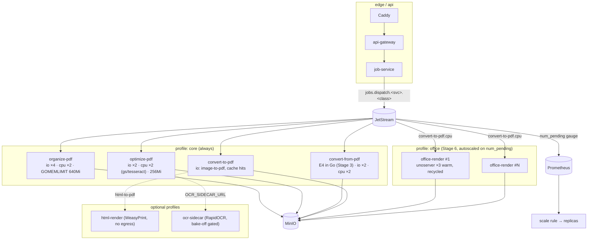

# 12 — Performance architecture

> Part of the Next-Generation Document Engine analysis (2026-11). Status: ANALYSIS — no code changed.

## 1. Purpose and scope

Performance here is an architectural property, not a tuning pass: the platform's throughput ceiling is the conversion
workers (`docs/developer/architecture/production-readiness.md:104,257`; `horizontal-scaling.md` §0), and every engine
decision in docs `04`–`11` either moves that ceiling or does not. This document (a) fixes the measured baseline,
(b) says where time and memory go per tool today, (c) evaluates the brief's 17 techniques against *this* system with
an adopt/defer/reject verdict and the measurement that must justify each, (d) designs the five mechanisms that matter
(workload-class scheduling, NATS backpressure and autoscaling, the office-render pool, caches, memory limits), and
(e) defines per-stage SLOs and the k6 / `bench-engine` gates. Companion docs: `16` (observability/capacity operations,
cross-referenced as 12↔16), `08` (E4 page model), `14` (E7 typesetting font cache), `15` (security limits that double as
performance limits).

Non-negotiable from `01-decisions-and-architecture`: never a number without a result file or a command; no
optimisation without a measurement that shows the cost first.

## 2. Current state

### 2.1 Measured baseline

`scripts/k6/results/capacity-jobs-20260727-234123.md` (k6 co-located on the host — **lower bound**), SLO
api p95 < 800 ms, p99 < 2.0 s, errors < 2 %, job e2e p95 < 60 s, job success > 98 %; steps 6 × 3 min:

| target | done/min | job p95 | queue p95 | ok % | err % | verdict |
|---|---|---|---|---|---|---|
| 3/min | 3.0 | 21.6 s | 1.9 s | 100.00 | 0.00 | PASS |
| 6/min | 6.3 | 15.6 s | 4.3 s | 100.00 | 0.00 | PASS |
| 9/min | 9.3 | 24.6 s | 5.6 s | 100.00 | 0.00 | PASS |
| 12/min | 12.3 | 3.0 s | 2.1 s | 97.30 | 0.39 | FAIL (success < 98 %) |
| 15/min | 15.3 | 31.9 s | 13.3 s | 78.26 | 2.85 | FAIL |
| 18/min | 18.0 | 10.9 s | 2.1 s | 57.41 | 8.04 | FAIL |

Sustained job capacity: **9 jobs/min (job e2e p95 24.6 s)**. These figures were measured with the unoserver pool
dead (finding D23, §2.2): every office/HTML conversion in that run was a cold `libreoffice --headless` process.
The API tier is not the limit:
`capacity-api-20260728-000715.md` passes 300/min at p95 78 ms and is 429-throttled above 600/min by the limiter.
Cost model (`production-readiness.md:104`): LibreOffice ≈ 2 s + 1.5 s/MB (~10 s CPU for a 5 MB office file);
capacity 8 concurrent jobs of which 2 LibreOffice; ~30 concurrent needed at the modelled peak (`:257`).

Fresh image sizes, binary sizes, RSS at idle/under load and cold-start times are being collected into
`benchmarks/baseline-2026-11.md` (directory exists, file pending) — this document references it and does not restate
numbers that are not yet in it. The k6 fixtures are `scripts/k6/fixtures/gen.py` sizes small ≈ 0.8 MB, medium ≈ 8 MB,
large ≈ 40 MB (`gen.py:8,22`), scanned PDFs 1/4/12 pages (`:389`); the mix is `SIZE_CLASSES` 70/25/5 (`config.js:74-77`).

### 2.2 Where time and memory go per tool today

| Tool class (worker) | Hot path | Time sinks | Memory / tmpfs sinks |
|---|---|---|---|
| office→PDF/ODF (convert-to-pdf) | **Today: one cold `libreoffice --headless` per job** (`convert-to-pdf/processing/processing_free.go:66-69`, shared profile). The warm path `tryUnoconvert` (`:30-50`) fails instantly with connection refused because **the unoserver pool has never started**: `entrypoint.sh:43` passes `--user-installation file:///tmp/uno-profile-$port`, unoserver 3.x (3.7 in the image, `benchmarks/raw/tool-versions.txt`) calls `Path(arg).as_uri()` on it and dies with `ValueError: relative path can't be expressed as a file URI`; the entrypoint logs "unoserver did not become ready; conversions will use direct LibreOffice fallback" and starts the Go binary anyway (`benchmarks/raw/startlog-convert-to-pdf.txt`; finding D23 in `01-decisions-and-architecture`, since commit 5d9d53b 2026-06-19) | LO process start + conversion per job, every job; warm-vs-cold timings with the corrected argument: see `benchmarks/raw/conversions.tsv` / `benchmarks/baseline-2026-11.md` (pending). The **fixed 30 s unoconvert timeout** (`:37-38`) and its ghost-work tail (`01` finding 1) cannot occur today; they become the next bottleneck the moment Q0 lands | one LO process per concurrent job (RSS: see baseline); after Q0, each unoserver 150–300 MB (compose comment `deployment/docker-compose.yml:893-896`); daemon-count mismatch entrypoint 2 vs Go `concurrency+1` (`entrypoint.sh:20-25`, `processing/unopool.go:54-66`) |
| compress/repair/flatten (optimize-pdf) | `gs -sDEVICE=pdfwrite` full rewrite `optimize-pdf/processing/processing_free.go:73`, args `:106`; repair `:196`; flatten `:251` | gs re-distils every object even for a text-only PDF; wall ∝ page count + image bytes | gs own heap; output on tmpfs |
| ocr-pdf (optimize-pdf) | `pdftoppm` all pages `:531-536` → errgroup ≤ 4 `:565` → tesseract per page `:579` → `MergeCreateFile` `:609` | tesseract CPU per page (LSTM); pdftoppm is fast but serial up front | **pages × PNG on tmpfs before the first OCR**; merge holds N page PDFs in memory |
| pdfcpu ops (organize-pdf) | `api.*File` calls (`organize-pdf/processing/processing_free.go:24,59,70,105,134,…`) | parse whole file into a context; mostly I/O-bound for small files; CPU-bound for `Optimize`/encrypt on large ones | **whole-document object model in memory per file** (two for merge); pdfcpu ignores `ctx` (`01` finding) |
| scan-to-pdf (organize-pdf) | `preprocessScanImages` sequential `organize-pdf/processing/processing_scan.go:337` | per-page warp/cleanup CPU | 3–4 RGBA buffers per page, up to 50 MP (doc `11` §2.1) |
| pdf→docx/xlsx/pptx/image (convert-from-pdf) | `pdf2docx` python `convert-from-pdf/processing/processing_free.go:466`; `pdf_to_xlsx.py` `:342`; `pdftoppm` `:181,:304`; LO fallback `:244` | Python interpreter + PyMuPDF import per job; LO cold | zip of page images on tmpfs (`:535`) |
| every job (all four workers) | `fetchInputs` → `DownloadToFile` `convert-to-pdf/internal/worker/storage.go:52-60`; `storeOutput` → `UploadFromFile` `:73-79`; result cache `cache.go:98-104` (sha256 of tool + canonical options + input ETags, `StatObject` per input `:136-143`); hit = server-side `CopyObject` (`worker.go:623`) | 2 MinIO round trips + 1 Stat per input + Redis GET; cache hit skips processing entirely but the hit rate is **not measured** (no metric) | tmpfs: input + output; budget `tmpfs.go:28-48` (900 MiB, output factor 200 %), `largeJobSem` size 1 (`:23`) |
| job-service upload fallback | multipart `job-service/handlers/jobs.go:273-352`; Gin `MaxMultipartMemory = 50 << 20` (`job-service/main.go:131`) | — | **buffers up to 50 MiB per request in RAM** before PutObject — the anti-pattern (presigned multipart `handlers/uploads.go:79-165` avoids it) |
| progress | time-based sqrt/ease-out 20→90 % every 10 s (`worker.go` ticker) | user sees motion, not progress; ghost work is invisible | — |

Nothing sets `GOGC`/`GOMEMLIMIT` anywhere (grep over `*.go`, compose, Dockerfiles, `*.sh`: no hits). Container limits:
workers 1 GiB / 2 CPU (`docker-compose.yml:840-841,921-922,994-995,1072-1073`), concurrency 2/2/4/2.

### 2.3 Target budgets per tool class — to be measured

Fill from the per-group k6 scenario and `docker stats`; one row per (tool, size class). Command for each cell:
`K6_SCENARIO=per-group K6_GROUP=<worker> ./scripts/k6/run.sh` (scenario names from `scripts/k6/README.md`), RSS via
`docker stats --no-stream <worker>` sampled at 1 s, tmpfs via `df /tmp` inside the container, cold start via
`docker compose up <worker>` → first `/readyz` 200.

| Tool class | small (~0.8 MB) p95 | medium (~8 MB) p95 | large (~40 MB) p95 | RSS peak | tmpfs peak | cold start |
|---|---|---|---|---|---|---|
| office→PDF warm | TBM | TBM | TBM | TBM | TBM | TBM |
| office→PDF cold fallback | TBM | TBM | TBM | TBM | TBM | — |
| compress medium | TBM | TBM | TBM | TBM | TBM | — |
| ocr-pdf 1/4/12 pages | TBM | TBM | TBM | TBM | TBM | — |
| merge ×2 / split / rotate | TBM | TBM | TBM | TBM | TBM | — |
| pdf→docx | TBM | TBM | TBM | TBM | TBM | TBM (python) |
| pdf→image zip | TBM | TBM | TBM | TBM | TBM | — |

Until the table is filled, the only budget this document asserts is the one already in the k6 SLO: job e2e p95 < 60 s.

## 3. Requirements

- **Throughput**: Stage 1 ≥ 1.5× sustained office jobs/min on the same hardware; Stage 6 office jobs/min linear in
  office-render replicas (roadmap acceptance, `01`).
- **Latency**: job e2e p95 < 60 s stays the user-facing SLO; large-office p95 −40 % in Stage 1.
- **Memory**: every worker survives its 1 GiB limit under its configured concurrency with the largest admitted input;
  zero OOM kills in a mixed-realistic run.
- **Isolation**: a slow class (LO, gs, tesseract) never starves a fast class (pdfcpu) inside the same worker.
- **Observability**: every design below names the metric that proves it (12↔16).
- **No feature removal for speed** (`01` non-negotiables).

## 4. Options evaluated — the 17 techniques against this system

| Technique | Where it would apply here | Verdict | Measurement that must justify it |
|---|---|---|---|
| Zero-copy | MinIO→tmpfs→tool→tmpfs→MinIO is already file-based (`FGet/FPut`, `shared/storage/storage.go:306,317`); the Gin 50 MiB buffer is the one copy that matters | **Adopt now** for the job-service multipart fallback (stream `io.LimitReader(body) → PutObject` with Content-Length); nothing else to do | job-service RSS during 20 concurrent 50 MB multipart uploads, before/after |
| Streaming parsers | pdfcpu is whole-document by design; E4 (doc `08`) is per-page over `pdftotext -bbox-layout` output | **Stage 3** in E4: parse page by page, emit as you go; do not fork pdfcpu | E4 RSS on a 1 000-page PDF ≤ 300 MiB |
| Lazy loading | pdfcpu `ReadContextFile` for `pdfinfo` replacement (Q8) loads objects on demand already (xref-driven) | **Adopt in Stage 1** via Q8 (page count without full parse) | `pdfcpu` page count wall on the 40 MB fixture vs `pdfinfo` |
| Incremental processing | OCR per page in the pool (Q7); E5 compress per image XObject; split/extract pages via `CollectFile` | **Adopt now** (Q7) / **Stage 4** (E5) | tmpfs peak ≤ 200 MB on a 300-page OCR (Stage 1 gate) |
| Memory pooling | imaging RGBA buffers (doc `11` §5.1); E4 word/box slices | **Stage 1** imaging only; E4 later if profiles show allocation-bound | `go test -bench -benchmem` allocs/op; `gctrace` GC CPU % < 10 % |
| Arena allocation | Go arenas are experimental (`GOEXPERIMENT=arenas`), not for production builds | **Not justified** | — |
| Sparse structures | pdfcpu object maps already; E4 page model is per page | **Not justified** as a separate effort | — |
| Parallelism | per-page OCR (exists, ≤ 4); per-image E5; per-page E4; never parallelise inside LO/gs (they are single-threaded by invocation and the CPU limit is 2) | **Adopt now** where it exists; keep goroutine fan-out ≤ CPU limit | CPU utilisation vs CPU limit in `docker stats`; no gain beyond the limit |
| SIMD | Go has no portable SIMD; `x/image/draw` is scalar; libvips has it | **Not justified** unless the libvips benchmark (doc `11` §5.1) wins | that benchmark |
| Bounded pools | `WORKER_CONCURRENCY` semaphore (`worker.go:362-366`), `largeJobSem` (`tmpfs.go:23`), OCR errgroup, unoserver port channel (`unopool.go:40-52`) | **Exists; extend** into per-class pools (§5.1) | class-level queue wait histograms |
| Backpressure | JetStream `MaxAckPending = 2×concurrency` (`worker.go:325`), `Fetch(maxConcurrency, 5 s)` (`:344`) | **Exists; tune** (§5.2) | `num_ack_pending` never exceeds `2×concurrency`; `num_pending` drives scaling |
| Adaptive scheduling | class-aware admission inside a worker; size-scaled timeouts (Q1, Q12) | **Stage 1** (timeouts) / **Stage 2** (class routing) | large-office p95 −40 %; fast-class p95 unchanged under heavy load |
| Reusable contexts | unoserver daemons (designed, **never running** — D23), Python interpreter (no — replaced by E4 in Stage 3), tesseract (no daemon mode; process per page is fine), Typst (exec per stamp, measure) | **Adopt now = Q0**: make the pool actually start, then recycle (§5.3) | `convert_fallback_total` = 0; warm vs cold wall from `benchmarks/raw/conversions.tsv`; daemon RSS flat over 1 000 conversions |
| Compression | gs `pdfwrite` (exists); E5 Go recompress (Stage 4); NATS/MinIO payloads are files, not messages | **Stage 4** per `01` gate (≥ 80 % of gs reduction, ≤ 50 % wall) | `make bench-engine SUITE=compress` |
| Content caching | result cache keyed by ETags (`cache.go:19-31`); hit = `CopyObject` | **Exists; measure hit rate, then extend** (§5.4) | `result_cache_hits_total / lookups` over a week of production |
| Font caching | E7 Typst exec per stamp parses fonts each run; LO font cache via `fc-cache` (Q6) | **Stage 2** measure first (§5.5) | Typst stamp wall p95 with and without a warm font cache dir |
| Intermediate caching | page renders (pdftoppm) reused by thumbnails (Q10), OCR, compare (Stage 5) | **Stage 2** keyed by (input ETag, page, DPI) in MinIO `thumbs/` and `renders/` | render cache hit rate; MinIO bytes/day |

Verdict summary: six "now/Stage 1", five "exists — extend", four staged behind a gate, two rejected (arenas, SIMD-in-Go).
Nothing in the list is adopted without a before/after number.

## 5. Recommendation — specific designs

### 5.1 Worker scheduling by workload class

Two classes exist in every worker whether we name them or not:

| Class | Members | Bound | Proposed per-worker concurrency (1 GiB / 2 CPU) | tmpfs share |
|---|---|---|---|---|
| `cpu` | unoconvert/LO, gs, tesseract, python, E4 reconstruct, E5 recompress, scan cleanup | CPU limit (2) and tool RSS | = CPU limit (2), one slot per daemon for LO | 70 % of `TMPFS_BUDGET_MB` |
| `io` | pdfcpu merge/split/rotate/collect/encrypt/metadata/page-count, thumbnails, cache hits, MinIO transfers | network + pdfcpu heap | 2× CPU limit (4) | 30 % |

Stage 1 (no routing change): a per-class weighted semaphore inside each worker's `processJob`, chosen by tool slug
(the tool→engine table in doc `02`/`03`), so a burst of `merge-pdf` on organize-pdf cannot be blocked behind four
`scan-to-pdf` cleanups, and two OCR jobs on optimize-pdf cannot run eight tesseracts across a 2-CPU limit
(`OCR_MAX_WORKERS × WORKER_CONCURRENCY` today). The NATS consumer still fetches `WORKER_CONCURRENCY` messages; the class
semaphore only orders execution. `largeJobSem` becomes the `cpu` class's size-1 "large" sub-slot.

Stage 2 (routing change, touches `job-service/internal/routing/routing.go`): publish `jobs.dispatch.<svc>.<class>` and
give each worker two durable consumers with `FilterSubject`, each with its own `MaxAckPending`, so a wedged `cpu` class
no longer holds `io` messages unacked. This is the point at which a dedicated `office-render` pool (§5.3) can be a
separate deployment consuming only `jobs.dispatch.convert-to-pdf.cpu`.

### 5.2 NATS backpressure and the autoscaling signal

Today: pull consumer, `MaxDeliver 4`, `AckWait 30 m`, `MaxAckPending 2×concurrency`, `BackOff 10 s/30 s/2 m`
(`worker.go:323-326`), `Fetch(maxConcurrency, FetchMaxWait 5 s)` (`:344`). This is already correct backpressure: a
worker can never hold more than twice its concurrency in flight, and JetStream's `num_pending` grows instead of RAM.
Changes:

- **Batch size = free slots, not concurrency.** `Fetch(maxConcurrency)` while `sem` is partly full pulls messages that
  then wait inside the process (counted as ack-pending, invisible as queue depth). Fetch `cap(sem) − len(sem)`.
- **Per-class `MaxAckPending`** once §5.1 Stage 2 lands.
- **Autoscaling signal**: `num_pending` on each dispatch consumer (exposed by `nats consumer info` and `/jsz?consumers=true`,
  Sources). Export it as `jobs_dispatch_pending{consumer}` — either from a NATS exporter in the `observability` profile
  or polled by analytics-service, which already scrapes `/metrics` (`analytics-service` Prometheus scraper). Rule of
  thumb to validate with data: scale a worker family when `pending / (replicas × concurrency) > 2` for 5 minutes and
  the family's CPU is at its limit; scale in when pending is 0 for 15 minutes. Compose already exposes
  `CONVERT_TO_PDF_REPLICAS` (`docker-compose.yml:918`); the runbook in `horizontal-scaling.md` §3–4 is the manual loop
  this signal automates. Existing alert `DLQBacklog` (`deployment/prometheus/rules/fyredocs-alerts.yml:147`) catches the
  failure mode; a `DispatchBacklog` alert on the new gauge catches the capacity one.
- **AckWait 30 m vs the 10-min job context** (`worker.go:546`): keep AckWait > ctx + drain; with size-scaled contexts
  (Q12) AckWait must scale too, or in-progress large jobs get redelivered — tie both to one function.

### 5.3 Office-render daemon pool

Q0 first, then Q1/Q2 in Stage 1, isolated container in Stage 6 (`04-libreoffice-replacement-strategy.md` owns the
LibreOffice decision; this section owns its performance mechanics):

- **Q0 — make the pool exist (1 day, before any timeout work).** Pass a filesystem path, not a `file://` URI, in
  `entrypoint.sh:43` (unoserver builds the URI itself); pin `unoserver` in `deployment/base-alpine-libreoffice.Dockerfile:24`
  to the version the fix is tested against; make `/readyz` (`convert-to-pdf/main.go:132`) return 503 — or at minimum
  raise `office_pool_ready{port}=0` and alert — when no daemon answers `unoconvert`. The entrypoint's "WARNING … fallback"
  branch (`entrypoint.sh:68-70`) must become a failure, not a note: a silent fallback is exactly how this went
  unnoticed for five months. The warm-vs-cold gain is **whatever `benchmarks/raw/conversions.tsv` says** (engines
  `unoserver-daemon-start-corrected-arg` vs `libreoffice-warm-unoconvert`), not a number this document asserts.
- **Warm instances** = `cpu`-class concurrency + 1 spare, one source of truth (Go computes, entrypoint reads the same
  env) — removes the entrypoint/Go mismatch (`entrypoint.sh:20-25`, `unopool.go:54-66`).
- **Size-scaled timeout** `max(30 s, 2 s + 1.5 s/MB)` capped by the job ctx, from the measured model
  (`production-readiness.md:104`); re-fit the coefficients from `benchmarks/baseline-2026-11.md` once it exists.
- **Kill + respawn on timeout** (procexec, doc `15` §5): the port is not released until the daemon is dead, so no ghost
  work queues behind the next job.
- **Recycling**: restart a daemon after N conversions or when its RSS exceeds a threshold (both **to be measured**:
  record RSS per conversion over 1 000 k6 docx jobs; set the threshold at the knee). LibreOffice leaks are a known
  class of behaviour; the number is not known for our mix.
- **Metrics**: `convert_fallback_total{reason}` (timeout | connect | crash), `office_daemon_restarts_total`,
  `office_convert_seconds{size_class}`; Stage 1 acceptance is zero cold fallbacks in a mixed-realistic run.
- **Stage 6**: `office-render` as its own compose service (`profiles: [office]`), scaled by replicas, consuming
  `jobs.dispatch.convert-to-pdf.cpu`; convert-to-pdf's Go worker keeps the `io` class (image-to-pdf, cache hits).

### 5.4 Result cache and content-addressed outputs

The cache key is already content-addressed on the input side (`cache.go:98-104`), and hits are server-side copies
(`worker.go:623`). Gaps and changes:

1. **Measure before extending**: add `result_cache_lookups_total{svc}` / `result_cache_hits_total{svc}`. If the
   production hit rate is < 5 %, stop here.
2. **Content-addressed outputs**: store outputs under `outputs/cas/<sha256(output)>` and write the job's
   `outputs/jobs/{jobID}/{name}` as a server-side copy (MinIO `CopyObject`, same as a hit today). Deduplicates storage for
   repeat conversions across users and makes the cache entry a pointer, not a second object. Cleanup
   (`job-service/internal/cleanup/cleanup.go`) then needs reference counting or a TTL on `cas/` ≥ the longest plan TTL
   (`shared/config/defaults.go:14-27`) — the TTL route is simpler and matches `cacheTTL()`'s "≤ bucket TTL" rule
   (`cache.go:84-87`).
3. **Intermediate caching** (Stage 2): `renders/<etag>/<page>@<dpi>.png` written by thumbnails (Q10) and reused by OCR
   and compare; TTL 24 h; keyed by ETag so edits invalidate naturally.
4. Keep the per-service key prefix (`cache.go:31`) — CLAUDE.md §1 forbids a shared cache namespace with shared logic.

### 5.5 Font cache for E7

Typst (doc `14`) is exec'd per stamp; it scans font directories on every start. Proposal: bake fonts into
`/usr/share/fonts` of the organize-pdf image (Noto Devanagari etc., Q6), point `TYPST_FONT_PATHS` at it, and
**measure** stamp wall p95 for a one-line Devanagari stamp. If font discovery dominates (> 100 ms of a < 300 ms
budget), keep a single warm `typst` per worker via `typst watch`-style stdin loop is *not* available — the fallback is
pre-compiling a per-font-set template once per process and reusing the compiled PDF page with pdfcpu for repeated
stamps with identical text (page numbers "1 of N" are the common case: 2 × N distinct strings, cacheable per job).
LibreOffice: `fc-cache` at image build (Q6) so no daemon rebuilds the fontconfig cache on first use.

### 5.6 Memory: GOMEMLIMIT per worker

Go's GC guide recommends `GOMEMLIMIT` when the program is alone in its container, with 5–10 % headroom, and warns
against it when memory is shared with other programs (Sources). Our workers share the cgroup with LO/gs/tesseract/
python, so the limit must be the *Go share* of the container, not the container:

| Worker | Container limit | Non-Go residents | Proposed `GOMEMLIMIT` | `GOGC` |
|---|---|---|---|---|
| organize-pdf | 1 GiB | tesseract (scan OCR only) | 640 MiB (pdfcpu contexts + imaging budget 512 MiB from doc `11`) | 100 |
| optimize-pdf | 1 GiB | gs, pdftoppm, ≤ 4 tesseract | 256 MiB | 100 |
| convert-to-pdf | 1 GiB | 3 unoserver (150–300 MB each) | 128 MiB | 100 |
| convert-from-pdf | 1 GiB | python/PyMuPDF, LO, gs, pdftoppm (until Stage 3), then E4 in Go | 128 MiB now → 512 MiB after Stage 3 | 100 |

These are starting points, to be set from `runtime/metrics` `/memory/classes/total:bytes` under the k6 mixed-realistic
run and from `benchmarks/baseline-2026-11.md`. `GOGC=off` is rejected (shared cgroup, Sources caveat). The cgroup limit
remains the hard stop; `GOMEMLIMIT` only makes the Go heap yield first.

### 5.7 Streaming instead of buffering

- job-service multipart fallback: stream the part to `PutObject` with a known size (`io.LimitReader` at the plan limit),
  drop `MaxMultipartMemory` reliance (`job-service/main.go:131`); the presigned multipart path is already streaming.
- Workers: `DownloadToFile`/`UploadFromFile` already stream (`storage.go:52-60,73-79`); keep tools on files.
- document-service exports build CSV/JSON in memory (`document-service/handlers/exports.go:169-251`): stream rows to the
  response writer or to MinIO with `io.Pipe` — only matters past ~10 k documents per user; measure the largest library.
- OCR text sidecar: 512 KB cap (`processing_free.go:637`) is the right bound for jsonb; do not raise it.

### 5.8 Large-job admission

`tmpfs.go:42-48` projects `input × 3` and rejects over 900 MiB after the upload already succeeded (`01` audit). Move the
same arithmetic to job creation: job-service knows the input size at `consumeUpload` (`jobs.go:731`) and the tool; a
per-tool max input (env table duplicated in both services by design, §1) rejects with 413 before a job row exists.
Office inputs capped at ~150 MB (Q12) until size-scaled contexts exist.

### 5.9 Target worker-profile layout

## 6. Classification

| Item | Class | Stage | EM |
|---|---|---|---|
| Class semaphores, fetch sizing, GOMEMLIMIT, streaming upload fallback, admission at job creation | A (runtime/infra changes in existing workers; `shared/` only gets procexec) | 1 | 0.5 (inside Stage 1's 3 EM) |
| Size-scaled timeouts, daemon kill/respawn/recycle, `convert_fallback_total` | A | 1 (Q1/Q2) | in Q1/Q2 |
| Class-routed subjects + two consumers per worker | A | 2 | 0.3 |
| Render/intermediate cache, CAS outputs | A | 2 | 0.4 |
| Font cache for E7 | A | 2 | 0.1 (+ measurement) |
| office-render isolated + autoscaling signal | D (LibreOffice stays) + A | 6 | within Stage 6's 2 EM |

## 7. Acceptance criteria and gates — SLOs per stage

| Stage | SLO | Gate measurement | Command |
|---|---|---|---|
| 0 (today) | api p95 < 800 ms; job e2e p95 < 60 s; success > 98 %; sustained 9 jobs/min (lower bound) | `capacity-jobs-20260727-234123.md` | `K6_SCENARIO=capacity MODE=jobs ./scripts/k6/run.sh` off-box |
| 1 | Q0: `/readyz` 200 only with a live pool; `office_pool_ready` = instances at steady state; then ≥ 1.5× sustained office jobs/min on same hardware; large-office p95 −40 %; `convert_fallback_total` = 0 in mixed-realistic; 0 OOM; 300-page OCR tmpfs ≤ 200 MB | capacity ladder on `word-to-pdf` only, before/after (the "before" is the cold-LO state of July 2026 — re-measure it off-box first); mixed-realistic 30 min | `K6_SCENARIO=capacity K6_TOOL=word-to-pdf`, `K6_SCENARIO=mixed-realistic`; `docker events --filter event=oom`; `docker compose logs convert-to-pdf \| grep -c "did not become ready"` must be 0 |
| 2 | cancel → tool dead ≤ 2 s; thumbnails for 100 % of uploaded PDFs with p95 ≤ 3 s; render-cache hit rate reported | cancellation test (doc `15` §9); thumbnail latency histogram | `make bench-engine SUITE=cancel`; Grafana panel |
| 3 | pdf→docx p95 ≤ today's pdf2docx p95 on the k6 fixtures; convert-from-pdf RSS ≤ 512 MiB; image ≤ 150 MB | per-group ladder, before/after | `K6_GROUP=convert-from-pdf`; `docker image ls` |
| 4 | compress wall ≤ 50 % of gs; ≥ 80 % of gs size reduction; gs invocations on compress −70 % in prod | `bench-engine SUITE=compress`; `jobs_processed_total` by engine label | `make bench-engine SUITE=compress` |
| 5 | PDFium WASM ≥ 0.7× pdftoppm throughput at 150 DPI or Poppler stays | `bench-engine SUITE=render` | `make bench-engine SUITE=render` |
| 6 | office jobs/min scales linearly 1→2→4 replicas (±15 %); autoscale reacts within 5 min | capacity ladder per replica count on two hosts | `CONVERT_TO_PDF_REPLICAS=n` ladder |

Every stage also re-runs the Stage 0 ladder: no stage may lower sustained jobs/min or raise p95 on any tool class.

## 8. Risks and open questions

- **The baseline is a cold-LO baseline (D23).** Q0 alone may clear the Stage 1 "1.5× office jobs/min" gate; the
  gate must then be re-based on the post-Q0 ladder so Q1/Q2 are judged on their own effect. Conversely, the 30 s
  timeout tail (`01` finding 1) will *appear* for the first time after Q0 — plan Q1 immediately behind it.
- **Co-located k6** makes every current number a lower bound; the first Stage 1 action is an off-box baseline, or the
  −40 % / 1.5× gates are measured against noise.
- **GOMEMLIMIT with subprocess residents**: too low a limit makes the Go runtime thrash GC while LO sits on 600 MB; the
  table in §5.6 must be derived from measured shares, not set from this document.
- **Class routing changes the job contract** (subjects, two consumers, DLQ subjects); it needs Swagger/Postman/runbook
  updates (CLAUDE.md §8) and a one-release dual-subscribe migration.
- **CAS outputs vs cleanup**: reference counting across services violates data ownership; the TTL approach wastes some
  storage. Decide after measuring the duplicate rate.
- **Autoscaling on Compose** is a script, not a controller; `horizontal-scaling.md` §8 names the point at which
  Kubernetes becomes the answer. The signal design above is the same either way.
- Unknown until `benchmarks/baseline-2026-11.md` lands: cold-start times, image sizes, idle RSS — they decide whether
  the office-render split is a Stage 6 or a Stage 2 item.

## Sources (accessed 2026-11-07)

- Go GC guide — GOMEMLIMIT with container limits, 5–10 % headroom, `GOGC=off` caveats: https://go.dev/doc/gc-guide
- NATS JetStream consumers — `MaxAckPending`, pull `Fetch` batch/expires: https://docs.nats.io/nats-concepts/jetstream/consumers , https://docs.nats.io/using-nats/developing-with-nats/js/consumers ; `num_pending` / `num_ack_pending` semantics and `/jsz`: https://docs.nats.io/learn/monitoring/jetstream-health , https://docs.nats.io/running-a-nats-service/nats_admin/monitoring ; nats.go consumer config / `DefaultExpires 30 s`: https://raw.githubusercontent.com/nats-io/nats.go/main/jetstream/consumer_config.go , https://raw.githubusercontent.com/nats-io/nats.go/main/jetstream/pull.go
- Docker Compose `runtime`, `deploy.replicas`, resource limits: https://docs.docker.com/reference/compose-file/services/
- libvips speed/memory wiki (self-reported; no Go library in its table): https://github.com/libvips/libvips/wiki/Speed-and-memory-use
- Repository result files: `scripts/k6/results/capacity-jobs-20260727-234123.md`, `capacity-api-20260728-000715.md`; cost model `docs/developer/architecture/production-readiness.md:104,257`; runbook `docs/developer/architecture/horizontal-scaling.md` §0, §3–4, §8.
- Measured 2026-11-07 (this folder): `benchmarks/raw/startlog-convert-to-pdf.txt` (unoserver traceback, D23), `benchmarks/raw/tool-versions.txt` (unoserver 3.7, LibreOffice 7.6.7.2 / 7.4.7.2, gs 10.05.1 / 10.00.0, tesseract 5.3.3), `benchmarks/raw/image-sizes.tsv` (convert-from-pdf 1.76 GB, convert-to-pdf 1.17 GB, optimize-pdf 327 MB, organize-pdf 217 MB); pending: `benchmarks/raw/conversions.tsv`, `benchmarks/raw/cold-start.tsv`, `benchmarks/raw/idle-rss.tsv`, `benchmarks/baseline-2026-11.md`.
