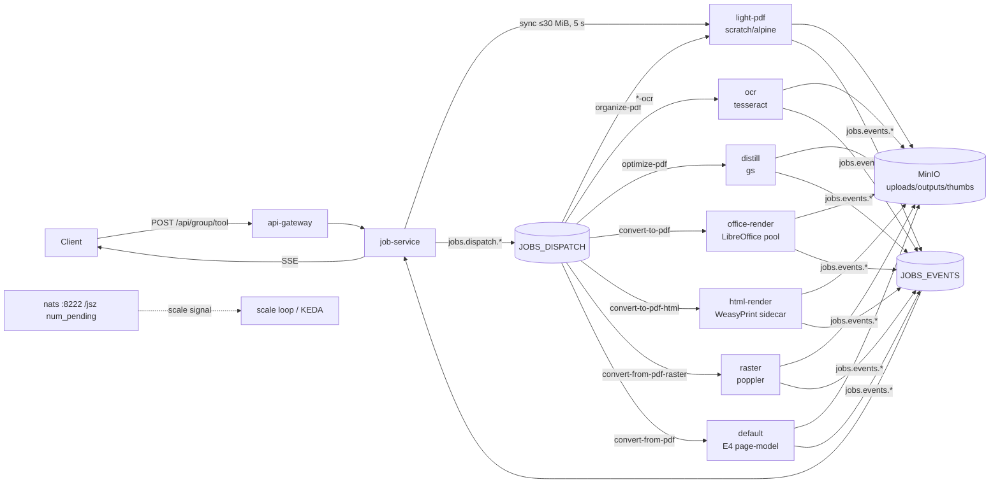
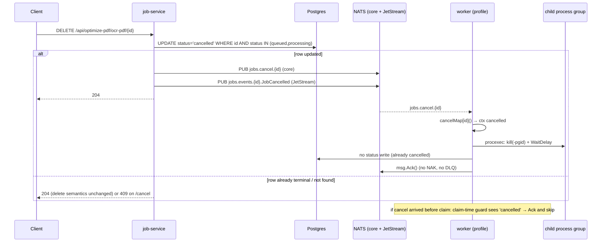

# 14 — API and Distributed Architecture
> Part of the Next-Generation Document Engine analysis (2026-11). Status: ANALYSIS — no code changed.

Siblings: `04-libreoffice-replacement-strategy.md` (what stays on LibreOffice), `12-*` (engine
integration decisions this doc routes onto), `15-*` (observability/operations the autoscaling signal
feeds), `16-benchmarking-and-testing.md` (gates named here), `18-deployment-optimization.md`
(profile images that §5.3 dispatches to).

## 1. Purpose and scope

Design the stable processing interface the brief asks for (create / parse / convert / render / merge /
split / extract text / extract images / thumbnails / compress / compare / validate / metadata / process
spreadsheet / render presentation) as **extensions of the contract that already ships**, and the
distributed shape (worker profiles, subjects, autoscaling signal, tenant isolation, caching, storage)
that those extensions run on. Nothing here removes or renames an existing route, slug, header, status
code, or envelope field. Every new capability is one more row in the existing
`POST /api/<group>/<tool>` + job model, or a documented sync exception under a hard budget.

Out of scope: engine internals (docs 05–10), the office-render container's own lifecycle (doc 04 §5,
doc 18 §5.7), pricing of quotas (product).

## 2. Current state

**Edge and gateway.** Caddy publishes 80/443 only; `/api/*`, `/auth/*`, `/admin/*` go to api-gateway,
`/uploads/*` and `/outputs/*` straight to MinIO (audit brief; `deployment/caddy/Caddyfile:25-42,54-88`).
The gateway route table is `serviceRoutes` at `api-gateway/main.go:122-259`: `/api/upload` →
job-service `/api/uploads`, the four tool groups `/api/convert-from-pdf|convert-to-pdf|organize-pdf|
optimize-pdf`, `/api/jobs`, `/api/share`, `/api/backup`, public `/share` (`noV1Alias`, main.go:170-189),
document/folder/tag/export, orgs, notifications, `/api/ai` (+ 4 MiB caps on `/api/ai/extract` and
`/api/ai/transcribe`, main.go:230-241), admin/dashboard/activity. Every route gets an `/api/v1` alias
from `withV1Aliases` (main.go:80-101); legacy prefixes are flagged `deprecated` but stay live until
mobile traffic is ~0 (`docs/developer/api/versioning.md:80-101`). Body cap 1 MiB per route
(`defaultMaxBodyBytes` main.go:61; `registerServiceRoutes` main.go:504-520). Proxy transport: dial 3 s,
response-header 5 min, idle 90 s (main.go:490-501); `FlushInterval = -1` so SSE and redirects stream
(main.go:634). One circuit breaker per upstream shared by a route and its alias (main.go:513-519).

**Job-service routes** (`job-service/routes/upload_routes.go:52-135`): presigned upload protocol
`POST /api/uploads/init`, `GET /:uploadId/parts`, `POST /:uploadId/complete`, `GET /:uploadId/status`,
`DELETE /:uploadId`, retired `PUT /:uploadId/chunk` (410); per group `GET|POST /:tool`,
`GET|DELETE /:tool/:id`, `GET /:tool/:id/download`; `POST /api/organize-pdf/detect-edges` (sync relay);
`POST|DELETE /api/share`; `POST /api/backup`; `GET /api/jobs/history`; `POST /api/jobs/dlq/redrive`;
`GET /api/jobs/:id/events` (SSE); public `GET /share/:token`. Rate limiters are split by cost
(upload 30, job-create 20, detect 60, share-redeem 30 per IP per minute; lines 36-50, 85-90, 129-133).

**Job model.** `processing_jobs.status` CHECK is `queued|processing|completed|failed`
(`job-service/internal/migrations/00001_baseline.sql:50`); the struct is
`job-service/internal/models/job.go:20-34`. Each worker keeps its own copy of the struct and
job-service is the sole migrator (audit brief; `convert-to-pdf/internal/worker/worker.go:756-774`).

**Create path** (`job-service/handlers/jobs.go:97-450`): tool normalised and looked up in
`routing.ToolServiceMap` (`job-service/internal/routing/routing.go:18-73`, 47 slugs), idempotency
reservation via Redis `SetNX` for 10 min (jobs.go:116-153), uploads claimed, MIME sniffed from the
first bytes, DB transaction (jobs.go:388-406), JetStream publish to `jobs.dispatch.<service>`
(jobs.go:419-425; subject helper `shared/queue/events.go:134-136`). Multi-input jobs already exist
(`uploadIds[]`, used by merge-pdf and image-to-pdf; `docs/developer/api/jobs-api.md:33-43`).

**Delete / download / SSE.** `DeleteJobByID` (jobs.go:553-603) removes objects and rows but a running
worker keeps going — there is no cancellation. `DownloadJobFile` (jobs.go:608-671) 302-redirects to a
5-minute presigned GET with attachment disposition. SSE (`job-service/handlers/sse.go:51-158`) creates
an ephemeral JetStream consumer on `jobs.events.<jobId>.>`, keepalive 15 s, 5-min cap, closes on
`JobCompleted|JobFailed` (sse.go:150).

**Sync precedent.** `POST /api/organize-pdf/detect-edges` is a synchronous relay from job-service to
organize-pdf's `POST /internal/v1/detect-edges` guarded by `InternalTokenGin`
(`organize-pdf/internal/httpapi/detect.go:61`), object ≤ 30 MiB (detect.go:23), client timeout 15 s
(`job-service/handlers/detect.go:32`). This is the only sync processing path today.

**NATS.** `JOBS_DISPATCH` WorkQueue on `jobs.dispatch.>` (24 h, 1 GiB, 64 KiB msgs), `JOBS_EVENTS`
Interest on `jobs.events.>` (1 h), `JOBS_DLQ` Limits 7 d (`shared/natsconn/natsconn.go:70-110`).
Worker consumer: durable = service name, `FilterSubject jobs.dispatch.<service>`, MaxDeliver 4,
AckWait 30 m, MaxAckPending 2×concurrency, BackOff 10 s/30 s/2 m
(`convert-to-pdf/internal/worker/worker.go:319-327`). `handleFailure` (worker.go:682) NAKs with delay
only if `isRecoverable` (worker.go:858-875: explicit marker, `status=5xx/429` strings, net timeouts);
everything else → `failed` + DLQ copy + Ack. Duplicate guard skips `processing|completed` rows
(worker.go:457-464). 10-minute job context (worker.go:546). Progress: time-based sqrt ease-out
20→90 % every 10 s (worker.go:151-175); `hasRealProgress` (worker.go:233) names organize-pdf tools
from inside convert-to-pdf — a dead branch.

**Result cache** `rescache:v1:<svc>:sha256(tool, canonical options, input ETags)`, TTL
`RESULT_CACHE_TTL_SECONDS` (1 h), hit = server-side CopyObject (`convert-to-pdf/internal/worker/
cache.go:31,100`; worker.go:623). **Scratch**: tmpfs `/tmp` 1 GiB, `TMPFS_BUDGET_MB` 900,
`LARGE_JOB_THRESHOLD_MB` 100 → one large job at a time (`convert-to-pdf/internal/worker/tmpfs.go`).

**Quotas.** Plan rows carry `max_file_size_mb`, `max_files_per_job`, `retention_days`
(`auth-service/internal/migrations/00001_*.sql:54-56`); gateway reads the plan from Redis
(`api-gateway/internal/plancache/plancache.go:30-45`, default free 50 MB / 10 files) and job-service
trusts the `X-User-Plan-*` headers (jobs.go:1178-1196 — a quota bypass if job-service is reachable
directly). Rate limits per plan: guest 30, free 120, pro 600 req/min (main.go:430-437). Retention:
guest 30 m, free 7 d, pro 30 d (`shared/config/defaults.go:14-27`). No concurrency quota exists.

**Measured capacity.** 9 jobs/min sustained with k6 co-located (lower bound), job e2e p95 24.6 s
(`scripts/k6/results/capacity-jobs-20260727-234123.md:9,14`).

## 3. Requirements

Functional: every capability in the brief reachable through the existing create/poll/SSE/download
contract; sync answers only where a worst case fits a 5 s budget; batch submission with per-item
status; cancellation that actually stops `soffice.bin`/`gs`/`tesseract`; progress that is real where
an engine exposes page loops; idempotent creates; per-error-class retry.
Performance: p95 job e2e ≤ 60 s and success > 98 % stay the k6 SLO (`scripts/k6/config.js:166-173`);
cancel-to-stop ≤ 2 s (roadmap Stage 2 acceptance).
Compatibility: no existing route, slug, status code, envelope field or SSE event name changes; all new
routes get `/api/v1` aliases automatically (`versioning.md:103-108`); a job created before the
cancellation migration must still poll correctly.
Security: sync endpoints never accept bytes through the gateway (1 MiB body cap stays); internal worker
HTTP stays `INTERNAL_API_TOKEN`-guarded; a cancel is authorised like a delete (`authorizeJobAccess`);
quotas resolved server-side, not from client headers (closes jobs.go:1183-1196).

## 4. Options evaluated

| Option | Language | Licence | Maturity | Fidelity/coverage | Integration | Effort (EM) | Verdict |
|---|---|---|---|---|---|---|---|
| A. Extend `POST /api/<group>/<tool>` with new slugs (this doc) | Go | — | existing contract, 47 slugs | full | in-process routing table | 0.3 for routing + per-tool | **Adopt** |
| B. New generic `POST /api/v2/documents/:op` resource | Go | — | new | full but duplicates the group routes | new gateway prefix + handlers | 1.5 + client rewrite | Reject: two contracts for one job model; mobile builds cannot be force-updated (`versioning.md:84-86`) |
| C. Sync ops via a new sync worker service | Go | — | new service | metadata/validate only | new HTTP service | 1 | Reject: a 13th service for two pure-pdfcpu calls that organize-pdf already links; use the detect-edges relay pattern |
| D. Sync ops computed in job-service | Go | — | — | — | in-process | 0.3 | Reject: puts an engine (pdfcpu) into job-service — CLAUDE.md §1 (engines live in the worker that owns the tool) |
| E. Cancellation via JetStream `JOBS_CANCEL` stream | Go | — | — | durable cancel | new stream + consumer per worker | 0.5 | Reject for v1: a durable cancel still needs the DB-status check at claim time; core NATS pub/sub + DB status is sufficient and simpler (§5.4) |
| F. Cancellation via core NATS `jobs.cancel.<id>` + DB status + worker cancel map | Go | — | — | at-most-once signal, DB is source of truth | core subscription | 0.4 (Q11: 1.5 wk) | **Adopt** |
| G. Per-profile subjects `jobs.dispatch.<service>-<profile>` with routing-table profile column | Go | — | — | — | routing + consumer filter | 0.3 | **Adopt** (§5.3) |
| H. Priority/fair-share via JetStream priority groups | Go | — | NATS 2.11 feature, not in the 2.10 image used (`docker-compose.yml` nats 2.10-alpine) | — | server upgrade | 0.5 | Defer; per-user in-flight cap in Redis gives fair share without a server upgrade |
| I. KEDA nats-jetstream scaler (k8s) / compose loop on `num_pending` | Go/YAML | Apache-2 | KEDA scaler reads consumer `num_pending` from the monitoring endpoint ([KEDA docs](https://github.com/kedacore/keda-docs/blob/main/content/docs/2.13/scalers/nats-jetstream.md), accessed 2026-11-07) | — | ops | 0.3 | **Adopt** as the signal; compose loop first, HPA later |

## 5. Recommendation

### 5.1 Capability → slug → owner (routing table extensions)

Owner follows CLAUDE.md §1 and `routing.go:13-17` (group by dependency/performance profile). "Exists"
means no API change; "new" means one new row in `ToolServiceMap` plus a per-tool options schema in
`job-service/handlers/tool_options.go`, an allowlist entry in the owner's `main.go`, and a
`processing/` case in the owner.

| Brief capability | Slug(s) | Owner (service · profile §5.3) | Engine (doc 01 table) | Sync? | Stage | Class |
|---|---|---|---|---|---|---|
| create | `create-pdf` (new; from JSON page spec / plain text; Unicode via Typst) | organize-pdf · light-pdf (Typst stamp path: Stage 2) | E1 pdfcpu `api.Create*`; E7 Typst for text | async | 2 | A |
| parse | `parse-pdf` (new; returns the E4 page-model JSON as the output object) | convert-from-pdf · default | E4 | async | 3 | B |
| convert | all `*-to-*` slugs (exist, 29 rows at routing.go:20-50) | as today | E3/E4/E1 | async | — | D/A |
| render | `pdf-to-image` (exists) | convert-from-pdf · raster | E2 (pdftoppm; PDFium after Stage 5 bake-off) | async | — | A |
| merge / split | `merge-pdf`, `split-pdf` (exist) | organize-pdf · light-pdf | E1 | async | — | A |
| extract text | `pdf-to-text` (exists) + new option `layout: "bbox"` (Stage 3) | convert-from-pdf · default | pdftotext → E4 extractor | async | 3 | A |
| extract images | `extract-images` (new; zip of page images) | organize-pdf · light-pdf | E1 `api.ExtractImagesFile` (pure Go) | async | 2 | A |
| thumbnails | `pdf-thumbnail` (new; first page, `-scale-to 320`; also emitted automatically on `document.uploaded`, Q10) | convert-from-pdf · raster | E2 pdftoppm | async (auto) | 2 | A |
| compress | `compress-pdf` (exists) | optimize-pdf · distill | E5 Go-first, gs fallback | async | 4 | B |
| compare | `compare-pdf` (new; 2 inputs; output = JSON diff + side-by-side PNG zip) | convert-from-pdf · default | E4 text diff + E2 render diff | async | 5 | C |
| validate | `validate-pdf` (new) | organize-pdf · light-pdf | E1 `api.ValidateFile` | **sync** ≤ 30 MiB, else async | 2 | A |
| metadata (read) | `pdf-info` (new; page count, page boxes, Info dict, encryption flag, PDF version) | organize-pdf · light-pdf | E1 `api.ReadContextFile` (Q8) | **sync** ≤ 30 MiB, else async | 1 | A |
| metadata (write) | `pdf-metadata` (exists) | organize-pdf · light-pdf | E1 | async | — | A |
| process spreadsheet | `excel-to-pdf`, `excel-to-ods` (exist) + `spreadsheet-extract` (new; sheets → CSV/JSON via excelize, see doc 09) | convert-to-pdf · office-render (LO) / default (excelize) | E3 / Go | async | 3+ (doc 09 gate) | D / A |
| render presentation | `powerpoint-to-pdf` (exists) + `render-presentation` (new; slides → PNG zip, LO→PDF→pdftoppm inside convert-to-pdf, whose base image already has poppler-utils `deployment/base-alpine-libreoffice.Dockerfile:16`) | convert-to-pdf · office-render | E3 + E2 | async | 6 | E |

No alias slugs are added. The brief's "PDF/A validation" flavour of validate is an open question
(§8): veraPDF is Java and belongs in the test image only (doc 01 "Ghostscript" paragraph).

### 5.2 Sync-vs-async rule

A request is answered synchronously only when **all** hold: the tool is in the sync allowlist
(`pdf-info`, `validate-pdf`), the completed upload's `StatObject` size is ≤ `SYNC_MAX_MB` (initial 30,
matching the detect-edges cap `detect.go:23`), and the worker answers within a **hard 5 s budget**
(`context.WithTimeout` on the relay, as `detect.go:32` does with 15 s). On timeout or oversize the
same request is converted into an ordinary job and the client gets the normal 201 + `jobId` — the
response shape tells the caller which happened (`data.sync: true|false`). Everything else is a job.

Sync path = the existing relay pattern: job-service `POST /api/organize-pdf/pdf-info` →
`POST http://organize-pdf:8084/internal/v1/pdf-info` with `INTERNAL_API_TOKEN`, body `{bucket, key}`,
worker reads the object range it needs (pdfcpu needs the xref, so `GetObject` capped at 30 MiB) and
answers JSON. Sync calls bypass JetStream and the job table entirely; they are rate-limited by the
detect limiter bucket (60/min/IP, `upload_routes.go:85-90`) renamed to a `sync` bucket.

### 5.3 Worker profiles, subjects, routing table (backwards compatible)

A **profile** is a deployment of an existing worker binary with (a) its own durable consumer and
filter subject, (b) an image containing only that profile's binaries (doc 18 §5.4), (c) lazy
initialisation so a basic request never starts an OCR, spreadsheet or presentation subsystem.

| Profile | Service binary | Tools | Workload class | Subject (new) | Image contents (doc 18) |
|---|---|---|---|---|---|
| `light-pdf` | organize-pdf | all pdfcpu tools; `scan-to-pdf` with `ocr:false`; `pdf-info`/`validate-pdf` sync | CPU-light, **memory-bound** on large merges (pdfcpu holds the xref in RAM) | `jobs.dispatch.organize-pdf` (unchanged) | static binary (+ Typst from Stage 2) |
| `ocr` | optimize-pdf and organize-pdf (two consumers, same profile name) | `ocr-pdf`; `scan-to-pdf` with `ocr:true` | **CPU-bound** (tesseract), memory-bound at 600 DPI | `jobs.dispatch.optimize-pdf-ocr`, `jobs.dispatch.organize-pdf-ocr` | tesseract + eng/hin data + poppler |
| `distill` | optimize-pdf | `compress-pdf`, `repair-pdf`, `flatten-pdf` | CPU-bound (gs) | `jobs.dispatch.optimize-pdf` (unchanged) | gs + poppler (E5 removes most gs calls, Stage 4) |
| `office-render` | convert-to-pdf | office/ODF → PDF/ODF, `render-presentation` | CPU-bound (LO ≈ 2 s + 1.5 s/MB, `production-readiness.md:104`), high RSS per daemon | `jobs.dispatch.convert-to-pdf` (unchanged) | LO + unoserver + fonts |
| `html-render` | convert-to-pdf | `html-to-pdf` | CPU-light, network-egress-sensitive | `jobs.dispatch.convert-to-pdf-html` | WeasyPrint sidecar, no LO (doc 04 §5 rank 1) |
| `raster` | convert-from-pdf | `pdf-to-image`, `pdf-thumbnail`, `pdf-to-powerpoint` (image slides) | memory-bound (pdftoppm at DPI ≤ 600, `processing_free.go:181`) | `jobs.dispatch.convert-from-pdf-raster` | poppler only |
| `default` (E4) | convert-from-pdf | `pdf-to-word/excel/html/text/odt/ods/odp`, `parse-pdf`, `compare-pdf`, `pdf-to-pdfa` | CPU-bound (Go), IO-bound on fetch | `jobs.dispatch.convert-from-pdf` (unchanged) | static binary + gs for PDF/A until Stage 4 |
| `ai` | ai-service | `/api/ai/*` | IO-bound (provider latency) | HTTP, not NATS | scratch (unchanged) |

Routing change: `ToolServiceMap` stays as-is for compatibility and gains a sibling
`ToolRouteMap[tool] = {Service, Profile, ProfilePredicate func(options) string}` (predicate needed only
for `scan-to-pdf`, whose `ocr` option is already validated in `tool_options.go`). `SubjectForDispatch`
(`shared/queue/events.go:134-136`) gains a `profile` argument; empty profile → the old subject, so the
stream `jobs.dispatch.>` (`natsconn.go:75`) needs no change. Rollout order that cannot drop a job:
(1) deploy profile consumers (they create their durables and sit idle), (2) flip
`ROUTING_PROFILES=on` in job-service, (3) drain and retire the old consumer for split profiles only
(`ocr`, `html-render`, `raster`); the `default` profiles keep their old subject forever. Rolling back
is flipping the flag.

### 5.4 Cancellation

Contract: `DELETE /api/<group>/:tool/:id` keeps its 204 and its side effects (jobs.go:553-603) and
**additionally** publishes `jobs.cancel.<jobId>` when the row is `queued|processing`. A new additive
`POST /api/<group>/:tool/:id/cancel` returns 200 with the job in `status: "cancelled"` for clients that
want to keep the row in history. Both are authorised through `authorizeJobAccess`.

Mechanics: (1) job-service sets `status='cancelled'` in a transaction only if the current status is
`queued|processing` (compare-and-set; terminal rows return 409 `ALREADY_FINISHED`), publishes core-NATS
`jobs.cancel.<jobId>` (no stream: at-most-once is fine because the DB row is the source of truth), and
publishes `jobs.events.<jobId>.JobCancelled`. (2) Every worker holds a `sync.Map` jobID → `CancelFunc`
registered at claim and removed at terminal; a core subscription on `jobs.cancel.>` looks the ID up
and cancels. (3) The duplicate guard (worker.go:457-464) adds `cancelled` to the skip set so a cancel
that lands before the claim is honoured at claim time; the 10 s progress ticker (worker.go:162) also
re-reads status so a lost core message is caught within one tick. (4) `shared/procexec` (doc 01
cross-cutting) turns the context cancel into `kill(-pgid)` so `soffice.bin`, `gs`, `tesseract` and
`python3` die — today `CommandContext` kills only the direct child (audit brief). (5) `handleFailure`
gains a first branch: `ctx.Err() != nil && status == cancelled` → Ack, no DLQ, no `failed` overwrite.

Migration (owned by job-service, `internal/migrations/00003_cancelled_status.sql`): drop and recreate
`chk_job_status` with `cancelled` added. Workers do not migrate (they keep private struct copies,
worker.go:756-774) but their `statusToEventType` (worker.go:877) gains `cancelled → JobCancelled`, and
SSE closes on `JobCancelled` as well as `JobCompleted|JobFailed` (sse.go:150). Consumers of
`jobs.events.>` must ignore unknown event types: document-service already filters on
`JobCompleted` (`document-service/subscriber/subscriber.go:106`); notification- and analytics-service
need the same check verified (§8).

### 5.5 Timeouts (size-scaled)

Replace the fixed 10-minute job context (worker.go:546) and the fixed 30 s unoconvert timeout
(`convert-to-pdf/processing/processing_free.go:37-45`, doc 01 finding 1) with per-engine budgets
computed from the summed input size `S` (MiB) known before fetch (`totalInputSize`, worker.go:505):

| Engine path | Per-attempt budget | Job context | Ceiling |
|---|---|---|---|
| LibreOffice (unoconvert) | `max(30 s, 2 s + 1.5 s × S)` (Q1) | `2 × attempt` | AckWait 30 m (worker.go:324) |
| Ghostscript | `max(60 s, 3 s × S)` | same | 30 m |
| Tesseract | per page `max(20 s, DPI/150 × 10 s)`; job = pages × per-page / `OCR_MAX_WORKERS` | same | 30 m |
| pdfcpu (in-process; ignores ctx) | ctx checked between pages/stages (doc 01 "pdfcpu ctx-ignorance") | `max(2 m, 1 s × S)` | 30 m |
| pdftoppm | `max(60 s, 0.5 s × pages × (DPI/150)²)` | same | 30 m |

The slopes are **initial values** derived from the one published figure (LO 2 s + 1.5 s/MB,
`production-readiness.md:104`); the others are to be calibrated from `make bench-engine`
(doc 16 §5.3) before they ship. Any budget above AckWait is rejected at create time with 413
`FILE_TOO_LARGE_FOR_TOOL` (this is Q12: office inputs capped at ≈150 MB, since 500 MB × 1.5 s/MB
> 10 min).

### 5.6 Progress

Real page-level progress where the engine has a loop: pdfcpu per-page operations (`split-pdf`,
`add-page-numbers`, `edit-pdf`, `watermark-pdf`, `extract-images`) through the existing
`ProgressFunc` pattern (the `hasRealProgress` branch at worker.go:233 moves to organize-pdf where
those tools live); tesseract per page inside the errgroup (`optimize-pdf/processing/processing_free.go:
565-588`); E4 per page; pdftoppm per page once rendering is per-page (Q7). Time-based ease-out stays
for LibreOffice and Ghostscript (no hook exists). Progress events keep the existing
`jobs.events.<id>.JobProgress` shape and the `progress` integer; a new optional `stage` string
(`fetch|convert|ocr|upload`) is additive.

### 5.7 Streaming, batch, idempotency

Streaming: SSE exists and stays; download via 302 → presigned GET stays (jobs.go:608-671). No byte
streaming through the gateway (1 MiB cap stays). Multi-output tools keep returning one zip.

Batch (new, Stage 2): `POST /api/jobs/batch` body `{items: [{group, tool, uploadIds, options}]}`
(≤ `max_files_per_job` items, each item validated exactly as a single create; one Idempotency-Key covers
the batch). Response 201 `{batchId, items: [{index, jobId, status}]}`; `GET /api/jobs/batch/:id`
returns per-item status/progress/failureReason; `DELETE /api/jobs/batch/:id` cancels every non-terminal
item (§5.4). Implementation is a nullable `batch_id uuid` column + index on `processing_jobs`
(job-service migration), no new table, no new NATS subject: items dispatch individually, so profiles,
retries and caching are unchanged. Partial failure is the normal case and is reported per item.

Idempotency: exists (jobs.go:116-153, Redis `SetNX`, 10 min, documented at `jobs-api.md:30`). Keep;
extend the same header to batch and cancel (a replayed cancel is a no-op 204).

### 5.8 Retry policy per error class

Today: binary recoverable/permanent (worker.go:858-875). Proposed classes, mapped by
`classifyError` (worker.go:88-113 already maps code → message):

| Class | Examples | Action | DLQ |
|---|---|---|---|
| `TRANSIENT_INFRA` | MinIO 5xx/429, Redis/DB timeouts, NATS publish | NAK, BackOff 10 s/30 s/2 m (existing) | after MaxDeliver 4 |
| `ENGINE_TIMEOUT` | budget §5.5 exceeded | NAK once with 2× budget (counted via `NumDelivered`), then fail | yes |
| `ENGINE_CRASH` | non-zero exit, panic recovered | NAK once, then fail | yes |
| `RESOURCE` | tmpfs budget (worker.go:514), OOM-kill of child | NAK with 2 m delay (lets a larger worker or a drained peer pick it up) | after 4 |
| `INPUT_INVALID` | MIME mismatch, malformed PDF, wrong password, encrypted without password | fail immediately | **no** (keeps DLQ actionable) |
| `CANCELLED` | §5.4 | Ack silently | no |
| `UNKNOWN` | everything else | fail (existing posture: unknown = permanent) | yes |

### 5.9 Resource quotas and tenant isolation

Plan-driven today for size/count/retention. Add `max_concurrent_jobs` to `subscription_plans` and to
the plan payload auth-service publishes to Redis (plan routes `auth-service/routes/routes.go:94,103,112`; gateway reader `plancache.go:38`), and
resolve plans **in job-service from Redis** (duplicating the small `plancache` reader, which is
allowed infra, not business logic) so `X-User-Plan-*` headers stop being trusted (jobs.go:1183-1196).
Enforcement: Redis `INCR inflight:<userId|guestToken>` with a TTL equal to AckWait at create; a
job-service durable consumer `job-service-inflight` on `jobs.events.>` filtered to terminal events
`DECR`s. Over the cap → 429 `TOO_MANY_ACTIVE_JOBS` with `Retry-After`. Initial caps are a product
decision (suggested guest 1, free 2, pro 5 — not measured). Fair share falls out of the per-user cap:
one tenant cannot fill a profile's `MaxAckPending` (2 × concurrency, worker.go:325). Per-profile
isolation is physical (own containers, own memory limits); JetStream priority groups are deferred
(option H).

### 5.10 Queue-depth autoscaling signal

Signal = JetStream consumer `num_pending` per durable, read from the NATS monitoring endpoint
(`nats:8222/jsz?consumers=true`; compose already exposes 8222 internally, audit brief). Exported to
Prometheus as `nats_consumer_num_pending` through `prometheus-nats-exporter -jsz` ([NATS monitoring
docs](https://docs.nats.io/learn/monitoring/prometheus-and-dashboards.md), accessed 2026-11-07) and
alerted alongside `DLQBacklog`. Compose stage: a `deployment/scripts/scale-workers.sh` loop
(`docker compose up -d --scale <profile>=N`, N = clamp(ceil(pending / per-replica-target), min, max));
`--scale` already works because nothing sets `container_name` (`horizontal-scaling.md:148-149`).
k8s stage: KEDA `nats-jetstream` trigger with `lagThreshold` per profile (option I; its known
multi-node accuracy caveat, [KEDA PR 3564](https://github.com/kedacore/keda/pull/3564), only matters
once NATS is clustered). Per-replica targets come from doc 16's throughput table, not guesses.

### 5.11 Distributed caching and object storage

Result cache exists and stays. Content-addressed outputs (Stage 2): write outputs to
`outputs/cas/<sha256(tool, options, input ETags)>/<name>` and record that key in `file_metadata`, so a
cache hit becomes a presign of the existing object instead of a `CopyObject` (worker.go:623) — same
Redis key, less IO. Thumbnails under `thumbs/<documentId>.png`. Font cache: `fc-cache` baked at image
build (doc 18 §5.5); Typst stamp cache: rendered stamp PDFs keyed by `(text, font, size, colour)` in
`outputs/cache/stamps/`. Because retention is DB-driven with no bucket lifecycle rules
(`docs/developer/architecture/object-storage.md:91-95`), derivable prefixes (`thumbs/`, `cas/`,
`cache/`) are the one place a MinIO `mc ilm` expiry rule is appropriate (proposal: 30 d, matching
`PRO_JOB_TTL`); `minio-init` currently removes all rules (`docker-compose.yml:302`), so the rule must
be added after that line. Multi-host: `deployment/docker-compose.data.yml` already isolates the data
node on `PRIVATE_BIND_ADDR`; profiles are the per-worker slices (`docker-compose-<svc>.yml`) and need
no new file.

### 5.12 The "basic request touches nothing heavy" rule

Three enforcement points: (1) image composition — a profile image contains only its binaries
(doc 18 §5.4), so a `light-pdf` container physically cannot exec tesseract; (2) startup — probes such
as `tesseract --list-langs` (`optimize-pdf/processing/processing_free.go:444`) and the unoserver pool
run only when the profile owns a tool that needs them; (3) routing — `ToolRouteMap` sends a request to
a profile only if that profile's allowlist (`main.go` of the owner) contains the tool, so a
misconfiguration fails at the API boundary (`routing.go:3-7` principle), not in a worker.

### 5.13 Contract table (every new or changed endpoint)

| Method | Path | Body | Response | Sync/async | Owner | Stage |
|---|---|---|---|---|---|---|
| POST | `/api/organize-pdf/pdf-info` | `{uploadId}` | 200 `{sync:true, pages, pageBoxes[], info{}, encrypted, version}` or 201 job | sync ≤30 MiB/5 s, else async | job-service → organize-pdf `/internal/v1/pdf-info` | 1 |
| POST | `/api/organize-pdf/validate-pdf` | `{uploadId, options:{profile:"structure"}}` | 200 `{sync:true, valid, issues[]}` or 201 job | same | same, `/internal/v1/validate` | 2 |
| POST | `/api/organize-pdf/extract-images` | `{uploadId, options:{pages?, format?}}` | 201 job (zip) | async | organize-pdf | 2 |
| POST | `/api/organize-pdf/create-pdf` | `{options:{pages:[...]|text, pageSize}}` (no upload) | 201 job | async | organize-pdf | 2 |
| POST | `/api/convert-from-pdf/pdf-thumbnail` | `{uploadId, options:{width:320}}` | 201 job (png) | async | convert-from-pdf · raster | 2 |
| POST | `/api/convert-from-pdf/parse-pdf` | `{uploadId}` | 201 job (json) | async | convert-from-pdf | 3 |
| POST | `/api/convert-from-pdf/compare-pdf` | `{uploadIds:[a,b], options:{mode:text|visual|both}}` | 201 job (json + zip) | async | convert-from-pdf | 5 |
| POST | `/api/convert-to-pdf/spreadsheet-extract` | `{uploadId, options:{format:csv|json}}` | 201 job | async | convert-to-pdf (excelize) | 3+ |
| POST | `/api/convert-to-pdf/render-presentation` | `{uploadId, options:{dpi}}` | 201 job (zip) | async | convert-to-pdf · office-render | 6 |
| POST | `/api/<group>/:tool/:id/cancel` | — | 200 job `{status:"cancelled"}` / 409 `ALREADY_FINISHED` | — | job-service | 2 |
| DELETE | `/api/<group>/:tool/:id` (changed side effect) | — | 204 (unchanged) + publishes `jobs.cancel.<id>` if non-terminal | — | job-service | 2 |
| GET | `/api/<group>/:tool/:id` (changed value set) | — | `status` may now be `cancelled` | — | job-service | 2 |
| GET | `/api/jobs/:id/events` (changed) | — | new `event: job-update` with `status:"cancelled"`, stream closes on `JobCancelled` | SSE | job-service | 2 |
| POST | `/api/jobs/batch` | `{items:[{group,tool,uploadIds,options}]}` | 201 `{batchId, items[]}` | async | job-service | 2 |
| GET | `/api/jobs/batch/:id` | — | 200 `{batchId, items:[{index,jobId,status,progress,failureReason}]}` | — | job-service | 2 |
| DELETE | `/api/jobs/batch/:id` | — | 204 (cancels non-terminal items) | — | job-service | 2 |
| POST | any create (changed) | — | 429 `TOO_MANY_ACTIVE_JOBS` + `Retry-After` when over `max_concurrent_jobs` | — | job-service | 2 |
| POST | `/internal/v1/pdf-info`, `/internal/v1/validate` (new, mesh-only) | `{bucket,key}` | JSON | sync | organize-pdf (`InternalTokenGin`) | 1–2 |

All paths get `/api/v1` aliases automatically (`withV1Aliases`); `/api/jobs/batch` is under the
existing `/api/jobs` gateway prefix, so no gateway route is added. Every response uses the
`shared/response.APIResponse` envelope (`shared/response/response.go:6-13`).

### 5.14 OpenAPI / Postman obligations (CLAUDE.md §5.5 — list only)

- `docs/developer/swagger/openapi.yaml`: add the nine new tool paths (as concrete paths under the group
  prefixes, as `/api/organize-pdf/detect-edges` is today at line 1531), the `/cancel` sub-resource for
  all four groups, `/api/jobs/batch` and `/api/jobs/batch/{id}`, the `cancelled` enum value on the Job
  schema, the `sync` field and 200-vs-201 split on the two sync tools, error codes
  `ALREADY_FINISHED`, `TOO_MANY_ACTIVE_JOBS`, `FILE_TOO_LARGE_FOR_TOOL`, and the SSE `JobCancelled`
  close condition at `/api/jobs/{id}/events` (line 2229).
- `docs/developer/api/jobs-api.md`, `organize-pdf-api.md`, `convert-from-pdf-api.md`,
  `convert-to-pdf-api.md`: mirror the above; `docs/developer/api/versioning.md` needs no change.
- `docs/developer/services/job-service.md`, `organize-pdf.md`, `optimize-pdf.md`, `convert-*.md`:
  profiles, subjects, cancel map, migration 00003.
- `docs/developer/mermaid/service-job-service-sequence.md` + each worker sequence: cancel flow.
- Postman: no `postman/` directory exists at HEAD (checked 2026-11-07); §5.5 obliges a collection to
  be created with the first API change, covering the rows above.

## 6. Classification

A (lightweight lib, pdfcpu in-process): pdf-info, validate-pdf, extract-images, create-pdf,
pdf-thumbnail, cancel/batch plumbing. B (custom engine): parse-pdf, compress (E5). C (specialised):
compare-pdf. D (mature external, stays): all LibreOffice conversions, OCR. E (optional plugin):
render-presentation, spreadsheet-extract beyond doc 09's gate.

## 7. Acceptance criteria and gates

| Item | Criterion | Proven by |
|---|---|---|
| Contract preservation | k6 `smoke` passes unchanged against the new build (`scripts/k6/scenarios/smoke.js`, one job per tool); gateway `TestServiceRoutesHaveNoAliasCollisions` passes | k6 + `api-gateway/main_test.go` |
| Sync budget | `pdf-info`/`validate-pdf` p99 ≤ 5 s on the ≤30 MiB slice of the corpus; oversize/timeouts fall back to 201 | `make bench-engine` sync table (doc 16 §5.2) |
| Cancellation | 100 forced cancels across every profile leave 0 orphan `soffice.bin|gs|tesseract|python3` (`ps` inside container) and the job row is `cancelled` within 2 s | Stage 1/2 acceptance in doc 01 roadmap; integration test in each worker |
| Profiles | zero jobs lost during the §5.3 rollout order; `nats_consumer_num_pending` per durable visible in Grafana | integration test + dashboard |
| Autoscaling | scale loop raises replicas when pending > target and office jobs/min scales linearly with replicas | Stage 6 acceptance (doc 01) |
| Quotas | a tenant at `max_concurrent_jobs` gets 429 and cannot exceed `MaxAckPending` of any profile under the `spike` scenario | k6 `spike` + unit test |
| Retry classes | DLQ receives no `INPUT_INVALID` messages over a `mixed-realistic` run with malformed fixtures | k6 + DLQ inspection |
| Docs | §5.14 items all landed in the same change as the code (CLAUDE.md §8) | review |

## 8. Risks and open questions

- Adding `cancelled` changes a value set three downstream consumers read; notification- and
  analytics-service subscribers must be verified to ignore unknown `EventType`s before migration
  00003 ships (document-service does, `subscriber.go:106`).
- Core-NATS cancel is lossy by design; the claim-time guard and the 10 s ticker bound the loss to one
  tick, but a job that is inside a long pdfcpu call (ctx ignored) stops only at the next stage boundary.
- Sync `pdf-info` on a 30 MiB PDF with a broken xref forces pdfcpu to rebuild — a 5 s budget may be
  tight; the fallback-to-job path covers it, but the relay must stream-cap memory.
- PDF/A validation as a runtime capability needs a validator that is not Java (veraPDF); open.
- `spreadsheet-extract` / `render-presentation` depend on doc 09 / doc 10 verdicts; listed here only
  so the contract space is reserved.
- `max_concurrent_jobs` initial values and whether guests get batch access are product decisions.
- JetStream priority groups need NATS 2.11+; the stack runs 2.10 (`docker-compose.yml`), so fair
  share stays Redis-based until an upgrade is scheduled.

## Sources

- `api-gateway/main.go`, `job-service/routes/upload_routes.go`, `job-service/handlers/{jobs,sse,detect}.go`,
  `job-service/internal/routing/routing.go`, `job-service/internal/migrations/00001_baseline.sql`,
  `shared/natsconn/natsconn.go`, `shared/queue/events.go`, `convert-to-pdf/internal/worker/{worker,cache,tmpfs}.go`,
  `organize-pdf/internal/httpapi/detect.go`, `document-service/subscriber/subscriber.go`,
  `docs/developer/api/{jobs-api,versioning}.md`, `docs/developer/architecture/{horizontal-scaling,
  object-storage,production-readiness}.md`, `scripts/k6/results/capacity-jobs-20260727-234123.md` (all read 2026-11-07).
- KEDA NATS JetStream scaler docs — https://github.com/kedacore/keda-docs/blob/main/content/docs/2.13/scalers/nats-jetstream.md (accessed 2026-11-07); accuracy caveat https://github.com/kedacore/keda/pull/3564 (accessed 2026-11-07).
- NATS Prometheus exporter / `num_pending` — https://docs.nats.io/learn/monitoring/prometheus-and-dashboards.md (accessed 2026-11-07).
