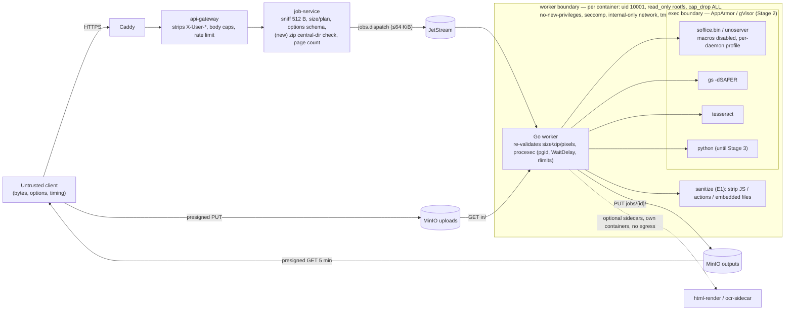

# 15 — Security and reliability for untrusted files

> Part of the Next-Generation Document Engine analysis (2026-11). Status: ANALYSIS — no code changed.

## 1. Purpose and scope

Every byte a worker touches was chosen by a stranger. This document is the security-first design for the engines in
docs `04`–`11`: what controls exist today (with file:line), the threat analysis the brief asks for, the limits and
defaults we propose, sandboxing of exec'd tools, temp-file isolation, dependency scanning, audit logging, and the
reliability mechanics (retries, DLQ, cancellation, circuit breakers, health semantics). It is paired with doc `18`
(operations/incident runbook, cross-referenced as 15↔18) and relies on doc `12` for the performance side of the same
limits. Already-remediated items are referenced by their finding IDs in `docs/developer/architecture/backend-hardening.md`
§3.20 (F1, F2/S1, B1, B2, B3, F4, A1/S8, I1, I2) and §3.23.

## 2. Current state

### 2.1 Controls in place

| Control | Where | Note |
|---|---|---|
| Content sniff at job creation | `job-service/handlers/jobs.go:731` `consumeUpload` → `GetObjectRange` first 512 B (`:793`, `sniffLen` `:944`) → `validateMIMEHead` `:1358-1385` against `allowedMIMETypes` `:57-75` | **Fail-open** for tools with no category (`:1361-1367`, deliberate). `application/zip` is accepted for every Office category (`:59-62`) because OOXML/ODF *are* zips — so any zip passes the sniff for `word-to-pdf`. |
| Size and plan limits | `shared/config/defaults.go:54-60` `MAX_UPLOAD_MB` 500 (hard ceiling); guest 20 MB / 5 files `:70,:80`; per-plan from `X-User-Plan-Max-File-MB` (`jobs.go:1178-1200`); gateway body caps 1 MiB / 4 MiB (`api-gateway/main.go:61,230,237`); upload complete re-checks size via `StatObject` (`handlers/uploads.go:224-300`) | Header trust is documented as a quota-bypass if job-service is reachable directly (`jobs.go:1189-1196`); gateway strips client `X-User-*` (`shared/authverify/context.go:94-100`) |
| Options validation | `job-service/handlers/tool_options.go` (`validateOcrOptions`, `validateSignOptions`: data URL ≤ 256 KB, I2); worker OCR language whitelist `optimize-pdf/processing/processing_free.go:487-497` (I1); page-range parsers fuzzed (`organize-pdf/processing/fuzz_test.go:13,46`) | Secrets scrubbed from persisted metadata (`jobs.go:1405-1418`) |
| tmpfs and large-job budgets | `convert-to-pdf/internal/worker/tmpfs.go:28-48` (900 MiB, factor 200 %), `largeJobSem` `:23`; compose `tmpfs: /tmp:size=1g` (`deployment/docker-compose.yml:825-826,903-904,981,1059`); memory 1 GiB / 2 CPU (`:840-841,921-922,994-995,1072-1073`) | Rejection happens after upload (doc `12` §5.8) |
| Job-scoped scratch | `os.MkdirTemp("", "job-<id>-")` removed by defer (`worker.go:500-505`); inputs landed by `path.Base` (`storage.go:52-60`), outputs by `filepath.Base` (`:73-79`) | Tools also create their own `pdf-ocr-*`, `pdf-scan-*`, `pdf-watermark-*`, `pdf-sign-*` dirs directly under `/tmp` (`optimize-pdf/processing/processing_free.go:522`, `organize-pdf/processing/processing_scan.go:455,505`, `processing_edit.go:323,500`) |
| Time bound | 10-min job context (`worker.go:546`) → `exec.CommandContext` | pdfcpu calls ignore ctx; **no process group kill** (`01` finding 2) |
| Image bombs | `DecodeConfig` before `Decode`, 50 MP (`organize-pdf/internal/imaging/decode.go:17,48-60`); detect-edges 30 MiB (`internal/httpapi/detect.go:23,95,108`); OCR render dim 10 000 px (`processing_free.go:291-292`); pdf→image `IMAGE_MAX_IMAGE_DIM` (`convert-from-pdf/processing/processing_free.go:92`) | Data-URL watermark image not sniffed/capped in the worker (`processing_edit.go:295-315`); implicit bound = 64 KiB JetStream max message (`shared/natsconn/natsconn.go:69-112`) |
| Encryption | AES-256/128, RC4-128 via pdfcpu (`processing_edit.go:183-191`; password length `:106`); SSE-S3 at rest (`docker-compose.yml:232-236`, §3.23) | No custom crypto (non-negotiable) |
| Process identity | uid 10001 `appuser` in every image (`convert-to-pdf/Dockerfile:25,37`, `convert-from-pdf/Dockerfile:42,55`, `organize-pdf/Dockerfile:35,47`, `optimize-pdf/Dockerfile:35,47`, `deployment/base-go-builder.Dockerfile:28`); `init: true` reaper (`docker-compose.yml:790,866`) | No `read_only`, `cap_drop`, `security_opt`, `user:` keys anywhere in compose (grep verified) |
| Reliability | `MaxDeliver 4`, `AckWait 30 m`, `MaxAckPending 2×concurrency`, backoff (`worker.go:323-326`); `handleFailure` recoverable vs permanent (`:682`, `isRecoverable` `:858`), DLQ `jobs.dlq.<svc>` (§3.6) + `/api/jobs/dlq/redrive`; duplicate guard (`:459`); idempotency keys SetNX (`jobs.go:116-153`, B2); upload claim (B1); `/readyz` checks Redis/NATS/Postgres (`convert-to-pdf/main.go:132-160`) | No cancellation (`01`), no daemon recycling, no circuit breaker on exec'd tools |
| Ghostscript | compress/repair/flatten pass `-dSAFER` explicitly (`optimize-pdf/processing/processing_free.go:73`); PDF/A path does not (`convert-from-pdf/processing/processing_free.go:212-221`) | SAFER is the default since 9.50 (Sources) — the omission is hygiene, not an exposure, on current versions |
| Fuzzing | 10 targets: `organize-pdf/processing/fuzz_test.go` (page ranges ×2, `FuzzDecodeDataURLImage`), `job-service/handlers/fuzz_test.go` (filename, part numbers), `shared/authverify`, `shared/config` ×2, `analytics-service/handlers` ×2; CI stage `scripts/ci/06-fuzz-short.sh` 10 s each | None on a document parser path |
| XML / zip in Go | `encoding/xml`: **not imported by any non-test Go file**; `archive/zip`: write-only (`organize-pdf/processing/processing_free.go:397`, `convert-from-pdf/processing/processing_free.go:535`, `pptx_builder.go`) | Office inputs are unzipped by LibreOffice/Python, not by Go — today |

### 2.2 Gaps confirmed on the fresh build (`benchmarks/raw/tool-versions.txt`, 2026-11-07)

| Gap | Evidence |
|---|---|
| **Alpine 3.19 is EOL** (2025-11-01, Sources): convert-to-pdf base, optimize-pdf, organize-pdf run Alpine 3.19.9 — no further security updates for LibreOffice 7.6.7.2, tesseract 5.3.3, poppler 23.10.0, ghostscript 10.05.1 | `tool-versions.txt`; `deployment/base-alpine-libreoffice.Dockerfile`, `optimize-pdf/Dockerfile`, `organize-pdf/Dockerfile` |
| **Ghostscript 10.05.1** in optimize-pdf is in the affected range of CVE-2025-59798/59799 (pdfwrite, fixed 10.06.0) — the exact device `compress`/`repair`/`flatten` use | `tool-versions.txt`; Sources (gs 10.06.0 News) |
| **Ghostscript 10.00.0** in convert-from-pdf (Debian 12.15): whether Debian backported CVE-2024-29510, CVE-2024-46951..46956, CVE-2025-27830..27837 is **unverified** — check `apt changelog ghostscript` in the image | `tool-versions.txt`, `convert-from-pdf/Dockerfile:32-34` |
| **unoserver unpinned** (`base-alpine-libreoffice.Dockerfile:24`) and the pool has never started (D23: `entrypoint.sh:43` passes a `file://` URI; unoserver 3.7 dies; entrypoint warns and continues; `benchmarks/raw/startlog-convert-to-pdf.txt`) — a readiness probe that passes while the service is in permanent fallback | `convert-to-pdf/entrypoint.sh:43,68-70`, `main.go:132` |
| LibreOffice fallback uses the shared default profile across concurrent jobs (`processing_free.go:69`, no `-env:UserInstallation`) — and is the *only* path in use today | D23 |
| No macro execution anywhere: no VBA/Basic/JS engine is invoked by any exec site (`01` exec table) — **confirmed**; LibreOffice's default `MacroSecurityLevel` is High (2) per `Common.xcs`, so unsigned macros do not run; that `--convert-to` never fires document events at that level is **unverified by official docs** (forum evidence only, Sources) | exec table; Sources |
| PDF JavaScript, `/OpenAction`, `/AA`, `/Launch`, embedded files are not stripped on any path; pdfcpu (pinned v0.9.1 `organize-pdf/go.mod:10`) has `attachments remove` but **no JavaScript/action removal** (open issue #653); qpdf none either | Sources |
| Workers trust job-service: no MIME/extension check in any worker (`01` audit) | — |
| pdf2docx is MIT; its AGPL exposure is via PyMuPDF 2.1 (`tool-versions.txt`) — licence notice still due | `01` |

## 3. Requirements and threat analysis

Threat model: the attacker controls file bytes, option values within the validated schema, and timing (concurrency,
cancellation). The attacker does not control the gateway headers (stripped) or the NATS message. Goals we defend:
worker availability (no OOM/CPU/tmpfs exhaustion that stalls other tenants), isolation (no read of other jobs' files,
no write outside scratch, no egress), integrity of outputs (no live content delivered to the next viewer), and
confidentiality of logs.

| Threat | Exposure today | Mitigation (proposed) |
|---|---|---|
| **ZIP bombs** (OOXML/ODF input) | Sniff accepts any zip for Office tools; LibreOffice/Python unzip inside the container; only the 1 GiB memory limit and tmpfs stop them | Go-side pre-check at job creation and again in the worker before exec: read the central directory (`archive/zip` `UncompressedSize64`), reject when Σ uncompressed > `ZIP_MAX_TOTAL` or ratio > `ZIP_MAX_RATIO` or entries > `ZIP_MAX_ENTRIES`; nested zips (`.zip` entries) rejected for Office tools (OOXML never nests). This is a *reader*, so it inherits the zip-slip rule below. |
| **Malformed XML / entity expansion** | No Go XML parsing today; E4 writers (Stage 3) only write; optional Stage 6 readers would parse | Go `encoding/xml` does not expand DTD-declared entities (golang/go#35389, open-by-design), never fetches external entities, caps unmarshal depth at 10 000 (CVE-2022-30633 fix) — billion-laughs is not possible unless we populate `Decoder.Entity`. Rules for any future reader: `io.LimitReader` per part (`XML_MAX_PART_BYTES`), reject `Directive` tokens containing `<!ENTITY`, cap attribute length and element depth in our own walker. LibreOffice's own XML parser is the exposure until then — sandbox it (§5.3). |
| **Path traversal** | Object keys based (`storage.go:55,76`); zip *writes* only; filenames fuzzed (`FuzzSanitizeFileName`) | Any future zip reader: `GODEBUG=zipinsecurepath=0` so `archive/zip` returns `ErrInsecurePath` for `..`/absolute/backslash names (Go 1.20, off by default — Sources), plus our own `fs.ValidPath` check; extract only into `<scratch>/in/<job>/`. |
| **Malicious embedded objects** (OLE, fonts, images inside Office/PDF) | Parsed by LibreOffice, Ghostscript, poppler, PyMuPDF — all C/C++ | Sandbox the exec (§5.3), keep versions patched (§5.5), never execute anything (macros, JS, Launch); strip on sanitize (§5.4). |
| **Decompression bombs in PDF streams** (Flate/LZW in content streams and images) | pdfcpu inflates streams fully in memory (no documented limit — unverified, assume none); gs/poppler have their own behaviour (poppler issue #878, unverified) | Byte-level: input size by plan; process-level: `GOMEMLIMIT` + cgroup (doc `12` §5.6) so an inflate of one job cannot take the container; per-stream cap in E5 (Stage 4) where *we* decode image XObjects: refuse streams whose declared `/Width×/Height×bpc` exceeds the pixel budget before inflating. |
| **Extremely large images** | 50 MP guard; OCR 10 000 px; detect 30 MiB | Keep; add the worker-side cap for data-URL images (1 MiB decoded, `DecodeConfig` sniff); per-worker byte semaphore (doc `11` §5.1). |
| **Recursive structures** (page-tree loops, object cycles, nested zips) | pdfcpu/gs/poppler handle PDF cycles internally (version-dependent); nested zips untested | Fuzz our wrappers with page-tree-loop seeds; pdfcpu `validate` as the first stage of every pdfcpu tool with a time bound (run in a goroutine, abandon on ctx — pdfcpu ignores ctx, so the *job* still ends); nested zips rejected (above). |
| **Memory / CPU exhaustion** | 1 GiB / 2 CPU per worker; concurrency semaphores; OCR pool ≤ 4; no GOMEMLIMIT; no per-class limits | Doc `12` §5.1/§5.6; size-scaled timeouts (Q1/Q12); `ulimit`-style `RLIMIT_AS`/`RLIMIT_CPU` on exec'd children via procexec (`SysProcAttr` + `prlimit` is Linux-only — acceptable, workers are Linux). |
| **Parser vulnerabilities** | C/C++ parsers in every worker; Go parsers (pdfcpu, x/image) memory-safe but panic-able (panics recovered → Term, `worker.go:369-384`) | Patch cadence (§5.5), sandbox (§5.3), fuzz (§5.7), one job per scratch, no shared daemon state across tenants except the LO profile (recycle it, doc `12` §5.3). |
| **PDF JavaScript / embedded files / Launch, URI, GoToR actions** | Passed through untouched; viewers (pdf.js in the web Reader, native app viewer) are the execution surface | **Sanitize on output** (§5.4): strip `/JavaScript`, `/JS`, `/OpenAction`, `/AA`, `/Launch`, `/EmbeddedFiles`, `/FileAttachment` annots, `/RichMedia`, `/Movie`/`/Sound`; never execute anywhere (no JS engine in the stack — confirmed). |
| **Macro-containing Office documents** (settings applied 2026-11-09, `convert-to-pdf/processing/loprofile.go`; verified 2026-11-09: every key exists in the installed schema, and the sentinel macro did not run through either path; the permissive control did not run it either, so headless `--convert-to` itself does not fire the open event) | LibreOffice at MacroSecurityLevel High; output is PDF (macros cannot survive) or ODF (converted Basic module could be written, `Writer.xcs` defaults Load/Executable/Save = true — Sources) | Set `DisableMacrosExecution=true` and `Filter/Import/VBA/Load=false` in each daemon's `registrymodifications.xcu` under its `--user-installation` profile (and in the fallback profile), so macros are neither run nor carried into ODF outputs; verify with a DOCX fixture carrying an `AutoOpen` that writes a sentinel file (§7). |
| **SSRF / egress via documents** (HTML with remote images, DOCX with linked pictures, PDF `/URI`) | Workers have default Docker egress; LibreOffice will fetch linked resources | Internal-only network for workers (§5.3); WeasyPrint sidecar egress blocked (doc `04` gate). |
| **Quota bypass via direct service access** | `X-User-Plan-Max-File-MB` trusted (`jobs.go:1189-1196`) | Resolve plan from Redis in job-service (duplicating plancache logic is permitted per §1 — it is config, not business logic) when app services span hosts (`horizontal-scaling.md` §4 prerequisite 1). |

## 4. Options evaluated — sandboxing and scanning

| Option | Language | Licence | Maturity | Coverage | Integration | Effort (EM) | Verdict |
|---|---|---|---|---|---|---|---|
| Docker hardening keys (`read_only`, `cap_drop: [ALL]`, `security_opt: [no-new-privileges:true, seccomp=<profile>]`, `tmpfs`) | compose | — | stable, documented | blocks privilege gain, namespace creation (default seccomp already denies `clone` with `CLONE_NEW*`, `unshare`, `mount`, `ptrace` — Sources), writes outside tmpfs | compose only | 0.2 | **Adopt now** (Stage 1) for all four workers |
| Custom seccomp per worker (deny `socket` families except AF_UNIX/AF_INET to allowed hosts is not expressible in seccomp; deny `execve` after start is not possible for exec-based workers) | JSON | — | stable | limited beyond the default profile | compose | 0.2 | **Stage 2**: start from Docker's default, remove what `strace -f -c` of a k6 run shows unused |
| AppArmor profile for `soffice.bin`, `gs`, `tesseract`, `python3` (deny network, deny write outside `/tmp`, deny read of `/app`, `/etc` beyond fontconfig) | AppArmor | GPL (kernel) | host must run AppArmor (Ubuntu does) | per-binary file + network mediation — exactly the boundary we want | host-installed profile, `security_opt: apparmor=<name>` | 0.3 | **Stage 2** on hosts with AppArmor; document the host requirement in `18` |
| Internal network (`networks: workers: internal: true`) + MinIO/NATS/DB/Redis attached to it | compose | — | stable | no external egress for workers; sidecars same | compose | 0.1 | **Adopt now** |
| gVisor `runtime: runsc` per service | Go | Apache-2.0 | weekly releases (`release-20261102.0`); compose `runtime:` key supported; DNS caveat (set `dns:`) | kernel-syscall interposition; VFS/Gofer overhead is the known cost; tmpfs inside the sandbox is fine; no block FS inside | compose, host installs runsc | 0.3 + benchmark | **Evaluate in Stage 2** for convert-to-pdf and convert-from-pdf (the C/C++-heaviest); adopt only if `word-to-pdf` p95 regresses < 20 % on the k6 ladder |
| bubblewrap inside the worker container | C | LGPL-2.1 | active | per-exec namespaces | needs unprivileged user namespaces, which Docker's default seccomp denies without `CAP_SYS_ADMIN` (moby profile: `clone` with `CLONE_NEWUSER` → EPERM, `clone3` → ENOSYS — Sources); issue #587 needed `privileged` | — | **Not justified**: weakening the container to enable a sandbox inside it is backwards; gVisor at the container boundary gives the same isolation without it |
| Separate uid per exec'd tool inside the container | — | — | — | needs `CAP_SETUID` in the worker | — | **Not justified** (contradicts `cap_drop: ALL`); the container is the unit of identity |
| govulncheck v1.9.0 (2026-10-11) | Go | BSD | Go team | Go module + call-graph reachability | CI stage `08-vuln.sh` | 0.1 | **Adopt now** |
| Trivy v0.76.2 / Grype v0.121.2 (both Apache-2.0, 2026-11-05) | Go | Apache-2.0 | active | OS packages + language deps in images; both read SBOMs | CI + nightly on built images | 0.1 | **Adopt now** (one of them; Trivy also scans compose/Dockerfiles) |
| syft v1.57.0 CycloneDX (`-o cyclonedx-json`) | Go | Apache-2.0 | active | SBOM per image; feeds the AGPL inventory | CI, artefact per build | 0.1 | **Adopt now** |

## 5. Recommendation

### 5.1 Limits with proposed defaults

All env-driven, duplicated in job-service (reject before a job exists) and in the owning worker (defence in depth, no
shared code), **to be validated against `benchmarks/baseline-2026-11.md` before shipping**:

| Limit | Proposed default | Where enforced |
|---|---|---|
| File size by plan | From the `subscription_plans` table (Q12, done 2026-11-08): guest 20 MB per file / 100 MB per job, free 50 / 300, pro 300 / 300; `MAX_UPLOAD_MB` 300 is the worker-capacity ceiling; image tools 20 MB | job-service `planMaxFileSizeMB` + per-tool table; worker `tmpfs.go` |
| Zip (OOXML/ODF) | `ZIP_MAX_TOTAL_MB` 2 000, `ZIP_MAX_RATIO` 100, `ZIP_MAX_ENTRIES` 10 000, no nested zip, names must pass `fs.ValidPath` | job-service sniff stage (central directory read via `GetObjectRange` tail), worker pre-exec |
| XML (future readers) | `XML_MAX_PART_MB` 64, depth 256, attribute value 64 KiB, no `<!ENTITY` | reader package |
| Page count | `PDF_MAX_PAGES` 2 000 for OCR and pdf→image, 5 000 for pdfcpu ops (from `api.PageCountFile`, Q8/Q9) | job-service at upload (Q9) + worker |
| Pixel budget | 50 MP decode guard (keep); scan page 30 MP; data-URL image 1 MiB; per-worker `IMAGING_BUDGET_MB` 512 | organize-pdf, convert-to-pdf |
| Processing timeouts | base 10 min; office `max(30 s, 2 s + 1.5 s/MB)` per attempt; job ctx scaled `min(10 min × ceil(size/50 MB), 30 min)`; AckWait = ctx + drain | workers |
| Memory | cgroup 1 GiB (keep); `GOMEMLIMIT` per doc `12` §5.6; `RLIMIT_AS` on gs/tesseract/python children = container limit − Go share | compose, procexec |
| tmpfs | 1 GiB (keep); `TMPFS_BUDGET_MB` 900; class shares 70/30 (doc `12` §5.1) | workers |
| Exec stderr capture | 64 KiB, path-scrubbed, never returned to the user (already the gs policy, `processing_free.go:48-51`) | procexec |

### 5.2 Trust boundaries

### 5.3 Sandboxing

Stage 1 (compose only): `read_only: true` with `tmpfs: /tmp` (LibreOffice profiles already live in `/tmp`;
`PYTHONDONTWRITEBYTECODE=1` for convert-from-pdf; gs/tesseract write nothing), `cap_drop: [ALL]`,
`security_opt: [no-new-privileges:true]`, an `internal: true` network for workers with MinIO/NATS/DB/Redis attached and
the OTLP collector reachable only when the `observability` profile is on. Health checks must keep working from inside
(they do: `wget`/`python3 urllib` on localhost).

Stage 2: AppArmor profiles per exec'd binary on AppArmor hosts; gVisor evaluation for the two LibreOffice workers on the
k6 `word-to-pdf` ladder (adopt if p95 regression < 20 %; note compose `dns:` caveat); custom seccomp from `strace -c`.
Each daemon gets its own LibreOffice profile with `DisableMacrosExecution=true` and VBA `Load=false` written at start
(the Go-owned lifecycle from Q1/Q2 is where this belongs); the cold fallback gets `-env:UserInstallation=file:///tmp/lo-<job>`.

### 5.4 Sanitize on output (E1, organize-pdf)

pdfcpu has no action/JavaScript removal (issue #653 open; `validate` only *reports* JS since v0.16.1), qpdf has none;
pdfcpu's object model is already imported by organize-pdf (`pkg/pdfcpu`, `/model`, `/types`). A `sanitize-pdf` step
(1–2 weeks, Stage 2) walks the catalog and each page: delete `/OpenAction`, `/AA` (catalog, pages, fields, annots),
`/Names/JavaScript`, `/Names/EmbeddedFiles` (or `attachments remove`), annotations of subtype `/FileAttachment`,
`/RichMedia`, `/Movie`, `/Sound`, `/Screen`, and any `/A` whose `/S` is `/JavaScript`, `/Launch`, `/GoToR`, `/ImportData`,
`/SubmitForm`; `/URI` actions are kept (links are a feature) but logged. Run it on every PDF output and expose it as a
tool. Acceptance: a corpus of 30 PDFs with each action type (hand-built with pdfcpu's low-level API plus public
"malicious PDF" samples) comes out with zero matching dictionaries (`pdfcpu validate` notices = 0) and identical page
renders. Never implement an action *executor*; the viewers are the only place actions are interpreted, and pdf.js
scripting in the web Reader should be confirmed disabled (frontend item, out of scope here).

### 5.5 Dependency and image hygiene

- **Base images**: move the three Alpine 3.19 images to a supported release (3.22 EOL 2027-05-01 or 3.23 EOL
  2027-11-01, Sources) in Stage 1; this is what refreshes Ghostscript past 10.06.0 (CVE-2025-59798/59799 in pdfwrite),
  tesseract, poppler and LibreOffice. For convert-from-pdf (Debian bookworm) verify the gs 10.00.0 backports or move to
  trixie; the Python stack leaves in Stage 3 anyway.
- **Pin everything exec'd**: `unoserver==<tested>` (`base-alpine-libreoffice.Dockerfile:24`), apk/apt packages by
  version where the distro allows, with the `benchmarks/raw/tool-versions.txt` capture repeated per build.
- **CI**: new `scripts/ci/08-vuln.sh` running `govulncheck ./...` per module (workspace rule: loop over modules), `syft`
  SBOM per image, `trivy image --severity HIGH,CRITICAL --exit-code 1` on every built image; nightly rescan of the
  deployed tags.
- **AGPL inventory** (from the SBOM, kept in `docs/developer/architecture/licences.md` — proposed): Ghostscript (AGPL,
  exec'd unmodified, notice required), PyMuPDF (AGPL via pdf2docx; pdf2docx itself MIT; gone in Stage 3), poppler
  (GPL, exec'd), LibreOffice (MPL-2.0), tesseract (Apache-2.0), pdfcpu (Apache-2.0), unoserver (MIT — unverified).

### 5.6 Temp-file isolation and safe cleanup

- `shared/procexec` (cross-cutting, Stage 1): `SysProcAttr{Setpgid: true}`, `cmd.Cancel = kill(-pgid, SIGKILL)` after a
  `SIGTERM` grace, `cmd.WaitDelay` so inherited pipes cannot block `CombinedOutput`, `prlimit` on the child, stderr ring
  buffer. Adopted at every exec site in the `01` table.
- Tool scratch under the job scratch: `MkdirTemp(scratch, "ocr-*")` instead of `MkdirTemp("", …)` so one `RemoveAll`
  covers everything and a crash leaves one directory, not three.
- **Orphan sweep** at worker start and every 10 min: kill `soffice.bin`/`gs`/`tesseract`/`python3` whose pgid has no
  live job, remove `/tmp/job-*` older than the maximum job ctx; count both as `orphans_swept_total{kind}` — a non-zero
  rate is a bug report.
- Daemon profiles (`/tmp/uno-profile-<port>`) are recreated on recycle; the cold fallback profile is per job.

### 5.7 Security test plan

| Test | Corpus / method | Pass condition |
|---|---|---|
| Malicious corpus | ≥ 100 files in `benchmarks/corpus/security/`: zip bombs (nested, high-ratio, 100 k entries), zip-slip names, DOCX with AutoOpen writing `/tmp/PWNED`, PDF with JS/OpenAction/Launch/EmbeddedFiles/page-tree loop/Flate bomb, 100 MP PNG, 20 000×20 000 JPEG, SVG with external entity, HTML with `` | every job ends `failed` with a structured code or `completed` with the payload removed; no sentinel file; worker RSS < limit; no egress (see below); no orphan |
| Fuzz | targets added for `decodeBytes`, `parseScanOptions`, `computeSafeDPI`, `projectedFootprint`, zip central-directory reader, sanitize walker, E4 parsers (Stage 3); `make fuzz-short` in CI, 1 h per target nightly | no crasher older than one release; coverage of each wrapper ≥ 80 % by `go test -cover` |
| Exec orphan test | 100 forced cancels (Q11) mid-conversion across all four workers; `ps -eo pgid,comm` inside each container | 0 `soffice.bin`/`gs`/`tesseract`/`python3` after 5 s (Stage 1 roadmap acceptance) |
| Egress test | from each worker and sidecar: `wget -T 3 https://example.com`, DNS to a public resolver, and the SSRF fixture above | all fail; only MinIO/NATS/DB/Redis/OTLP reachable |
| Readiness truth test | kill the unoserver daemons | `/readyz` → 503 within one probe interval; `office_pool_ready` → 0 (lesson of D23) |
| Hardening regression | `docker inspect` of each worker | `ReadonlyRootfs`, `CapDrop=[ALL]`, `no-new-privileges`, network list = internal only |

### 5.8 Audit logging (per job, no content)

Log once at terminal state (structured, `trace_id`/`request_id` already present, `shared/logger/logger.go:53-60`):
`jobId`, `userId` or `guest` (hashed token), `tool`, option *keys* (never values; passwords are already scrubbed),
input count/sizes/sniffed MIME/page count, engine path (`warm|cold|fallback|cache-hit|sidecar`), per-stage durations,
child exit codes and signal, sanitizer counts (`js_removed`, `attachments_removed`, `actions_removed`), limits hit,
output size and sha256, retry attempt. Never: filenames (hash them), extracted text, data URLs, raw tool stderr beyond
the scrubbed 64 KiB, bucket credentials or presigned URLs. Retention follows the existing Loki pipeline; access to job
logs is an admin function.

### 5.9 Reliability

- **Retry classes** (exist): recoverable → `NakWithDelay` with the backoff ladder; permanent → mark failed, DLQ, Ack
  (`worker.go:682,858`). Add a third class **poison**: a job whose previous attempt died with the worker (delivery count
  > 1 and no failure record) is sent to the DLQ on its second delivery instead of its fourth, so a parser crash cannot
  take a worker down four times.
- **DLQ** (exists, §3.6) + redrive route; add `jobs.dlq` reason labels for sanitizer/limit rejections so they are
  not redriven blindly.
- **Idempotency** (exists, B2; cache keys content-addressed) — keep.
- **Cancellation** (Q11): `DELETE /jobs/:id` → `jobs.cancel.<id>`; worker map jobID→cancel; procexec kills the group;
  pdfcpu stages check ctx between pages. State machine gains `cancelled` (migration in job-service, the sole migrator).
- **Daemon recycling** and kill-on-timeout (doc `12` §5.3).
- **Circuit breaker on sidecars** (`shared/circuitbreaker`, gobreaker v2.4.0, already used by the gateway): open after
  N consecutive sidecar failures → fall back to the in-worker path (Tesseract, cold LO) and emit `sidecar_circuit_open`.
- **Health/readiness semantics**: `/healthz` = process alive (keep); `/readyz` = dependencies **and** engine pool
  (daemons answering, binaries present, tmpfs mounted) — D23 is the proof that a probe which ignores the engine lies;
  add `/drainz` (or a header) reporting in-flight jobs so the deploy script can wait on it instead of a fixed
  `stop_grace_period`.

## 6. Classification

| Item | Class | Stage | EM |
|---|---|---|---|
| Compose hardening, internal network, procexec, orphan sweep, tool scratch under job scratch, base-image bump, pins, CI scanners, SBOM | A (infra; `shared/procexec` is the only shared code) | 1 | 0.6 |
| Zip central-directory limits, data-URL cap, page-count limits, limits table | A (duplicated validators by design) | 1–2 | 0.3 |
| Sanitize on output (E1 walker) | B custom (small), inside organize-pdf | 2 | 0.4 |
| Macro-disabled LO profiles, per-job fallback profile | D (LibreOffice config) | 1 (with Q0–Q2) | 0.1 |
| AppArmor / seccomp / gVisor | D (host/runtime) | 2, gated on the ladder | 0.4 |
| Cancellation, poison class, readiness truth, drain endpoint | A | 2 | within Q11 |
| Security corpus + fuzz expansion | harness (Q13) | 1–3 | 0.4 |

## 7. Acceptance criteria and gates

| Gate | Proof |
|---|---|
| No EOL base image; no HIGH/CRITICAL in Trivy on built images; govulncheck clean | CI stage 08 green; `tool-versions.txt` regenerated per build |
| Malicious corpus: 0 sentinel files, 0 OOM, 0 orphans, 0 egress | §5.7 run in CI integration stage (docker) |
| Macro fixture: `AutoOpen` DOCX converted to PDF and ODT with no sentinel and no Basic module in the ODT | `unzip -l out.odt \| grep -c Basic` = 0 |
| Sanitize: 30-file action corpus → 0 `pdfcpu validate` notices, SSIM 1.0 vs input render | `make bench-engine SUITE=sanitize` |
| Readiness truth: daemons killed → 503 ≤ 10 s | §5.7 |
| Cancel → tool dead ≤ 2 s; 100 cancels → 0 orphans | Stage 1/2 roadmap acceptance |
| gVisor adoption only if `word-to-pdf` p95 regression < 20 % | k6 ladder before/after |

## 8. Risks and open questions

- **LibreOffice headless event macros**: the "never runs under `--convert-to` at High" claim is forum-level evidence;
  the `DisableMacrosExecution` setting plus the sentinel fixture turns it into a tested property — do not ship Stage 1
  without that fixture.
- **Ghostscript exposure window**: optimize-pdf runs 10.05.1 on an EOL Alpine; until the base bump, every `compress`
  job runs a pdfwrite with known CVEs on attacker-controlled input. This is the single most urgent item in the document.
- **pdfcpu version jump** (v0.9.1 → v0.16.x) for the sanitizer may change behaviour of existing tools; the fidelity
  harness (Q13) is the regression net.
- **Header trust** stays a documented bypass until plan lookup moves into job-service; acceptable only while service
  ports are unreachable except from the edge (`horizontal-scaling.md` §4).
- **gVisor on a 12-vCPU single host**: overhead may eat the Stage 1 throughput gain; measure, do not assume.
- **Logging hashes of filenames** changes what support can see; `18` must document the lookup path.

## Sources (accessed 2026-11-07)

- LibreOffice macro security levels — https://help.libreoffice.org/latest/en-US/text/shared/optionen/macrosecurity_sl.html ; default `MacroSecurityLevel` = 2 and `DisableMacrosExecution` — https://raw.githubusercontent.com/LibreOffice/core/master/officecfg/registry/schema/org/openoffice/Office/Common.xcs ; VBA Load/Executable/Save options — https://help.libreoffice.org/latest/en-US/text/shared/optionen/01130100.html ; defaults — https://raw.githubusercontent.com/LibreOffice/core/master/officecfg/registry/schema/org/openoffice/Office/Writer.xcs ; headless event macros (forum, unverified) — https://ask.libreoffice.org/t/run-event-based-macro-headless-mode/55365
- Ghostscript SAFER default since 9.50 / NOSAFER — https://ghostscript.readthedocs.io/en/latest/Use.html ; releases — https://ghostscript.com/releases/index.html ; 10.06.0 CVE-2025-59798..59801 — https://ghostscript.readthedocs.io/en/gs10.06.0/News.html , https://security-tracker.debian.org/tracker/CVE-2025-59798 ; 10.05.1 CVE-2025-27830..27837 — https://ghostscript.readthedocs.io/en/gs10.05.1/News.html ; 10.04.0 CVE-2024-46951..46956 — https://ghostscript.readthedocs.io/en/gs10.04.0/News.html ; CVE-2024-29510 (secondary) — https://securityaffairs.com/165449/hacking/ghostscript-vulnerability-cve-2024-29510.html
- Go `encoding/xml` — https://pkg.go.dev/encoding/xml ; DTD entities not expanded — https://github.com/golang/go/issues/35389 ; depth limit (CVE-2022-30633) — https://go.googlesource.com/go/+/c4c1993fd2a5b26fe45c09592af6d3388a3b2e08 , https://go.dev/issue/53614
- Go `archive/zip` `ErrInsecurePath` / `zipinsecurepath` — https://pkg.go.dev/archive/zip , https://go.dev/doc/go1.20
- gVisor Docker/compose — https://gvisor.dev/docs/user_guide/quick_start/docker/ , https://gvisor.dev/docs/tutorials/docker-compose/ ; performance/compat — https://gvisor.dev/docs/architecture_guide/performance/ , https://gvisor.dev/docs/user_guide/compatibility/ ; releases — https://github.com/google/gvisor/releases
- bubblewrap — https://github.com/containers/bubblewrap , https://github.com/containers/bubblewrap/blob/main/bwrap.xml , https://github.com/containers/bubblewrap/issues/587
- Docker compose `security_opt`/`cap_drop`/`read_only`/`runtime` — https://docs.docker.com/reference/compose-file/services/ ; default seccomp profile — https://docs.docker.com/engine/security/seccomp/ , https://raw.githubusercontent.com/moby/profiles/main/seccomp/default.json
- govulncheck — https://pkg.go.dev/golang.org/x/vuln/cmd/govulncheck ; Trivy — https://github.com/aquasecurity/trivy/releases ; Grype — https://github.com/anchore/grype/releases ; syft — https://github.com/anchore/syft/releases
- NATS consumer semantics — https://docs.nats.io/nats-concepts/jetstream/consumers ; Go GC guide — https://go.dev/doc/gc-guide
- pdfcpu attachments remove — https://pdfcpu.io/attach/attach_remove ; no JS removal (#653) — https://github.com/pdfcpu/pdfcpu/issues/653 ; OpenAction (#1269) — https://github.com/pdfcpu/pdfcpu/issues/1269 ; validate notices — https://pdfcpu.io/core/validate ; releases — https://github.com/pdfcpu/pdfcpu/releases
- qpdf — https://github.com/qpdf/qpdf , https://qpdf.readthedocs.io/en/stable/cli.html
- PDF deflate bombs: poppler #878 (unverified content) — https://gitlab.freedesktop.org/poppler/poppler/-/issues/878 ; OWASP compression bombs — https://wiki.owasp.org/images/c/c9/Benelux_day_20161125_G_Pellegrino_CompressionBombsStrikeBack.pdf
- Alpine EOL — https://alpinelinux.org/releases/
- Repository evidence: `benchmarks/raw/tool-versions.txt`, `benchmarks/raw/startlog-convert-to-pdf.txt` (D23), `docs/developer/architecture/backend-hardening.md` §3.20, §3.23.
