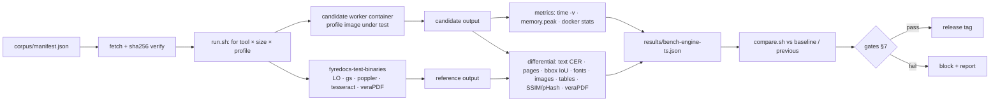

# 16 — Benchmarking and Testing
> Part of the Next-Generation Document Engine analysis (2026-11). Status: ANALYSIS — no code changed.

> **Status update (2026-11-16): M1.7 first slice implemented** (`scripts/bench-engine/`). What runs:
> `gen`/`verify` over 226 generated files (§5.2 categories; real-world series listed as `pending`),
> `run` through the live stack (upload → job → download via Caddy) with per-job wall/server time,
> worker-container RAM/CPU from the Docker API, and the §5.6 checks (pdfinfo pages/sizes, pdftotext
> CER and word recall, SSIM on 72 dpi greyscale renders, pdffonts embedding, veraPDF 2b, LibreOffice
> reference for office/HTML → PDF, OCR recall against the generator's source text); `compare`
> (and `-noise`) with the §5.5 thresholds; CI stage 09 (`scripts/ci/09-engine-gate.sh`, nightly/release).
> First development baseline: `benchmarks/results/baseline-2026-11-16-dev.{json,md}` (446 jobs,
> 29 min, Apple M1 / 8 GB; development numbers). **Noise floor on this host: 57 % wall p50**
> (two same-code runs, `benchmarks/results/noise-2026-11-16-r*.json`): LibreOffice tools 24–57 %
> (warm vs cold unoserver daemons), the rest under 10 %, pure pdfcpu tools under 4 %. Far above the
> ±5 % target, so on this Mac a single run cannot gate timing (the +10 % rule): use `-runs 3` medians
> and, for quotable numbers, the production-class host. Quality checks are deterministic and do gate.
>
> **Deviations from §5:** stats come from Docker's stats stream (about 1 per second, not 250 ms or
> cgroup `memory.peak`), so peak RAM is a lower bound and jobs under about 1 s show "n/a"; the tofu
> check is a Devanagari text/font proxy, not a pHash match against a `.notdef` glyph; the gate is
> stage 09 (stage 08 became `08-vuln.sh`); the manifest is JSON recipes plus a local `corpus.lock`
> (generated files are not byte-stable), not committed checksums; k6 throughput, cold startup on the
> production-class host, build/binary/image sizes and per-engine golden bands are still open.
> Benchmark runs need `scripts/bench-engine/compose.bench.yml`, which raises rate limits and turns
> the workers' result cache off (`RESULT_CACHE_TTL_SECONDS=0`); the harness refuses a cached worker.
>
> **Findings from the first full run** (real; thresholds not tuned to hide them). **Status after the
> fixes (re-run 2026-11-16, `baseline-2026-11-16b-dev`):** 1 fixed for compress/repair (output guard
> falls back to a lossless pdfcpu optimisation; text kept on all 10 Hindi PDFs) and flagged for
> PDF/A and flatten (`textExtractable=false` + warning; no Ghostscript option fixes it); 2 fixed
> (text layer stamped onto the original page: SSIM passes on all 20 scans, output 3.5 → 1.65 MB, peak
> RAM 317 → 233 MiB at 200 dpi, time unchanged); 3 fixed (page guard rebuilds the page tree with
> Poppler; 2 of 2 pages on all 8 jobs; otherwise `PAGES_LOST`); 4 still open. The original list:
> 1. compress-pdf and pdf-to-pdfa (Ghostscript 10.08) break Devanagari text extraction: every word
>    extracts as "फा" (CER 0.86 on all 10 Hindi PDFs); rendering is unchanged, so search and
>    copy/paste break silently.
> 2. ocr-pdf replaces the scan with a re-render: SSIM 0.86 against the input on every scan (text
>    recall ≥ 0.90 on all). The page is rendered to PNG and rebuilt from Tesseract's output instead
>    of adding a text layer over the original image.
> 3. repair-pdf and compress-pdf (pdfcpu) keep 1 of 2 pages on the deep-nesting and cyclic-pages
>    corrupt inputs, where Poppler recovers both.
> 4. Minor: two two-column DOCX → PDF outputs at SSIM 0.945/0.949 against the harness's cold
>    LibreOffice 25.8.7.3 (same version as the worker); stream-length-long repairs at CER 0.045.
>
> Harness lessons, kept as regression tests: generated image pages must be Letter, not the image's
> pixel size in points (posters made pdf-to-image look 15× slower); pdfcpu `ImportImagesFile`
> appends to an existing file; pdfinfo reports `/Rotate` separately from the MediaBox; encrypted
> references need `-upw`; OCR text is read in raw order.

Siblings: `12-*` (engine integration decisions; every gate here is the proof a doc-12 decision asks
for, and doc 12 cites this harness), `14-api-and-distributed-architecture.md` (sync budgets, per-profile
throughput targets), `15-*` (metrics the harness reuses), `18-deployment-optimization.md` (image-size
budget measured by the same baseline file), `04-libreoffice-replacement-strategy.md` (SSIM gates).

## 1. Purpose and scope

Define one repeatable benchmark suite and one differential-testing system that every engine change
from Stage 1 onward must pass, reusing the test and load estate that already exists. Two deliverables:
`make bench-engine` (engine-level harness, new, Stage 1 — Q13 in doc 01) and the release gate "every
engine release must pass established compatibility tests", wired into the CI stage order. No numbers
are invented here; the only current figures cited come from `scripts/k6/results/`.

## 2. Current state

**Test taxonomy** (`docs/developer/architecture/testing-strategy.md:8-25`): three tiers by build tag —
unit (none), `integration` (essentials stack), `integration && binaries` (gs/libreoffice/tesseract/
poppler/python3 via Docker). No e2e tier; full-stack traffic is the k6 suite. Runners
(`Makefile:35,79-159`): `make test` with `TESTFLAGS = -race -count=1 -shuffle=on -timeout=10m`,
`make test-integration` (`-p 1`), `make test-binaries` (builds `deployment/test-binaries.Dockerfile`
and runs the four PDF workers with `-tags="integration binaries"`, Makefile:131-142), `make cover`
(`scripts/coverage.sh`), `make bench` (`-bench=. -benchmem -run='^$'` per module, Makefile:149-155),
`make fuzz-short` (`scripts/fuzz-short.sh`, `FUZZTIME` default 10 s per target).

**Estate** (`docs/developer/audit/test-report-2026-08.md:15-16,129-140`): 190 test files, 1,042 test
functions, 8 benchmarks listed in that report (the tree at HEAD has 9 `Benchmark*` functions:
`BenchmarkRateLimitMiddleware`, `BenchmarkParsePageRange`, `BenchmarkDetectDocumentQuad`,
`BenchmarkCoonsWarp12MP`, `BenchmarkSanitizeFileName`, `BenchmarkParsePartNumbers`,
`BenchmarkVerify`, `BenchmarkEnvelopeOK`, `BenchmarkBuildCacheKey` — grep 2026-11-07), 10 fuzz
targets (`FuzzParsePageRange`, `FuzzParsePageRangeGroups`, `FuzzDecodeDataURLImage` in organize-pdf;
`FuzzSanitizeFileName`, `FuzzParsePartNumbers` in job-service; `FuzzScopeListUnmarshalJSON`,
`FuzzUnquoteValue`, `FuzzApplyPostgresDSNDefaults` in shared; `FuzzBoundedJSON`,
`FuzzSanitizeMetadata` in analytics-service). Benchmarks measure parsers and crypto, not engines; the
only imaging hot path measured is `BenchmarkDetectDocumentQuad` (12.5 ms, test-report:137-138).

**Fixtures**: generated in-code into `t.TempDir()`; committed binaries ≤ 50 KB, synthetic only
(`testing-strategy.md:94-99`). **Binaries image** (`deployment/test-binaries.Dockerfile:11-27`):
`golang:1.26-alpine` + poppler-utils, ghostscript, tesseract (eng, deu), libreoffice, ttf-liberation,
python3 + unoserver — but **not** pdf2docx/pdfplumber (comment lines 6-8), so the Python paths of
convert-from-pdf are untested outside its own image.

**CI** (`scripts/ci/00-07`, `docs/developer/architecture/ci-pipeline.md:11-27`): 01 format, 02 static,
03 unit, 04 integration, 05 coverage, 06 fuzz-short, 07 build (`for_each_module go build`,
`07-build.sh:5` — modules, not images). Deliberately excluded from PRs: `make bench`, long fuzz,
`make test-binaries`, k6 (`ci-pipeline.md:19-23`).

**k6 suite** (`scripts/k6/README.md`, `config.js`): scenarios smoke / capacity / mixed-realistic /
per-group / browse / auth-churn / upload-heavy / spike / soak (README:111-122); `TOOL_MATRIX` of 32
tools with server-verified options and weights (config.js:88-134); `THRESHOLDS` `http_req_failed
<2 %`, api p95 < 800 ms / p99 < 2 s, `job_e2e` p95 < 60 s, `job_success` > 98 % (config.js:166-173);
size classes small 70 % / medium 25 % / large 5 % (config.js:74-78); capacity ladder with
INVALID/throttled detection (README:151-198); fixtures generator `scripts/k6/fixtures/gen.py`
(stdlib only; pdf, scanned-pdf, docx, xlsx, pptx, odt/ods/odp, png, html; small ≈ 0.8 MB, medium ≈ 8 MB,
large ≈ 40 MB, gen.py:7-8,22). Not covered: `unlock-pdf`, `scan-to-pdf`, sign/edit stubs
(README:140-142). Results: `scripts/k6/results/capacity-jobs-20260727-234123.md` — sustained 9 jobs/min,
job e2e p95 24.6 s, with the note that co-located k6 makes it a lower bound (lines 14-17).

**What does not exist**: an engine-level corpus, any fidelity (render-diff) comparison, per-tool wall
time/RAM/CPU measurement, image-size tracking, a release gate for conversions, fuzzing of PDF/OOXML
readers, golden outputs. `docs/developer/architecture/next-generation-document-engine/benchmarks/` is
present and empty at HEAD (2026-11-07); the lead is producing `baseline-2026-11.md` and
`measure-images.sh` there in parallel (§5.4 states their contract only).

## 3. Requirements

Functional: one command runs every tool over a fixed corpus in a fixed container and emits a
machine-readable report; a second command diffs two reports (current vs candidate); differential checks
compare candidate output to reference oracles with thresholds per gate; the release gate runs
unattended. Performance: the harness must not perturb what it measures (no co-located load generator
for quotable numbers; `capacity-jobs-…md:16-17`). Compatibility: reuse `make`, `scripts/ci/*.sh`
conventions (`00-lib.sh`, exit-code-clean), Go test infrastructure, the test-binaries image, the k6
suite; no new CI vendor config (`ci-pipeline.md:3-9`). Security/licensing: donated real-world files
never enter git; oracles (LibreOffice, Ghostscript, Poppler, veraPDF) are development/test
dependencies only and never a runtime dependency of the lightweight path; AGPL components appear in
the SBOM check (doc 18 §5.9), not in the candidate image after Stage 3.

## 4. Options evaluated

| Option | Language | Licence | Maturity | Fidelity/coverage | Integration | Effort (EM) | Verdict |
|---|---|---|---|---|---|---|---|
| A. Extend k6 for engine benchmarks | JS | AGPL (k6 tool) | mature, in repo | full stack only; cannot isolate an engine or read container RAM | exec | 0.2 | Keep for throughput/concurrency/failure-rate rows; not for engine rows |
| B. Go harness module `scripts/bench-engine/` (own `go.mod`, listed in `go.work`) using `x/image` for SSIM/pHash, `os/exec` into the test-binaries image | Go | BSD (x/image) | new; x/image already a worker dep (`organize-pdf/go.mod`, audit brief) | engine-level, per-tool, in-container | exec + in-process | 0.6 | **Adopt** |
| C. Python harness (Pillow/numpy/scikit-image) | Python | PSF/BSD | mature libs | same | exec | 0.4 | Reject: adds a second toolchain to CI; team is Go; `-I` hygiene for untrusted corpus files is extra care |
| D. `go test -bench` only | Go | — | exists (`make bench`) | in-process only; cannot cover exec'd engines or images | in-process | 0.1 | Keep for pure-Go engines (E4/E5 unit benches); insufficient alone |
| E. hyperfine for CLI timing | Rust tool | MIT | mature | wall time only | exec | 0.05 | Optional helper inside the container; not required |
| F. veraPDF for PDF/A oracle | Java | GPL/MPL dual | mature | PDF/A only | exec in test image | 0.1 | **Adopt** in test-binaries image only (doc 01 Q5) |

## 5. Recommendation

### 5.1 Layout

CLAUDE.md §2 lists the allowed top-level folders; `benchmarks/` is not one, `scripts/` is. The harness
code and the corpus manifest therefore live under `scripts/bench-engine/`; results and baselines live
under this doc folder's `benchmarks/`. (This departs from the brief's `benchmarks/corpus/` naming —
recorded in §8.)

```
scripts/bench-engine/
  run.sh                      # make bench-engine entry: build images, run suites, write report
  compare.sh                  # current-vs-candidate: two reports → markdown table + exit code
  go.mod / main.go / ...      # Go harness: corpus loader, runners, metrics, differential checks
  corpus/
    README.md                 # categories, how to add a file, licence rules (this §5.2)
    manifest.json             # {path, sha256, bytes, category, tags[], origin, licence, pages}
    synthetic/                # generated by gen.py + extensions; committed if ≤ 50 KB, else generated
    donated/                  # .gitignore'd; fetched into place by `run.sh --fetch` from BENCH_CORPUS_URL
  golden/                     # per-tool expected metrics (JSON), updated via UPDATE_GOLDEN=1
docs/developer/architecture/next-generation-document-engine/benchmarks/
  baseline-2026-11.md         # produced by measure-images.sh (lead, in parallel)
  measure-images.sh           # image/binary/build-time measurements (lead, in parallel)
  results/bench-engine-<ts>.{json,md}
```

### 5.2 Corpus (`scripts/bench-engine/corpus/README.md`)

Target ≥ 200 files (doc 01 Q13). Categories and the gate each one serves:

| Category | Source | Min count | Used by |
|---|---|---|---|
| pdf small / medium / large (≈0.8 / 8 / 40 MB) | `scripts/k6/fixtures/gen.py` (sizes gen.py:22) | 3 × 5 | every PDF tool; timeout slopes (doc 14 §5.5) |
| complex layout (multi-column, footnotes, floats) | donated | 20 | E4 text recall, column detection |
| image-heavy (DCT, Flate, SMask, CMYK, ICC) | generated + donated | 20 | E5 compress gate |
| table-heavy | donated, labelled cells | 20 | E4 table F1 |
| multi-page (≥ 100, ≥ 300 pages) | generated | 5 | OCR tmpfs peak, progress, large-job semaphore |
| large spreadsheets (≥ 50 k rows, formulas) | generated via excelize/openpyxl at build time | 5 | doc 09 gate, LO timeouts |
| complex presentations (SmartArt, media, transitions) | donated | 10 | doc 10 verdict, LO |
| malformed (truncated xref, bad streams, nested objects) | fuzz crashers + hand-made ≤ 50 KB | 20 | repair tier-1/2, parser robustness |
| Hindi / Devanagari (text PDFs, DOCX, scans) | generated with Noto Devanagari + donated | 20 | E7 stamps, OCR CER, no-tofu gate |
| scans (200–600 DPI, skew, noise) | generated from text pages via pdftoppm + noise, and donated | 20 | OCR, scan-to-pdf cleanup |
| forms (AcroForm, XFA) | donated | 10 | flatten (gs stays), E4 field extraction |
| encrypted (RC4-128, AES-128/256, owner-only) | generated with pdfcpu `EncryptFile` | 6 | unlock, pdf-info, repair |
| html (flex/grid/images/Devanagari/RTL) | hand-written | 30 | WeasyPrint gate (doc 04 rank 1) |
| office round-trip (DOCX/XLSX/PPTX with unknown parts) | donated | 15 | "preserve unknown XML" rule (doc 01 non-negotiables) |

Donated real-world files are listed in `manifest.json` with SHA-256, byte size, page count, origin and
licence, stored outside git (private object-store bucket or a developer's disk), fetched by
`run.sh --fetch`, and verified against the manifest before use. A file whose checksum mismatches fails
the run. Synthetic files above 50 KB are regenerated, never committed (`testing-strategy.md:97-99`).
Every corpus file is treated as untrusted input: the harness reads it only through the engine under
test, inside the container.

### 5.3 Metrics and measurement method (exact, per the brief)

All rows are measured per tool × size class × profile image, 3 runs, median reported with p50/p95
across the corpus slice. `C` = the worker container under test; `H` = the harness container
(`fyredocs-test-binaries`, which holds the oracles).

| Metric | Method / command | Unit |
|---|---|---|
| Cold startup | `docker run` timestamp → first `/healthz` 200, read from the container log timestamps (`docker logs -t C`); for convert-to-pdf additionally the entrypoint's `unoserver pool ready` line (`convert-to-pdf/entrypoint.sh:68`) | ms |
| Warm processing | inside C: `/usr/bin/time -v <engine cmd>` (GNU time; `apk add` it in profile images only for the bench build, never the release build) → "Elapsed (wall clock)"; for in-process Go engines `go test -bench=<Tool> -benchmem -run='^$' -count=3` in the owner module | ms |
| Throughput | k6 `capacity -e MODE=jobs` per-group ladder (`scripts/k6/README.md:161-171`) with the generator **off-box**; the last PASS step | jobs/min |
| Peak RAM | cgroup v2 `memory.peak` read inside C after the job (`cat /sys/fs/cgroup/memory.peak`); cross-check `/usr/bin/time -v` "Maximum resident set size" (child processes included via `-v` on the parent only when `procexec` keeps them in the group) | MiB |
| Average RAM | `docker stats --no-stream --format '{{.MemUsage}}' C` sampled every 1 s during the job, mean | MiB |
| CPU time | `/usr/bin/time -v` "User time" + "System time"; for Go in-process `go test -bench … -cpuprofile` total | s |
| CPU utilisation | `docker stats --no-stream --format '{{.CPUPerc}}' C` sampled every 1 s, mean and max, relative to `deploy.resources.limits.cpus` | % |
| Build time | `time docker build …` per image with a **warm** `fyredocs-go-builder` (its warm cache is the documented baseline, `deployment/base-go-builder.Dockerfile:9-11`); report cold separately only when the builder is rebuilt | s |
| Binary size | `stat -c %s /app/<binary>` inside C (built `-trimpath -ldflags="-s -w"`, e.g. `convert-to-pdf/Dockerfile:20`) | MiB |
| Docker image size | `docker image inspect --format '{{.Size}}' <image>` (uncompressed) and `docker save <image> \| gzip \| wc -c` (transfer) | MiB |
| Concurrent jobs | k6 per-group scenario at `WORKER_CONCURRENCY` × replicas; report the concurrency at which `job_e2e` p95 first exceeds 60 s | count |
| Failure rate | k6 `job_success` (threshold > 98 %, `config.js:172`) plus the harness's own per-file pass/fail over the full corpus | % |

`docker stats` and `memory.peak` require cgroup v2 on the measurement host; the macOS Docker VM
(8 CPU / 4 GB, audit brief) is cgroup v2 but numbers taken there are development numbers — quotable
numbers come from the production-class host (`load-testing.md:5-6`: VPS-40 12 vCPU / 48 GB).

### 5.4 Storage of numbers and the baseline contract

- `benchmarks/baseline-2026-11.md` is written by `benchmarks/measure-images.sh` (lead, in parallel).
  Contract this doc relies on, not its contents: one row per image (the 12 service images, `fyredocs-base`,
  `fyredocs-go-builder`, `fyredocs-test-binaries`) with uncompressed size, compressed size, binary size,
  build time (warm builder), base image + digest, measurement host and date; a machine-readable twin
  `baseline-2026-11.json` with the same rows so `compare.sh` and the CI size budget (doc 18 §5.10) can
  read it. Until it lands, every size in docs 16/18 is "to be measured".
- `benchmarks/results/bench-engine-<ts>.json`: `{host, date, git_sha, image_digests{}, corpus_manifest_sha,
  rows: [{tool, profile, size_class, file, run, metric, value}]}`; `.md` is the human table.
- The first full run on the production-class host is tagged `engine-baseline-<date>` and referenced by
  the Stage 1 acceptance row (doc 01 roadmap: "make bench-engine report over ≥ 200 files").

### 5.5 Comparison protocol (current vs candidate)

Same corpus manifest SHA, same host, same `docker` and kernel, candidate and current images built from
the same `fyredocs-go-builder` digest; 3 runs each, interleaved (C, K, C, K, …) to spread thermal and
cache effects; median per file, then p50/p95 over the slice. The load generator is never on the host
for throughput rows (`capacity-jobs-…md:16-17`). `compare.sh current.json candidate.json` prints a table
with the delta per metric and exits non-zero when a gate in §7 fails. A change that improves one metric
and regresses another is reported, not netted.

### 5.6 Differential testing

Reference oracles run **only** inside `fyredocs-test-binaries` (plus veraPDF added there, doc 01 Q5);
they are never installed in `light-pdf`, `raster` or the Stage-3 convert-from-pdf image. Each check
takes the candidate output and the oracle output for the same input and reports a score:

| Property | Oracle | Candidate | Score | Threshold (gate) |
|---|---|---|---|---|
| Extracted text | `pdftotext -layout` (`convert-from-pdf/processing/processing_free.go:520` today) | E4 text / candidate extractor | normalised Levenshtein → CER; recall of oracle words | recall ≥ 99 % (Stage 3, doc 01) |
| Page count | `pdfinfo` | pdfcpu `PageCountFile` / candidate | equality | 100 % (PDFium gate, doc 01) |
| Page dimensions | `pdfinfo -f N -l N` page size | candidate MediaBox/CropBox | abs diff ≤ 0.5 pt | 100 % |
| Text positions | `pdftotext -bbox-layout` word boxes | candidate word boxes | per-word IoU, mean and p5 | mean ≥ 0.9 (E4 interim extractor is the oracle itself until PDFium — note the circularity in §8) |
| Font metrics | `pdffonts` (embedded, subset, type) | candidate font list | set equality on (name, embedded, subset) | 100 % for E4 writers' output |
| Images | `pdfimages -list` (count, w, h, bpc, colourspace) + `pdfimages -png` SHA-256 | pdfcpu `ExtractImagesFile` | count/dims equality; hash equality for lossless; PSNR for re-encoded | count 100 %; PSNR ≥ 40 dB after E5 at `low` |
| Tables | labelled cell set (donated table-heavy corpus) | E4 table detector; pdfplumber script as the Stage-3 comparator | cell F1 | ≥ pdfplumber (Stage 3) |
| Layout / rendered pages | `pdftoppm -r 150 -png` of the **reference** PDF (LibreOffice output for office→PDF; gs output for compress) | `pdftoppm` of the candidate PDF | SSIM on greyscale, pHash Hamming distance, per page | office→PDF fast path SSIM ≥ 0.95 on 95 % (doc 01 verdict 4); compress SSIM ≥ 0.9 at `medium` (doc 01 Ghostscript); HTML SSIM ≥ 0.9 vs Chrome (doc 04 rank 1); Hindi stamp SSIM ≥ 0.95 + zero tofu glyphs (Stage 1) |
| PDF/A | veraPDF | gs PDF/A output after Q5 fix | pass/fail | 2b pass on the PDF/A slice (Stage 1) |
| ODF | `odfvalidator` + LibreOffice round-trip | E4 ODF writers | valid + round-trip opens with identical page count | 100 % (doc 01 verdict 3) |
| OOXML round-trip | unzip + XML diff of untouched parts | go-docx/excelize writers | byte-identical untouched parts, relationships preserved | 100 % (non-negotiable "preserve unknown XML") |
| OCR | ground-truth transcripts (50 Hindi + 50 English scans) | tesseract config / PaddleOCR sidecar | CER | switch only on ≥ 30 % relative gain (Stage 6) |
| Tofu detection | — | rasterised page | count of the `.notdef` glyph box pattern via pHash match | 0 |

SSIM and pHash are implemented in the Go harness on `image.Gray` from `x/image` (both are short,
well-specified algorithms; no cgo, no new runtime dependency). Rasters come from `pdftoppm` in the
harness container for both sides, so the comparison measures the PDF, not the rasteriser.



### 5.7 Regression corpora per engine and golden files

Each engine keeps a regression slice: a list of manifest IDs plus a golden JSON of expected metrics
(`scripts/bench-engine/golden/<engine>.json`: per file — page count, text CER vs oracle, SSIM, output
byte size band). A run fails if any golden metric regresses beyond its band; `UPDATE_GOLDEN=1 make
bench-engine ENGINE=e5` rewrites the golden and the diff is reviewed like code. Golden files hold
metrics, never output bytes — PDFs are not byte-stable (IDs, dates), and rasters would bloat git.
Every production incident that is reproducible adds its (synthetic or donated) file to the slice.

### 5.8 Release gate and CI wiring

New stage `scripts/ci/08-engine-gate.sh` (same `00-lib.sh` conventions, exit-code-clean):
builds the profile images, runs `make bench-engine` on the regression slices and the differential
checks, runs `compare.sh` against `baseline-2026-11.json`, and fails on any §7 gate. It is **not** in
the PR pipeline (it needs the oracles image and ≥ 30 min) — it runs on release tags and nightly, the
same way `make test-binaries` and k6 are excluded from PRs today (`ci-pipeline.md:19-23`). PRs keep
stages 01–07 plus a cheap addition to 03: the engine unit benchmarks (`go test -bench` for E4/E5
packages) run with `-benchtime=1x` so they compile and execute, not measure. Stage order:
01 → 02 → 03 → 04 → 05 → 06 → 07 → **08 (release/nightly only)**. `make bench-engine` is the local
parity target, as `make test-binaries` is for the binaries tier.

### 5.9 Fuzz expansion

Current targets fuzz parsers of user-supplied strings. Each new parser or engine adds a target in its
owning module (`testing-strategy.md` convention; corpora in `testdata/fuzz/<FuzzName>/`):

| Target | Module | Seeds |
|---|---|---|
| `FuzzPDFReadContext` (pdfcpu `ReadContext` on mutated PDFs — page count must equal pdfinfo's or return an error, never panic) | organize-pdf | malformed slice |
| `FuzzBBoxLayoutParse` (the `-bbox-layout` XHTML parser feeding E4) | convert-from-pdf | pdftotext outputs |
| `FuzzE4Reconstruct` (words+boxes → paragraphs/tables; must terminate) | convert-from-pdf | labelled sets |
| `FuzzOOXMLWriter` (round-trip of mutated DOCX/XLSX parts; untouched parts byte-identical) | convert-from-pdf / convert-to-pdf | office round-trip slice |
| `FuzzImageXObjectDecode` (E5 DCT/Flate/SMask walker) | optimize-pdf | image-heavy slice |
| `FuzzTypstStampInput` (text escaping into the Typst template; no injection of markup) | organize-pdf | Hindi/emoji/control chars |
| `FuzzUnoconvertArgs` / `FuzzProcexecArgs` (no shell metacharacter reaches `exec`) | shared/procexec | — |
| `FuzzSpreadsheetFormula` (excelize `CalcCellValue`, doc 09) | convert-to-pdf | formula list |

`make fuzz-short` picks them up automatically (`scripts/fuzz-short.sh:40-56` greps for `^func Fuzz`).
Crashers that are minimised to ≤ 50 KB join the malformed corpus category.

### 5.10 Stage-by-stage gate table

| Roadmap stage (doc 01) | Must pass before release |
|---|---|
| 1 Foundation | `make bench-engine` runs ≥ 200 files and writes a baseline; k6 convert-to-pdf ladder ≥ 1.5× sustained jobs/min vs `capacity-jobs-20260727-234123.md` on the same hardware class; zero `convert_fallback_total` in `mixed-realistic`; 0 orphan processes after 100 cancels; Hindi DOCX→PDF SSIM ≥ 0.95 and tofu = 0; veraPDF 2b pass; 300-page scan OCR tmpfs peak ≤ 200 MB (`memory.peak`) |
| 2 Core infra | cancel-to-stop ≤ 2 s on gs/tesseract; Hindi stamp shaped + selectable (pdftotext recovers the string); thumbnails for 100 % of uploaded PDFs in the corpus; HTML slice SSIM ≥ 0.9 vs Chrome reference; sync `pdf-info` p99 ≤ 5 s on ≤ 30 MiB |
| 3 High-value engine | text recall ≥ 99 % vs pdftotext on the labelled 200; table F1 ≥ pdfplumber; DOCX→PDF(LO) round-trip SSIM ≥ pdf2docx on 90 %; OOXML untouched parts byte-identical; convert-from-pdf image ≤ 150 MB (`docker image inspect`); SBOM has no AGPL (doc 18 §5.9) |
| 4 Advanced rendering/optimising | compress: ≥ 80 % of gs size reduction on image-heavy at same DPI, text-only never grows, ≤ 50 % gs wall time, SSIM ≥ 0.9 at `medium`; gs invocations on compress −≥ 70 % in `jobs_processed_total`-adjacent metric over a `mixed-realistic` run |
| 5 Advanced processing | go-pdfium WASM ≥ 0.7× pdftoppm throughput at 150 DPI, identical page counts on the fuzz corpus, no cross-job instance crash under `soak`; pdfsign signatures validate in `pdfsig` (poppler, in oracles image); compare/redact outputs in harness with goldens |
| 6 Production optimisation | office jobs/min scales linearly with replicas (k6 per-group ladder at 1, 2, 3 replicas); OCR engine switch only on ≥ 30 % relative CER gain on the 100-scan set |

## 6. Classification

The harness is cross-cutting infrastructure (CLAUDE.md §2 `scripts/`), not a feature: class A
(lightweight Go code over x/image and exec). Oracles are class D components confined to the test
image. No class B/C engine is introduced by this document.

## 7. Acceptance criteria and gates

| Criterion | Proven by |
|---|---|
| `make bench-engine` completes on the production-class host over the full manifest and writes `results/bench-engine-<ts>.{json,md}` with every §5.3 metric populated or marked `n/a` with a reason | the first baseline run |
| `compare.sh` reproduces a current-vs-current comparison with p50 wall-time deltas within ±5 % (noise floor established before any candidate is judged) | two back-to-back runs on the same host |
| Every differential check in §5.6 has a unit test on a synthetic pair with a known score (e.g. identical rasters → SSIM 1.0; one shifted word → IoU < 1) | `scripts/bench-engine` unit tests under `make test` once the module is in `go.work` |
| Stage 08 blocks a release when a golden band or a §5.10 gate fails; the failure names the file, metric, expected band, measured value | dry run with an intentionally regressed candidate |
| No oracle binary is present in a lightweight profile image | `docker run <image> sh -c 'command -v soffice gs pdftoppm tesseract'` returns nothing in `light-pdf` (doc 18 §7) |
| Corpus ≥ 200 files, every donated file manifest-listed with checksum and licence, none in git | `run.sh --verify` |

## 8. Risks and open questions

- Layout departs from the brief (`scripts/bench-engine/` instead of top-level `benchmarks/`) to respect
  CLAUDE.md §2; results still live under this doc folder's `benchmarks/`. Needs the lead's confirmation
  since `measure-images.sh` is being written there now.
- Oracle circularity: until PDFium lands, `pdftotext -bbox-layout` is both E4's interim extractor and
  the text-position oracle; the position check is then only meaningful for the reconstruction step, not
  the extraction. LibreOffice-rendered references are also an oracle with its own bugs (doc 02 leads).
- SSIM thresholds come from the architecture brief; they are not yet validated against human judgement
  on this corpus. The first baseline should include a 30-file human-rated calibration slice.
- Donated-file licensing: a manifest `licence` field is required but unverifiable; keep donated files
  out of any public artefact and out of golden outputs.
- Adding a Go module under `scripts/` is a `go.work` change (analysis-only phase: proposed, not applied);
  the alternative is a module-less `go run` with a vendored `x/image`, which the warm builder would not cache.
- Measurement-host variance: the only production-class numbers today are the July 2026 k6 runs; a new
  baseline must be taken before Stage 1 numbers are compared.

## Sources

- `docs/developer/architecture/{testing-strategy,ci-pipeline,load-testing}.md`, `docs/developer/audit/test-report-2026-08.md`,
  `Makefile`, `scripts/ci/*.sh`, `scripts/fuzz-short.sh`, `deployment/test-binaries.Dockerfile`,
  `scripts/k6/{README.md,config.js,fixtures/gen.py}`, `scripts/k6/results/capacity-jobs-20260727-234123.md`,
  `convert-to-pdf/entrypoint.sh`, `convert-from-pdf/processing/processing_free.go` (all read 2026-11-07).
- Go GC guide (for `-benchmem`/memory semantics used in §5.3) — https://go.dev/doc/gc-guide (accessed 2026-11-07).
- Docker Compose service reference (`tmpfs`, `read_only` used by the bench container) — https://docs.docker.com/reference/compose-file/services/ (accessed 2026-11-07).
