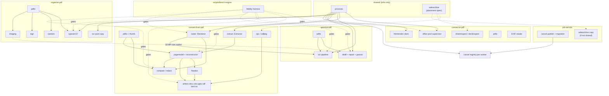

# 17 — Custom Library Roadmap

> Part of the Next-Generation Document Engine analysis (2026-11). Status: ANALYSIS — no code changed.

Siblings: `05-document-core-architecture.md` (IRs), `06-parsing-engine-design.md` (parser contract, archive limits),
`07-layout-and-rendering-engine.md` (E7), `08-pdf-engine-design.md` (E1/E2/E5/E9, per-worker layout),
`09-spreadsheet-engine-design.md`, `10-presentation-engine-design.md`, `11-image-and-ocr-subsystems.md`,
`13-language-and-technology-selection.md` (contracts A–D), `14-api-and-distributed-architecture.md` (cancellation,
profiles), `15-security-and-reliability.md`, `16-benchmarking-and-testing.md` (harness, gates),
`19-risk-and-compatibility-analysis.md`, `20-implementation-roadmap.md` (stages).

## 1. Purpose and scope

The brief asks for an internal library development strategy: for every component the sibling documents propose to
*build* (as opposed to adopt), one specification — responsibility, public API, architecture, data structures,
dependencies and licences, language, memory model, error handling, testing, benchmarks, compatibility target, effort
and owner — plus the dependency graph, build order, interface-stability rules, the "do not build" list and the
per-library stage/gate table. Effort numbers are copied from the sibling that owns the component; where a sibling
gives none the field says "not estimated". Nothing here is a new engine: every component below is already decided in
docs 05–16; this document only makes them buildable in order.

Binding constraints restated: Go-first; every worker is `CGO_ENABLED=0` (doc 13 §2); CLAUDE.md §1 — no shared
business logic, engines live inside the worker that owns the tool, `shared/` holds infrastructure only; LibreOffice
(E3) stays for office layout; no feature removed; unknown XML/relationships preserved on round-trip.

## 2. Current state

What exists in-house today that any of these libraries grows from (all read 2026-11-07):

| Seed | Where | Grows into |
|---|---|---|
| Hand-written PPTX writer (zip + OOXML templates, 351 lines) | `convert-from-pdf/processing/pptx_builder.go` (doc 10 §2) | `writers/pptx` (deck writer) and the OPC writer side |
| Pure-Go imaging (decode guard 50 MP, warp, cleanup, Hough) | `organize-pdf/internal/imaging` (doc 11 §2.1) | E8 budgets, EXIF reader, buffer pools |
| unoserver port pool (channel of ports, no health) | `convert-to-pdf/processing/unopool.go` (doc 04 §2.1) | office pool supervisor (Q0–Q2), later the `office-render` shim |
| OCR errgroup pipeline (all pages rendered up front) | `optimize-pdf/processing/processing_free.go` (doc 11 §2.2) | per-page OCR pipeline + text-only overlay |
| pdfcpu `api.*File` calls, no ctx, per-page rewrites | `organize-pdf/processing/processing_edit.go:446-456` (page-number loop, doc 07 §2) | `pdfio` adapters, single-pass stamps |
| 20 bare `exec.CommandContext` sites, no process group | audit exec table (doc 01 §2.4, §2.6) | `shared/procexec` |
| 10 fuzz targets, 9 benchmarks, k6 suite, test-binaries image | doc 16 §2 | harness `scripts/bench-engine/` |
| Result cache + tmpfs budget + large-job semaphore | `convert-to-pdf/internal/worker/tmpfs.go` (doc 01 §2.3) | memory model every library assumes |

No IR, no parser, no Go XML reading (`encoding/xml` unused outside tests, doc 06 §2), no SSIM, no cancellation.

## 3. Requirements

- R1 Every library is a Go package inside the owning worker's module (or `shared/` for pure infrastructure), buildable
  with `CGO_ENABLED=0`, tested with the repo's `TESTFLAGS` (`-race -shuffle=on`), and fuzzed where it parses bytes.
- R2 Every library observes `ctx` at its unit of work (page, part, image, process) — pdfcpu and excelize ignore ctx,
  so the adapter checks between units (doc 08 §5.5).
- R3 Memory is bounded by explicit limits, never by file size (doc 06 §7, doc 09 §5.8, doc 11 §5.1).
- R4 Replacement without rewrite: exec'd tools sit behind interfaces (`Extractor`, `Renderer`, `Distiller`,
  `Typesetter`) so pdftotext→PDFium, pdftoppm→go-pdfium, gs→Go distiller are implementation swaps (doc 13 §5.2).
- R5 Nothing in this document claims Office compatibility; each library's "compatibility target" is what its gate
  proves (doc 16 §5.6), nothing more.

## 4. Options evaluated

The build-vs-adopt choice was made per component in the sibling documents; this table records only the outcome so
the rest of the document can be read without them.

| Component | Build or adopt | Decided in | Why build (one line) |
|---|---|---|---|
| Flow IR (`flowdoc`), fixed-page IR (`pagemodel`), E4 reconstructor | Build (B) | 05 §4 O2, §6 | no Go library gives a flow model with opaque-part fidelity; the page model is the one engine worth owning |
| Writers DOCX/PPTX/ODF/HTML/TXT | Build (B/A) | 04 §4.3 rank 3, 05 §5.6, 10 §4 | own the XML → own preservation; commercial/AGPL alternatives rejected |
| Writer XLSX | Adopt excelize + thin wrapper (A) | 09 §4 | BSD-3, StreamWriter, active |
| OPC/ODF container reader+writer | Build thin over stdlib (A) | 06 §4 | `archive/zip` + `encoding/xml` suffice |
| `safearchive` | Build (A) | 06 §5.3, 15 §3 | stdlib has no bomb/ratio guard |
| `procexec` | Build (A) | 13 §5.3 | no stdlib process-group helper |
| E5 distiller | Build (B) | 08 §5.6 | pdfcpu has no downsampling; gs stays for the rest |
| Office pool supervisor | Build (A) | 04 §5.2, 12 §5.3 | unoserver 3.7 flags do the lifecycle; Go only supervises |
| E7 stamp adapter | Build adapter, adopt Typst (D) | 07 §5.2 | Typst does the typesetting |
| OCR per-page pipeline | Build pipeline, adopt Tesseract (D) | 11 §5.2 | no Go OCR exists |
| Imaging additions | Extend existing (A/B) | 11 §5.1 | already pure Go |
| Thumbnail / page-count adapters | Build thin (A) | 08 §5.3, §5.11 | pdfcpu + pdftoppm |
| Compare / redact | Build (B) | 05 §5.9, 08 §5.12 | no Go library; raster redaction is the chosen scope |
| Fidelity harness | Build (A) | 16 §4 B | Go, x/image SSIM, exec oracles |
| Cancellation plumbing | Build (A) | 14 §5.4 | contract change in job-service + workers |
| E1 sanitize walker | Build (B, small) | 15 §5.4 | pdfcpu has no action/JS removal |
| `pdfio` adapters | Build thin, duplicated per worker (A) | 08 §5.1 | ctx checks around a ctx-less library |

## 5. Recommendation — library specifications

Format per library: one table. "EM" is the sibling's number; "Owner" is the worker module and package path the
sibling names. "Dup/shared" states what is intentionally duplicated across workers (CLAUDE.md §1) and what sits in
`shared/`.

### 5.1 `flowdoc` — flow IR (doc 05 §5.2, §5.4, §5.5)

| Field | Specification |
|---|---|
| Responsibility | Flow-document IR for DOCX/ODT/HTML-shaped output: arena of nodes, interned styles, sections, numbering, notes, comments, `PartStore` for opaque parts; bridge B1 target; L1 validation; digests (`ir_text_sha256`, `ir_struct_sha256`) |
| Public API (Go sketch) | `type FlowDoc struct{…}`; `type NodeID uint32`; `func New(lim Limits) *FlowDoc`; `func (d *FlowDoc) Append(parent NodeID, k NodeKind, payload any) NodeID`; `func (d *FlowDoc) Validate(ctx, level) []DocError`; `func (d *FlowDoc) TextDigest() [32]byte`; `func (d *FlowDoc) StructDigest() [32]byte`; `func (d *FlowDoc) Walk(fn func(NodeID, *Node) bool)` |
| Internal architecture | struct-of-arrays: `[]Node` (32-byte nodes, sibling-linked), kind-specific payload tables, one `[]byte` text store with `(off,len)` refs, `StyleTable.Intern`, `Origins` for source byte ranges |
| Data structures | `Node{Kind, Flags, Parent, FirstChild, LastChild, NextSibling, Style, Payload, Origin}`, `ParaProps`/`CharProps` interned, `PartStore{Parts, Rels, ContentTypes, Order}`, `OpaqueXML{Raw, NS}` |
| Dependencies (licence) | stdlib only (`hash`, `crypto/sha256`); `golang.org/x/text` (BSD-3) for NFC in digests |
| Language | Go, in-process |
| Memory model | one arena per job; 1 M runs ≈ 32 MB nodes + text; `Limits{MaxNodes 5 M, MaxTextBytes 256 MiB, MaxDepth, MaxMediaBytes}` → typed `LimitError`; big tables streamed via `RowSource` (not materialised) |
| Error handling | `DocError{Kind: Malformed\|Unsupported\|Limit\|Encrypted\|Internal, Part, Path, Offset, Fatal}`; non-fatal → `Diagnostics` surfaced in job metadata; `Limit`/`Malformed` never retried |
| Testing | unit on arena invariants; L1 validation on corpus; `FuzzFlowParseDocumentXML` (Stage 6, when a parser exists); digest stability test (doc 05 A6) |
| Benchmarks | `BenchmarkArenaAppend1M`, `BenchmarkTextDigest`; peak RSS on 40 MB `docx/large.docx` via `/usr/bin/time -l` (doc 05 A4, ≤ 400 MB) |
| Compatibility target | writer-side only in Stage 3 (no parser); round-trip byte-equivalence A1 applies from Stage 6 when parsers land |
| Development complexity | ≈ 1 EM for the IR share of E4 (doc 05 §7); PartStore round-trip ≈ 0.5 EM; full editing/parsers 3–4 EM Stage 6+ optional |
| Owner / dup | `convert-from-pdf/internal/flowdoc` (doc 05 §5.7). If the Stage 6 DOCX fast path ships, convert-to-pdf gets **its own copy** (allowed to diverge). Never in `shared/` |

### 5.2 `pagemodel` — fixed-page IR + E4 reconstructor (doc 05 §5.3, 09 §5.5, 10 §5.4, 11 §5.3)

| Field | Specification |
|---|---|
| Responsibility | `PageDoc`/`Page` (glyph runs with boxes, images, rule paths, annots) produced by an `Extractor`; `Reconstructed` layer: lines → blocks → columns → tables → figures with reading order; the per-page confidence rule for PPTX; typed-cell inference for XLSX |
| Public API | `type Extractor interface{ Extract(ctx, in string) (*PageDoc, error) }` (doc 13 §5.2); `func Reconstruct(ctx, p *Page, opt Options) (*Reconstructed, error)`; `type Options{SnapTol, ColGapFactor, MinTableRows, MinTableCols, …}`; `func (r *Reconstructed) Tables() []Table`; `func BridgeToFlow(ctx, *PageDoc, []*Reconstructed) (*FlowDoc, error)` (B1, lossy, marks nodes synthetic) |
| Internal architecture | Stage A word boxes → lines (baseline clustering, tol 0.5 × median font size); Stage B x-gap histogram → columns; Stage C ruled grid (rule clustering, snap 1.5 pt) then unruled grid (gap projection ≥ 60 % rows) → tables; Stage D block classification (title/heading/paragraph/list/caption) by size and indent; Stage E figures = images + nearest caption |
| Data structures | `Page{Index, MediaBox, CropBox, Rotation, Glyphs []GlyphRun, Images, Paths, Annots, Loaded}`, `GlyphRun{Text, BBox, Baseline, Font, Size, Color, Chars []CharBox, Flags}`, `Reconstructed{Blocks, Columns, Tables, Figures}`, `Table{Cells [][]Cell, Merged, HeaderRows}` |
| Dependencies | stdlib; `golang.org/x/text` (BSD-3) for Devanagari digit normalisation; interim extractor is exec'd `pdftotext -bbox-layout` + `pdfimages` (Poppler, GPL-2/3, exec'd) via `procexec`; later go-pdfium (MIT; PDFium Apache-2) |
| Language | Go, in-process; extractor exec'd now |
| Memory model | pages loaded lazily (`Page.Loaded`); one page reconstructed at a time; E4 RSS target ≤ 300 MiB on a 1 000-page PDF (doc 12 §4 "streaming parsers") |
| Error handling | same `DocError`; a page whose extractor output fails the confidence rule falls back to image (PPTX) or text-line sheet (XLSX) — never a job failure; `OCR`-sourced pages flagged `from-ocr` |
| Testing | labelled 200-PDF set (doc 16 §5.2 "complex layout", "table-heavy"); `FuzzBBoxLayoutParse`, `FuzzE4Reconstruct` (doc 16 §5.9); unit tests per stage with synthetic pages |
| Benchmarks | `BenchmarkReconstructPage` (median ms/page; Rust exit criterion is > 200 ms/page, doc 13 §5.7); B4 wall vs pdfplumber (doc 09 §7) |
| Compatibility target | text recall ≥ 99 % vs `pdftotext`; table cell F1 ≥ pdfplumber; DOCX→PDF(LO) round-trip SSIM ≥ pdf2docx on 90 % (Stage 3 gate). Scope = pdf2docx parity, not Acrobat parity |
| Development complexity | inside E4's 4–5 EM: fixed IR ≈ 1 (doc 05), table reconstruction + typing 1.0 (doc 09 §6), slide reconstruction + confidence 0.5 (doc 10 §6) |
| Owner / dup | `convert-from-pdf/internal/pagemodel`; extractor interface in `convert-from-pdf/internal/extract` (doc 08 §5.1). Page-model JSON is the `parse-pdf` output (doc 14 §5.1) — a versioned external format |

### 5.3 Writers — `writers/{docx,xlsx,pptx,odf,html,txt}` (doc 05 §5.6, 09 §5.1/§5.7, 10 §5.5, 04 §4.3)

| Field | Specification |
|---|---|
| Responsibility | Serialise `FlowDoc` (DOCX/ODT/HTML/TXT), `pagemodel.Table` (XLSX/ODS) and `pagemodel.Page` (PPTX/ODP) to files; fresh documents only in Stage 3 |
| Public API | `type Writer interface{ Write(ctx, m *Model, out string) (Meta, error) }` (doc 13 §5.2); xlsx: `sheetwriter.New(limits).AddTableSheet(name, t).AddTextSheet(name, lines).Save(ctx, path)`; pptx: `deckwriter.New(w,h EMU).AddTextImageSlide(p, opts).AddImageSlide(png).SetNotes(i, s).Save(ctx, w)`; docx/odf: `docx.Write(ctx, *FlowDoc, io.Writer)`, `odf.WriteODT/ODS/ODP` |
| Internal architecture | streaming `zip.Writer`; `[Content_Types].xml` and rels written last; modelled parts from templates (`text/template` is banned for XML — use `xml.EscapeText` + typed emitters); untouched parts `OpenRaw→CreateRaw`; media `io.Copy` from extractor files, dedup by SHA-256 |
| Data structures | `Deck{parts, rIdAlloc, mediaIndex}`, `PartStore` (shared type with flowdoc), ODF manifest list |
| Dependencies | stdlib `archive/zip`, `encoding/xml`; excelize v2.11.1 (BSD-3, Go ≥ 1.26) for XLSX; Noto fonts (OFL-1.1) referenced by family name only |
| Language | Go, in-process |
| Memory model | never `os.ReadFile` media (replaces `pptx_builder.go:104-115` pattern, doc 10 §2); XLSX via `StreamWriter` ascending rows; one slide/sheet in memory at a time; G5: 300-page scanned PDF → deck with ≤ 150 MiB cap (doc 10 §7) |
| Error handling | writer errors are permanent (`Internal`/`Limit`); partial zip removed; L2 cheap checks at serialize (content types cover every part, no dangling rId) |
| Testing | open in LibreOffice headless (`--convert-to pdf`) for 100 % of corpus outputs; `xmllint --schema` in test-binaries (doc 09 G3); Word/PowerPoint manual 20-sample per release (docs 09 C1, 10 G3); `odfvalidator` for ODF (doc 04 G-ODF); `FuzzOOXMLWriter` (doc 16 §5.9) |
| Benchmarks | B2 `BenchmarkWrite1M` cells ≤ 120 s on 2 CPU (doc 09); `BenchmarkWriteDeck100Pages` (doc 10 B2) |
| Compatibility target | opens without repair prompt in Word/Excel/PowerPoint 365, LibreOffice, Google import — **proven only per gate**; HTML writer: structure + CSS positions, browser-renderable (replaces `pdftohtml`) |
| Development complexity | docx: inside E4 4–5 (doc 04 §4.2 row 5); xlsx 0.5 (doc 09 §6); pptx 1.0 within E4 (doc 10 §6); ODF 1 EM after E4 (doc 04 §4.3 rank 4); txt 0.1 (doc 06 §6); **html: not estimated** (doc 02 row 5 says "high after E4", no EM) |
| Owner / dup | `convert-from-pdf/internal/writers/{…}` (doc 05 §5.7). Docs 09/10 name the same packages `internal/sheetwriter` and `internal/deckwriter` — one naming must win at design review (see `19-…` §8) |

### 5.4 `opc` / `odfpkg` — package readers and writers (doc 06 §4, §5.4, §5.7; 05 §5.4)

| Field | Specification |
|---|---|
| Responsibility | OPC (`[Content_Types].xml`, `.rels`, part index) and ODF (`mimetype` first, `META-INF/manifest.xml`) container open/inspect/serialize with lazy parts and raw copy of untouched entries |
| Public API | `func Open(ctx, r io.ReaderAt, size int64, lim Limits) (*Package, error)`; `(*Package).Parts() PartIndex`; `(*Package).Rels(part) []Relationship`; `(*Package).Open(part) (io.ReadCloser, error)` (counting, ctx-checking reader); `(*Package).Serialize(ctx, w io.Writer, modelled map[string]io.Reader) error`; `mimetype.Detect` wrapper `Sniff(head, r, size)` |
| Internal architecture | central directory only on open (via `safearchive`); two small parts inflated (content types, root rels); every other entry registered `Untouched`; `OpenRaw`/`CreateRaw` for byte-identical copy; order and compression method recorded |
| Data structures | `Part{Name, CType, Method, Status, raw lazyBytes, Model}`, `Relationship{ID, Type, Target, Mode}`, `ContentTypes{Defaults, Overrides (ordered)}` |
| Dependencies | stdlib `archive/zip` (OpenRaw go1.17+), `encoding/xml`; `github.com/gabriel-vasile/mimetype` v1.4.8 (MIT, already indirect) |
| Language | Go |
| Memory model | central directory + two parts; parts inflate on demand through a counting reader bounded by `MaxTotalBytes`/`MaxRatio`; XML parts > `MaxPartXML` (16 MiB) spill to job scratch |
| Error handling | L0 structural errors → `DocError{Malformed}`; encrypted ODF → `Encrypted`; type mismatch (DOCX job given XLSX) → `Malformed` with message (doc 06 §5.5 step 1) |
| Testing | A1/G2 round-trip byte-equivalence on the office round-trip slice (doc 16 §5.2); G6 type mismatch 100 %; `FuzzOPCOpen`, `FuzzODFOpen` |
| Benchmarks | G7 `Inspect` ≤ 50 ms per corpus file (to be measured) |
| Compatibility target | strict and transitional OOXML namespaces accepted; Zip64; `mc:AlternateContent` kept opaque |
| Development complexity | 0.5 EM container + safearchive (doc 06 §6) |
| Owner / dup | `convert-from-pdf/internal/opc`, `/odfpkg` (doc 05 §5.7) — doc 06 §5.3 places them under `internal/parse/`; one path must win. Copied into convert-to-pdf only if `sheetinspect`/`deckinspect` (docs 09/10) or the fast path land there |

### 5.5 `safearchive` — zip limits guard (doc 06 §5.3, §7; 15 §3, §5.1)

| Field | Specification |
|---|---|
| Responsibility | Open a zip's central directory and enforce entry count, name safety (`fs.ValidPath`, no backslash, no duplicates, ≤ 1 024 bytes), declared sizes, compression ratio (per entry and total, re-checked while inflating), nested-package depth. No document semantics |
| Public API | `func Open(r io.ReaderAt, size int64, lim Limits) (*Reader, error)`; `(*Reader).Entries() []Entry`; `(*Reader).Open(ctx, i int) (io.ReadCloser, error)` — counting reader returning `ErrLimit{Which}`; `type Limits{MaxEntries 10 000, MaxEntryBytes 256 MiB, MaxTotalBytes min(4×input, 2 GiB), MaxRatio 100, MaxNameLen}` |
| Internal architecture | wraps `archive/zip.NewReader`; unconditional insecure-path check (Go only reports with GODEBUG); ratio uses declared sizes first, then measured bytes |
| Data structures | `Entry{Name, Method, CompressedSize, UncompressedSize, Offset}` |
| Dependencies | stdlib only |
| Language | Go |
| Memory model | central directory only; no entry inflated by this package beyond the caller's reads |
| Error handling | `ErrLimit`, `ErrInsecureName`, `ErrDuplicate`, `zip.ErrFormat` wrapped; all permanent |
| Testing | G4 per-limit fixtures trip within 100 ms and < 64 MiB; `FuzzSafeArchiveOpen` seeded with bombs (nested 100:1, 10 M-entry header, 1 GiB declared) |
| Benchmarks | none beyond G4 timing |
| Compatibility target | any zip LibreOffice opens must open here (G1 ≤ 1 % `Malformed`) |
| Development complexity | inside the 0.5 EM of §5.4 (doc 06 §6); job-service copy 0.3 EM (doc 15 §6 "duplicated validators") |
| Owner / dup | **Open question carried from docs 05 Q3 / 06 Q2**: `shared/safearchive` (argument: pure I/O guard like `procexec`, CLAUDE.md §2 "utility packages only") **or** one copy in each of job-service (upload-time central-directory read, doc 15 §3) and the workers that open zips. Doc 15 §5.1 already assumes the check runs in both job-service and the worker; a shared package avoids two drifting limit tables. Decision owner: tech lead, before Stage 2. Until decided, plan for the per-worker copy (the conservative reading of §1) |

### 5.6 `procexec` — exec contract (doc 13 §5.3; 15 §5.6)

| Field | Specification |
|---|---|
| Responsibility | Run every external binary with a process group, `cmd.Cancel → kill(-pgid)` after a SIGTERM grace, `WaitDelay`, bounded stderr ring, explicit env allow-list, scratch cwd, size-scaled deadline, rlimits where available, metrics |
| Public API | `type Spec struct{ Tool string; Args []string; Dir string; Env []string; Stdout io.Writer; Deadline time.Duration; StderrCap int; Limits RLimits }`; `func Run(ctx, Spec) (Result, error)`; `type Result struct{ ExitCode int; Duration time.Duration; PeakRSS int64; Stderr []byte; TimedOut, Killed bool }`; `func Deadline(base, perMB time.Duration, sizeMB float64, jobCtx context.Context) time.Duration` |
| Internal architecture | `exec.CommandContext` + `SysProcAttr{Setpgid:true}`; `cmd.Cancel` closure; `WaitDelay` 5 s; stderr to a 64 KiB ring; optional `prlimit` on Linux; post-run `pgrep -g` only in tests |
| Data structures | `Spec`, `Result`, per-tool default table (LO 2 s + 1.5 s/MB; others "to be measured") |
| Dependencies | stdlib `os/exec`, `syscall`; `golang.org/x/sys` (BSD-3) for rlimits |
| Language | Go |
| Memory model | stderr bounded; stdout to file when tools stream; no buffering of tool output in RAM |
| Error handling | `ErrTimeout`, `ErrKilled`, `ErrExit{Code}` wrapped; worker maps to `ENGINE_TIMEOUT`/`ENGINE_CRASH` classes (doc 14 §5.8) |
| Testing | orphan test: 100 forced cancels → 0 `soffice.bin`/`gs`/`tesseract`/`python3` (Stage 1); `FuzzProcexecArgs` (no shell metacharacter reaches exec — args are a slice, the fuzz proves no joining); contract test for `WaitDelay` with a child holding the pipe |
| Benchmarks | spawn overhead per tool (to be measured; feeds doc 14 §5.5 slopes) |
| Compatibility target | Linux only (workers are Linux); macOS dev builds compile with rlimits no-op |
| Development complexity | Stage 1 quick win Q3 (doc 01 §5); doc 15 §6 bundles it into 0.6 EM Stage 1 infra |
| Owner / dup | `shared/procexec` — the **only** engine-adjacent shared package (doc 08 §5.1, doc 13 §2). Allowed by CLAUDE.md §2 as infrastructure; carries no tool knowledge (per-tool defaults live in each worker) |

### 5.7 `distill` — E5 Go distiller (doc 08 §5.2, §5.6)

| Field | Specification |
|---|---|
| Responsibility | pdfcpu-first compression: walk page XObjects with CTM tracking, decide eligibility, decode DCT/Flate/LZW/RunLength images, downsample, re-encode, dedupe, optimise structure; return `NeedsGS` for the rest |
| Public API | `type Options{Preset, TargetDPI, Threshold, JPEGQuality, Grayscale, MaxImagePixels}`; `type Result{Original, Final int64; Images, Downsampled, Skipped, PassedThrough int; FellBackToGS bool; Reason string}`; `func Distill(ctx, in, out string, o Options) (Result, error)`; sentinels `ErrNeedsGS`, `ErrUnsupportedFilter`, `ErrEncrypted`, `ErrCancelled` |
| Internal architecture | content-stream tokenizer tracking `q/Q`, `cm`, `Do` (Form XObjects compose `/Matrix`); eligibility table (filter chain, bpc, colour space, SMask, Decode arrays); `image.DecodeConfig` + pixel cap; `x/image/draw` scaler chosen by harness; `image/jpeg` encode; Flate 1-bit for mono; SHA-256 dedupe; pdfcpu `Optimize` + object/xref streams; "never grows" guard |
| Data structures | `imageRef{objNr, drawnIn, effPPI, filterChain, cs, bpc, smask}`, per-page CTM stack |
| Dependencies | pdfcpu ≥ v0.16.4 (Apache-2); `golang.org/x/image` (BSD-3: draw, ccitt decode); stdlib `image/jpeg`, `compress/zlib` — **no custom codecs** |
| Language | Go in-process; Ghostscript (AGPL, exec'd unmodified) fallback via `gsexec` |
| Memory model | page-at-a-time, one image decoded at a time (50 MP cap reused from `organize-pdf/internal/imaging`); writes a second file (tmpfs factor 200 % stays valid); pdfcpu decode allowance set to `min(1 GiB, tmpfs − input)` |
| Error handling | any mid-walk error → `NeedsGS` fallback, metered `distill_fallback_total{reason}`; never a job failure if gs succeeds |
| Testing | differential vs gs on the image-heavy slice; `FuzzImageXObjectDecode`; every output passes `pdfcpu validate` + `qpdf --check` (test image) |
| Benchmarks | `BenchmarkDistill{low,medium,high}` size/wall/SSIM vs gs; JPEG quality calibration run recorded in `benchmarks/` |
| Compatibility target | ≥ 80 % of gs size reduction at same DPI; text-only never grows; ≤ 50 % gs wall; SSIM ≥ 0.9 at `medium`; CMYK/Separation/JPX/JBIG2/patterns → gs |
| Development complexity | 1.5 EM (doc 08 §5.3); doc 02 row 36 says 2 EM; Stage 4 total 2 EM includes repair 0.25 |
| Owner / dup | `optimize-pdf/internal/distill`, `internal/repair`, `internal/gsexec` (doc 08 §5.1). The 50 MP decode rule is **copied** from organize-pdf, not imported |

### 5.8 Office pool supervisor → `office-render` shim (doc 04 §5.2–§5.3; 12 §5.3; 18 §4 F)

| Field | Specification |
|---|---|
| Responsibility | Stage 1: start, probe (`unoping`), recycle (`--stop-after N`, RSS watch, kill on timeout via `--libreoffice-pid-file`) and hand out N unoserver daemons; make `/readyz` tell the truth (D23); size-scaled `unoconvert` timeout; `convert_fallback_total`. Stage 6: the same loop as the Go shim inside the isolated `office-render` container with `POST /v1/convert` (doc 13 §5.4 Contract C) |
| Public API | `type Pool struct{…}`; `func Start(ctx, cfg Config) (*Pool, error)` — `Config{Instances, Host, ProfileDir, StopAfter, MaxRSSMB, ConvertBase, ConvertPerMB}`; `(*Pool).Convert(ctx, in, out, to string, sizeMB float64) (ConvertResult, error)`; `(*Pool).Healthy() (up, total int)`; `(*Pool).Close()`; Stage 6 HTTP: `POST /v1/convert` headers `X-Convert-To`, `X-Job-ID`, `X-Deadline-Seconds`; `200 + X-Pages`, `408`, `413`, `503` |
| Internal architecture | one goroutine per daemon: spawn (`unoserver --interface 127.0.0.1 --port P --user-installation <PATH, not file://> --conversion-timeout T --stop-after N --libreoffice-pid-file F`), probe loop, claim/release channel; conversion runs `unoconvert` under `procexec`; on timeout kill pid from the pid-file, respawn, then release the port (never before) |
| Data structures | `daemon{port, pid, pidFile, conversions, lastRSS, state}`; metrics `office_pool_ready{port}`, `office_render_daemon_restarts_total{reason}`, `office_render_duration_seconds` |
| Dependencies | unoserver 3.7 (MIT, pinned), LibreOffice (MPL-2), both exec'd; `procexec`; `shared/metrics` |
| Language | Go supervisor; Python stays only as unoserver's runtime (no Go UNO client — doc 18 §4 F) |
| Memory model | daemons are the residents (150–300 MB each per compose comment, doc 12 §2.2); Go heap small (`GOMEMLIMIT` 128–256 MiB, docs 12 §5.6 / 18 §5.12 differ — to be measured) |
| Error handling | connect refused → `convert_fallback_total{reason="connect"}` and respawn, **not** silent cold `libreoffice --headless`; cold fallback keeps a per-job `-env:UserInstallation` (doc 04 D3) and is counted |
| Testing | readiness-truth test (kill daemons → `/readyz` 503 ≤ 10 s, doc 15 §5.7); 100 forced cancels → 0 `soffice.bin`; k6 convert-to-pdf ladder before/after Q0 |
| Benchmarks | warm vs cold from `benchmarks/raw/conversions.tsv`; daemon RSS over 1 000 conversions (knee sets `MaxRSSMB`) |
| Compatibility target | = LibreOffice 7.6.7 (Alpine 3.19) today; version changes with the base-OS bump (doc 18 §5.15 Stage 1) — re-baseline the office slice |
| Development complexity | Q0 1 d, Q1 1 wk, Q2 3 d (doc 01 §5 quick wins); doc 02 §4 "1 (lifecycle) + 2 (Stage 6)"; Stage 6 shim within the 2 EM of Stage 6 |
| Owner / dup | `convert-to-pdf` (grows from `processing/unopool.go`); Stage 6 `office-render` is a separate deployable with **no business logic** (doc 04 §5.3). Docs 04 (REST), 12 (NATS consumer on a `.cpu` subject) and 14 (profile of convert-to-pdf) describe three different integration shapes — see `19-…` §8 |

### 5.9 `typeset` — E7 Typst stamp adapter (doc 07 §5.2)

| Field | Specification |
|---|---|
| Responsibility | Render Unicode stamps, page-number pages, edit-text boxes and (later) templates with Typst into a PDF page set; cache; validate; hand to pdfcpu PDF-mode watermark in one pass; Go raster fallback via go-text |
| Public API | `type StampSpec{Text string; Font string; SizePt, Opacity float64; Color RGBA; RotationDeg int; PageW, PageH float64}`; `func (t *Typesetter) Render(ctx, StampSpec) (StampPDF, error)`; `func (t *Typesetter) PageNumbers(ctx, n int, fmt NumberFormat, spec StampSpec) (StampPDF, error)` (N pages, one compile); `type Typesetter interface{…}` with `typstTypesetter` and `rasterTypesetter` (go-text → PNG) implementations; `func Apply(ctx, host, stamp StampPDF, pos Position) error` wrapping `api.PDFMultiWatermarkForReadSeeker` |
| Internal architecture | Go-embedded `.typ` templates versioned by hash; user text passed via `--input text=…` (never markup); numeric params validated in Go; `--root` = scratch, `--font-path` = baked Noto dir, empty package paths; 10 s fixed timeout; output ≤ 8 MB; `api.ValidateFile` before use; tmpfs LRU 64 MB keyed by SHA-256(template‖fonts‖spec‖pages) |
| Data structures | `StampPDF{Path string; Pages int; Key [32]byte}`, cache index |
| Dependencies | Typst 0.15.1 static musl binary (Apache-2, sha256-pinned download); pdfcpu (Apache-2); fallback `github.com/go-text/typesetting` v0.3.5 (BSD-3/MIT/Unlicense) + `golang.org/x/image/vector` (BSD-3); fonts Noto (OFL-1.1), Liberation (OFL-1.1) |
| Language | Go adapter; Typst is a Rust tool exec'd (zero team Rust) |
| Memory model | stamp PDFs small; cache bounded; Typst process per compile under `procexec` |
| Error handling | `ErrTypstMissing` → raster fallback (documented lower quality); compile error → permanent `Unsupported` with scrubbed stderr; validation failure → discard, no cache |
| Testing | 40-string fixture set (conjuncts, matras, reph, nukta, Bengali/Tamil/Gujarati, Arabic joined, RTL, ligatures): SSIM ≥ 0.95 vs LO reference, zero `.notdef`; `pdftotext` returns input NFC byte-exact; `FuzzStampSpec`/`FuzzTypstStampInput` (no read outside `--root`, ≤ 10 s); 100 cancels → 0 `typst` |
| Benchmarks | Typst cold/warm compile p95 and on-disk size **measured before merge** (no number quoted); page numbers N = 300 single-pass ≤ 25 % of today's loop |
| Compatibility target | output passes `pdfcpu validate` relaxed; host PDF version ≤ 1.7 preserved; opens in pdf.js and the native viewer |
| Development complexity | 0.5 EM total (doc 07 §6: stamps 0.25, page numbers 0.1, edit-text 0.1, cache/sandbox 0.1, raster fallback 0.15 included) |
| Owner / dup | `organize-pdf/internal/typeset` (doc 07 §5.2, doc 08 §5.1). Typst binary in the organize-pdf / `light-pdf` image only (docs 07, 18); doc 13 §5.6 also lists `fyredocs-base` — see `19-…` §8 |

### 5.10 `ocr` — per-page OCR pipeline (doc 11 §5.2)

| Field | Specification |
|---|---|
| Responsibility | Page count → errgroup (`OCR_MAX_WORKERS`) → per-page `pdftoppm -f N -l N -gray -r DPI` → `tesseract --oem 1 --dpi N -l LANG [-c textonly_pdf=1] pdf txt` → overlay text-only page on the original via pdfcpu PDF-mode stamp (Stage 2) → collect; per-page failure isolation; text sidecar ≤ 512 KB; ctx per page |
| Public API | `type Options{Langs []string; DPI int; Overlay bool; Workers int}`; `func Run(ctx, in, out string, o Options, progress func(page, total int)) (Result, error)`; `type Result{Pages, Failed int; Text []byte; Truncated bool}`; sidecar client `type Engine interface{ Recognise(ctx, png string, langs []string) (PageText, PagePDF, error) }` with `tesseract` and (Stage 6, optional) `rapidocrHTTP` implementations behind `shared/circuitbreaker` |
| Internal architecture | render-inside-pool so tmpfs holds `workers × (PNG + page PDF)`; DPI policy 300 when `hin` present, else 150, user override wins, `computeSafeDPI` cap kept; delete PNG after OCR; merge via pdfcpu collect |
| Data structures | per-page job struct, bounded result slice |
| Dependencies | Tesseract 5.x (Apache-2, exec'd) + tessdata_best `hin` (Apache-2); Poppler `pdftoppm` (GPL, exec'd; go-pdfium later); pdfcpu; `golang.org/x/sync/errgroup` (BSD-3); `procexec` |
| Language | Go pipeline; engines exec'd |
| Memory model | tmpfs peak independent of page count (Stage 1 gate ≤ 200 MB on 300 pages); RSS = workers × tesseract |
| Error handling | per-page failure → image-only page (today's behaviour kept); cancel stops tesseract/pdftoppm ≤ 2 s via procexec |
| Testing | CER on 50 Hindi + 50 English scans not worse than today (Q7 gate); overlay SSIM ≥ 0.99 vs input on 20 fixtures; text selectable in pdf.js and Acrobat; bake-off protocol doc 11 §7.1 |
| Benchmarks | wall/page and RSS per engine; `df /tmp` sampled 1 s during a 300-page job |
| Compatibility target | searchable PDF opens in pdf.js and native viewer; overlay verified on rotated/cropped pages (risk, doc 11 §8) |
| Development complexity | 0.3 EM (doc 11 §6: Q7 + overlay); sidecar 1.0 EM only on bake-off win (Stage 6, class E) |
| Owner / dup | `optimize-pdf/internal/ocr` (doc 08 §5.1) and a **duplicated** pool in `organize-pdf` for `scan-to-pdf` (doc 11 §5.2, "duplicated by design") |

### 5.11 `imaging` additions — E8 (doc 11 §5.1)

| Field | Specification |
|---|---|
| Responsibility | Register bmp/tiff/gif decoders behind the existing `DecodeConfig` guard; per-tool pixel budgets; per-worker byte semaphore; no-copy cleanup passes; `sync.Pool` of RGBA by size class; minimal EXIF orientation reader (APP1/IFD0 tag 0x0112) for image-to-pdf; alpha flattening (white matte) for PDF import |
| Public API | existing `DecodeReader/DecodeFile/EncodeJPEG/EncodePNG/DownscaleTo/DetectDocumentQuad/…` kept; new `type Budget struct{ MaxPixels int64; Bytes *semaphore.Weighted }`; `func (b *Budget) Acquire(ctx, w, h int) (release func(), error)`; `func Orientation(r io.ReaderAt) (int, error)`; `func Flatten(img image.Image, bg color.Color) *image.RGBA`; cleanup functions take a `dst *image.RGBA` |
| Internal architecture | unchanged pipeline; budgets wrap decode; pools keyed ≤ 4 / ≤ 12 / ≤ 30 MP |
| Data structures | `Budget`, pool buckets |
| Dependencies | `golang.org/x/image` v0.47.0 (BSD-3; bump from v0.21.0), `golang.org/x/sync` (BSD-3); optional `gen2brain/webp` (MIT, WASM-in-Go) only if WebP thumbnails are required (class E) |
| Language | Go |
| Memory model | ≤ 3 full-size RGBA buffers alive per scan page; `IMAGING_BUDGET_MB` 512 on the 1 GiB organize-pdf container (4 concurrent 30 MP jobs → 0 OOM) |
| Error handling | over-budget → wait (semaphore), not OOM; decode guard rejects before allocation |
| Testing | 4 concurrent 30 MP jobs on 1 GiB: 0 OOM, RSS ≤ 900 MiB; `cleanup_bench_test.go` allocs/page −50 %; fuzz on the EXIF reader |
| Benchmarks | `go test -bench=. -benchmem ./organize-pdf/internal/imaging/`; `GODEBUG=gctrace=1` on a 50-page scan |
| Compatibility target | JPEG/PNG/WebP (decode)/GIF/BMP/TIFF in; JPEG/PNG out; HEIC/AVIF gated on product + legal (Stage 5) |
| Development complexity | 0.2 + 0.3 + 0.1 EM (doc 11 §6 rows E8) |
| Owner / dup | `organize-pdf/internal/imaging` (exists); EXIF reader in `convert-to-pdf` (image-to-pdf) — a separate small copy (doc 11 §6 owner column) |

### 5.12 `pdfio`, `thumb`, page-count adapters (doc 08 §5.2, §5.3, §5.11)

| Field | Specification |
|---|---|
| Responsibility | Thin per-worker adapters over pdfcpu with ctx checks (open/validate/write/per-page/page count/page dims); thumbnail tool (`pdftoppm -f 1 -l 1 -scale-to 320 -png`) on `document.uploaded`; page count in every worker's result metadata and at upload (Q8/Q9/Q10) |
| Public API | `func Open(ctx, path string, o OpenOptions) (*model.Context, error)`; `func Write(ctx, pc, path string, incremental bool) error`; `func ForEachPage(ctx, pc, fn func(int, types.Dict) error) error`; `func PageCount(ctx, path) (int, error)`; `func PageDims(ctx, path) ([]types.Dim, error)`; `thumb.Render(ctx, in, out string, width int) error` |
| Internal architecture | ≤ 150 lines per worker; `DisableConfigDir()` in every main; relaxed validation default; decode allowance from tmpfs budget |
| Data structures | `OpenOptions{Password, Relaxed, MaxDecodeBytes}` |
| Dependencies | pdfcpu ≥ v0.16.4 (Apache-2; upgrade from v0.9.1 is a Stage 1 prerequisite — `organize-pdf/go.mod:10`, `convert-from-pdf/go.mod:10`); Poppler `pdftoppm` exec'd until E2 |
| Language | Go |
| Memory model | pdfcpu holds the whole object graph; one context per file; no goroutine fan-out inside one context |
| Error handling | `ErrEncrypted`, parse errors classified permanent (`isRecoverable` must not retry them) |
| Testing | `pdfinfo` vs `PageDimsFile` identical page sizes on the corpus (Stage 1); thumbnails for 100 % of uploaded corpus PDFs within 10 s; `FuzzPDFReadContext` |
| Benchmarks | `BenchmarkPageCount` pdfcpu vs `pdfinfo` on the 40 MB fixture; page count at upload ≤ 50 ms for 100 pages (to be measured) |
| Compatibility target | read PDF 1.0–2.0 (2.0 "basic" per pdfcpu); write preserves input version, ≥ 1.5 with object streams, 1.7 for created documents; never 2.0-only features |
| Development complexity | upgrade 0.1 EM (doc 08 §5.3); `pdfinfo`→pdfcpu 0.1 EM (doc 03 §2.2 Poppler table); thumbnails 0.25 EM (doc 08 §5.3) |
| Owner / dup | `internal/pdfio` **duplicated** in organize-pdf, optimize-pdf, convert-from-pdf, convert-to-pdf (doc 08 §5.1, "exactly like `pdfPageDimensions` today"); `convert-from-pdf/internal/thumb` |

### 5.13 `compare` / `redact` (doc 05 §5.9; 08 §5.12)

| Field | Specification |
|---|---|
| Responsibility | Compare: page alignment, word-sequence LCS with boxes, flow-IR tree diff for DOCX pairs, render diff (SSIM + XOR heat-map) → JSON + report PDF/PNG zip. Redact (rasterise-region): render page region at 300 DPI, paint black, replace the entire page with the image, strip Info/XMP/attachments/bookmarks, assert `pdftotext` returns nothing in the region |
| Public API | `compare.Run(ctx, a, b string, o Options{Mode text\|visual\|both; DPI int}) (Report, error)`; `type Change{Kind Insert\|Delete\|Replace\|Move\|FormatChange; Page int; BBox Rect; Text string}`; `redact.Run(ctx, in, out string, boxes []PageRect) (Result, error)` |
| Internal architecture | compare: `pagemodel` words → Myers/LCS per page; page alignment by index then text similarity; block keys = subtree text digest; render via `Renderer`; SSIM routine **copied** from the harness (no import of `scripts/`). redact: `Renderer` crop → `ImportImages` → `InsertPages`/`RemovePages`; sanitizer-style strip of metadata |
| Data structures | `Report{Pages []PageDiff; Summary; RenderScores []float64}` |
| Dependencies | `pagemodel`, `pdfio`, `raster` (Poppler exec → go-pdfium), `golang.org/x/image` (BSD-3) |
| Language | Go |
| Memory model | page pair at a time; raster at 100 DPI for compare, 300 DPI cropped region for redact |
| Error handling | scanned inputs without text → compare degrades to visual mode with a diagnostic (OCR first is the user's choice); redact never partially succeeds (whole output discarded on any page failure) |
| Testing | A7: 20-pair labelled set, precision/recall ≥ 0.95; redact: region text = ∅ via `pdftotext`, SSIM of untouched areas ≥ 0.99; goldens in the harness |
| Benchmarks | `bench-compare` (doc 05 A7) |
| Compatibility target | compare on born-digital PDFs and DOCX pairs; redaction is **lossy by design** (page becomes raster) and says so in result metadata; true content-stream redaction is out of scope |
| Development complexity | 1.0 EM (doc 08 §6; doc 05 §6 "~1 EM inside Stage 5's 3 EM") |
| Owner / dup | `convert-from-pdf/internal/compare`, `internal/redact` (doc 08 §5.1; doc 05 §5.7 routes `compare-pdf` here). Doc 14 §5.1 classes compare as C, docs 05/08 as B — see `19-…` §8 |

### 5.14 Fidelity harness — `scripts/bench-engine/` (doc 16 §5)

| Field | Specification |
|---|---|
| Responsibility | One command (`make bench-engine`) runs every tool over a manifest-verified ≥ 200-file corpus in fixed containers, measures (cold start, wall, RSS peak/avg, CPU, image/binary size, throughput, failure rate), runs differential checks against oracles (text CER, page count/dims, bbox IoU, fonts, images, tables, SSIM/pHash, veraPDF, odfvalidator, OOXML round-trip, OCR CER, tofu), compares to a baseline, and gates releases (`scripts/ci/08-engine-gate.sh`) |
| Public API | CLI: `run.sh [--fetch] [--verify] SUITE=… ENGINE=…`, `compare.sh current.json candidate.json`; Go: `type Runner interface{ Run(ctx, Case) (Row, error) }`, `type Check interface{ Score(ctx, candidate, reference string) (float64, error) }`, `func SSIM(a, b *image.Gray) float64`, `func PHash(img image.Image) uint64` |
| Internal architecture | corpus loader (manifest SHA-256), runners (docker exec into worker image; `/usr/bin/time -v`; cgroup `memory.peak`), oracle runners in `fyredocs-test-binaries` (+ veraPDF, odfvalidator, qpdf), checks, JSON/MD reporters, golden bands per engine |
| Data structures | `manifest.json{path, sha256, bytes, category, tags, origin, licence, pages}`; `results/bench-engine-<ts>.json{host, date, git_sha, image_digests, corpus_manifest_sha, rows[]}`; `golden/<engine>.json` |
| Dependencies | `golang.org/x/image` (BSD-3); exec'd oracles LibreOffice (MPL-2), Ghostscript (AGPL), Poppler (GPL), Tesseract (Apache-2), veraPDF (GPL/MPL), odfvalidator (Apache-2), qpdf (Apache-2) — test image only; k6 (AGPL tool) for throughput rows; pdfplumber as Stage-3 comparator (MIT, test image only) |
| Language | Go module (own `go.mod`, added to `go.work` — a workspace change, proposed) |
| Memory model | harness never loads a corpus file itself; everything through the engine under test inside the container |
| Error handling | checksum mismatch fails the run; a gate failure names file, metric, band, measured value and exits non-zero |
| Testing | every check has a unit test with a known score (identical rasters → SSIM 1.0; shifted word → IoU < 1); current-vs-current noise floor ±5 % |
| Benchmarks | it *is* the benchmark; first full run on the production-class host tagged `engine-baseline-<date>` |
| Compatibility target | reproduces the Stage 1–6 gate table (doc 16 §5.10) |
| Development complexity | 0.6 EM (doc 16 §4 B) + 0.1 veraPDF; brief Q13 ≈ 1.5 wk for the first ≥ 200-file run |
| Owner / dup | `scripts/bench-engine/` (CLAUDE.md §2 allows `scripts/`); results under this folder's `benchmarks/`. Not a worker package; workers **copy** SSIM if they need it (compare) rather than import from `scripts/` |

### 5.15 Cancellation plumbing (doc 14 §5.4; 15 §5.9)

| Field | Specification |
|---|---|
| Responsibility | `DELETE /api/<group>/:tool/:id` and new `POST …/cancel` → compare-and-set `status='cancelled'` → core-NATS `jobs.cancel.<id>` + JetStream `JobCancelled` event; every worker keeps a `sync.Map` jobID → `CancelFunc`, cancels, kills the process group via `procexec`, Acks without DLQ; pdfcpu stages check ctx between pages |
| Public API | job-service: migration `00003_cancelled_status.sql`, handler changes; worker: `type CancelRegistry struct{…}`; `func (r *CancelRegistry) Register(jobID string, cancel context.CancelFunc)`; `func (r *CancelRegistry) Cancel(jobID string) bool`; `func (r *CancelRegistry) Subscribe(ctx, nc *nats.Conn) error`; `handleFailure` gains the `CANCELLED` branch; `statusToEventType` gains `cancelled → JobCancelled` |
| Internal architecture | at-most-once signal, DB is the source of truth; claim-time guard adds `cancelled` to the skip set; 10 s progress ticker re-reads status (bounds loss to one tick) |
| Data structures | registry map; new status value; SSE closes on `JobCancelled` |
| Dependencies | nats.go (Apache-2) core pub/sub (exists); `procexec` |
| Language | Go |
| Memory model | map entry per in-flight job |
| Error handling | cancel of a terminal row → 409 `ALREADY_FINISHED` on `/cancel`, 204 on `DELETE` (unchanged semantics) |
| Testing | 100 forced cancels across every profile → 0 orphans, row `cancelled` within 2 s; subscribers (document/notification/analytics) verified to ignore unknown event types before migration ships |
| Benchmarks | cancel-to-stop latency histogram (`make bench-engine SUITE=cancel`) |
| Compatibility target | no existing route/field renamed; `status` gains one value; Swagger/Postman/service docs/mermaid updated in the same change (doc 14 §5.14) |
| Development complexity | 0.4 EM (doc 14 §4 F; Q11 1.5 wk) |
| Owner / dup | job-service (sole migrator, publish) + **each worker's own registry copy** (private `ProcessingJob` structs stay private); `shared/queue` only gains the subject helper (infra) |

### 5.16 Smaller adapters named by siblings

| Library | Responsibility / API | Deps (licence) | Tests / gate | EM | Owner / dup |
|---|---|---|---|---|---|
| `sanitize` (E1 walker, doc 15 §5.4) | `sanitize.Walk(ctx, pc *model.Context, policy) (Counts, error)` deleting `/OpenAction`, `/AA`, `/Names/JavaScript`, `/EmbeddedFiles`, `/FileAttachment`/`/RichMedia`/`/Movie`/`/Sound`/`/Screen` annots, `/Launch`/`/GoToR`/`/ImportData`/`/SubmitForm` actions; `/URI` kept + logged; run on every PDF output and as a tool | pdfcpu object model (Apache-2) | 30-file action corpus → 0 validate notices, SSIM 1.0 vs input; `FuzzSanitizeWalker` | 0.4 (doc 15 §6) | `organize-pdf` (imports `pkg/pdfcpu` already) |
| `raster` (E2 interface, doc 08 §5.11) | `type Renderer interface{ RenderPage(ctx, in string, page, dpi int) (image.Image, error) }`; `popplerRenderer` now; `pdfiumWASM` (go-pdfium pool, `WithMemoryLimitPages`, `WithCloseOnContextDone`, instance-per-job, recycle on trap) behind the Stage 5 gate | Poppler (GPL, exec); go-pdfium v1.21.4 (MIT) + wazero 1.12 (Apache-2) + PDFium (Apache-2) | `BenchmarkRender150DPI`: WASM ≥ 0.7× pdftoppm, identical page counts on fuzz corpus, no cross-job crash in 1 000-job soak | 1.0 (doc 08 §5.3) | `convert-from-pdf/internal/raster`; **do not switch the builder to cgo** |
| `sign` (E9, doc 08 §5.7) | `sign.Apply(ctx, in, out string, opts{Cert, Key, TSAURL, Appearance})` via digitorus/pdfsign; incremental update; always the last op | pdfsign v1.0.0 (BSD-2-Clause); Go `crypto/*` | validates in `pdfsig` (test image) and Acrobat; B-T with TSA | 0.75 (doc 08 §5.3) | `organize-pdf/internal/sign`; keys from a secret mount, never MinIO; product must decide the certificate model first |
| `sheetinspect` / `deckinspect` (docs 09 §5.7, 10 §5.5) | `Inspect(ctx, path, limits) (Summary, error)` — sheet/slide counts, defined names, VBA/external-link/pivot/chart/SmartArt/OLE flags for routing, limits and metadata; `Rows()`-only for XLSX | excelize v2.11.1 (BSD-3); own OPC walker copy for PPTX | B1 `BenchmarkOpenStream1M` ≤ 600 MiB; `BenchmarkOpenLazy200Slides` ≤ 200 ms / ≤ 50 MiB; `FuzzInspect`, `FuzzOpen` | 0.25 (doc 09 §6) / 1.0 (doc 10 §6) | `convert-to-pdf/internal/sheetinspect`, `/deckinspect` — **conflicts** with doc 05 §5.7 ("nothing in convert-to-pdf in Stages 1–5") and doc 06 §6 (PPTX parser Stage 6); see `19-…` §8 |
| `htmlrender` client (doc 13 §5.4 Contract C; 04 §4.3 rank 1) | HTTP client for the WeasyPrint sidecar: `POST /v1/render-html`, `X-Deadline-Seconds`, `X-Engine-Version` in the cache key, 408/413/422/503 mapping, `shared/circuitbreaker` | WeasyPrint 70.0 (BSD-3, pinned, sidecar image; three 2026 CVEs → rebuild on advisory) | G-HTML: 30 fixtures SSIM ≥ 0.90 vs Chrome, recall ≥ 99 %, 0 egress | 0.5–1 (doc 04 §4.3) | `convert-to-pdf` (`html-render` profile, doc 14 §5.3); sidecar image owned by deployment |

## 6. Classification

| Library | Class (A–E) | Source |
|---|---|---|
| flowdoc, pagemodel + reconstructor, writers docx/pptx/odf/html, compare/redact, distill, sanitize | **B** custom engine | docs 05 §6, 08 §6, 15 §6 |
| writers xlsx (excelize wrapper), opc/odfpkg, safearchive, procexec, pdfio/thumb/page-count, imaging additions, cancellation, harness, sheetinspect, office pool supervisor, htmlrender client | **A** lightweight lib / adapter | docs 06 §6, 08 §6, 11 §6, 12 §6, 14 §6, 16 §6 |
| typeset (Typst adapter), ocr pipeline (Tesseract), raster (Poppler → PDFium), sign (pdfsign) | **D** adapter over a mature external; raster/PDFium **C** when gated in | docs 07 §6, 08 §6, 11 §6, 13 §6 |
| OCR sidecar client, libvips sidecar, HEIC, WebP encode, simple-DOCX fast path, Typst templates | **E** optional, gated | docs 07 §6, 11 §6 |

## 7. Acceptance criteria and gates

### 7.1 Dependency graph

### 7.2 Build order

1. **Stage 1 Foundation** — `procexec` (everything else execs through it); pdfcpu upgrade + `pdfio` ×4 with
   `DisableConfigDir`; office pool supervisor Q0 → Q1/Q2; OCR per-page render (Q7); page count (Q8); imaging
   budgets + x/image bump; harness with the first ≥ 200-file baseline. No IR code yet.
2. **Stage 2 Core infra** — cancellation (job-service + registries); `typeset` + fonts; `thumb` (Q10); `htmlrender`
   client + sidecar; `sanitize`; type detection (`mimetype`) at job-service and worker; `safearchive` placement
   decided and built (needed before any Go zip reading).
3. **Stage 3 E4** — `safearchive`/`opc`/`odfpkg` writer side → `pagemodel` + `extract` (pdftotext interim) →
   `flowdoc` (writer-side subset) → writers in the order TXT, XLSX (excelize), DOCX, PPTX (from `pptx_builder.go`),
   HTML, ODF; remove pdf2docx/pdfplumber/LO/Python from convert-from-pdf once the Stage 3 gate passes.
4. **Stage 4 E5** — `distill` + tier-1 `repair` + `gsexec` fallback.
5. **Stage 5 Advanced** — `raster` interface + go-pdfium bake-off; `sign`; `compare`/`redact`; optional
   `sheetinspect`/`deckinspect` if the routing in doc 14 needs them earlier (open).
6. **Stage 6 Production** — `office-render` shim (same pool code behind Contract C); OCR sidecar client (E); the
   optional fast path copies `flowdoc` + a DOCX parser into convert-to-pdf.

### 7.3 Interface-stability rules

1. **Seams are interfaces, implementations swap**: `Extractor`, `Renderer`, `Typesetter`, `Engine` (OCR),
   `Distiller`, `Writer`, `Parser`. A replacement (pdftotext → PDFium, pdftoppm → go-pdfium, Tesseract → sidecar,
   gs → Go) changes an implementation file and a flag, never a caller.
2. **Internal semantic versioning**: every package in this document carries a doc comment `// API: v1` and a
   `CHANGELOG` section in the package doc. Breaking an exported signature after the package's stage gate has passed
   requires `v2` as a new import path (`internal/pagemodel/v2`), the old path kept for one release, and a line in
   `docs/developer/services/<worker>.md`. Additive changes bump the minor in the comment only.
3. **Cross-service formats are versioned explicitly**: page-model JSON (`parse-pdf` output), digests
   (`ir_digest_v1`), stamp-cache keys (template hash ‖ font-set hash), result-cache keys (`rescache:v1`), sidecar
   paths (`/v1/…`) and `X-Engine-Version`. Changing any of them invalidates caches by construction.
4. **Duplicated by design**: `pdfio`, OCR pool, 50 MP decode rule, DTO copies, cancel registries, limit tables and
   (if not shared) `safearchive` are copies with a `NOTE: duplicated by design (CLAUDE.md §1); source of the
   pattern: <path>` comment. Copies may diverge; the harness runs the same corpus against each.
5. **Gate-earned capability flags**: `Caps` bits (`CapRoundTrip`, `CapEdit`, doc 06 §5.2) and profile build tags
   (doc 18 §5.3) are set only after the named gate passes; the router refuses an insufficient pair at startup.
6. **Dependency pins**: pdfcpu, excelize, go-text, go-pdfium, wazero pinned in `go.mod`; Typst, unoserver,
   WeasyPrint pinned by version + sha256 in Dockerfiles; upgrades go through the harness regression slice.

### 7.4 Do-not-build list

| Not built | Use instead | Reason |
|---|---|---|
| PDF object model, xref/object streams, encryption (AES/RC4), forms fill, page ops, watermarks | pdfcpu (Apache-2) | mature, pure Go, in use; "no custom crypto" is a non-negotiable |
| XLSX reader/writer, shared strings, styles, charts (write) | excelize v2.11.1 (BSD-3) | 454 functions, StreamWriter, active |
| Typesetting: line breaking, shaping (Indic/USE/Arabic), font subsetting, tagged PDF | Typst 0.15.1 (Apache-2, exec'd) | full layout engine; pdfcpu cannot shape (no GSUB/GPOS) |
| OpenType shaper in Go | go-text/typesetting (BSD-3/MIT/Unlicense) | HarfBuzz port already exists; fallback only |
| OCR engine | Tesseract 5 (Apache-2, exec'd) | no Go OCR engine exists; neural engines only as a gated sidecar |
| Office layout (DOCX/XLSX/PPTX → PDF), OOXML ↔ ODF conversion | LibreOffice (MPL-2) in `office-render` | 8+ EM per format with unbounded fidelity liability; capacity is a scaling problem |
| HTML/CSS paged layout | WeasyPrint 70.0 (BSD-3, sidecar) | no Go CSS Paged Media engine |
| PDF rasteriser / text extraction | Poppler (GPL, exec'd) now, PDFium via go-pdfium WASM (MIT/Apache-2) gated | writing a rasteriser is out of scope (doc 02 row 4) |
| JBIG2 / JPX codecs, CCITT G4 encoder | pass-through in E5; gs/PDFium render; gobig2 (Apache-2) optional later | no pure-Go importable JPX; JBIG2 pre-1.0 |
| PDF/A conformance writer, appearance-stream flattening, `extreme` grey distillation | Ghostscript (AGPL, exec'd unmodified, notice kept) | ≥ 2 EM mini-distiller; gs stays ("fewer calls, not zero") |
| PAdES signing, CMS/PKCS#7, RFC 3161 | digitorus/pdfsign (BSD-2) + Go `crypto` | no custom crypto |
| Compression, hashing, TLS | Go stdlib `compress/*`, `crypto/*`, `klauspost/compress` where already present | non-negotiable |
| Formula engine (T0–T4) | excelize `CalcCellValue` for ad-hoc needs; engine deferred after Stage 4 on product need (doc 09 §5.4) | ≈ 6.5 EM for parity; no consumer today |
| libvips bindings, cgo of any kind | pure Go `x/image`; libvips only as an exec'd/sidecar option on a ≥ 2× measured win | `CGO_ENABLED=0` invariant |
| UNO bridge in Go | unoserver (MIT) under LibreOffice's Python | no UNO without Python/Java/C++ (doc 18 §4 F) |
| True content-stream redaction, PDF/UA retro-tagging, LTV (B-LT/B-LTA) signatures, VBA, chart/SmartArt native render | scoped out (doc 08 §5.9, §5.12; §5.7; docs 09/10) | liability or no product request |

### 7.5 Per-library stage/gate table

Stages per `20-implementation-roadmap.md`: 1 Foundation · 2 Core infra · 3 E4 · 4 E5 · 5 Advanced · 6 Production.
Gates are the doc 16 §5.10 rows and the sibling gate IDs.

| Library | Stage | Gate that admits it to production | Proof |
|---|---|---|---|
| procexec | 1 | 0 orphan `soffice.bin`/`gs`/`tesseract`/`python3` after 100 forced cancels; `grep exec.Command` outside the package = 0 | harness orphan sweep; CI grep (doc 13 §7) |
| pdfio ×4 + pdfcpu upgrade | 1 | all organize-pdf tests + 16 real-binary exec tests pass; `pdfinfo` vs `PageDimsFile` identical on corpus | `make test-binaries`; harness (doc 08 §7.1) |
| office pool supervisor (Q0–Q2) | 1 | `/readyz` 200 only with a live pool; `convert_fallback_total` = 0 in mixed-realistic; ≥ 1.5× office jobs/min; large-office p95 −40 % | k6 ladder off-box; G-POOL (doc 04 §7); doc 12 §7 |
| ocr per-page (Q7) | 1 (render), 2 (overlay) | 300-page scan tmpfs peak ≤ 200 MB; CER not worse; overlay SSIM ≥ 0.99 | `df /tmp` sampling; doc 11 §7 |
| imaging additions | 1 | 4 × 30 MP jobs on 1 GiB → 0 OOM; allocs/page −50 % | k6 scan-to-pdf + `docker stats`; bench |
| harness | 1 | baseline over ≥ 200 files written; noise floor ±5 % | first run tagged `engine-baseline-<date>` (doc 16 §7) |
| cancellation | 2 | cancel → tool dead ≤ 2 s; row `cancelled` ≤ 2 s; subscribers ignore unknown events | integration tests per worker (doc 14 §7) |
| typeset (E7) | 2 | 40-string fixture SSIM ≥ 0.95, zero tofu, text selectable; page numbers single-pass; Typst timings measured | doc 07 §7 gates 1–7 |
| thumb / page count | 2 | thumbnails for 100 % of uploaded corpus PDFs ≤ 10 s; page count in every result | doc 08 §7.2 |
| htmlrender + sidecar | 2 | G-HTML SSIM ≥ 0.90 on 30 fixtures, 0 egress | doc 04 §7 |
| sanitize | 2 | 30-file action corpus → 0 notices, SSIM 1.0 | `make bench-engine SUITE=sanitize` (doc 15 §7) |
| safearchive / opc / odfpkg | 2–3 | G4 limits, G6 type mismatch 100 %, G2 round-trip on untouched parts | doc 06 §7 |
| pagemodel + extract | 3 | text recall ≥ 99 % vs pdftotext; table F1 ≥ pdfplumber | labelled 200-PDF set (doc 16 §5.10 Stage 3) |
| flowdoc (writer-side) | 3 | A6 digest stability; A4 peak RSS ≤ 400 MB per document | unit + bench (doc 05 §7) |
| writers | 3 | DOCX→PDF(LO) round-trip SSIM ≥ pdf2docx on 90 %; LO opens 100 %; ODF `odfvalidator` 100 %; image ≤ 150 MB; no AGPL in SBOM | harness; `syft` licence gate (doc 18 §5.9) |
| distill + repair | 4 | ≥ 80 % gs reduction, text-only never grows, ≤ 50 % gs wall, SSIM ≥ 0.9 at medium; gs compress calls −70 % in prod | `make bench-engine SUITE=compress`; prod metric |
| raster / go-pdfium | 5 | ≥ 0.7× pdftoppm at 150 DPI, identical page counts, no cross-job crash in soak — else Poppler stays | `BenchmarkRender150DPI` |
| sign | 5 | validates in `pdfsig` and Acrobat (B-T, visible appearance); certificate model decided | harness + release checklist |
| compare / redact | 5 | A7 precision/recall ≥ 0.95; redacted region text = ∅; untouched SSIM ≥ 0.99 | `bench-compare` goldens |
| sheetinspect / deckinspect | 3 or 5 (open) | B1 ≤ 600 MiB; lazy open ≤ 200 ms / ≤ 50 MiB; fuzz clean | benches (docs 09/10 §7) |
| office-render shim | 6 | office jobs/min linear in replicas; 0 cold fallbacks; 0 orphans | k6 per-replica ladder (doc 04 §5.3) |
| ocr sidecar client (E) | 6 | ≥ 30 % relative CER gain, ≤ 2× time/page, fits 1 GiB | bake-off protocol (doc 11 §7.1) |
| simple-DOCX fast path (E, optional) | 6+ | start gate (LO still the ceiling after scaling) **and** ship gate G-FAST (SSIM ≥ 0.95 on 95 %, 0 classifier false positives) | doc 07 §7 gates 9–11 |

## 8. Risks and open questions

- **O1 `safearchive` placement** (docs 05 Q3, 06 Q2): shared infra vs per-worker copies. Affects job-service's
  upload-time check (doc 15 §3) as well. Decision needed before Stage 2.
- **O2 Package naming drift**: `writers/xlsx` vs `sheetwriter`, `writers/pptx` vs `deckwriter` (docs 05 vs 09/10);
  `internal/opc` vs `internal/parse/opc` (05 vs 06). Pick one at the Stage 3 design review.
- **O3 convert-to-pdf inspect packages**: docs 09/10 schedule `sheetinspect`/`deckinspect` for Stage 3 while doc 05
  §5.7 reserves convert-to-pdf for Stage 6 and doc 06 §6 puts the PPTX parser at Stage 6. The metadata/limits value is
  real but the EM (0.25 + 1.0) is not in the 17 EM baseline unless Stage 3 absorbs it.
- **O4 office-render integration shape**: REST sidecar (doc 04), NATS class consumer (doc 12), convert-to-pdf profile
  (doc 14). Only one can be the Stage 6 contract; the pool supervisor code is the same in all three.
- **O5 No sibling specifies the E4 paragraph/column reconstruction algorithm** at the level docs 09 §5.5 (tables) and
  10 §5.4 (slides) do; doc 05 §5.3 points at a non-existent "08-pdf-engine-design.md". §5.2 above records the
  intended stages; the Stage 3 design review must write them down before coding.
- **O6 HTML writer has no effort estimate** anywhere (doc 02 row 5 only). It replaces `pdftohtml` in Stage 3 and must
  be sized at the review.
- **O7 Stage 3 "no AGPL in SBOM"** vs Ghostscript (AGPL) remaining in convert-from-pdf for `pdf-to-pdfa` until Stage 4
  (docs 03 §5.2, 08 §5.1, 14 §5.3, 18 §5.4): either the gate reads "no AGPL other than exec'd Ghostscript" (doc 03's
  wording) or `pdf-to-pdfa` moves to optimize-pdf's `distill` profile. See `19-…` §8.
- **O8 Harness as a Go module** is a `go.work` change (analysis-only phase: proposed, not applied).
- **O9 Rust re-evaluation triggers** (doc 13 §5.7) apply to `pagemodel` (> 200 ms/page), `typeset` fallback (go-text
  Devanagari), `raster` (WASM gate) — each needs a harness number before any discussion.

## Sources

- Sibling documents 05–16 and 18 in this folder (read 2026-11-07); CLAUDE.md §1–§2.
- Repository files confirmed 2026-11-07: `convert-from-pdf/processing/pptx_builder.go`, `convert-to-pdf/processing/unopool.go`,
  `convert-to-pdf/processing/processing_free.go:37-45`, `convert-to-pdf/entrypoint.sh:43`,
  `organize-pdf/processing/processing_edit.go:276,446-456`, `organize-pdf/go.mod:10`, `convert-from-pdf/go.mod:10`,
  `job-service/handlers/jobs.go:57-64`, `convert-to-pdf/internal/worker/tmpfs.go:35`.
- Licences as recorded in the siblings: pdfcpu Apache-2.0; excelize BSD-3; go-text BSD-3/MIT/Unlicense; go-pdfium MIT,
  PDFium Apache-2.0, wazero Apache-2.0; digitorus/pdfsign BSD-2-Clause; Typst Apache-2.0; Tesseract Apache-2.0;
  Ghostscript AGPL-3.0 (exec'd unmodified); Poppler GPL-2/3 (exec'd); LibreOffice MPL-2.0; unoserver MIT; WeasyPrint
  BSD-3; Noto/Liberation OFL-1.1; `golang.org/x/*` BSD-3; gabriel-vasile/mimetype MIT.
