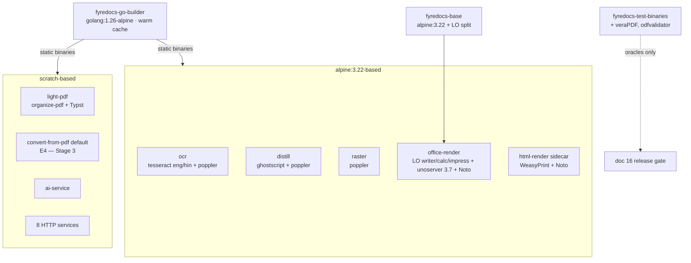

# 18 — Deployment Optimization
> Part of the Next-Generation Document Engine analysis (2026-11). Status: ANALYSIS — no code changed.

Siblings: `15-*` (observability and operations: the metrics these images export, the alerts the
autoscaler feeds), `14-api-and-distributed-architecture.md` §5.3 (the profiles these images realise),
`16-benchmarking-and-testing.md` §5.3–5.4 (how every size/time below gets measured; the baseline file
contract), `04-libreoffice-replacement-strategy.md` (which images keep LibreOffice), `12-*` (engine
integration choices that fix what each image must contain).

## 1. Purpose and scope

Lightweight deployment architecture for the worker profiles: what each image contains and omits, how
it is built (static, reproducible, cached), how it is hardened and resource-limited, how its size is
budgeted in CI, and the path from Compose to Kubernetes. Every "before" size here is the stale local
figure from the audit brief; fresh numbers land in `benchmarks/baseline-2026-11.md` (doc 16 §5.4) and
are referenced, never guessed.

## 2. Current state

**Build base.** Every service builds `FROM fyredocs-go-builder:latest`
(`deployment/base-go-builder.Dockerfile:18` is `golang:1.26-alpine`; warm `/go/pkg/mod` and
`/root/.cache/go-build` baked into layers, lines 49-66; `LABEL fyredocs.gomod-hash` line 76 drives
automatic rebuilds via `deploy.sh ensure_base_images`, `deployment/deploy.sh:64`).
`GO_BUILD_PARALLELISM` defaults to 6 (`base-go-builder.Dockerfile:22`, `deploy.sh:41`); the
measurement VM is 8 CPU / 4 GB (audit brief), where `GO_BUILD_PARALLELISM=4` is the documented
override (`deploy.sh:40`). Binaries: `CGO_ENABLED=0 GOOS=linux go build -p N -trimpath
-ldflags="-s -w"` (e.g. `convert-to-pdf/Dockerfile:20`, `job-service/Dockerfile:20-21`) — static,
stripped, path-trimmed. uid 10001 `appuser` is created in the builder (`base-go-builder.Dockerfile:27-28`)
and re-created in each non-scratch runtime (`convert-to-pdf/Dockerfile:25`,
`convert-from-pdf/Dockerfile:42`, `optimize-pdf/Dockerfile:35`, `organize-pdf/Dockerfile:35`);
every runtime ends with `USER appuser` (grep 2026-11-07, all 12 Dockerfiles).

**Runtime images.**

| Image | Base | Packages | Stale local size (audit brief, ~3 months old) |
|---|---|---|---|
| api-gateway, auth, job, document, user, notification, analytics, ai (8) | `scratch` + CA certs, zoneinfo, passwd/group, healthcheck binary (`job-service/Dockerfile:25-40`) | none | 43–60 MB |
| organize-pdf | `alpine:3.19` | ca-certificates, tesseract-ocr, -data-eng, -data-hin (`organize-pdf/Dockerfile:24-33`; comment line 26-27 still claims deu/fra/spa) | 287 MB |
| optimize-pdf | `alpine:3.19` | + poppler-utils, ghostscript, tesseract eng/hin (`optimize-pdf/Dockerfile:24-33`) | 325 MB |
| convert-to-pdf | `fyredocs-base:latest` = `alpine:3.19` + poppler-utils, **libreoffice** (full meta-package), ttf-liberation, python3, py3-pip, `pip3 install unoserver` unpinned (`deployment/base-alpine-libreoffice.Dockerfile:6-24`) | | 1.17 GB (base 1.07 GB) |
| convert-from-pdf | `python:3.11-slim-bookworm` + libreoffice-core/-writer/-calc/-impress, poppler-utils, ghostscript, fonts-liberation; pip pdf2docx 0.5.8, pdfplumber 0.11.4, openpyxl 3.1.5 (`convert-from-pdf/Dockerfile:28-40`) | | 1.54 GB |
| fyredocs-go-builder / test-binaries | golang:1.26-alpine | (+ LO, gs, tesseract eng/deu, unoserver in test image, `deployment/test-binaries.Dockerfile:13-27`) | 3.82 GB / 2.3 GB |

All four worker Dockerfiles declare unused `VOLUME /app/uploads /app/outputs` (audit brief). Fonts:
only Liberation; no Noto, no Devanagari, no `fc-cache` (audit brief). `base-image-setup.md:16`
estimates LibreOffice at ~500 MB and 2–5 min install; `docs/developer/architecture/base-image-setup.md:57-71`
still describes a `BASE_IMAGE` build-arg flow that the Dockerfiles do not implement (they hard-code
`FROM fyredocs-base:latest`).

**Alpine 3.19 is past end of support** (2025-11-01; 3.20 ended 2026-04-01; 3.22 is supported to
2027-05-01 — [alpinelinux.org/releases](https://alpinelinux.org/releases/), accessed 2026-11-07).
Three runtime images and the LibreOffice base pin it. This is a security finding independent of the
engine programme.

**Compose limits and env** (`deployment/docker-compose.yml`): workers `init: true`,
`stop_grace_period: 3m`, `tmpfs /tmp:size=1g`, memory 1G / 2 CPU each (convert-from-pdf lines
~786-860, convert-to-pdf ~860-938, organize-pdf, optimize-pdf; audit table). `WORKER_CONCURRENCY` 2/2/4/2,
`UNOSERVER_INSTANCES` left empty so entrypoint and Go pool disagree (`convert-to-pdf/entrypoint.sh:15-25`).
No `read_only`, `cap_drop`, `security_opt`, `pids_limit`, `user:` or `GOMEMLIMIT` anywhere in the
compose file (grep 2026-11-07). Multi-host split exists (`docker-compose.app.yml`,
`docker-compose.data.yml`, 12 per-service slices).

**CI stage 07** compiles modules only (`scripts/ci/07-build.sh:5`); images are built by `deploy.sh`
and never by CI; no SBOM, no scanner, no size tracking (audit brief: no .github/Jenkinsfile).

**Dependencies.** `gorm.io/datatypes v1.2.7` pulls `gorm.io/driver/mysql v1.5.6` and
`go-sql-driver/mysql v1.10.0` into every worker and document-service (`organize-pdf/go.mod:14,36,105`);
`quic-go v0.54.0` and `grpc v1.82.1` arrive through the OTel exporter graph (`shared/go.mod:69-70,95`).
Compiled into static binaries, their cost is binary bytes and SBOM noise, not runtime packages.

## 3. Requirements

Functional: one image per profile (doc 14 §5.3) containing exactly that profile's binaries, fonts and
data; a basic PDF request runs in an image with no OCR, office or presentation subsystem. Performance:
cold start of `light-pdf` ≤ 1 s to `/healthz` (to be measured, doc 16 §5.3); convert-from-pdf ≤ 150 MB
after Stage 3 (doc 01 roadmap); other targets "size to be measured". Compatibility: static
`CGO_ENABLED=0` binaries stay (doc 01 finding 5); `fyredocs-go-builder` warm cache stays; the existing
per-service compose slices keep working; no tool is removed. Security: supported base images only;
non-root, read-only rootfs, no new privileges, dropped capabilities, SBOM per image, scanner gate,
licence inventory with AGPL visible; digest-pinned bases.

## 4. Options evaluated

| Option | Language | Licence | Maturity | Fidelity/coverage | Integration | Effort (EM) | Verdict |
|---|---|---|---|---|---|---|---|
| A. Runtime base `scratch` (as 8 services today) | — | — | in use | no shell, no `apk`, no exec'd tools | Dockerfile | 0 | **Adopt** for `light-pdf` (pdfcpu-only), `ai`, all HTTP services; Typst static binary can be COPY'd in |
| B. `gcr.io/distroless/static` | — | Apache-2 | mature (Google) | same as scratch + CA/tz/passwd pre-made, nonroot user | Dockerfile | 0.05 | Equivalent to today's scratch+COPY recipe; adopt only if the team wants the signed base — not required |
| C. `alpine:3.22` (supported) | — | MIT | mature | shell + `apk` for poppler/gs/tesseract/LO | Dockerfile | 0.1 | **Adopt** for every image that execs a binary (`ocr`, `distill`, `raster`, `office-render`); replaces EOL 3.19 |
| D. Debian slim (`python:3.11-slim-bookworm`, as convert-from-pdf today) | — | — | mature | needed only for pdf2docx wheels (`convert-from-pdf/Dockerfile:23-27`) | Dockerfile | 0 | Keep **until Stage 3** removes pdf2docx; then convert-from-pdf moves to A (default) + C (raster) |
| E. Alpine LibreOffice split: `libreoffice-writer`/`-calc`/`-impress` instead of the `libreoffice` meta-package | — | MPL-2 | Alpine 3.19 `libreoffice` 7.6.7.2-r0 depends on base, calc, common, draw, impress, math, connector-postgres, writer, libreofficekit ([pkgs.alpinelinux.org](https://pkgs.alpinelinux.org/package/v3.19/community/x86_64/libreoffice), accessed 2026-11-07) | `libreoffice-common` alone is **326.8 MiB installed** ([common](https://pkgs.alpinelinux.org/package/v3.19/community/x86_64/libreoffice-common)); writer 11.4 MiB, impress 1.4 MiB installed ([writer](https://pkgs.alpinelinux.org/package/v3.19/community/x86_64/libreoffice-writer), [impress](https://pkgs.alpinelinux.org/package/v3.19/community/x86_64/libreoffice-impress)) | Dockerfile | 0.05 | **Adopt** (drops base/draw/math/postgres-connector/libreofficekit) but the saving is small relative to `-common`; verify by measurement that writer/calc/impress still import every format in the allowlist |
| F. Replace unoserver's Python with a Go supervisor | Go | — | — | unoserver must run under LibreOffice's own Python to reach UNO ([PyPI unoserver](https://pypi.org/project/unoserver/), accessed 2026-11-07) — no UNO bridge without Python/Java/C++ | — | 1+ | Reject: Go can supervise the daemons (Q1/Q2 move lifecycle into Go) but the conversion client stays `unoconvert`; **pin `unoserver==3.7`** (released 2026-06-10, PyPI) |
| G. Cold `soffice --headless --convert-to` per job, no unoserver, no Python | — | — | exists as the fallback path (`convert-to-pdf/processing/processing_free.go:69`) | adds a cold start per job | exec | 0 | Reject as default; removing Python buys little against a 326 MiB `-common` |
| H. Go build tags per profile (`-tags ocr,office,html,raster`) | Go | — | standard | gates compiled-in subsystem init and allowlists | build | 0.3 | **Adopt** — primarily for "never initialises" guarantees; binary-size effect expected small, measured not assumed |
| I. WeasyPrint sidecar on Alpine for `html-render` | Python | BSD-3 | mature; community Alpine images reported ~59–105 MB (self-reported, [pdf-service releases](https://github.com/mormahr/pdf-service/releases), [docker-weasyprint](https://github.com/mecodia/docker-weasyprint), accessed 2026-11-07; unverified for current WeasyPrint) | HTML/CSS, no JS | HTTP sidecar | 0.5–1 (doc 04) | **Adopt** per doc 04 rank 1; size to be measured |
| J. SBOM: syft (CycloneDX) + grype; scanner: Trivy | Go tools | Apache-2 | mature | image + Go module inventory incl. licences | CI stage | 0.2 | **Adopt** both: syft/grype for the licence inventory, Trivy as the single-binary scan gate (vendor speed claims unverified) |
| K. Reproducible builds: `SOURCE_DATE_EPOCH` + `rewrite-timestamp=true` + digest-pinned `FROM` | BuildKit | — | BuildKit ≥ 0.13 ([build-repro.md](https://github.com/moby/buildkit/blob/master/docs/build-repro.md), accessed 2026-11-07) | layer timestamps, base identity | build | 0.2 | **Adopt**; apk package pinning is best-effort (Alpine does not keep old package versions in the index) |

## 5. Recommendation

### 5.1 Multi-stage builds, static linking, stripping, trimpath — keep

All exist (`*/Dockerfile` builder stages; §2). Add `-buildvcs=false` only if the builder context lacks
`.git` (it is not a git repo on the measurement host, audit brief), and keep `-trimpath -s -w`.

### 5.2 Build caching — keep, document the 4 GB constraint

`fyredocs-go-builder` warm cache is the single biggest build-time asset (cold ≈ 21 min observed,
`base-image-setup.md:155-159`). Keep it; add `GO_BUILD_PARALLELISM=4` as the documented default for
hosts with ≤ 4 GB RAM in `deploy.sh` help text, and set `GOFLAGS=-p=4` in CI runners of that class.
Build-time rows are measured warm (doc 16 §5.3).

### 5.3 Selective feature compilation and optional modules

Build tags per profile, resolved in each worker's `main.go` allowlist and init:

| Tag | Compiles in | Profile images that set it |
|---|---|---|
| `ocr` | tesseract exec paths, `--list-langs` startup probe (`optimize-pdf/processing/processing_free.go:444`), OCR option validation | `ocr` |
| `office` | unoserver pool + Go daemon lifecycle (Q1/Q2) | `office-render` |
| `html` | WeasyPrint sidecar client | `html-render` |
| `raster` | pdftoppm paths, thumbnail tool | `raster`, `office-render` (render-presentation) |
| `distill` | Ghostscript paths | `distill`, `default` (PDF/A until Stage 4) |
| (none) | pdfcpu, Typst stamp, sync `pdf-info`/`validate` | `light-pdf` |

A binary built without a tag registers the tool as "unavailable in this profile" and terms the message
with a permanent error (routing in doc 14 §5.3 means this path is defensive only). Binary-size deltas
are reported in the baseline; the expectation is small because exec wrappers are thin — the point of
the tags is the "never initialises" rule (doc 14 §5.12), not bytes.

### 5.4 Worker profile images — target composition

"Size" is **to be measured** by `measure-images.sh` for every row; no target is asserted beyond the
Stage-3 convert-from-pdf ≤ 150 MB gate (doc 01).

| Profile image | Base | Packages IN | Packages OUT (vs today) | Fonts | Stage |
|---|---|---|---|---|---|
| `light-pdf` (organize-pdf) | `scratch` (A) | binary, CA certs, zoneinfo, passwd; Typst static musl binary from Stage 2 (doc 01 E7) | tesseract-ocr + eng/hin data, alpine userland | Typst font dir: Noto Sans/Serif, Noto Devanagari, Liberation (copied files, no fontconfig) | 1 (scratch) / 2 (Typst) |
| `ocr` (optimize-pdf + organize-pdf with `-tags ocr`) | `alpine:3.22` | tesseract-ocr, tesseract-ocr-data-eng, -hin (tessdata_best hin from Q7), poppler-utils (`pdftoppm -f N -l N`) | ghostscript, libreoffice | none needed (OCR output PDFs embed Tesseract's glyphless font) | 1 |
| `distill` (optimize-pdf) | `alpine:3.22` | ghostscript, poppler-utils (pdfinfo until Q8) | tesseract + data | gs bundled fonts only | 1; gs call volume falls in Stage 4 |
| `office-render` (convert-to-pdf) | `alpine:3.22` (new `fyredocs-base`) | libreoffice-writer, -calc, -impress (+ `-common` they imply), python3, py3-pip, `unoserver==3.7`, poppler-utils (render-presentation) | libreoffice-base, -draw, -math, -connector-postgres, libreofficekit | font-noto, font-noto-devanagari (25.0 MiB installed, [pkgs](https://pkgs.alpinelinux.org/package/v3.19/community/x86_64/font-noto-devanagari)), ttf-liberation, fontconfig + `fc-cache -f` at build (Q6) | 1 |
| `html-render` (convert-to-pdf `-tags html` + sidecar) | `scratch` worker + `alpine:3.22` WeasyPrint sidecar (I) | sidecar: python3, py3-pip, pango, cairo, harfbuzz, weasyprint pinned | libreoffice, unoserver | sidecar: Noto + Devanagari + fontconfig | 2 |
| `raster` (convert-from-pdf `-tags raster`) | `alpine:3.22` | poppler-utils | python, pdf2docx, LO, gs | none | 3 (split out when E4 lands) |
| `default` E4 (convert-from-pdf) | `scratch` (+ gs via `distill` tag in a `alpine:3.22` variant until Stage 4 moves PDF/A) | binary; `pdftotext -bbox-layout` + `pdfimages` interim extractor means poppler-utils stays until PDFium (Stage 5) → base is `alpine:3.22` until then | pdf2docx (AGPL), pdfplumber, openpyxl, LibreOffice, Python | Noto for E4 writers' default fonts (embedded files) | 3 |
| `ai` (ai-service) | `scratch` (unchanged) | — | — | — | — |

### 5.5 Fonts per profile

Fonts are the one non-binary asset that must be present everywhere text is drawn: `office-render`
and the WeasyPrint sidecar via `font-noto`, `font-noto-devanagari`, `ttf-liberation` and
`fontconfig` with `fc-cache -f` run at build time (so first conversion pays no cache build);
`light-pdf`/E4 via plain font files copied into the image for Typst and the E4 writers (no
fontconfig in scratch). The existing Dockerfiles install no Noto and run no `fc-cache`
(`base-alpine-libreoffice.Dockerfile:14-20`, `convert-from-pdf/Dockerfile:30-36`), which is why
Devanagari renders as tofu today (doc 01 Q6). Font files are licence-clean (OFL) and listed in the SBOM.

### 5.6 Removal of unnecessary packages — verdicts

- `libreoffice` meta → writer/calc/impress (E). Saves base/draw/math/postgres connector/libreofficekit;
  `-common` (326.8 MiB installed, Alpine 3.19 figure) remains the floor — honest expectation: tens of
  MiB, measured.
- `poppler-utils` only where a profile execs it (`ocr`, `distill`, `raster`, `office-render`, E4 until
  PDFium). Not in `light-pdf` once Q8 (pdfinfo → pdfcpu) lands.
- `python3` stays **only** in `office-render` (unoserver, F) and the WeasyPrint sidecar. Leaves
  convert-from-pdf in Stage 3 (E4 replaces pdf2docx/pdfplumber/openpyxl; doc 01 E4).
- `ghostscript` stays in `distill` and (until Stage 4 moves PDF/A) in the E4 image; never in
  `light-pdf`, `ocr`, `raster`.
- Pin everything: `unoserver==3.7`; `apk add pkg=version` for the LibreOffice/tesseract/gs/poppler
  packages with a comment that Alpine drops old versions from the index (so a pin can fail a rebuild —
  the digest-pinned base and the SBOM diff are the durable guarantees, K).
- Drop the unused `VOLUME /app/uploads /app/outputs` lines (every worker Dockerfile; audit brief) —
  they create anonymous volumes on every `docker run` and contradict the tmpfs-only scratch model.
- Fix the stale organize-pdf comment (`organize-pdf/Dockerfile:26-27`, claims deu/fra/spa).

### 5.7 Dependency pruning (Go)

- `gorm.io/datatypes` is used for `datatypes.JSON` on `Metadata` (`job-service/internal/models/job.go:28`
  and each worker's private copy). Replacing it with `json.RawMessage` + a `gorm:"type:jsonb"` tag
  removes `gorm.io/driver/mysql` and `go-sql-driver/mysql` from five modules' graphs. Effect on binary
  size: to be measured (`go tool nm -size` before/after); effect on SBOM: two fewer packages to scan.
  Risk: low; the JSON column semantics are unchanged.
- `quic-go` and `grpc` come from the OTel OTLP exporter dependency graph (`shared/telemetry/tracer.go:69-70`
  uses `otlptracehttp.New`, i.e. OTLP/HTTP). The gRPC exporter is not imported, so the linker already drops its code; `quic-go` is
  reachable via `net/http`'s HTTP/3 shim in the exporter's transport chain. Assessment: not worth a
  replacement; track in the SBOM, do not prune.
- `pdfcpu` is the largest dependency in the workers and is needed; `hhrutter/tiff,lzw` ride with it.
- `bytedance/sonic` (gin) and `klauspost/compress` are build-tag-gated; nothing to do.

### 5.8 Reproducible builds

Per BuildKit's `build-repro.md` (K): export `SOURCE_DATE_EPOCH=$(git log -1 --pretty=%ct)` in
`deploy.sh`/CI (BuildKit passes it as a build arg automatically), add `--output type=image,
rewrite-timestamp=true` to the service builds so layer mtimes match, pin every `FROM` by digest
(`golang:1.26-alpine@sha256:…`, `alpine:3.22@sha256:…`, `python:3.11-slim-bookworm@sha256:…`) with a
one-line renovation script, and emit the digest list into `baseline-2026-11.json` so a release can be
re-built bit-for-bit as far as apk permits. Go builds are already reproducible given `-trimpath`,
`CGO_ENABLED=0` and a fixed toolchain.

### 5.9 SBOM, licence inventory, image scanning

New CI stage `scripts/ci/08-images.sh` (naming aligned with doc 16's `08-engine-gate.sh`; the two run
in the release/nightly lane, not on PRs):

1. `docker build` each profile image (and `fyredocs-base`) with the K flags.
2. `syft <image> -o cyclonedx-json > sbom/<image>.cdx.json` — CycloneDX with Go module and apk/pip
   package licences.
3. Licence gate: fail if any component's licence matches `AGPL` in an image other than
   `office-render`/`distill` (Ghostscript AGPL is exec'd unmodified and accepted with notice, doc 01)
   and, after Stage 3, in **any** convert-from-pdf image (pdf2docx/PyMuPDF gone — Stage 3 acceptance
   "no AGPL in SBOM").
4. `grype sbom:sbom/<image>.cdx.json --fail-on high` and `trivy image --severity HIGH,CRITICAL
   --exit-code 1 <image>` (both; either alone is acceptable once the team picks one). Cache the
   vulnerability DB for at most 24 h (newly published CVEs must be seen).
5. Size budget (§5.10). Artefacts: SBOMs, scan reports, size table.

Tool versions are pinned in the CI image like golangci-lint (`scripts/ci/02-static.sh:20`).

### 5.10 Size budget check (fails CI)

`08-images.sh` reads `benchmarks/baseline-2026-11.json` (doc 16 §5.4 contract) and compares
`docker image inspect --format '{{.Size}}'` per image. Fail when `size > baseline × (1 + X/100)`;
**X is set from the baseline's observed run-to-run noise** (two builds of the same commit) plus a
margin — not chosen here. Budgets are per image, updated only by committing a new baseline row with
the reason in the commit message. The same stage prints the compressed size (`docker save | gzip |
wc -c`) for the transfer metric.

### 5.11 Runtime hardening hooks (compose today, k8s later)

All per [Docker Compose service reference](https://docs.docker.com/reference/compose-file/services/)
(accessed 2026-11-07): `read_only: true`, `cap_drop: [ALL]`, `security_opt: [no-new-privileges:true]`,
`pids_limit`, `user`.

| Hook | Status | Proposal |
|---|---|---|
| Non-root | exists (`USER appuser`, uid 10001, every Dockerfile) | also set `user: "10001:10001"` in compose so an image regression cannot silently run as root |
| Read-only rootfs | **done 2026-11-09 for every Fyredocs service** (was absent) | `read_only: true` for every service; workers already have `tmpfs /tmp:size=1g`; LibreOffice profiles live at `/tmp/uno-profile-<port>` (`entrypoint.sh:41`) so they stay writable; **pdfcpu writes `config.yml` under the user config dir and can `os.Exit(1)`** — Q4 (`DisableConfigDir` in the 3 remaining mains, doc 01 finding 4) is a prerequisite for read-only in those workers; set `HOME=/tmp` for LO/tesseract |
| no-new-privileges | absent | `security_opt: ["no-new-privileges:true"]` everywhere (note: snap-installed Docker rejects it — install from the official repo) |
| Capabilities | absent | `cap_drop: [ALL]`; nothing in the stack binds a port < 1024 inside a container (Caddy publishes 80/443 but runs as root inside its own image; evaluate `cap_add: NET_BIND_SERVICE` for Caddy only) |
| seccomp | Docker default profile applies | keep default; a custom profile only after `strace`-derived syscall lists per profile (Stage 6) |
| PID limit | absent | `pids_limit` per worker: LibreOffice/gs spawn process trees; set from `WORKER_CONCURRENCY × observed per-job tree size × 2` once measured; `init: true` stays for zombie reaping |
| tmpfs flags | `size=1g` only | add `noexec,nosuid` to `/tmp` for every profile except `office-render` (LO's profile dir must not need exec — verify) |

### 5.12 Resource limits per profile and GOMEMLIMIT

Compose limits today: 1G / 2 CPU per worker, 256M for HTTP services, 512M job-service (audit table).
Go's runtime does not read the cgroup memory limit; `GOMEMLIMIT` is a **soft** limit covering all
runtime-managed memory, with a GC CPU cap of ~50 % that bounds the slowdown at ≈ 2× if set too low;
the guide recommends it for containerised services with 5–10 % headroom and warns against using it
when the program already sits at the environment limit ([Go GC guide](https://go.dev/doc/gc-guide),
accessed 2026-11-07).

| Profile | Memory limit (compose today) | Proposed `GOMEMLIMIT` | Rationale |
|---|---|---|---|
| HTTP services (scratch) | 256M | `230MiB` (≈ 90 %) | pure Go; the guide's container case |
| job-service | 512M | `460MiB` | pure Go; multipart buffering up to 50 MiB (`job-service/main.go:131`) |
| `light-pdf` | 1G | `850MiB` | pdfcpu is in-process and the dominant allocator; large merges are memory-bound (doc 14 §5.3) |
| `ocr`, `distill`, `office-render`, `raster` | 1G | `256MiB` initial | Go heap is small; the limit must leave room for `tesseract`/`gs`/`soffice.bin`/`pdftoppm`, which the Go runtime cannot see — the subprocess budget is enforced by the cgroup, not by GOMEMLIMIT |
| E4 `default` | 1G | `700MiB` | in-process page model; measured on the 300-page slice before fixing |

All values are starting points to be replaced by `memory.peak` rows from `make bench-engine`
(doc 16 §5.3). `GOMAXPROCS` follows the cgroup CPU limit automatically on Go ≥ 1.25 (community claim,
[memlimit](https://pkg.go.dev/github.com/gocronx-team/memlimit), accessed 2026-11-07 — verify against
the Go 1.26 release notes before relying on it); the workspace is on Go 1.26.0 (audit brief).

### 5.13 Compose → Kubernetes migration path

Profiles are already the unit: each profile = one compose service (a new slice file
`deployment/docker-compose-<profile>.yml` extending the worker's existing slice) = one k8s Deployment
later. Mapping: `deploy.resources.limits` → `resources.limits`; `tmpfs /tmp` → `emptyDir{medium:
Memory, sizeLimit: 1Gi}`; `init: true` → `shareProcessNamespace` or a tini entrypoint;
`stop_grace_period: 3m` → `terminationGracePeriodSeconds: 180` (must stay > `WORKER_DRAIN_TIMEOUT` 120 s);
`read_only` → `securityContext.readOnlyRootFilesystem`; `cap_drop` → `capabilities.drop: [ALL]`;
`no-new-privileges` → `allowPrivilegeEscalation: false`; `user` → `runAsUser: 10001`. Autoscaling:
compose `scale-workers.sh` loop → KEDA `ScaledObject` with the `nats-jetstream` trigger per durable
(doc 14 §5.10). The data node (`docker-compose.data.yml`) is the last to move; `horizontal-scaling.md`
§4 already sequences it. No Helm/Kustomize exists at HEAD; writing it is Stage 6 work.

### 5.14 CI stage changes (summary)

- `scripts/ci/07-build.sh`: unchanged (module compile) **plus** a `go build -tags <profile>` loop so
  every tag combination compiles on every PR (cheap, catches tag drift).
- New `scripts/ci/08-images.sh` (release/nightly): build profile images → SBOM → licence gate →
  scan → size budget (§5.9–5.10). Shares the lane with doc 16's `08-engine-gate.sh`; order:
  images first (the gate needs them).
- `deploy.sh`: `SOURCE_DATE_EPOCH`, digest-pinned bases, `GO_BUILD_PARALLELISM=4` guidance,
  `UNOSERVER_INSTANCES` single source of truth (Q2).
- Docs to update in the same change (CLAUDE.md §8): `base-image-setup.md` (drop the unimplemented
  `BASE_IMAGE` arg flow, add profiles), `compose-files.md`, each `services/<worker>.md`, `ci-pipeline.md`
  stage table.

### 5.15 Stage table

| Stage | Deployment deliverable | Measured by |
|---|---|---|
| 1 | Alpine 3.22 everywhere (EOL fix); `fyredocs-base` LO split + Noto/Devanagari + `fc-cache`; `unoserver==3.7` pinned; `light-pdf` on scratch (tesseract moves to the `ocr` profile build of organize-pdf); `GOMEMLIMIT` initial values; `read_only` + `no-new-privileges` + `cap_drop` on HTTP services; baseline file | `measure-images.sh` baseline; doc 16 Stage 1 gates |
| 2 | Typst in `light-pdf`; `html-render` sidecar image; `read_only` on workers (after Q4); `08-images.sh` with SBOM + scan + size budget | size budget green; SBOM artefacts |
| 3 | convert-from-pdf without Python/LO/pdf2docx; `raster` profile split; AGPL gate on that image | ≤ 150 MB; no AGPL in SBOM |
| 4 | `distill` loses most gs calls (image unchanged until flatten/PDF-A move) | gs call metric −70 % |
| 5 | E4 image drops poppler if PDFium (WASM) passes its gate; pdfsign adds no packages | PDFium gate (doc 01) |
| 6 | `office-render` autoscaled Deployment; KEDA; PID limits and seccomp from measured syscall sets; optional PaddleOCR sidecar image if the CER gate passes | office jobs/min linear in replicas |

## 6. Classification

Image composition and hardening: class A (configuration over existing tooling). WeasyPrint sidecar:
class D (mature external). Typst static binary: class D (Rust tool, exec'd; Go alternative in doc 01
E7). PaddleOCR sidecar: class E (optional, gated). No class B/C work is introduced by deployment.

## 7. Acceptance criteria and gates

| Criterion | Proven by |
|---|---|
| No runtime image is based on an Alpine release past its end-of-support date at release time | `08-images.sh` checks the base tag against a pinned EOL table (`alpinelinux.org/releases`) |
| `light-pdf` contains no `tesseract`, `gs`, `soffice`, `python3`, `pdftoppm` | `docker run --rm --entrypoint sh` fails (scratch has no shell) **and** `syft` SBOM lists no apk packages |
| Every profile image size is ≤ its baseline budget (X % from baseline noise) | `08-images.sh` |
| convert-from-pdf ≤ 150 MB after Stage 3 and SBOM free of AGPL | `docker image inspect`, syft licence gate |
| All services run with `read_only`, `cap_drop: [ALL]`, `no-new-privileges`, uid 10001; k6 `smoke` still passes | compose diff + `docker inspect` + k6 |
| `GOMEMLIMIT` present in every service env; no OOM-kill in a `soak` run; `memory.peak` ≤ compose limit − 10 % for every profile over the corpus | `docker events` (no `oom`), doc 16 §5.3 |
| Hindi DOCX→PDF produces no tofu in `office-render` after the font change | doc 16 tofu detector = 0 (Stage 1 gate) |
| Reproducible: two builds of the same commit on the same builder produce identical image digests for every scratch-based image (alpine-based: identical apk package lists) | `08-images.sh` double-build on release |
| Compose → k8s mapping validated: one profile (`light-pdf`) deployed on a kind cluster with the §5.13 mapping and passing `smoke` | Stage 6 |

## 8. Risks and open questions

- Alpine 3.19 EOL is the most urgent finding here and is not an engine question; it should ship with
  Stage 1 regardless (LibreOffice version changes with the Alpine bump — the doc 16 office slice must
  be re-baselined after it).
- The LibreOffice split saving is bounded by `-common`; if measurement shows < 5 % gain, keep the
  meta-package for simplicity and spend the effort on Stage 3 (removing LO from convert-from-pdf
  entirely, −≈ 400 MB per doc 01's estimate — itself to be measured).
- `read_only` on `office-render` depends on where LibreOffice and fontconfig write at runtime
  (`$HOME/.config`, `/var/cache/fontconfig`); needs an `strace`/`inotify` pass before enabling.
- `GOMEMLIMIT` on workers with heavy subprocesses protects only the Go heap; the real protection is
  the per-job `/usr/bin/time -v` budget plus `pids_limit` and cgroup limits — do not over-claim it.
- apk version pinning breaks rebuilds when Alpine drops a package version; digest-pinned bases plus
  SBOM diffs are the durable reproducibility story, and the team must accept occasional pin bumps.
- WeasyPrint image size figures are community self-reports for older versions; measure before
  committing to the "~150 MB" planning number in doc 04.
- distroless vs scratch: equivalent for this repo; choosing distroless adds an external base to pin and
  scan, which is only worth it if the team wants a signed base provenance.
- Removing `gorm.io/datatypes` touches five modules' models (private copies by design, CLAUDE.md §1);
  schedule it as one coordinated change under §8/§9 of CLAUDE.md.

## Sources

- `deployment/{base-go-builder,base-alpine-libreoffice,test-binaries}.Dockerfile`, `*/Dockerfile`,
  `deployment/docker-compose.yml`, `deployment/docker-compose.data.yml`, `deployment/deploy.sh`,
  `convert-to-pdf/entrypoint.sh`, `scripts/ci/{02-static,07-build}.sh`, `organize-pdf/go.mod`, `shared/go.mod`,
  `docs/developer/architecture/{base-image-setup,ci-pipeline,horizontal-scaling}.md` (all read 2026-11-07).
- Alpine releases and support dates — https://alpinelinux.org/releases/ (accessed 2026-11-07).
- Alpine 3.19 x86_64 packages: `libreoffice` meta — https://pkgs.alpinelinux.org/package/v3.19/community/x86_64/libreoffice; `libreoffice-common` 326.8 MiB installed — https://pkgs.alpinelinux.org/package/v3.19/community/x86_64/libreoffice-common; `libreoffice-writer` 11.4 MiB — https://pkgs.alpinelinux.org/package/v3.19/community/x86_64/libreoffice-writer; `libreoffice-impress` 1.4 MiB — https://pkgs.alpinelinux.org/package/v3.19/community/x86_64/libreoffice-impress; `font-noto-devanagari` 25.0 MiB — https://pkgs.alpinelinux.org/package/v3.19/community/x86_64/font-noto-devanagari (all accessed 2026-11-07).
- unoserver 3.7 (2026-06-10), must run under LibreOffice's Python — https://pypi.org/project/unoserver/ (accessed 2026-11-07).
- Go GC guide, memory limit semantics — https://go.dev/doc/gc-guide (accessed 2026-11-07); GOMAXPROCS-from-cgroup claim (unverified) — https://pkg.go.dev/github.com/gocronx-team/memlimit (accessed 2026-11-07).
- Docker Compose service attributes — https://docs.docker.com/reference/compose-file/services/ (accessed 2026-11-07).
- BuildKit reproducible builds (`SOURCE_DATE_EPOCH`, `rewrite-timestamp`, source policy digest pinning) — https://github.com/moby/buildkit/blob/master/docs/build-repro.md (accessed 2026-11-07).
- WeasyPrint Alpine image sizes (self-reported, unverified for current versions) — https://github.com/mormahr/pdf-service/releases, https://github.com/mecodia/docker-weasyprint (accessed 2026-11-07).
- SBOM/scan tooling overview (vendor/blog claims, unverified for speed figures) — https://lucaberton.com/blog/trivy-vs-grype-2026/ (accessed 2026-11-07).
