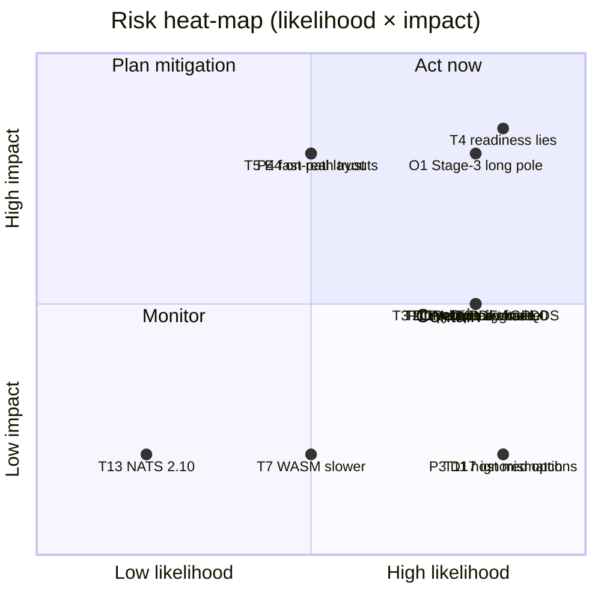

# 19 — Risk and Compatibility Analysis

> Part of the Next-Generation Document Engine analysis (2026-11). Status: ANALYSIS — no code changed.

## 1. Purpose and scope

This document answers two questions the brief (§9, §19) requires before any implementation starts: *what
compatibility can honestly be claimed per format at each stage, and what could make the programme fail*.
It consolidates the per-engine gates from `04-libreoffice-replacement-strategy.md` §7 and
`16-benchmarking-and-testing.md` §5, the defects from `01-existing-system-audit.md` (D1–D23b), the licence
findings from `03-heavy-dependency-analysis.md`, and the stage plan in `20-implementation-roadmap.md`. It also
records every architectural decision taken in this study with the measurable condition that would reopen it.

Nothing here claims Office compatibility beyond what a named gate has proven; today no gate has run.

## 2. Current state

| Fact | Evidence |
|---|---|
| Every office/HTML→PDF conversion has run on cold `libreoffice --headless` since 2026-06-19: the unoserver pool never starts (`file://` profile argument, D23) and would still not start after that fix (`--uno-port` collision, D23b) | `convert-to-pdf/entrypoint.sh:43`; `benchmarks/raw/startlog-convert-to-pdf.txt`; `benchmarks/raw/unoserver-corrected-2002.log` |
| The only throughput figure is 9 jobs/min sustained (co-located k6, lower bound), measured in that state | `scripts/k6/results/capacity-jobs-20260727-234123.md` |
| Readiness treats the pool as informational, so total feature degradation was invisible for five months | `convert-to-pdf/main.go` `/readyz`; `12-performance-architecture.md` §5 |
| pdfcpu pinned at v0.9.1; upstream v0.16.4 (2026-10-27) with 8 advisories fixed in 0.16.x | `convert-to-pdf/go.mod`; `08-pdf-engine-design.md` §4 |
| Alpine 3.19.9 (EOL 2025-11-01) in three images; Ghostscript 10.05.1 inside the CVE-2025-59798/59799 range | `benchmarks/raw/tool-versions.txt`; `15-security-and-reliability.md` §2 |
| Upload MIME check admits `application/zip` for every Office/ODF category → DOCX/XLSX/PPTX/ODT/EPUB indistinguishable at upload | `job-service/handlers/jobs.go:57-64`; `06-parsing-engine-design.md` §4 |
| No Devanagari font in any image; pdfcpu stamps use core Helvetica and pdfcpu has no GSUB/GPOS shaping at all | `07-layout-and-rendering-engine.md` §2; `organize-pdf/processing/processing_edit.go:276,446,604` |
| No cancellation, no process-group kill, pdfcpu ignores `ctx` | `01-existing-system-audit.md` D4, D11; `14-api-and-distributed-architecture.md` §5 |
| Measurement host is an 8-CPU / 4 GB arm64 Docker VM, not the 12 vCPU / 48 GB x86 production class | `benchmarks/baseline-2026-11.md` header |

## 3. Requirements

- Distinguish, per format, **parsing**, **round-trip**, **rendering**, **editing** and **feature-preservation**
  compatibility (brief §9) and never conflate them.
- Every claimed level must name the gate that proves it and the corpus revision it was measured on
  (`benchmarks/corpus/README.md`).
- Unknown XML parts and relationships are preserved verbatim on any write path
  (`05-document-core-architecture.md` §5 PartStore); modifying one element never deletes an unrelated one.
- Risks carry likelihood, impact, an early-warning signal, a mitigation, an owning stage and the sibling doc.

## 4. Compatibility matrix

Legend — **P** parsing · **R** round-trip (open→save byte-identical for untouched parts) · **V** rendering to PDF/raster
· **E** editing · **F** feature preservation. Each cell: *today → after the named stage (gate)*. "LO" = LibreOffice as
isolated `office-render` (E3), retained for the whole roadmap. "—" = not offered and not planned.

| Format | P | R | V | E | F |
|---|---|---|---|---|---|
| DOCX (`.docx`, `.doc`) | none (LO opaque) → S5/6 own OPC walker, structure only (`06-…` §6; gate G-RT: 200-file parse corpus) | none → S5/6 PartStore byte-identical untouched parts (gate G-RT) | LO (cold) → S1 LO warm pool (G-POOL) → S6 *optional* simple-doc fast path only if G-FAST passes (SSIM ≥ 0.95 on 95 % of simple class, 0 false positives on 200 complex docs) | none → S3 write-only from E4 (pdf→docx, G-E4) → S5/6 limited edit (paragraph/run/table) | n/a → S5/6 opaque parts, rels untouched; VBA carried, never executed (`15-…` §4) |
| XLSX (`.xlsx`, `.xls`) | none → S3 excelize read (`09-…` §4; gate: corpus open + `Rows` stream) | none → excelize round-trip is **lossy for unsupported parts** (pivot caches, some charts) — stated as such until an opaque-part test exists | LO → LO (no Go print-layout engine; `09-…` §5 enumerates why) | none → S3 write-only (pdf→xlsx, G-E4 table F1) → formulas preserved as strings; recalculation engine only after Stage 4 if a product need appears (`09-…` §5 tiers T0–T4) | lossy today (LO re-export) → S3 excelize-level; charts write-only |
| PPTX (`.pptx`, `.ppt`) | none → S3 own OPC/deck reader (`10-…` §5) | none → S5/6 PartStore (G-RT) | LO → LO (charts, SmartArt, animations never native) | image-only output today → S3 text+image slides with confidence fallback (`10-…` §5.3) | n/a → S5/6 opaque parts incl. animations/transitions |
| ODT/ODS/ODP | none → S3 ODF writers (pdf→odt/ods/odp, gate G-ODF: `odfvalidator` + LO round-trip 100 %) | — | LO → LO | — | n/a |
| PDF 1.4–1.7 | pdfcpu v0.9.1 (`08-…` §2) → S1 pdfcpu v0.16.x (upgrade gate: fuzz corpus + organize suites green) | n/a (rewrite semantics: pdfcpu re-serialises) | Poppler `pdftoppm` → S5 go-pdfium WASM only if G-PDFIUM (≥ 0.7× throughput at 150 DPI, identical page counts, crash isolation) | pdfcpu ops (merge/split/…); stamps Latin-only → S2 Unicode via Typst (G-FONT) | annotations/forms/bookmarks preserved by pdfcpu; JS/actions not stripped (sanitize-on-output proposed, `15-…` §5) |
| PDF 2.0 | pdfcpu reads; AES-256 R6 supported (`08-…` §4) → unchanged | n/a | as above | as above | as above |
| PDF/A-2b (output) | n/a | n/a | gs; **currently non-conformant** (no `PDFA_def.ps`/ICC, D-PDFA) → S1 fixed invocation, gate: veraPDF 2b pass on the slice | — | — |
| Encrypted PDF | pdfcpu decrypt with password (`unlock-pdf`) | — | — | protect/unlock via pdfcpu AES | — |
| HTML | LO Writer import → S2 WeasyPrint sidecar (G-HTML: 30 fixtures SSIM ≥ 0.9 vs Chrome, egress blocked) | — | LO → WeasyPrint (no JS by design) | — | — |
| Images (png/jpeg/webp) | Go stdlib + x/image, 50 MP guard (`11-…` §2) → unchanged | — | pdfcpu image→PDF (options silently ignored today, D17 → S2 fix) | scan pipeline (pure Go) | EXIF not carried into PDF |
| EPUB / Markdown / RTF | — (no tool; `06-…` classifies E-optional) | — | — | — | — |

**Explicit non-goals** (stated so nobody reads the matrix as a promise): a custom office layout engine as a core
deliverable; team-written Rust; full Ghostscript removal (flatten, PDF/A, `extreme` stay on gs); PAdES LTV
(B-LT/B-LTA — `pdfsign` has no DSS); true content-stream redaction (Stage 5 is rasterise-region, documented as
lossy); VBA execution of any kind; native rendering of charts/SmartArt/animations; xlsx→pdf and pptx→pdf without
LibreOffice; JavaScript execution in HTML→PDF.

## 5. Risk register

Likelihood/Impact: H/M/L. "Signal" is what to watch so the risk is seen early, not after the stage gate fails.

### 5.1 Technical

| ID | Risk | L | I | Signal | Mitigation | Stage | Doc |
|---|---|---|---|---|---|---|---|
| T1 | pdfcpu v0.9.1 → v0.16.4 upgrade breaks organize-pdf watermark/import paths (seven minors) | H | M | organize-pdf test suites + 10 fuzz corpora under the new version | Upgrade first in Stage 1 under the harness; pin exact version; keep 0.9.1 branch one release | 1 | `03-…` §8, `08-…` §8 |
| T2 | Q0 fixes the pool and the **30 s timeout ghost-work tail appears for the first time** (`processing_free.go:37-45`) | H | M | `convert_fallback_total` > 0 after Q0; p95 on > 18 MB inputs | Q1 size-scaled timeout + kill/respawn (uses unoserver `--conversion-timeout`) lands in the same stage | 1 | `04-…` §5.2, `12-…` §5 |
| T3 | LibreOffice/unoserver versions are dictated by the base OS (7.6.7 Alpine, 7.4.7 Debian); the Alpine bump changes LO and therefore fidelity | H | M | SSIM drift in the office slice between base images | Treat the base bump as a fidelity change: run `make bench-engine` office slice before/after | 1 | `04-…` §8, `18-…` §4 |
| T4 | Readiness lies: `/readyz` passed for five months with the pool dead | H | H | any dependency marked "informational" | Readiness truth rule: a dead pool → 503 within 10 s; metric + alert; integration test in test-binaries asserts pool up | 1 | `15-…` §5.9 |
| T5 | E4 table/column reconstruction underperforms on real layouts (synthetic fixtures are padding, not layout) | M | H | table-cell F1 on the labelled set below pdfplumber during Stage 3 week 4 | Scope = pdf2docx parity; keep pdf2docx path behind a flag until G-E4 passes; grow the real corpus first (Q13) | 3 | `08-…` §5, `05-…` §8 |
| T6 | SSIM thresholds (0.9/0.95) are uncalibrated against human judgement | M | M | gate passes that reviewers reject, or vice versa | Human-rated calibration slice (50 pairs) before any gate is used as a release blocker | 1 | `16-…` §8 |
| T7 | go-pdfium WASM ≈ 2× slower than native and retains memory until instance close | M | L | G-PDFIUM throughput < 0.7× pdftoppm | Keep Poppler; never switch the builder to cgo | 5 | `08-…` §5.11, `13-…` §5 |
| T8 | go-text/typesetting (v0.3.5, no releases, v0.x) or Typst's shaper (rustybuzz archived 2026-07; HarfRust migration unverified) regress Devanagari | M | M | G-FONT tofu count > 0 on the Hindi slice | Typst is exec'd and pinned; Devanagari fixtures in every release gate; Go alternative kept | 2 | `07-…` §8 |
| T9 | Fixtures stop at 40 MB; the 100 MB large-job path (`tmpfs.go:35`) is untested | M | M | any > 100 MB claim in a gate | Add ≥ 1 real 150 MB fixture before claiming; office input cap decision (Q12) | 1 | `06-…` §2 |
| T10 | Upload MIME check cannot tell DOCX from any zip; wrong tool on wrong file fails late in the worker | M | L | `[UNSUPPORTED]`/load failures per tool in analytics | Worker-side zip-subtype sniff (mimetype already indirect); job-service adoption later | 2 | `06-…` §4 |
| T11 | Measurement host (4 GB arm64) vs production (48 GB x86): absolute numbers mislead | H | L | anyone quoting `baseline-2026-11.md` absolutes as production | Every number carries host; k6 ladders only off-box on the VPS class | 1 | `16-…` §4 |
| T12 | pdfcpu ignores `ctx`: cancellation of a 500-page merge takes seconds | M | L | cancel latency > 2 s in harness | Check ctx between stages; never fork pdfcpu | 2 | `08-…` §5, `14-…` §5 |
| T13 | Compose runs NATS 2.10: no JetStream priority groups; fair share must stay Redis-based | L | L | tenant starvation under spike | Redis in-flight counters per user/plan | 2 | `14-…` §5 |

### 5.2 Licensing

| ID | Risk | L | I | Signal | Mitigation | Stage | Doc |
|---|---|---|---|---|---|---|---|
| L1 | PyMuPDF (AGPL-3.0) inside the convert-from-pdf image via pdf2docx (itself MIT) | H | M | SBOM lists `pymupdf` | Licence notice now; E4 removes it in Stage 3; AGPL gate on that image in CI | 1→3 | `03-…` §5, `18-…` §5 |
| L2 | Ghostscript AGPL (exec'd unmodified) — attribution/notice obligation; commercial licence only if modified or linked | L | M | any proposal to link gs | Keep exec-only; licence notice; `15-…` AGPL inventory | 1 | `03-…` §5 |
| L3 | Tempting Go libraries are commercial (unioffice) or AGPL (go-fitz/MuPDF, fumiama/go-docx) | M | M | a PR adding one | `18-…` CI licence gate (syft + policy) rejects AGPL/commercial-only in worker images | 1 | `13-…` §4, `06-…` §4 |
| L4 | Noto fonts OFL-1.1 (fine), Typst Apache-2 (fine), Liberation OFL — embedding/subsetting permitted | L | L | — | Record in licence notice | 2 | `07-…` §5 |

### 5.3 Product

| ID | Risk | L | I | Signal | Mitigation | Stage | Doc |
|---|---|---|---|---|---|---|---|
| P1 | PAdES signing without a CA-backed certificate shows "unknown validity" in Acrobat; product has not chosen a certificate model | H | M | feature spec without a cert decision | Decide (platform cert, user upload, or hosted CA) before Stage 5 work starts | 5 | `08-…` §5.7 |
| P2 | Hindi OCR quality: Tesseract `hin` at 150 DPI default; PaddleOCR Devanagari unproven on our scans (ICON 2024: Tesseract 93 % vs PaddleOCR 56 %) | M | M | CER on the 50-scan Hindi slice | Q7 (300 DPI, `tessdata_best`); bake-off only on ≥ 30 % relative CER gain | 1/6 | `11-…` §5 |
| P3 | image-to-pdf options (page size, margins, orientation, quality) are accepted by the app and silently ignored (D17) | H | L | support tickets; app UI | Implement in convert-to-pdf (pdfcpu import config) — Stage 2 | 2 | `01-…` D17 |
| P4 | Fast-path output that is "almost right" damages trust more than slow output | M | H | any fast-path SSIM < 0.95 in production samples | Fast path stays optional, classifier-gated, with per-plan opt-in and a "rendered by" marker | 6 | `04-…` §5.1 |

### 5.4 Organisational

| ID | Risk | L | I | Signal | Mitigation | Stage | Doc |
|---|---|---|---|---|---|---|---|
| O1 | Two engineers, ~17 EM: Stage 3 (E4, 4–5 EM) is the long pole and needs OOXML + PDF depth | H | H | Stage 3 week-6 checkpoint without a passing DOCX writer round-trip | Stage 3 starts only after the harness exists; E4 scoped to pdf2docx parity; writers before readers | 3 | `17-…` §6, `20-…` §3.3 |
| O2 | CLAUDE.md §1 forbids shared engines; duplication of thin adapters across workers must be deliberate | M | M | a PR creating `shared/<engine>` | `17-…` ownership table; `NOTE:` comments marking intentional duplication; only `procexec` (and possibly `safearchive`, open) in `shared/` | all | `17-…` §5, `05-…` §8 |
| O3 | Documentation obligations (service docs, mermaid, swagger, postman) per change are large; postman/ does not exist | M | L | PRs without doc updates | Create postman/ with the first API change; CI doc-sync check | 2 | `14-…` §5.14 |

### 5.5 Operational

| ID | Risk | L | I | Signal | Mitigation | Stage | Doc |
|---|---|---|---|---|---|---|---|
| X1 | Office-render isolation changes deployment topology (new container, subjects); rollback must be instant | M | M | fallback rate after cut-over | Flag-gated subject split; old subject kept one release | 6 | `14-…` §5, `18-…` §5 |
| X2 | Cancellation adds a state (`cancelled`) that document-, notification- and analytics-service subscribers must ignore or handle | M | M | subscriber DLQ growth after rollout | Migration owned by job-service; subscribers verified in integration tests before the API flips | 2 | `14-…` §5 |
| X3 | Sidecars (WeasyPrint, optional PaddleOCR) add Python images back and need egress policy, pinning (WeasyPrint has 2026 CVEs) | M | M | image scan findings | Pin, scan, no-network except MinIO; circuit breaker per sidecar | 2/6 | `15-…` §5, `18-…` §4 |
| X4 | 1 GB worker limit with LibreOffice daemons (~90–100 MB RSS each at idle after a corrected start; ~300 MB budgeted per daemon in `deploy.sh:542`) plus Go leaves little headroom for 3 daemons | M | M | OOM kills in `docker events` | Daemon recycling (`--stop-after`), per-profile GOMEMLIMIT, measured not budgeted sizing | 1/6 | `12-…` §5, `benchmarks/baseline-2026-11.md` §7 |

## 6. Compatibility profiles

A conversion request resolves to one profile; the profile states what it promises and what it refuses.

| Profile | Promise | Engine path | Refuses | Available |
|---|---|---|---|---|
| `fidelity-first` (default) | Output matches LibreOffice (office) / Ghostscript–Poppler (PDF) reference behaviour; fonts embedded; Devanagari shaped | E3 `office-render` warm pool; E1/E5 with gs fallback; E7 Typst stamps | nothing — always available | today (cold), Stage 1 (warm) |
| `fast` | Lower latency and memory for the *simple-document class* only; same text, page count and SSIM ≥ 0.95 vs `fidelity-first` on the gate corpus | classifier → Go fast path, else transparently `fidelity-first` | documents the classifier flags complex; any format without a passed G-FAST | Stage 6, optional |
| `strict` | Conformance-validated output: PDF/A-2b (veraPDF pass), tagged where the engine supports it, no JS/actions/embedded files | gs PDF/A with corrected invocation; sanitize-on-output | inputs that cannot be made conformant (reports why) | Stage 1 (PDF/A), Stage 5 (sanitize) |

## 7. Decision log

| # | Decision | Alternatives rejected | Reopen when (measurable) | Doc |
|---|---|---|---|---|
| 1 | Keep LibreOffice for office→PDF and office→ODF for the whole roadmap; isolate it as `office-render` | custom Go/Rust office layout engine as core deliverable; office2pdf/dxpdf adoption | G-FAST passes on a 500-doc corpus AND Stage 6 shows LO still the ceiling after horizontal scaling | `04-…` §5 |
| 2 | Go-first; Rust only as exec'd static binaries (Typst) or behind a measured sidecar/WASM gate; no team Rust for 12 months | Rust core engines | E4 > 200 ms/page in Go; go-text fails Devanagari; G-PDFIUM fails AND Poppler blocks a requirement | `13-…` §5 |
| 3 | E4 page-model reconstruction is the one custom engine, inside convert-from-pdf | keep pdf2docx; LibreOffice `writer_pdf_import` | G-E4 unmet after Stage 3 + 1 month | `08-…` §5, `05-…` §5 |
| 4 | Replace Ghostscript only for compress (medium/high) and repair tier-1; keep for flatten, PDF/A, extreme | full gs removal | pdfcpu gains appearance-stream flattening or a validated Go PDF/A writer exists | `08-…` §5.6, §5.10 |
| 5 | Poppler stays until go-pdfium WASM passes G-PDFIUM; never cgo | go-fitz (AGPL); native cgo PDFium | G-PDFIUM pass | `08-…` §5.11 |
| 6 | Tesseract stays; PaddleOCR only as an optional sidecar on ≥ 30 % relative CER gain | replace OCR engine now | bake-off result | `11-…` §5 |
| 7 | Unicode/Devanagari stamps via Typst → pdfcpu PDF-mode watermark | pdfcpu TrueType stamps (no shaping); raster stamps | pdfcpu gains GSUB/GPOS shaping | `07-…` §5 |
| 8 | HTML→PDF via WeasyPrint sidecar (no JS) | headless Chromium; keep LO | product requires JS-rendered HTML | `04-…` §4.3 |
| 9 | Layered IR: flow IR + fixed-page IR with lossy bridges; opaque parts for unknown XML | single unified IR | — (design principle) | `05-…` §5 |
| 10 | pdfcpu upgrade to v0.16.x is a Stage 1 prerequisite | stay on v0.9.1 | — | `08-…` §4 |
| 11 | Q0 (pool fix + readiness truth) is the first milestone, day 1 | start with the timeout/lifecycle work | — | `20-…` §3.1 |
| 12 | Cancellation = DB state + NATS `jobs.cancel.<id>` + process-group kill; `cancelled` added to the CHECK constraint | delete-only semantics | — | `14-…` §5 |
| 13 | Worker profiles (light-pdf, office-render, ocr, html-render, raster, default, ai) with flag-gated subject split | one fat worker image | — | `14-…` §5, `18-…` §5 |
| 14 | Fidelity harness `make bench-engine` under `scripts/bench-engine/`; results in this folder's `benchmarks/` | top-level `benchmarks/` (forbidden by CLAUDE.md §2) | — | `16-…` §5 |
| 15 | Reference engines (LO, gs, Poppler, veraPDF) live only in the test-binaries image, never in lightweight runtime images | runtime fallback everywhere | — | `16-…` §5 |
| 16 | PAdES B-B/B-T via `pdfsign`; no LTV | commercial SDK | product chooses a certificate model with LTV need | `08-…` §5.7 |
| 17 | Redaction = rasterise affected region (lossy, documented) | content-stream surgery | a validated Go content-stream redactor passes a leak-test corpus | `08-…` §5.12 |
| 18 | Signing, compare, redact tools are routed to the worker that owns the page model (convert-from-pdf) rather than a shared engine | `shared/<engine>` package | CLAUDE.md §1 amended by the user | `17-…` §5 |
| 19 | `safearchive` zip-limit guard: open — shared infra vs per-worker copy | — | tech-lead decision before Stage 1 week 3 | `05-…` §8, `17-…` §5 |
| 20 | Baseline numbers are only ever rendered from `benchmarks/raw/` by script; absolute figures carry the host | hand-written numbers | — | `benchmarks/baseline-2026-11.md` |

## 8. Risks and open questions

Open questions for the tech lead, in the order the roadmap needs them answered:

1. `safearchive` in `shared/` (infrastructure under CLAUDE.md §2) or duplicated per worker? (needed Stage 1)
2. Office input cap value (Q12): cap at ~150 MB or scale the job context by size? (Stage 1)
3. Is JS-rendered HTML a product requirement? Decides WeasyPrint vs Chromium (Stage 2).
4. Certificate model for signing (Stage 5).
5. Does any customer need xlsx recalculation (decides whether a formula engine ever starts)?
6. Which production-class host runs the before/after k6 ladders, and when (Stage 1 week 1 and week 6)?

## Sources

- Sibling documents in this folder (2026-11-07/08): `01`–`18`, `20`.
- `benchmarks/baseline-2026-11.md`, `benchmarks/raw/*` (2026-11-07/08).
- `scripts/k6/results/capacity-jobs-20260727-234123.md`.
- unoserver 3.x `server.py` (`Path(args.user_installation).as_uri()`; `--port`/`--uno-port` check) inspected inside
  `fyredocs-convert-to-pdf:baseline-2026-11` on 2026-11-08 for versions 3.0, 3.3.2, 3.4, 3.5, 3.6, 3.7.
- Licence facts: `03-heavy-dependency-analysis.md` §5 (pdf2docx MIT, PyMuPDF AGPL-3.0, Ghostscript AGPL,
  pdfsign BSD-2, Typst Apache-2, Noto OFL-1.1), each with its dated link there.
