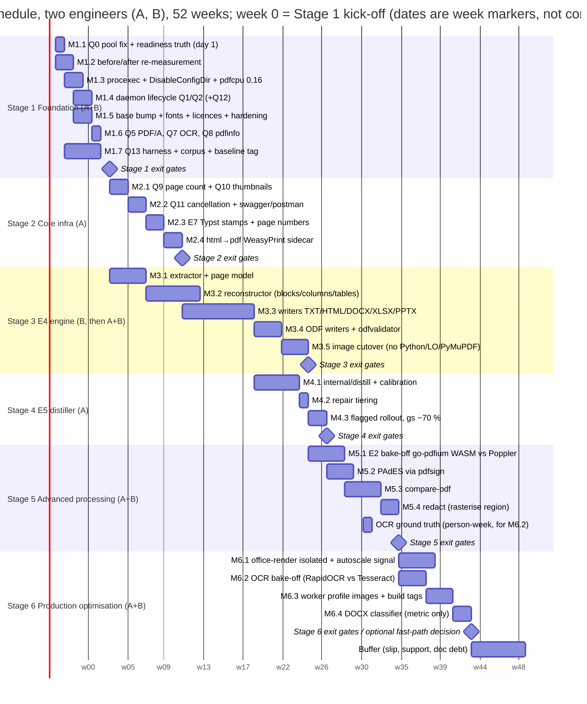
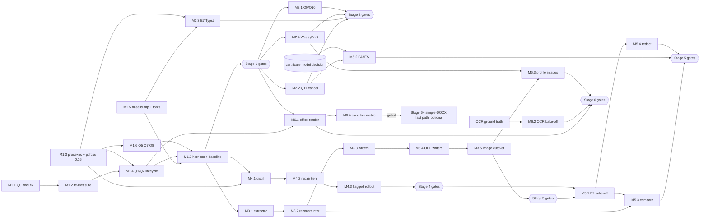

# 20 — Implementation Roadmap

> Part of the Next-Generation Document Engine analysis (2026-11). Status: ANALYSIS — no code changed.

Siblings this roadmap sequences: `01-existing-system-audit.md` (defects D1–D23), `02-document-capability-matrix.md`
(per-row gates), `03-heavy-dependency-analysis.md` (removal order), `04-libreoffice-replacement-strategy.md` (gates
G-HTML…G-FONT), `05`–`10` (engine designs and per-feature EM), `11-image-and-ocr-subsystems.md`,
`12-performance-architecture.md` (SLOs per stage), `13-language-and-technology-selection.md` (contracts A–D),
`14-api-and-distributed-architecture.md` (API/profile changes), `15-security-and-reliability.md`,
`16-benchmarking-and-testing.md` (harness, stage gate table), `17-custom-library-roadmap.md`,
`18-deployment-optimization.md`, `19-risk-and-compatibility-analysis.md` (risk register this document links to).

## 1. Purpose and scope

Turn the approved engine decomposition (E1–E9) and the quick wins Q0–Q13 into six ordered stages with milestones
that two Go engineers can execute over ~12 months, each milestone carrying its owner (CLAUDE.md §1: engines live in
the worker that owns the tool; only `shared/procexec` is shared), its documentation/swagger/postman/test obligations
(CLAUDE.md §5, §8, §9), its measurable gate (copied from `04-libreoffice-replacement-strategy.md` §7 and
`16-benchmarking-and-testing.md` §5.10), its rollback switch, and what it deliberately does **not** do. Effort figures
are engineer-months (EM) taken from the sibling documents; where siblings disagree both numbers are shown and one is
chosen with a reason. Nothing here is a commitment to a calendar date: the Gantt uses relative weeks.

Binding stance restated: Go-first; Rust only as exec'd static binaries (Typst) and never written by the team in these
12 months; LibreOffice stays for office→PDF/ODF for the whole roadmap; Ghostscript "fewer calls, not zero"; no tool is
removed; no Office-compatibility claim without a passed gate; a custom office layout engine is an optional, gated
Stage 6+ item, not a core deliverable (`04-…` §5.1, `07-…` §5.3).

## 2. Current state (what the roadmap starts from)

| Fact | Evidence | Consequence for sequencing |
|---|---|---|
| The unoserver pool has **never started**: `convert-to-pdf/entrypoint.sh:41-43` passes `file:///tmp/uno-profile-<port>` as `--user-installation`; unoserver 3.7 calls `Path(arg).as_uri()` and dies (`benchmarks/raw/startlog-convert-to-pdf.txt:8-12`); a second defect (D23b) would stop the first daemon even after that fix: unoserver 3.x defaults `--uno-port` to 2002 and refuses `--port 2002`; the entrypoint logs a warning (`entrypoint.sh:70`) and the Go worker starts anyway | D23 in `01-…`/`12-…` §2.2 | Every office/HTML conversion today is a cold `libreoffice --headless` (`convert-to-pdf/processing/processing_free.go:69`); Q0 is the first change of the programme and the July 2026 k6 numbers are a cold-LO baseline |
| `/readyz` ignores the pool (`convert-to-pdf/main.go:165-175`, "informational") and the as-shipped container takes ≈42 s to become ready (`benchmarks/raw/cold-start.tsv`: 41 895 / 42 354 / 42 250 ms, "unoserver-pool-DEAD-as-shipped") | `15-…` §2.2 | Readiness truth is part of Q0, not a later hardening item |
| Fixed 30 s unoconvert timeout and port release before fallback (`processing_free.go:35-38`); entrypoint default 2 daemons vs Go `WORKER_CONCURRENCY+1` (`entrypoint.sh:30`, `unopool.go:65-75`; compose passes an empty `UNOSERVER_INSTANCES`, `deployment/docker-compose.yml:897`) | D1, D5 | Both become live defects the moment Q0 lands (`12-…` §8) → Q1/Q2 follow Q0 inside the same stage |
| No process-group handling at any of the 20 exec sites (D2); `DisableConfigDir()` only in `organize-pdf/main.go:57` (D4); PDF/A invocation without `PDFA_def.ps`/ICC/`-dSAFER` (`convert-from-pdf/processing/processing_free.go:212-221`, D3) | `01-…` §8.1 | Stage 1 correctness items, Go-only |
| pdfcpu pinned v0.9.1 in all four workers (`*/go.mod:10`); upstream v0.16.4 with 8 security advisories fixed in 0.16.x | `03-…` §8.3, `08-…` §2 | Upgrade is a Stage 1 prerequisite under the harness, not bundled with E4 |
| Alpine 3.19 (EOL 2025-11-01) under organize-pdf, optimize-pdf and `fyredocs-base` (`*/Dockerfile:24`, `deployment/base-alpine-libreoffice.Dockerfile:6`); gs 10.05.1 in optimize-pdf inside the CVE-2025-59798/59799 range | `15-…` §2.2, `18-…` §2 | Base bump ships in Stage 1 independent of any engine work; LO version changes with it, so the office slice is re-baselined after the bump |
| Fresh image sizes (tag `baseline-2026-11`, `benchmarks/raw/image-sizes.tsv`): convert-from-pdf 1 764 776 958 B, convert-to-pdf 1 172 107 399 B (base 1 065 229 146 B), optimize-pdf 326 851 682 B, organize-pdf 216 600 735 B | measured 2026-11-07 | Stage 3 target convert-from-pdf ≤ 150 MB is a ≈12× reduction |
| `benchmarks/raw/conversions.tsv` holds the warm/cold LibreOffice, Ghostscript and OCR timings measured 2026-11-08 (3 runs each); `benchmarks/baseline-2026-11.md` does not exist yet; `make bench-engine` is not a Makefile target (`Makefile:149-160` has `bench` and `fuzz-short` only); no `postman/` directory | checked 2026-11-07 | Warm-vs-cold LibreOffice gain is **to be measured** by the Stage 1 protocol in §3.1.3 — no number is quoted here; the first API change must create the Postman collection (CLAUDE.md §5.5, `14-…` §5.14) |
| Only committed throughput number: 9 jobs/min sustained, job e2e p95 24.6 s, k6 co-located (lower bound) | `scripts/k6/results/capacity-jobs-20260727-234123.md` | Stage 1 gate "≥ 1.5×" must be judged against an off-box re-measurement, then re-based after Q0 (`12-…` §8) |

## 3. Roadmap by stage

### 3.0 Shape of the programme

Common obligations for **every** milestone (CLAUDE.md §8/§9; listed once, assumed below): update
`docs/developer/services/<service>.md` and `docs/developer/mermaid/service-<service>-{architecture,sequence}.md`
for the owning worker; update `docs/developer/swagger/openapi.yaml` and the Postman collection for any route,
status value, option or event change; `*_test.go` in the same package for every new function, `go build`/`go vet`/
`go test ./<module>/...` per module (root `./...` does not work in this workspace), `gofmt -l .` clean; no `TODO`.

### 3.1 Stage 1 — Foundation (weeks 0–6; both engineers; **first implementation milestone**)

**Objectives.** Make the office pool exist and be observable (Q0), fix the lifecycle and correctness defects that
need no engine (Q1–Q8, Q12), establish the measurement harness that every later gate depends on (Q13), upgrade
pdfcpu, leave EOL base images, add licence notices and the compose hardening that costs nothing at runtime.

**Milestones.**

| ID | Deliverable | Owner (worker / module) | Docs · swagger · postman · tests |
|---|---|---|---|
| M1.1 | **Q0**: pass a filesystem path (not `file://`) at `convert-to-pdf/entrypoint.sh:41-43`; pass a distinct `--uno-port` per daemon (unoserver 3.x defaults it to 2002 and refuses `--port 2002` with "--port and --uno-port must be different" — defect D23b, `benchmarks/raw/unoserver-corrected-2002.log`); pin `unoserver==3.7` at `deployment/base-alpine-libreoffice.Dockerfile:24`; `/readyz` (`convert-to-pdf/main.go:132`) returns 503 when no daemon answers; gauge `office_pool_ready{port}`; the entrypoint's "did not become ready" branch (`entrypoint.sh:70`) exits non-zero | convert-to-pdf (`entrypoint.sh`, `main.go`, `processing/unopool.go`) | `services/convert-to-pdf.md` readiness semantics; readiness-truth test (`15-…` §5.7: kill daemons → 503 ≤ 10 s); no API change |
| M1.2 | Before/after re-measurement protocol run and committed (§3.1.3): `benchmarks/raw/conversions.tsv` populated, `benchmarks/baseline-2026-11.md` written, off-box k6 ladder results under `scripts/k6/results/` | both (measurement only; no code) | result files only |
| M1.3 | **Q3** `shared/procexec` per Contract B (`13-…` §5.3) adopted at all 20 exec sites; **Q4** `pdfcpuapi.DisableConfigDir()` in `convert-to-pdf/main.go`, `convert-from-pdf/main.go`, `optimize-pdf/main.go`; pdfcpu v0.9.1 → ≥ v0.16.4 in all four `go.mod`; `isRecoverable` treats parse errors as permanent (`08-…` §5.5) | `shared/procexec` (infra); each worker's `processing/` | `FuzzProcexecArgs`; orphan test (100 forced cancels → 0 orphans); all organize-pdf tests and the 16 real-binary exec tests green under `make test-binaries` (`08-…` §7.1) |
| M1.4 | **Q1** size-scaled unoconvert timeout `max(30 s, 2 s + 1.5 s/MB)` capped by `jobCtx`, kill + respawn the daemon on timeout **before** releasing the port, `--conversion-timeout` and `--stop-after N` on the daemons, `unoping` probe per port, metric `convert_fallback_total{reason}`; **Q2** single source of truth for `UNOSERVER_INSTANCES` (Go spawns/supervises; entrypoint path kept behind `OFFICE_POOL_SUPERVISOR=entrypoint` for one release), dead ports dropped, RSS/N-conversion recycling; per-job `-env:UserInstallation` on the cold fallback; `DisableMacrosExecution=true` in each daemon profile (`15-…` §5.3); **Q12** office inputs capped (≈150 MB) until size-scaled contexts (`14-…` §5.5) | convert-to-pdf (`processing/unopool.go`, new `internal/officepool/`) | `services/convert-to-pdf.md` + sequence diagram (daemon lifecycle); unit tests for the timeout curve, supervisor state machine, port drop; job-service 413 `FILE_TOO_LARGE_FOR_TOOL` → swagger + Postman |
| M1.5 | Alpine 3.19 → 3.22 for organize-pdf, optimize-pdf, `fyredocs-base` (`18-…` §4 C); LO meta → writer/calc/impress (E, measured); **Q6** `font-noto`, `font-noto-devanagari`, `fontconfig` + `fc-cache -f` in `base-alpine-libreoffice.Dockerfile`, `fonts-noto-core` in `convert-from-pdf/Dockerfile`; `THIRD-PARTY-LICENCES.md` per worker image (Ghostscript AGPL, PyMuPDF AGPL via pdf2docx, Poppler GPL, LO MPL-2.0 — `03-…` §5.1); compose `read_only`/`cap_drop: [ALL]`/`no-new-privileges` on HTTP services and the `internal: true` worker network; CI `scripts/ci/08-vuln.sh` (govulncheck, syft, trivy); drop unused `VOLUME` lines | deployment/, each worker Dockerfile, scripts/ci | `base-image-setup.md`, `compose-files.md`, `ci-pipeline.md`; `tool-versions.txt` regenerated; office slice re-baselined after the LO version change (`18-…` §8) |
| M1.6 | **Q5** PDF/A invocation per `08-…` §5.8 (`PDFA_def.ps` + sRGB ICC, `-sColorConversionStrategy=RGB`, `-dEmbedAllFonts`, `-dSAFER`), veraPDF added to `deployment/test-binaries.Dockerfile`; **Q7** OCR: render page N inside the errgroup (`pdftoppm -f N -l N -gray -r DPI`), delete PNG after tesseract, 300 DPI default for `hin`, `--oem 1`, tessdata_best `hin`, same errgroup pool in `organize-pdf/processing/processing_scan.go:515-538`; **Q8** `pdfinfo` → `api.PageDimsFile` at `optimize-pdf/processing/processing_free.go:331` and `convert-from-pdf/processing/processing_free.go:126` | convert-from-pdf (`internal/pdfa`), optimize-pdf (`internal/ocr`, `internal/pdfio`), organize-pdf | veraPDF CI job; OCR tmpfs test; page-size equality test vs `pdfinfo` on the corpus; `services/optimize-pdf.md`, `convert-from-pdf.md`, `organize-pdf.md` |
| M1.7 | **Q13** `make bench-engine`: Go harness module under `scripts/bench-engine/` (go.work change), corpus manifest ≥ 200 files per `16-…` §5.2, differential checks §5.6, `compare.sh`, release stage `scripts/ci/08-engine-gate.sh` (nightly/tag only); first full run tagged `engine-baseline-<date>`; class semaphores + `GOMEMLIMIT` initial values (`12-…` §5.1, §5.6) | scripts/bench-engine (infra), each worker env | `testing-strategy.md`, `ci-pipeline.md`; harness unit tests (SSIM 1.0 on identical rasters, IoU < 1 on shifted word) |

**Dependencies.** M1.1 has none and goes first. M1.4 depends on M1.3 (procexec kills `soffice.bin`) and on the M1.2
"before" numbers. M1.7 depends on M1.5 (fonts for the Hindi slice; new LO version) and on the k6 fixtures
(`scripts/k6/fixtures/gen.py`). External facts: the production-class host (`load-testing.md` VPS-40 class) for
quotable numbers; a decision on the office input cap value (D7, `04-…` §8).

**Effort.** Brief: **3 EM**. Sibling items that compose it: procexec/hardening/base bump/pins/CI 0.6 (`15-…` §6) +
limits 0.3 (`15-…` §6) + class semaphores/GOMEMLIMIT 0.5 (`12-…` §6) + harness 0.6 (`16-…` §4 B) + Q7/E6 tuning 0.3
and E8 guards 0.5 (`11-…` §6) + PDF/A 0.15 and pdfcpu upgrade 0.1 (`08-…` §5.3) + fonts 0.05 (`07-…` §6) ≈ 3.1 EM.
`03-…` §4 puts the pdfcpu upgrade at 0.5 EM versus 0.1 in `08-…`; this roadmap takes **0.5** because the upgrade
crosses seven minors with watermark/import parser churn in organize-pdf (`03-…` §8.3) and must run under the harness.
Stage total stays **3 EM** (the 0.4 delta is absorbed by Q4/Q8, which are hours, not weeks).

**Risks** (`19-risk-and-compatibility-analysis.md`): daemon-lifecycle-in-Go regressions (keep the entrypoint path one
release); the 30 s timeout tail appears for the first time after Q0 (`12-…` §8); LO version change with the Alpine
bump is itself a fidelity change (`04-…` §8); pdfcpu API drift (`03-…` §8.3); co-located k6 makes every current
number a lower bound (`16-…` §8).

**Acceptance criteria** (verbatim from `16-…` §5.10 row 1 and `04-…` §7; command that proves each):

| Gate text | Proof command |
|---|---|
| "`make bench-engine` runs ≥ 200 files and writes a baseline" | `make bench-engine` → `benchmarks/results/bench-engine-<ts>.{json,md}` |
| "k6 convert-to-pdf ladder ≥ 1.5× sustained jobs/min vs `capacity-jobs-20260727-234123.md` on the same hardware class" (`G-POOL`: "≥1.5× sustained jobs/min; p95 −40 % on >18 MB inputs; 0 orphans") | `./scripts/k6/run.sh capacity -- -e MODE=jobs -e START_RATE=3 -e RATE_STEP=3 -e STEPS=6 -e STEP_DURATION=3m -e SETTLE=1m` **off-box**, and `./scripts/k6/run.sh convert-to-pdf vps40 -- -e JOB_RATE=<n>` stepped by hand (`scripts/k6/README.md:162-171,216-218`); compare against the M1.2 "before" run, then re-base after Q0 (`12-…` §8) |
| "zero `convert_fallback_total` in `mixed-realistic`" | `./scripts/k6/run.sh mixed-realistic vps40`; `docker compose logs convert-to-pdf \| grep -c "did not become ready"` = 0 (`12-…` §7) |
| "0 orphan processes after 100 cancels" | harness cancel test; `docker exec <worker> ps -eo pgid,comm` (`15-…` §5.7) |
| "Hindi DOCX→PDF SSIM ≥ 0.95 and tofu = 0" (`G-FONT`: "`pdffonts` shows embedded Noto; no `.notdef`; SSIM vs desktop LO with same fonts … no tofu; SSIM ≥ 0.95") | `make bench-engine` office slice, 20 Devanagari docs |
| "veraPDF 2b pass" | `verapdf --flavour 2b --format json` on the PDF/A slice in the test-binaries image |
| "300-page scan OCR tmpfs peak ≤ 200 MB (`memory.peak`)" | `df /tmp` sampled 1 s inside optimize-pdf during the 300-page job (`11-…` §7) |
| Readiness truth: "daemons killed → 503 ≤ 10 s" | `15-…` §5.7 readiness test |

**Exit criteria.** All gates above green on the production-class host; `engine-baseline-<date>` tag exists; no
Alpine 3.19 image remains; `grep -rn "exec.Command" --include=*.go` outside `shared/procexec` and tests returns 0
lines (`13-…` §7); `go.mod` pins pdfcpu ≥ v0.16.4 in four workers.

**Explicitly NOT in Stage 1.** No new engine, no new API route (the `pdf-info` sync tool proposed by `14-…` §5.13 for
Stage 1 is moved to Stage 2 so Stage 1 contains no swagger change beyond the 413 code), no Typst, no sidecar, no
`office-render` container, no class-routed NATS subjects, no removal of any binary from any image.

#### 3.1.1 First six weeks, week by week

| Week | Engineer A | Engineer B |
|---|---|---|
| 0 (day 0) | **Before** measurement on the as-shipped images (§3.1.3) — do not merge anything first | Same run, second host if available; file the raw TSVs |
| 0 (day 1) | **Q0** one-line entrypoint fix + `unoserver==3.7` pin + readiness truth (M1.1); rebuild `fyredocs-base` and convert-to-pdf | Start `shared/procexec` (M1.3) with its fuzz target and orphan test |
| 0–1 | **After** measurement on the Q0 image (§3.1.3); write `baseline-2026-11.md`; re-base the 1.5× gate | procexec adoption at the 20 exec sites, one worker per PR; Q4 in three mains |
| 1–2 | pdfcpu v0.16.x upgrade in organize-pdf first (largest surface), then the other three; run `make test-binaries` | Q1 size-scaled timeout + kill/respawn + `--conversion-timeout`/`--stop-after`; `convert_fallback_total` |
| 2–3 | Alpine 3.22 bump + LO split + Q6 fonts + `fc-cache` + licence notices (M1.5); re-run the office slice | Q2 supervisor in Go behind `OFFICE_POOL_SUPERVISOR` flag; `unoping` probe; macro-disabled profiles; Q12 cap |
| 3–4 | Q5 PDF/A + veraPDF in test-binaries; Q8 pdfinfo → pdfcpu (M1.6) | Q13 harness skeleton: `scripts/bench-engine/` module, manifest, SSIM/pHash, `compare.sh` (M1.7) |
| 4–5 | Q7 OCR per-page render + Hindi 300 DPI + tessdata_best; organize-pdf scan OCR pool | Corpus to ≥ 200 files (donated set fetched by manifest), differential checks, golden files |
| 5–6 | Compose hardening + `08-vuln.sh`; class semaphores + `GOMEMLIMIT`; docs/mermaid/services updates | First full `make bench-engine` on the production-class host → `engine-baseline-<date>`; Stage 1 gate run |

#### 3.1.2 Day-1 change (Q0) in full

1. `convert-to-pdf/entrypoint.sh:41`: `profile="/tmp/uno-profile-${port}"` (unoserver builds the URI itself; every
   3.x release checked behaves the same — brief D23).
2. `deployment/base-alpine-libreoffice.Dockerfile:24`: `pip3 install --break-system-packages unoserver==3.7`.
3. `convert-to-pdf/entrypoint.sh:66-71`: the `else` branch exits 1 (a container that cannot start its pool must not
   pass `docker compose up`).
4. `convert-to-pdf/main.go:165-175`: pool state moves from "informational" into the `/readyz` verdict; export
   `office_pool_ready{port}`; alert `convert_fallback_total` rate > 0 for 10 min (`04-…` §5.3).
5. Rollback: revert the three edits; the service returns to the cold-LO path it has run on since 2026-06-19.

#### 3.1.3 Re-measurement protocol (BEFORE and AFTER, identical commands)

The gain of Q0–Q2 is measured, never assumed. Both runs use the same host class, the same fixtures
(`bash scripts/k6/fixtures/generate.sh`) and the same compose file; the load generator is **off-box**.

1. `TAG=<tag> STEPS=5,6 bash docs/developer/architecture/next-generation-document-engine/benchmarks/measure-images.sh`
   — step 5 (unoserver cold start → `raw/cold-start.tsv`) and step 6 (warm `unoconvert` vs cold
   `libreoffice --headless` on docx/xlsx/pptx small/medium/large, gs compress, tesseract OCR; 3 runs each →
   `raw/conversions.tsv`). "Before" uses tag `baseline-2026-11` (as shipped; the warm engine rows will fail or
   fall back — record that), "after" uses the Q0 image tag. Run steps 1–4 once for sizes, binaries, versions, idle RSS.
2. `./scripts/k6/run.sh smoke` on the target, then
   `./scripts/k6/run.sh capacity -- -e MODE=jobs -e START_RATE=3 -e RATE_STEP=3 -e STEPS=6 -e STEP_DURATION=3m -e SETTLE=1m`
   and, for the office-only ladder, `./scripts/k6/run.sh convert-to-pdf vps40 -- -e JOB_RATE=<n>` stepped until the
   `job_e2e` p95 < 60 s / success > 98 % thresholds break (`scripts/k6/config.js` thresholds; README §5).
3. Record both result sets under `scripts/k6/results/` and summarise in `benchmarks/baseline-2026-11.md` with host,
   date, image digests. The Stage 1 "1.5×" and "p95 −40 %" gates are then stated against the **after-Q0** office ladder
   so that Q1/Q2 are judged on their own effect (`12-…` §8).

### 3.2 Stage 2 — Core infrastructure (weeks 6–14; engineer A)

**Objectives.** The three product-visible quick wins that touch the job contract (page count, thumbnails,
cancellation), Unicode stamping through Typst (E7), and html→pdf off LibreOffice.

| ID | Deliverable | Owner | Docs · swagger · postman · tests |
|---|---|---|---|
| M2.1 | **Q9** page count in every worker's result metadata (`api.PageCountFile`) and at upload for PDFs; **Q10** `pdf-thumbnail` tool (`pdftoppm -f 1 -l 1 -scale-to 320 -png`) triggered by `document.uploaded`, MinIO `thumbs/<docId>.png`, `documents.thumbnail_path` populated (`08-…` §5.11) | convert-from-pdf (`internal/thumb`); document-service subscriber (`document-service/subscriber/subscriber.go`) consumes the event; each worker's result metadata | swagger: metadata fields; `services/convert-from-pdf.md`, `document-service.md`; mermaid document-service sequence; Postman collection **created** (none exists at HEAD) |
| M2.2 | **Q11** cancellation per `14-…` §5.4: migration `00003_cancelled_status.sql` (job-service, sole migrator), `DELETE /api/<group>/:tool/:id` publishes core-NATS `jobs.cancel.<id>`, additive `POST …/:id/cancel`, per-worker `sync.Map` jobID→`CancelFunc`, claim-time guard, `statusToEventType` → `JobCancelled`, SSE closes on it; pdfcpu stages check ctx between pages; `handleFailure` cancelled branch (Ack, no DLQ) | job-service (`handlers/jobs.go:553-603`, `handlers/sse.go`), all four workers (`internal/worker/worker.go`) | swagger: `cancelled` enum, `/cancel`, 409 `ALREADY_FINISHED`, SSE close condition (`14-…` §5.14); Postman; `services/job-service.md` + each worker; mermaid job-service sequence; integration test per worker: cancel → tool dead ≤ 2 s; subscribers of `jobs.events.>` verified to ignore unknown event types |
| M2.3 | **E7**: `organize-pdf/internal/typeset/` — Typst 0.15.1 musl binary (sha256-pinned) in the organize-pdf image, Go-embedded `.typ` templates, user text via `--input` only, stamp cache, procexec sandbox; watermark/edit-text via `api.PDFWatermark`; page numbers in **one** `AddWatermarksFile` call via `PDFMultiWatermarkForReadSeeker` replacing the per-page loop at `organize-pdf/processing/processing_edit.go:446-456`; Go fallback go-text/typesetting → PNG → image stamp when `typst` is absent (`07-…` §5.2) | organize-pdf | `FuzzTypstStampInput`; stamp fixture set ≥ 40 strings; `services/organize-pdf.md`; no API change (options unchanged) |
| M2.4 | html→pdf WeasyPrint 70.0 sidecar (`html-render` profile, Contract C `13-…` §5.4): pinned image, egress blocked, `X-Engine-Version` in the cache key, circuit breaker via `shared/circuitbreaker`; `html-to-pdf` routed to it, **no LO fallback** | convert-to-pdf (`internal/htmlrender` client); new `deployment/docker-compose-html-render.yml` | contract test against a stub (deadline → 408, 413 at cap); egress test; `services/convert-to-pdf.md`; `compose-files.md`; k6 `smoke` unchanged |

**Dependencies.** All on Stage 1 gates (procexec for M2.3/M2.4 sandboxes; harness for every gate). M2.3 on M1.5
(Noto fonts in the organize-pdf image). M2.2 touches the job state machine and therefore the swagger/Postman set.
External facts: Typst startup and decompressed binary size (unmeasured — gate 5 in `07-…` §7); whether the product
requires JS-rendered HTML (decides WeasyPrint vs Chromium, `04-…` §8); the stamp script list for fonts (`07-…` Q3).

**Effort.** Brief: **2.5 EM**. Sibling sum for the brief's scope: Q9 2 d + Q10 1 wk (`02-…` §2.4; thumbnails 0.25
in `08-…` §5.3) + Q11 1.5 wk / 0.4 EM (`02-…` §2.4, `14-…` §4 F) + E7 0.5 (`07-…` §6) + WeasyPrint 0.5–1 (`04-…`
§4.3, `03-…` §4) ≈ 1.8–2.3 EM, plus the contract/docs/Postman work → **2.5 EM** adopted. Siblings also propose Stage 2
items **outside** the brief's scope: class-routed subjects + two consumers 0.3, render/CAS cache 0.4, font cache 0.1
(`12-…` §6); sanitize-on-output 0.4, AppArmor/seccomp/gVisor 0.4 (`15-…` §6); sync `pdf-info`/`validate-pdf`,
`extract-images`, `create-pdf`, batch API, `max_concurrent_jobs` (`14-…` §5.13, routing 0.3); mimetype type detection
0.1 (`06-…` §6); EXIF orientation 0.1 (`11-…` §6); build tags 0.3 (`18-…` §4 H). These ≈ 2.4 EM are listed as
**Stage 2 extended scope (optional, §4)** and are pulled in only if Stage 1 finishes inside its 6 weeks; they do not
change the baseline total.

**Risks** (`19-…`): Typst 0.15 shaper (rustybuzz archived 2026-07-26; HarfRust migration unverified, `07-…` R1);
WeasyPrint CVE cadence (three in 2026, `04-…` §8); cancellation changes a value set three subscribers read
(`14-…` §8); core-NATS cancel is lossy by design (bounded by the claim-time guard and the 10 s ticker).

**Acceptance criteria** (verbatim, `16-…` §5.10 row 2; `04-…` §7 G-HTML; `07-…` §7):

| Gate text | Proof command |
|---|---|
| "cancel-to-stop ≤ 2 s on gs/tesseract" | `make bench-engine SUITE=cancel`; 100 forced cancels, `ps` → 0 orphans |
| "Hindi stamp shaped + selectable (pdftotext recovers the string)"; `07-…` gate 1: "SSIM ≥ 0.95 on the stamp bitmap at 300 DPI, zero tofu"; gate 3: "an N-page PDF is stamped with one `AddWatermarksFile` call; wall time for N = 300 is ≤ 25 % of the current per-page loop" | harness stamp fixtures; `pdftotext` round-trip NFC byte-exact; page-number timing both measured on the same host |
| "thumbnails for 100 % of uploaded PDFs in the corpus" (`08-…` §7.2: "within 10 s (SSE-observed)"; `12-…` §7: "p95 ≤ 3 s") | thumbnail latency histogram; this roadmap takes **100 % within 10 s, p95 ≤ 3 s reported** (the 3 s figure becomes a gate only after one release of measurement) |
| G-HTML: "SSIM ≥ 0.90 on 100 %; recall ≥ 99 %; 0 network calls" on "30 HTML fixtures (flex, grid, images, Devanagari, RTL, long tables)" | `make bench-engine` html slice; egress test from inside the sidecar |
| "sync `pdf-info` p99 ≤ 5 s on ≤ 30 MiB" | only if the extended-scope sync tool ships; otherwise not a Stage 2 gate |
| Typst gate 5: "startup + compile of a one-line stamp p95 and decompressed binary size: measured and recorded in `benchmarks/` before merge" | `hyperfine 'typst compile stamp.typ'` inside the organize-pdf image |

**Exit criteria.** Gates green; `cancelled` present in swagger, Postman and all four worker docs; organize-pdf image
growth from Typst recorded in the size budget; `html-to-pdf` traffic shows zero LO invocations (`engine_invocations_total`).

**NOT in Stage 2.** No E4 code lands in a release (it is being built in parallel by engineer B but ships in Stage 3);
no Ghostscript change; no PDFium; no `office-render` split; Typst templates/certificates remain a product option
(`07-…` Q4), not a deliverable.

### 3.3 Stage 3 — High-value engine E4 (weeks 6–30; engineer B from week 6, both from week 14)

**Objectives.** The one custom engine worth owning: PDF → page model → reconstructed blocks/columns/tables → writers
for DOCX, XLSX, PPTX (text + image slides), ODT/ODS/ODP, HTML, TXT, inside `convert-from-pdf`; then remove pdf2docx
(MIT) → PyMuPDF (AGPL), pdfplumber, openpyxl, LibreOffice, Python and the Debian base from that image.

| ID | Deliverable | Owner | Docs · tests |
|---|---|---|---|
| M3.1 | `convert-from-pdf/internal/pagemodel` (`PageDoc`, `Page`, `GlyphRun`, `05-…` §5.3) behind an `Extractor` interface (Contract A, `13-…` §5.2): `pdftotext -bbox-layout` + `pdfimages` now, PDFium later; pdfcpu supplies MediaBox/Rotation/Annots; limits from `06-…` §7 | convert-from-pdf | `FuzzBBoxLayoutParse`; text recall unit tests vs `pdftotext -layout`; `services/convert-from-pdf.md` |
| M3.2 | Reconstructor: reading-order blocks, column detection by x-gap histograms, ruled and unruled table detection with typed cells and merged headers (`09-…` §5.5), figure regions, slide-confidence rule (`10-…` §5.4); labelled 200-PDF set in the corpus | convert-from-pdf (`internal/pagemodel`) | `FuzzE4Reconstruct`; table-cell F1 harness check vs pdfplumber (runs only in test-binaries) |
| M3.3 | Writers: TXT and HTML (replace `pdftotext -layout`/`pdftohtml`), DOCX (hand-written OOXML over an `opc` writer, `05-…` §5.6), XLSX via excelize v2.11.1 `sheetwriter` (`09-…` §5.7), PPTX `deckwriter` text+image slides with image-only fallback and `mode: editable|image` option (`10-…` §5.5); `pptx_builder.go` moves into `internal/writers`; digests `ir_text_sha256`/`ir_struct_sha256` in result metadata (`05-…` §5.8) | convert-from-pdf (`internal/writers/{docx,xlsx,pptx,html,txt}`, `internal/opc`) | `FuzzOOXMLWriter`; G-DOCXW ("100 % open; 0 byte diff on untouched parts" — writer output opens in LO + Word sample 20); swagger: new `mode` option on pdf-to-powerpoint, metadata digests; Postman |
| M3.4 | ODF writers ODT/ODS/ODP from the same model (`04-…` §4.2 row 14), replacing `writer_pdf_import` and the two-hop `--convert-to ods/odp` (`convert-from-pdf/processing/processing_free.go:239-277,368-397`) | convert-from-pdf (`internal/writers/odf`) | G-ODF; `odfvalidator` in test-binaries |
| M3.5 | Image cutover: `convert-from-pdf/Dockerfile` → `alpine:3.22` + poppler-utils + ghostscript (PDF/A only) + fonts + static binary; remove pdf2docx, PyMuPDF, opencv, pdfplumber, openpyxl, LibreOffice, Python, `/app/scripts/`; `raster` profile split (`18-…` §5.4); SBOM AGPL gate on this image; `E4_WRITERS=on` flag with the previous image kept deployable for one release | convert-from-pdf; deployment | `services/convert-from-pdf.md` rewritten; mermaid architecture; `compose-files.md`; `08-images.sh` licence gate |

**Dependencies.** M3.1 on M1.7 (harness, corpus, labelled set) and M1.3 (pdfcpu ≥ 0.16 API, `05-…` Q4). M3.3 on
M3.2. M3.4 on M3.3. M3.5 on M3.4 and on G-ODF/G-DOCXW passing. External facts: a labelled 200-PDF set with cell
ground truth (person-weeks of labelling, start in Stage 1 week 4); excelize needs Go ≥ 1.26 (`09-…` R1, satisfied).

**Effort.** Brief: **4–5 EM**. Sibling decomposition: IR share ≈ 1 (`05-…` §7), table reconstruction 1.0 and XLSX
writer 0.5 (`09-…` §6), PPTX writer 1.0 and slide reconstruction 0.5 (`10-…` §6), OPC container 0.5, XLSX read 0.5,
TXT 0.1 (`06-…` §6), ODF writers 1 (`04-…` §4.3 rank 4) → ≈ 5.1 EM when the ODF writers are counted inside the stage
(they must be, because removing LO from the image requires them). Docs 09/10 additionally place `sheetinspect` 0.25
and `deckinspect` 1.0 in **convert-to-pdf** in Stage 3; those packages serve limits/metadata/routing, not E4, and are
moved to the optional list (§4). **Chosen: 5 EM** (upper bound of the brief; ODF writers inside).

**Risks** (`19-…`): table/column detection on real layouts is the whole risk (`02-…` §8.3, `10-…` R1 — the confidence
rule falls back to today's output, so the worst case is "no better"); scope creep from "pdf2docx parity" to Acrobat
parity; oracle circularity until PDFium (`16-…` §8); two extractors order text differently → digest version
`ir_digest_v1` (`05-…` R4); `encoding/xml` allocation cost on a 40 MB `document.xml` to be measured (`06-…` R4).

**Acceptance criteria** (verbatim, `16-…` §5.10 row 3; `04-…` §7 G-ODF/G-DOCXW; `09-…`/`10-…` §7):

| Gate text | Proof command |
|---|---|
| "text recall ≥ 99 % vs pdftotext on the labelled 200; table F1 ≥ pdfplumber; DOCX→PDF(LO) round-trip SSIM ≥ pdf2docx on 90 %; OOXML untouched parts byte-identical; convert-from-pdf image ≤ 150 MB (`docker image inspect`); SBOM has no AGPL (doc 18 §5.9)" | `make bench-engine ENGINE=e4`; `docker image inspect --format '{{.Size}}' fyredocs-convert-from-pdf`; `syft <image> -o cyclonedx-json` + licence gate |
| G-ODF: "validator 100 %; round-trip SSIM ≥ 0.90 on 90 %" | `java -jar odfvalidator-…jar`, LO round-trip in test-binaries |
| G-DOCXW: "100 % open; 0 byte diff on untouched parts" | `go test ./internal/opc/... -run RoundTrip` + LO headless open |
| `09-…` G2: "≥ 95 % of numeric/date cells typed correctly, 0 wrong coercions of text to number" | harness typed-cell slice |
| `10-…` G1: "≥ 70 % of text pages produce text+image slides … text recall on those slides ≥ 99 % … 0 pages where text is placed outside the slide"; G2 SSIM ≥ 0.80 at 150 DPI on 90 % (threshold frozen after the first run) | `make bench-engine` deck slice; LO renders every deck |
| `12-…` §7 row 3: "pdf→docx p95 ≤ today's pdf2docx p95 on the k6 fixtures; convert-from-pdf RSS ≤ 512 MiB" | `./scripts/k6/run.sh convert-from-pdf vps40 -- -e JOB_RATE=<n>` before/after; `memory.peak` |

**Exit criteria.** Gates green; the Python interpreter and both LibreOffice installations are gone from
convert-from-pdf; `03-…` §5.2 image composition realised; `01-…` rows 1, 2, 5, 6, 8–10 reclassified B in production.

**NOT in Stage 3.** No office-format **parsers** (DOCX/PPTX/ODF readers are 5–7 EM of optional work, `06-…` R1);
no `PartStore` round-trip editing (Stage 6+ optional, `05-…` §7); no formula evaluation (`09-…` §5.1); no PDFium;
`pdf-to-pdfa` stays on Ghostscript; `parse-pdf` API row (`14-…` §5.1) ships only if its swagger/Postman work fits.

### 3.4 Stage 4 — Advanced rendering and optimising, E5 (weeks 26–34; engineer A)

**Objectives.** Pure-Go distiller for the common compress case (DCT/Flate RGB/Gray image XObjects), pdfcpu-first
repair, Ghostscript retained for flatten, PDF/A, `extreme` and every fallback.

| ID | Deliverable | Owner | Docs · tests |
|---|---|---|---|
| M4.1 | `optimize-pdf/internal/distill` per `08-…` §5.2/§5.6: CTM-tracked effective ppi, eligibility rules, page-at-a-time decode with pixel cap, `x/image/draw` downsample, `image/jpeg` re-encode, SHA-256 dedupe, "never grows" guard, `NeedsGS` outcome, `distill_fallback_total{reason}`; JPEG quality per preset **calibrated by the harness** (starting points 85/75/60, recorded with corpus hash) | optimize-pdf | `FuzzImageXObjectDecode`; `BenchmarkDistill{low,medium,high}` vs gs committed under `benchmarks/`; `services/optimize-pdf.md`; no API change (presets unchanged) |
| M4.2 | `optimize-pdf/internal/repair`: tier 1 pdfcpu relaxed read + `OptimizeContext` + rewrite, tier 2 gs `/prepress` as today; `qpdf` 11.6.3 added to `deployment/test-binaries.Dockerfile` as oracle (`08-…` §5.10) | optimize-pdf | tier-1 share measured on the harness `broken/` slice |
| M4.3 | Rollout behind `COMPRESS_ENGINE=go\|gs` (default `gs` for one release, then `go`); metric `engine_invocations_total{engine,tool}`; gs stays installed | optimize-pdf; compose env | k6 `optimize-pdf` ladder before/after; Grafana panel for gs call share |

**Dependencies.** M1.3 (pdfcpu ≥ 0.16 image/stream APIs; `08-…` Q2 spike on `UpdateImages` in week 1), M1.7
(image-heavy corpus slice ≥ 20 files). External: pdfcpu's cumulative decode allowance semantics (`08-…` Q1).

**Effort.** Brief: **2 EM**; `08-…` §5.3: distiller 1.5 + repair 0.25 = 1.75; `02-…`/`03-…` §4: 2. **Chosen: 2 EM**
(the 0.25 margin is the calibration loop and the flagged rollout).

**Risks** (`19-…`): CTM tracking misses images inside patterns/Type3 glyphs (`08-…` R2 — treat as page-size, never
over-downsample); JPX/JBIG2-heavy scans gain nothing (`NeedsGS` routes them; share measured); SMask/ICC/CMYK → gs.

**Acceptance criteria** (verbatim, `16-…` §5.10 row 4):

| Gate text | Proof command |
|---|---|
| "compress: ≥ 80 % of gs size reduction on image-heavy at same DPI, text-only never grows, ≤ 50 % gs wall time, SSIM ≥ 0.9 at `medium`" | `make bench-engine SUITE=compress` (`12-…` §7) |
| "gs invocations on compress −≥ 70 % in `jobs_processed_total`-adjacent metric over a `mixed-realistic` run" (`03-…` §7: "new metric `engine_invocations_total{engine="gs",tool}`") | `./scripts/k6/run.sh mixed-realistic vps40` + Prometheus query; production after one release |
| `08-…` §7.5: "every new op passes `pdfcpu validate` + `qpdf --check`" | harness differential stage |

**Exit criteria.** Go path is the default for low/medium/high; `extreme`, flatten, PDF/A and all fallbacks still run
Ghostscript; tier-1 repair share recorded in `benchmarks/`.

**NOT in Stage 4.** No Ghostscript removal from any image; no flatten in Go (pdfcpu has no appearance-stream baking,
`08-…` §2); no Go PDF/A writer (≥ 2 EM, not planned, `08-…` §5.8); no JBIG2 decoder (gobig2 is "optional later");
no CCITT G4 encoder (mono → Flate 1-bit).

### 3.5 Stage 5 — Advanced processing (weeks 30–42; engineer B from week 30, A from week 34)

**Objectives.** Decide E2 by measurement; add real signatures; add compare and (rasterised) redact.

| ID | Deliverable | Owner | Docs · swagger · postman · tests |
|---|---|---|---|
| M5.1 | `convert-from-pdf/internal/raster` `Renderer` interface with `popplerRenderer` and `pdfiumWASM` (go-pdfium v1.21.4 on wazero 1.12.0, Contract D `13-…` §5.5: instance per job, `MaxTotal = WORKER_CONCURRENCY`, memory pages capped, `WithCloseOnContextDone`); `BenchmarkRender150DPI`; 1 000-job soak with synthetic traps; written decision in `benchmarks/` | convert-from-pdf (+ optimize-pdf OCR render if adopted) | `pdfium_instance_recycled_total`; `PDF_RENDER_FALLBACK=poppler`; `services/convert-from-pdf.md` |
| M5.2 | PAdES B-B/B-T via digitorus/pdfsign (BSD-2) in `organize-pdf/internal/sign`: platform certificate first (keys from a secret mount, never MinIO), RFC 3161 TSA, visible appearance, sign is always the last op; **blocked on the product's certificate-model decision** (`08-…` §5.7) | organize-pdf; job-service options schema | swagger: `sign-pdf` gains `mode: visual\|pades`, TSA option; Postman; UI copy "B-T, no LTV"; `pdfsig` and pdfcpu `ValidateSignaturesFile` tests |
| M5.3 | `compare-pdf` (`14-…` §5.13): page-model word diff with bbox anchors + render diff at 100 DPI (SSIM + XOR heat-map) → JSON + report PDF zip (`08-…` §5.12, `05-…` §5.9 fixed-IR diff) | convert-from-pdf (`internal/compare`) | new route → swagger, Postman, routing table row, allowlist; 20-pair labelled set, precision/recall ≥ 0.95 (`05-…` A7) |
| M5.4 | `redact-pdf` rasterise-region: render region at 300 DPI, paint, replace the whole page, strip Info/XMP/attachments/bookmarks, state the lossy trade-off in result metadata (`08-…` §5.12, R6) | convert-from-pdf (`internal/redact`) | swagger/Postman; harness: `pdftotext` of the region = ∅, SSIM of untouched areas ≥ 0.99 |
| M5.5 | OCR ground truth for Stage 6: 50 Hindi + 50 English scans double-keyed (`11-…` §7.1, ≈ one person-week) | optimize-pdf owner + annotators | corpus manifest entries |

**Dependencies.** M5.1 on G3 and G4 (page model and distiller stable; PDFium would become the E4 extractor and the E5
JPX/JBIG2 renderer). M5.3 on M3.2 and M5.1. M5.2 on M2.2 (incremental writes must survive cancel) and on the
certificate decision. External facts: certificate model (whose key, TSA, revocation); product answer on tracked-changes
output for compare (`05-…` Q1).

**Effort.** Brief: **3 EM**. `08-…` §5.3: bake-off 1 + pdfsign 0.75 + compare/redact 1.0 = 2.75; `02-…`/`03-…` §4
put pdfsign at 1; `05-…` §6 compare ≈ 1 "inside Stage 5's 3 EM". Siblings also place in Stage 5 a DOCX parser 2 EM
for DOCX-pair compare (`06-…` §6) and a PPTX inheritance resolver 0.5 + geometry catalogue 0.1 (`10-…` §6); with
those the stage would be ≈ 5.4 EM. **Chosen: 3 EM** with compare scoped to **PDF pairs** (fixed-IR diff); DOCX-pair
compare and PPTX reading move to the optional editing block (§4), consistent with `05-…` §7 ("parsers — Stage 6+
optional, not in the 17 EM baseline").

**Risks** (`19-…`): WASM ≈ 2× slower than native and retains memory until instance close (vendor claim, `08-…` R4);
self-signed platform certificate shows "unknown validity" in Acrobat (`08-…` R5); raster redaction misread as
"secure" (`08-…` R6); compare on scans is bounded by OCR CER (`05-…` R5).

**Acceptance criteria** (verbatim, `16-…` §5.10 row 5; `08-…` §7.4):

| Gate text | Proof command |
|---|---|
| "go-pdfium WASM ≥ 0.7× pdftoppm throughput at 150 DPI, identical page counts on the fuzz corpus, no cross-job instance crash under `soak`" — else "Poppler retained; do not switch the builder to cgo" | `make bench-engine SUITE=render` (`12-…` §7); `./scripts/k6/run.sh soak`; RSS plateau via `docker stats` |
| "pdfsign signatures validate in `pdfsig` (poppler, in oracles image)"; `08-…`: "signatures validate in Acrobat and `pdfsig` (B-T with TSA, visible appearance)" | harness + Acrobat manual check in the release checklist |
| "compare/redact outputs in harness with goldens"; `08-…`: "redacted region text = ∅ via `pdftotext`, SSIM of untouched areas ≥ 0.99" | `make bench-engine` compare/redact slices; `05-…` A7 precision/recall ≥ 0.95 |

**Exit criteria.** A written E2 decision with numbers; if PDFium passes, Poppler leaves convert-from-pdf and
optimize-pdf in a follow-up release and `GetPageTextStructured` becomes the E4 extractor (digest version bumped);
if not, Poppler stays with no loss of function.

**NOT in Stage 5.** No true content-stream redaction (2+ EM with liability, `08-…` §5.12); no PAdES B-LT/B-LTA (pdfsign
has no DSS); no HEIC/AVIF server decode or SVG rasterisation unless product + legal sign off (`11-…` §4.1); no cgo.

### 3.6 Stage 6 — Production optimisation (weeks 42–50; both engineers)

**Objectives.** Make LibreOffice capacity a horizontal-scaling problem, decide OCR by CER, ship the profile images,
and collect the one number that decides whether the optional fast path is ever started.

| ID | Deliverable | Owner | Docs · tests |
|---|---|---|---|
| M6.1 | `office-render` as its own compose service/profile (`04-…` §5.3): Alpine 3.22 `fyredocs-base` lineage + Go supervisor shim, N daemons per replica with warm pre-created profiles, recycling by jobs/RSS/timeout, `POST /v1/convert` contract or the `jobs.dispatch.convert-to-pdf.cpu` consumer (`12-…` §5.3), `/healthz`/`/readyz` by `unoping`; `nats_consumer_num_pending` exported (`prometheus-nats-exporter -jsz`) and `deployment/scripts/scale-workers.sh` loop; convert-to-pdf keeps `io`-class tools and raises `WORKER_CONCURRENCY` | convert-to-pdf (tool owner) + new `office-render` service (no business logic) | new `services/office-render.md`, mermaid, `compose-files.md`, `horizontal-scaling.md`; `OFFICE_RENDER_URL` empty → in-container pool (rollback) |
| M6.2 | OCR bake-off per `11-…` §7.1: RapidOCR `devanagari_PP-OCRv5_rec_mobile` sidecar in the `ocr` compose profile vs Tesseract 5.5.x `--oem 1` tessdata_best; `OCR_SIDECAR_URL` + circuit breaker; decision recorded in `benchmarks/` | optimize-pdf, organize-pdf (clients only) | sidecar contract test; `sidecar_circuit_open` |
| M6.3 | Worker profile images and build tags (`18-…` §5.3–5.4, `14-…` §5.3): `light-pdf` on scratch, `ocr`, `distill`, `raster`, `office-render`, `html-render`; `ToolRouteMap` profiles behind `ROUTING_PROFILES=on`; `pids_limit`, seccomp from `strace -c`; `08-images.sh` size budget and SBOM gate; Compose→k8s mapping validated on `light-pdf` in kind | deployment, job-service routing, each worker `main.go` | `ci-pipeline.md`; `07-build.sh` tag loop; zero jobs lost during the rollout order (`14-…` §5.3) |
| M6.4 | DOCX classifier (allow-list XML scan, `07-…` §5.3) running **metric-only** for every DOCX: `docx_class_total{class}`; no engine | convert-to-pdf (`internal/simpledoc/classify`) | cost ≤ 50 ms on a 5 MB DOCX (to be measured) |
| M6.5 (optional, gated) | Simple-DOCX fast path (`convert-to-pdf/internal/simpledoc`): parser subset + layout + go-text shaping + PDF writer, every failure falls back to LO; started only if the start gate passes | convert-to-pdf | G-FAST; flag `DOCX_FAST_PATH=on`; auto-disable above 5 % fallback (`07-…` gate 11) |

**Dependencies.** M6.1 on M1.4 (the supervisor is the same code moved out) and on the Stage 1 and Stage 2 gates.
M6.2 on M5.5 (ground truth). M6.3 on M3.5 and M2.4 (images exist). M6.5 on M6.1 **and** M6.4 (both numbers of the
start gate). External facts: measured daemon RSS knee over 1 000 conversions (`12-…` §5.3); production share of
simple-class DOCX.

**Effort.** Brief: **2 EM (+4–6 optional)**. `03-…` §4: LibreOffice "1 (lifecycle) + 2 (Stage 6)"; `12-…` §6:
office-render + autoscaling "within Stage 6's 2 EM"; classifier 0.3 (`07-…` §6, counted inside the 2); RapidOCR
sidecar 1.0 "if admitted" (`11-…` §6) — the bake-off itself (sidecar image + client + run) is the part inside the 2 EM,
adoption work beyond it is optional. **Chosen: 2 EM**; fast path **4–6 EM optional** (`07-…` §5.3 breakdown: parser +
model 1, layout 1.5–2, shaping/fonts 0.5–1, PDF writer 0.5, classifier/harness/labelling 0.5–1, hardening 0.5).

**Risks** (`19-…`): fast-path fidelity liability (zero-false-positive classifier gate); PaddleOCR image/CPU cost and
the ICON 2024 result (Tesseract 93 % vs PaddleOCR 56 % Hindi, pre-v5 model) putting the burden of proof on the newcomer
(`11-…` §7.1); autoscaling on Compose is a script, not a controller (`12-…` §8); `read_only` on `office-render`
depends on where LO writes (`18-…` §8).

**Acceptance criteria** (verbatim, `16-…` §5.10 row 6; `04-…` §5.3; `07-…` §7):

| Gate text | Proof command |
|---|---|
| "office jobs/min scales linearly with replicas (k6 per-group ladder at 1, 2, 3 replicas)"; `12-…` §7: "1→2→4 replicas (±15 %); autoscale reacts within 5 min" | `OFFICE_RENDER_REPLICAS=n ./scripts/k6/run.sh convert-to-pdf vps40 -- -e JOB_RATE=<n>` per replica count on two hosts |
| "OCR engine switch only on ≥ 30 % relative CER gain on the 100-scan set"; `11-…` §7.1: "**and** time/page ≤ 2× Tesseract **and** RSS fits the 1 GiB sidecar limit" | `make bench-engine SUITE=ocr` |
| `04-…` §5.3: "zero cold fallbacks in mixed-realistic; 0 orphan `soffice.bin` after 100 forced cancels" | `./scripts/k6/run.sh mixed-realistic`; `ps` sweep |
| Fast-path **start** gate (`07-…` gate 9): "office jobs/min no longer scaling linearly with `office-render` replicas **and** the classifier's simple-class share justifies it (both measured)" | Stage 6 report |
| Fast-path **ship** gate G-FAST: "SSIM ≥ 0.95 on 95 % of simple-class docs; page count 100 %; recall ≥ 99.5 %; bbox IoU ≥ 0.9 median; **0** false positives" on "500-doc corpus + 200 complex docs" | `make bench-engine` office slice |

**Exit criteria.** `office-render` replicas are the capacity knob; every runtime image matches `18-…` §5.4; a
written go/no-go on the fast path with both start-gate numbers; the roadmap's 17 EM baseline is spent.

**NOT in Stage 6.** No pptx→pdf or xlsx→pdf engine (8+ EM each, `04-…` §4.3); no office↔ODF engine (LO stays); no
Kubernetes migration beyond the validated mapping; no team-written Rust; office2pdf only ever inside G-FAST.

### 3.7 Quick wins Q0–Q13

| Q | Change | file:line (confirmed at HEAD) | Effort (source) | Stage | Gate |
|---|---|---|---|---|---|
| Q0 | Pool start: path not `file://`; pin unoserver; readiness truth | `convert-to-pdf/entrypoint.sh:41-43,66-71`; `deployment/base-alpine-libreoffice.Dockerfile:24`; `convert-to-pdf/main.go:132,165-175` | 1 d (`12-…` §5.3) | 1 (day 1) | readiness truth ≤ 10 s; "did not become ready" count 0; cold start vs `raw/cold-start.tsv` ≈ 42 s today |
| Q1 | Size-scaled unoconvert timeout, kill + respawn before port release, `--conversion-timeout` | `convert-to-pdf/processing/processing_free.go:35-38` | 1 wk (brief; `04-…` §4.1) | 1 | G-POOL |
| Q2 | Single source of truth for instances; probe every port with `unoping`; drop dead ports; recycle | `entrypoint.sh:30,51-65`; `processing/unopool.go:65-75`; `docker-compose.yml:897` | 3 d (brief) | 1 | G-POOL; `office_pool_ready` = instances |
| Q3 | `shared/procexec` at all 20 exec sites | all `exec.CommandContext` sites in the four workers (`01-…` §2.4); new `shared/procexec` | 2 d (brief); Contract B `13-…` §5.3 | 1 | 0 orphans after 100 forced cancels |
| Q4 | `DisableConfigDir()` in three mains | present only at `organize-pdf/main.go:57` | 1 h (brief) | 1 | pdfcpu tests; prerequisite for `read_only` (`18-…` §5.11) |
| Q5 | PDF/A invocation + veraPDF | `convert-from-pdf/processing/processing_free.go:212-221` | 3 d (brief); 0.15 EM (`08-…` §5.3) | 1 | veraPDF 2b pass |
| Q6 | Noto + Devanagari + fontconfig + `fc-cache` | `deployment/base-alpine-libreoffice.Dockerfile:14-20`; `convert-from-pdf/Dockerfile:30-36` | 1 d (`02-…` §2.4); 0.05 EM (`07-…` §6) | 1 | G-FONT |
| Q7 | OCR per-page render in the pool, `-gray`, 300 DPI `hin`, `--oem 1`, tessdata_best; organize-pdf pool | `optimize-pdf/processing/processing_free.go:531-536,565-588`; `organize-pdf/processing/processing_scan.go:515-538` | 3 d (brief); 0.3 EM (`11-…` §6) | 1 | tmpfs peak ≤ 200 MB; CER not worse |
| Q8 | `pdfinfo` → pdfcpu `PageDimsFile` | `optimize-pdf/processing/processing_free.go:331`; `convert-from-pdf/processing/processing_free.go:126` | 1 d (brief); 0.1 EM (`03-…` §2.2) | 1 | identical page sizes on the corpus (`08-…` §7.1) |
| Q9 | Page count in every result; `PageCountFile` at upload | worker result metadata; job-service `consumeUpload` (`job-service/handlers/jobs.go:731`) | 2 d (`02-…` §2.4) | 2 | page count present 100 % |
| Q10 | Thumbnails on `document.uploaded` | `document-service/subscriber/subscriber.go:57-64`; `document-service/internal/models/document.go:39` | 1 wk (`02-…` §2.4); 0.25 EM (`08-…` §5.3) | 2 | 100 % of uploaded PDFs within 10 s |
| Q11 | Cancellation | `job-service/handlers/jobs.go:553-603`; `job-service/internal/migrations/00001_baseline.sql:50`; `*/internal/worker/worker.go` | 1.5 wk (`02-…` §2.4); 0.4 EM (`14-…` §4 F) | 2 | cancel → tool dead ≤ 2 s |
| Q12 | Office input cap vs 10-min ctx | `shared/config/defaults.go:54-56` (500 MB) vs `convert-to-pdf/internal/worker/worker.go:546` | 1 d (brief) | 1 | 413 `FILE_TOO_LARGE_FOR_TOOL`; no office job can exceed ctx |
| Q13 | Fidelity harness ≥ 200 files | new `scripts/bench-engine/`; results in `benchmarks/` | 1.5 wk (brief); 0.6 EM (`16-…` §4 B) | 1 | `make bench-engine` report; `compare.sh` noise ±5 % |

### 3.8 Rollback and feature-flag strategy

| Milestone | Switch | Rollback path |
|---|---|---|
| M1.1 Q0 | none (correctness) | revert three edits → cold-LO path |
| M1.3 procexec / pdfcpu | per-worker PR; pdfcpu upgrade one module at a time | `go.mod` revert per module; harness golden bands catch behaviour change |
| M1.4 lifecycle | `OFFICE_POOL_SUPERVISOR=entrypoint\|go` (entrypoint kept one release); `UNOSERVER_INSTANCES` explicit | flip env; daemons restart |
| M1.5 base bump | image tags; `fyredocs-base` digest pinned | redeploy previous digest; office slice re-baselined either way |
| M1.6 Q5/Q7/Q8 | `OCR_RENDER_MODE=batch\|perpage`; PDF/A args in one function | env flip / revert |
| M2.1 thumbnails | `THUMBNAILS_ENABLED` on document-service subscriber | disable; `thumbnail_path` stays null |
| M2.2 cancellation | migration 00003 is additive (enum widened); `DELETE` keeps 204 | workers ignore `jobs.cancel.>` if `JOB_CANCEL_ENABLED=off`; schema not rolled back |
| M2.3 Typst | `exec.LookPath("typst")` fails → Go raster fallback; `STAMP_ENGINE=helvetica\|typst\|goraster` | Helvetica path kept until gate 1 passes |
| M2.4 WeasyPrint | `HTML_RENDER_URL` empty → LO path for one release only (no LO fallback after acceptance) | unset env |
| M3.x E4 writers | `E4_WRITERS=on` per tool while the Python image still exists; after M3.5 the previous image tag stays deployable for one release | redeploy previous image + flag off |
| M4.3 distiller | `COMPRESS_ENGINE=go\|gs`; per-job `NeedsGS` fallback is permanent | env flip |
| M5.1 PDFium | `PDF_RENDER_ENGINE=poppler\|pdfium`, `PDF_RENDER_FALLBACK=poppler` | env flip; Poppler stays installed until a later release |
| M5.2 PAdES | `sign-pdf` `mode` option defaults to today's visual stamp | option default |
| M5.3/5.4 compare/redact | new slugs; absent from routing = not reachable | remove routing row |
| M6.1 office-render | `OFFICE_RENDER_URL` empty → in-container pool; `ROUTING_PROFILES=off` → old subjects | env flips; rollout order in `14-…` §5.3 cannot drop a job |
| M6.2 OCR sidecar | `OCR_SIDECAR_URL` empty; circuit breaker falls back per page | unset env |
| M6.5 fast path | `DOCX_FAST_PATH=on`; auto-off above 5 % fallback | flag |

## 4. Effort summary

| Stage | Weeks (calendar, overlapped) | EM (brief) | EM (sibling sum) | Chosen | Reason |
|---|---|---|---|---|---|
| 1 Foundation | 0–6 | 3 | ≈ 3.1 (`15-…`, `12-…`, `16-…`, `11-…`, `08-…`, `07-…`; pdfcpu 0.5 per `03-…` over 0.1 per `08-…`) | **3** | brief and siblings agree within rounding |
| 2 Core infrastructure | 6–14 | 2.5 | 1.8–2.3 for the brief's scope; +≈ 2.4 extended scope | **2.5** | brief scope is binding; extended scope listed below |
| 3 High-value engine E4 | 6–30 | 4–5 | ≈ 5.1 with ODF writers; +1.25 if convert-to-pdf inspect packages | **5** | ODF writers are required to remove LO from the image |
| 4 Advanced rendering/optimising E5 | 26–34 | 2 | 1.75 (`08-…`) / 2 (`02-…`, `03-…`) | **2** | calibration loop and flagged rollout |
| 5 Advanced processing | 30–42 | 3 | 2.75 core; ≈ 5.4 with office parsers | **3** | compare scoped to PDF pairs |
| 6 Production optimisation | 42–50 | 2 | 2 (`03-…`, `12-…`) | **2** | — |
| **Baseline total** | 52 incl. 6-week buffer | **16.5–17.5** | | **≈ 17 EM** | matches the brief; two engineers × 12 months = 24 EM leaves ≈ 7 EM for support, CLAUDE.md doc/test obligations and slip |
| Optional: simple-DOCX fast path | 6+ | +4–6 | `07-…` §5.3 | +4–6 | gated twice (start + ship) |
| Optional, not in the baseline (sibling proposals) | — | — | Stage 2 extended scope ≈ 2.4 (`12-…` §6, `14-…` §5.13, `15-…` §6, `18-…` H); convert-to-pdf `sheetinspect`/`deckinspect` 1.25 (`09-…`, `10-…` §6); office parsers + `PartStore` editing 3–4 (`05-…` §7) / 5–7 (`06-…` R1); formula engine ≈ 3 (T0–T2) + 3.5 (T3–T4) (`09-…` §5.4); RapidOCR adoption 1.0, libvips sidecar 1.0, ML layout 1.5 (`11-…` §6); Typst templates 0.5 (`07-…` §6) | — | each needs a product decision or a measured gate first |

## 5. Decision points (measurements that decide a branch)

| # | Decision | Measurement | Decides at | Outcomes |
|---|---|---|---|---|
| D-A | Re-base of the Stage 1 throughput gate | §3.1.3 before/after office ladder | M1.2 | Q0 alone may clear 1.5×; Q1/Q2 then judged against the post-Q0 ladder (`12-…` §8) |
| D-B | WeasyPrint vs Chromium | product answer "is JS-rendered HTML required?" + G-HTML on 30 fixtures | before M2.4 | WeasyPrint (default) / Chromium +250 MB, +0.5 EM, SSRF work (`04-…` §4.1) |
| D-C | Typst primary vs Go raster stamps | `07-…` gate 1 (SSIM ≥ 0.95, zero tofu), gate 5 (startup, binary size) | M2.3 | Typst / go-text PNG fallback as primary (quality documented lower) |
| D-D | gVisor for the LO workers | `word-to-pdf` p95 regression < 20 % on the k6 ladder (`15-…` §4) | Stage 2 extended | adopt / stay on compose hardening + AppArmor |
| D-E | `shared/safearchive` shared vs duplicated | tech-lead ruling under CLAUDE.md §2 (`05-…` Q3, `06-…` Q2) | before M3.1 | one infra package in `shared/` / one copy per worker (convert-from-pdf first, convert-to-pdf only with M6.5) |
| D-F | excelize `CapRoundTrip` | A1 round-trip test on the corpus (`06-…` §5.7) | M3.3 | excelize for XLSX edit paths / own `opc` XLSX parser (+1 EM, optional) |
| D-G | E2: go-pdfium WASM vs Poppler | "≥ 0.7× pdftoppm throughput at 150 DPI; identical page counts on the fuzz corpus; no cross-job crash" | M5.1 | PDFium becomes renderer + E4 extractor, Poppler leaves / Poppler stays, never cgo |
| D-H | PAdES certificate model | product decision (platform CA / per-user / PKCS#12 / remote signer) | before M5.2 | determines appearance, trust UI copy, key storage |
| D-I | OCR: RapidOCR/PaddleOCR vs Tesseract | "≥ 30 % relative CER gain **and** time/page ≤ 2× **and** RSS ≤ 1 GiB" on 50 + 50 scans | M6.2 | `ocr` profile sidecar default for `hin` / Tesseract stays (expected, ICON 2024) |
| D-J | Simple-DOCX fast path go/no-go | start gate: office jobs/min not linear in `office-render` replicas **and** `docx_class_total{class="simple"}` share | after M6.1 + M6.4 | start the 4–6 EM / do not; ship only on G-FAST |
| D-K | office2pdf (Rust binary) inside G-FAST | same corpus as G-FAST, as an exec'd binary | only if D-J is "go" | adopt as exec'd tool / Go engine / neither |
| D-L | libvips sidecar | ≥ 2× lower wall per page at SSIM ≥ 0.98 on 100 phone scans + 20 flatbed (`11-…` §5.1) | Stage 6 | option-E plugin / pure Go stays |
| D-M | Alpine LO split worth keeping | measured saving vs meta-package (`18-…` §8: keep meta if < 5 %) | M1.5 | split / meta |
| D-N | Result-cache extension (CAS outputs) | production hit rate from `result_cache_hits_total / lookups` (`12-…` §5.4: stop if < 5 %) | Stage 2 extended | extend / leave |

## 6. Risks

The register is `19-risk-and-compatibility-analysis.md`; this section only maps programme-level risks to the stage
where they bite and the mitigation already in the plan.

| Risk | Stage | Mitigation in this roadmap |
|---|---|---|
| The baseline is a cold-LO baseline (D23); gains misattributed | 1 | §3.1.3 before/after protocol; D-A re-base |
| Daemon lifecycle moved into Go regresses conversions | 1 | entrypoint path kept one release (`OFFICE_POOL_SUPERVISOR`); G-POOL |
| pdfcpu v0.9.1 → v0.16.x API drift breaks organize-pdf | 1 | one module at a time under `make test-binaries` + harness goldens; not bundled with E4 |
| Base bump changes LibreOffice fidelity | 1 | office slice re-baselined after M1.5 |
| Typst shaper differs from HarfBuzz on rare conjuncts; rustybuzz archived | 2 | gate 1 fixtures; Go raster fallback; version pinned |
| Cancellation changes a value set read by three subscribers | 2 | subscribers verified before migration 00003; SSE close on `JobCancelled` |
| E4 table/column detection on real layouts | 3 | confidence rule falls back to today's output; "pdf2docx parity" not Acrobat parity; labelled set from week 4 |
| OOXML written by us reported corrupt by Word (schema order, `mc:AlternateContent`) | 3 | G-DOCXW includes a manual Word sample; LO tolerance is not proof |
| E5 mis-measures effective ppi inside patterns/Type3 | 4 | never over-downsample; SSIM gate; `NeedsGS` |
| PDFium WASM memory retention under 1 GiB / 2 CPU | 5 | instance per job, pool recycle, soak with traps; Poppler fallback |
| Self-signed certificate "unknown validity" | 5 | product decision D-H before engineering; UI copy "B-T, no LTV" |
| Fast-path fidelity liability | 6+ | zero-false-positive classifier, per-document LO fallback, auto-disable above 5 % |
| Two engineers; CLAUDE.md §8/§9 obligations are real time | all | ≈ 7 EM of the 24 EM capacity is left unassigned; 6-week buffer in the Gantt |

## 7. Acceptance (consolidated)

Every stage must also re-run the Stage 0 ladder: "no stage may lower sustained jobs/min or raise p95 on any tool
class" (`12-…` §7), and every release must pass `scripts/ci/08-engine-gate.sh` (`16-…` §5.8) once it exists.

| Stage | Gate owner doc | Gates (names) | Harness / command |
|---|---|---|---|
| 1 | `16-…` §5.10 r1; `04-…` §7 G-POOL, G-FONT; `15-…` §7 | baseline written; ≥ 1.5× office jobs/min; p95 −40 % on > 18 MB; `convert_fallback_total` = 0; 0 orphans; Hindi SSIM ≥ 0.95, tofu 0; veraPDF 2b; OCR tmpfs ≤ 200 MB; readiness truth; no EOL base | `make bench-engine`; `./scripts/k6/run.sh capacity -- -e MODE=jobs …`; `./scripts/k6/run.sh convert-to-pdf …`; `./scripts/k6/run.sh mixed-realistic`; `ps` sweep; `verapdf`; `df /tmp` |
| 2 | `16-…` §5.10 r2; `04-…` §7 G-HTML; `07-…` §7 gates 1–7; `08-…` §7.2 | cancel ≤ 2 s; stamp shaped + selectable, SSIM ≥ 0.95, tofu 0; page numbers single pass ≤ 25 % of loop; thumbnails 100 %; HTML SSIM ≥ 0.9, recall ≥ 99 %, 0 egress | `make bench-engine SUITE=cancel`; stamp/html slices; `pdftotext`; thumbnail histogram |
| 3 | `16-…` §5.10 r3; `04-…` §7 G-ODF, G-DOCXW; `09-…` §7 G1–G5; `10-…` §7 G1–G6; `12-…` §7 r3 | text recall ≥ 99 %; table F1 ≥ pdfplumber; round-trip SSIM ≥ pdf2docx on 90 %; untouched parts byte-identical; image ≤ 150 MB; no AGPL; odfvalidator 100 %; typed cells ≥ 95 %; ≥ 70 % editable slides; pdf→docx p95 not worse; RSS ≤ 512 MiB | `make bench-engine ENGINE=e4`; `docker image inspect`; `syft`; `./scripts/k6/run.sh convert-from-pdf …` |
| 4 | `16-…` §5.10 r4; `08-…` §7.3, §7.5; `03-…` §7 | ≥ 80 % of gs reduction; never grows; ≤ 50 % gs wall; SSIM ≥ 0.9 at medium; gs calls −70 %; `pdfcpu validate` + `qpdf --check` | `make bench-engine SUITE=compress`; `engine_invocations_total` |
| 5 | `16-…` §5.10 r5; `08-…` §7.4; `05-…` §7 A7 | PDFium ≥ 0.7× or Poppler stays; page counts identical; no cross-job crash; `pdfsig` validates; compare precision/recall ≥ 0.95; redacted region text ∅, SSIM untouched ≥ 0.99 | `make bench-engine SUITE=render`; `./scripts/k6/run.sh soak`; compare/redact slices |
| 6 | `16-…` §5.10 r6; `04-…` §5.3; `11-…` §7.1; `07-…` §7 gates 9–11; `18-…` §7 | linear scaling 1→2→4 replicas (±15 %); OCR switch only on ≥ 30 % CER; 0 cold fallbacks; profile images contain only their binaries; size budget; fast-path start/ship gates | replica ladder; `make bench-engine SUITE=ocr`; `08-images.sh`; `docker run <image> sh -c 'command -v soffice gs pdftoppm tesseract'` empty for `light-pdf` |

## 8. Open questions

For the tech lead / product (carried from siblings; each blocks a milestone):

1. `shared/safearchive`: infrastructure under CLAUDE.md §2 or one copy per worker? (`05-…` Q3, `06-…` Q2; blocks M3.1 — D-E.)
2. Office input cap value and whether a > 100 MB fixture must be added to `scripts/k6/fixtures/gen.py` before any
   "> 100 MB" claim (`06-…` G5; Q12).
3. Does the product require JS-rendered HTML? (D-B, blocks M2.4.)
4. Certificate model for PAdES (D-H, blocks M5.2); tracked-changes DOCX output from compare or change list only (`05-…` Q1).
5. Which scripts beyond Hindi/English must stamps accept (font packages, `07-…` Q3)?
6. Is server-side recalculation or XLSX editing wanted (decides whether the ≈ 6.5 EM formula engine is ever scheduled, `09-…` R6)?
7. Is a PPTX organise tool class wanted (only driver for slide management/inheritance resolver, `10-…` R5)?
8. Harness module under `scripts/bench-engine/` is a `go.work` change — confirm, since `measure-images.sh` already lives in the doc folder (`16-…` §8).
9. SSIM thresholds need a 30-file human-rated calibration slice in the first baseline (`16-…` §8).
10. No non-Java PDF/A validator exists for a runtime `validate-pdf` flavour (`14-…` §8) — test-only veraPDF is the position until one appears.

Cross-document inconsistencies found while assembling this roadmap (to be fixed in the named docs):

- Reconciled 2026-11-08 by the lead: sibling links now use only the real filenames; brief files are no longer cited; pdf2docx is stated as MIT (AGPL via PyMuPDF) and pdfsign as BSD-2-Clause everywhere.
- `05-…` §1 and `06-…` §1 number the siblings as "layout `08-…`, PDF `09-…`, spreadsheet/presentation `10-…`"; `07-…` and `08-…` headers describe `11-*`/`12-*` as office engines and `15-*`/`16-*` as harness/roadmap; `11-…` cites "E7, doc `14`" and "E4, doc `08`"; `12-…` cites "`14` (E7 typesetting)" and "`16` (observability)". Real numbering: 07 layout/E7, 08 PDF, 09 spreadsheet, 10 presentation, 11 image/OCR, 12 performance, 14 API, 15 security, 16 benchmarking.
- go-pdfium version: `02-…` §4 and `03-…` §4 say v1.19.7; `08-…` §4 and `13-…` Sources say v1.21.4 (2026-10-21).
- excelize function count: `04-…` §4.2 row 8 says "~200 functions"; `09-…` §4 counts 454 in `calc.go` at v2.11.1.
- pdfcpu upgrade effort: `03-…` §4 0.5 EM vs `08-…` §5.3 0.1 EM (this roadmap takes 0.5).
- pdfsign effort: `02-…`/`03-…` 1 EM vs `08-…` 0.75 EM (this roadmap keeps Stage 5 at 3 EM either way).
- Thumbnail latency: `08-…` §7.2 "within 10 s" vs `12-…` §7 "p95 ≤ 3 s" (this roadmap: 10 s gate, 3 s reported).
- Stage of `pdf-info` sync tool: `14-…` §5.1/§5.13 Stage 1; this roadmap moves it to Stage 2 extended scope so Stage 1 carries no new route.
- `sheetinspect`/`deckinspect` in convert-to-pdf: `09-…` §6 and `10-…` §6 place them in Stage 3 (1.25 EM) although nothing in the brief's Stage 3 needs them; moved to optional.
- Compare scope: `06-…` §6 schedules a 2 EM DOCX parser in Stage 5 for compare; `05-…` §7 keeps parsers "Stage 6+ optional, not in the 17 EM baseline" (this roadmap follows `05-…`).
- k6 invocation form: `12-…` §2.3/§7 use `K6_SCENARIO=… K6_GROUP=… ./scripts/k6/run.sh` and a `per-group` scenario; `scripts/k6/run.sh:4-9` takes the scenario as a positional argument and the per-group scenarios are `convert-to-pdf.js` etc.
- Warm-vs-cold data: `12-…` §2.2/§5.3 and the brief point to engine rows in `benchmarks/raw/conversions.tsv`; at HEAD the file is header-only and `benchmarks/baseline-2026-11.md` does not exist (hence §3.1.3).
- Fuzz-target count: `05-…`, `06-…`, `08-…`, `15-…`, `16-…` say "10 targets"; `func Fuzz` appears in 5 files — 10 is the function count, which `16-…` §2 lists by name.
- Test image: `16-…` §2 says tesseract "(eng, deu)" in test-binaries while `01-…` §2.5 says it adds `deu` on top of eng/hin — verify `deployment/test-binaries.Dockerfile:22-27` before relying on `hin` in harness OCR runs.

## Sources

- Sibling documents in this folder (all read 2026-11-07): `01`–`16`, `18`; `17-custom-library-roadmap.md` and
  `19-risk-and-compatibility-analysis.md` referenced by filename only.
- Repository files confirmed at HEAD on 2026-11-07: `convert-to-pdf/entrypoint.sh`, `convert-to-pdf/main.go`,
  `convert-to-pdf/processing/{processing_free,unopool}.go`, `convert-to-pdf/internal/worker/{worker,tmpfs}.go`,
  `convert-from-pdf/processing/processing_free.go`, `convert-from-pdf/main.go`, `optimize-pdf/processing/processing_free.go`,
  `organize-pdf/main.go`, `organize-pdf/processing/processing_edit.go`, `job-service/handlers/jobs.go`,
  `job-service/internal/migrations/00001_baseline.sql`, `shared/config/defaults.go`, `*/go.mod`, `go.work`, `Makefile`,
  `deployment/base-alpine-libreoffice.Dockerfile`, `*/Dockerfile`, `deployment/docker-compose.yml`,
  `scripts/k6/{run.sh,README.md,config.js,fixtures/gen.py}`, `scripts/ci/*.sh`, `docs/developer/swagger/openapi.yaml`.
- Measurements in this folder: `benchmarks/measure-images.sh`; `benchmarks/raw/{image-sizes,cold-start,idle-rss,
  binary-sizes}.tsv`, `benchmarks/raw/tool-versions.txt`, `benchmarks/raw/startlog-convert-to-pdf.txt`,
  `benchmarks/raw/conversions.tsv` (populated 2026-11-08), `benchmarks/corpus/README.md`.
- k6 results: `scripts/k6/results/capacity-jobs-20260727-234123.md` (9 jobs/min sustained, p95 24.6 s, co-located).
- Architecture brief (approved decisions and corrections, 2026-11-07) for the stage skeleton, quick-win durations
  Q1–Q5, Q7, Q8, Q12, Q13 and the 17 EM total — not a linkable sibling.
