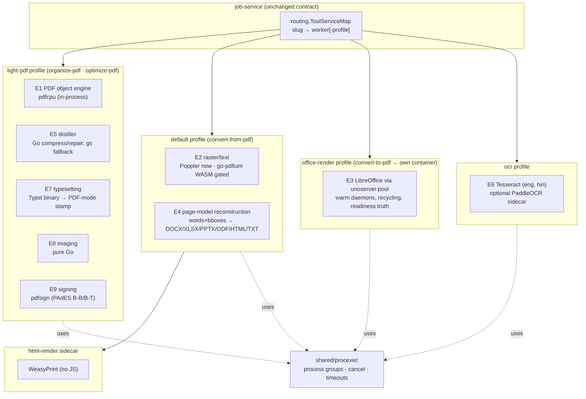

# Next-Generation Document Engine — target overview

Companion to `docs/developer/architecture/next-generation-document-engine/`. Shows the approved engine
decomposition (E1–E9) mapped onto worker profiles, and the capability-aware conversion routing. Status:
design only (2026-11); nothing here is deployed.

## Engines and the worker profiles that own them



## Capability-aware conversion routing (Stage 2+)

```mermaid
flowchart LR
    IN[(input object<br/>MinIO)] --> SNIFF["zip-subtype / PDF sniff<br/>(worker-side)"]
    SNIFF -->|docx/xlsx/pptx/odf → pdf| CLS{"simple-doc classifier<br/>(Stage 6, optional)"}
    CLS -->|complex or gate not passed| E3["E3 office-render<br/>LibreOffice warm pool"]
    CLS -->|simple and G-FAST passed| FP["Go fast path<br/>(optional)"]
    SNIFF -->|html → pdf| WP["WeasyPrint sidecar"]
    SNIFF -->|pdf → docx/xlsx/pptx/odf/html/txt| E4["E4 page model<br/>+ writers"]
    SNIFF -->|pdf → image / thumbnail| E2["E2 pdftoppm / PDFium"]
    SNIFF -->|pdf ops| E1["E1 pdfcpu"]
    SNIFF -->|compress / repair| E5{"E5 Go distiller"}
    E5 -->|unsupported image types, extreme, flatten, PDF/A| GS["Ghostscript"]
    SNIFF -->|scan / ocr| E6["E6 Tesseract"]
    E3 & FP & WP & E4 & E2 & E1 & E5 & GS & E6 --> OUT[(output object<br/>outputs/jobs/{id})]
    OUT --> EV["jobs.events.{id}.completed<br/>+ fidelity metadata"]
```

Reference renderers (LibreOffice, Ghostscript, Poppler, veraPDF) remain runtime dependencies only where the
diagram shows them; in the fidelity harness they are oracles inside the test-binaries image.
