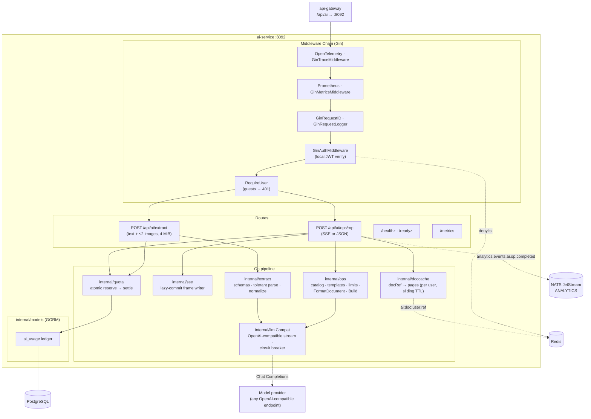

# AI Service -- Architecture

Internal structure of `ai-service` (port 8092): the server-side proxy for AI features. Owns the op catalog and prompt templates, and streams model answers over SSE.

## Component Diagram

## Notes
- **Publish-only on NATS.** No consumer exists, because the backend emits no user-lifecycle event to react to.
- The provider is not a readiness dependency: `/readyz` checks Postgres only.
