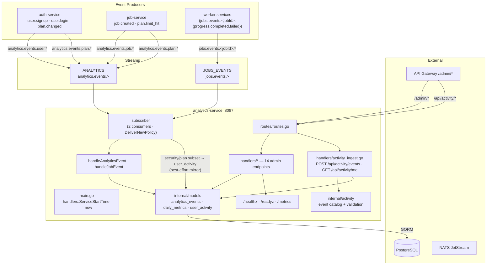
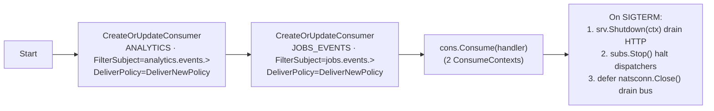
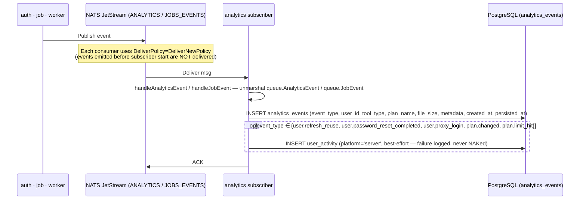
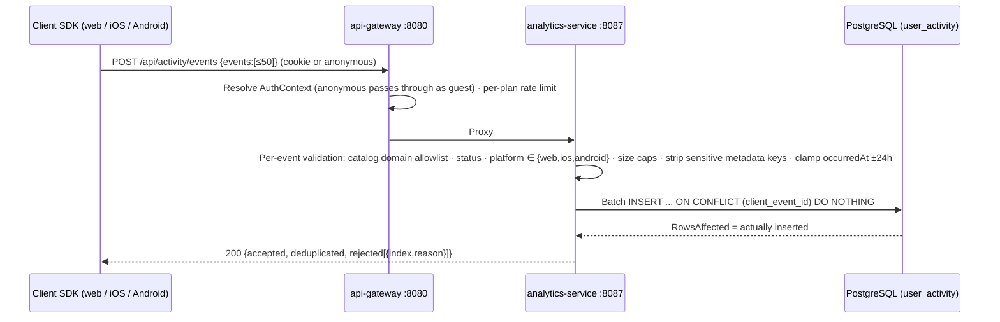
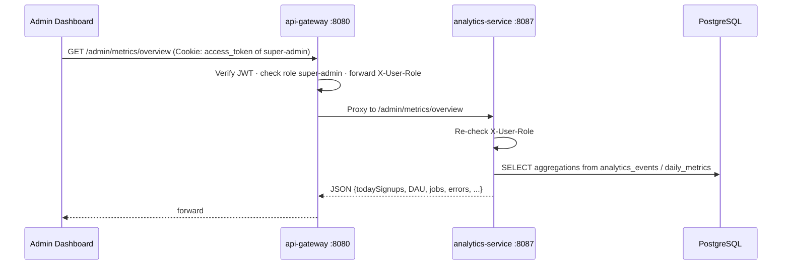
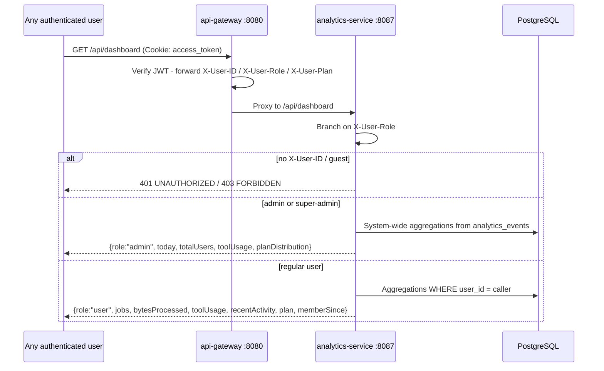

# Analytics Service — Architecture Diagram

## Subscriber Lifecycle

## Event → Persistence

## Activity Ingest Path (web/mobile SDKs)

## Admin Read Path

## Unified Dashboard Read Path (role-aware)

