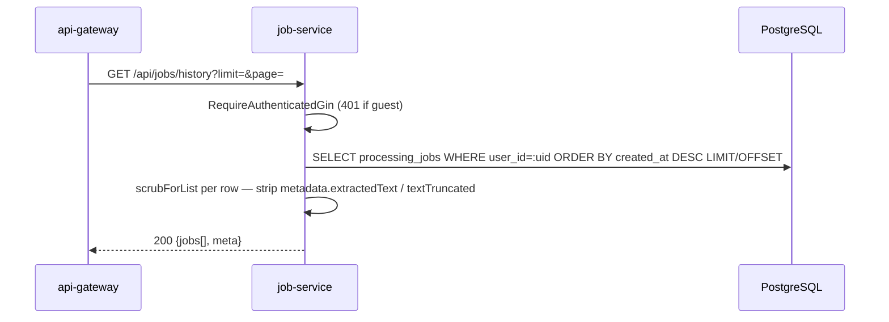
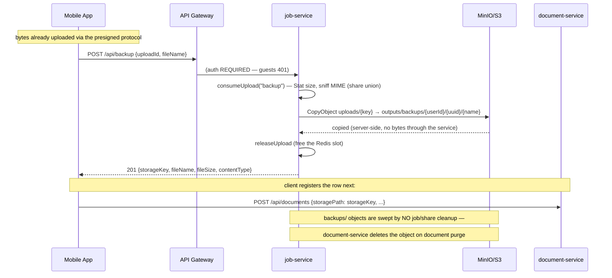

# Job Service -- Sequence Diagrams

Request flows through the `job-service` (port 8081).

## Presigned Multipart Upload (init → browser PUTs to MinIO → complete)

File bytes never pass through the job-service: the browser PUTs each part
directly to MinIO/S3 through presigned URLs (signed against
`S3_PUBLIC_ENDPOINT`, typically the API gateway origin).

```mermaid
sequenceDiagram
    participant Client
    participant GW as api-gateway
    participant JS as job-service
    participant Redis
    participant S3 as MinIO/S3

    Client->>GW: POST /api/uploads/init {fileName, fileSize, contentType}
    GW->>JS: Proxy
    JS->>JS: plan limit on declared size (413 FILE_TOO_LARGE) · partSize=UPLOAD_PART_SIZE_MB · totalParts=ceil (cap 1000)
    JS->>S3: CreateMultipartUpload uploads/&lt;uploadId&gt;/&lt;fileName&gt;
    JS->>JS: presign PUT URL per part (30m expiry)
    JS->>Redis: HSET upload:&lt;uploadId&gt; (fileName, declaredSize, contentType, bucket, key, s3UploadId, partSize, totalParts, createdAt) EX UPLOAD_TTL (30m)
    JS-->>Client: 201 {uploadId, key, partSize, totalParts, urlExpiresAt, parts[{partNumber,url}]}

    loop For each part
        Client->>S3: PUT &lt;presigned part URL&gt; [part bytes] (via gateway/public endpoint)
        S3-->>Client: 200 + ETag
    end

    opt Resume / expired URLs
        Client->>JS: GET /api/uploads/&lt;uploadId&gt;/parts?partNumbers=2,3
        JS->>Redis: HGETALL upload:&lt;uploadId&gt; (404 if gone)
        JS-->>Client: 200 {uploadId, partSize, parts (re-presigned)}
    end

    Client->>GW: POST /api/uploads/&lt;uploadId&gt;/complete {parts:[{partNumber,etag}]}
    GW->>JS: Proxy
    JS->>Redis: HGETALL upload:&lt;uploadId&gt; (404 if expired)
    alt part count != totalParts
        JS-->>Client: 400 UPLOAD_INCOMPLETE
    else
        JS->>S3: CompleteMultipartUpload(etags)
        JS->>S3: StatObject → TRUE size
        alt true size > plan limit
            JS->>S3: RemoveObject
            JS->>Redis: DEL upload:&lt;uploadId&gt;
            JS-->>Client: 413 FILE_TOO_LARGE
        else
            JS->>Redis: HSET upload:&lt;uploadId&gt; size · refresh TTL
            JS-->>Client: 200 {uploadId, fileName, size, complete:true}
        end
    end

    opt Cancel
        Client->>JS: DELETE /api/uploads/&lt;uploadId&gt;
        JS->>S3: AbortMultipartUpload (idempotent)
        JS->>Redis: DEL upload:&lt;uploadId&gt;
        JS-->>Client: 204
    end

    opt Stale frontend bundle (retired protocol)
        Client->>JS: PUT /api/uploads/&lt;uploadId&gt;/chunk
        JS-->>Client: 410 UPLOAD_PROTOCOL_CHANGED "Please refresh the page"
    end
```

## Create Job (JSON body with uploadIds)

```mermaid
sequenceDiagram
    participant GW as api-gateway
    participant JS as job-service
    participant Redis
    participant PG as PostgreSQL
    participant S3 as MinIO/S3
    participant NATS

    GW->>JS: POST /api/&lt;group&gt;/:tool {uploadIds, options} · Idempotency-Key?
    JS->>JS: GinAuth · normalize tool · routing.ServiceForTool · per-IP RATE_LIMIT_JOB_CREATE
    JS->>JS: validateToolOptions(tool, options) — 400 INVALID_OPTIONS (scan-to-pdf + pdf-metadata + ocr-pdf + pdf-to-image + sign-pdf + protect-pdf + unlock-pdf schemas)

    alt Idempotency-Key cache hit
        JS->>Redis: GET idempotency:&lt;key&gt;
        JS->>PG: SELECT processing_jobs WHERE id=...
        JS-->>GW: 201 (original job)
    else
        JS->>JS: findExistingJobForUploads(uploadIds) — replay safety
        alt mapped already
            JS-->>GW: 201 (original job)
        else
            JS->>JS: enforce plan max-files-per-job
            loop For each uploadId (consumeUpload — read-only)
                JS->>Redis: HGETALL upload:&lt;id&gt; (bucket, key, fileName)
                JS->>S3: StatObject(uploads, key) — existence + TRUE size
                JS->>S3: GetObjectRange(key, 0, 512)
                JS->>JS: validateMIMEHead(toolType, head)
            end
            Note over JS,S3: Object stays at uploads/&lt;uploadId&gt;/... — workers read it from there. InputPaths = object keys.

            JS->>PG: BEGIN TX
            JS->>PG: INSERT processing_jobs (id=UUIDv7, tool, status='queued', expires_at, ...)
            JS->>PG: INSERT file_metadata × N (path=&lt;object key&gt;)
            JS->>PG: COMMIT

            JS->>JS: assignGuestTokenIfNeeded
            JS->>NATS: Publish jobs.dispatch.&lt;serviceName&gt; (userId, inputPaths = object keys)
            JS->>Redis: SET idempotency:upload:&lt;id&gt; &lt;jobId&gt;
            JS->>Redis: DEL upload:&lt;id&gt; (session only — object untouched)
            JS->>Redis: SETEX idempotency:&lt;key&gt; 10m → jobId
            JS->>NATS: Publish analytics.events.job.created (planName from X-User-Plan)
            JS-->>GW: 201 {job, guestToken?}
        end
    end
```

## Create Job (multipart/form-data)

```mermaid
sequenceDiagram
    participant GW as api-gateway
    participant JS as job-service
    participant PG as PostgreSQL
    participant S3 as MinIO/S3
    participant NATS

    GW->>JS: POST /api/&lt;group&gt;/:tool · multipart files[] + options
    JS->>JS: enforce plan limits (max files · max file size MB)
    loop For each file (storeDirectUpload)
        JS->>JS: validateFileType(toolType, filename)
        JS->>JS: sniff first 512 bytes → validateMIMEHead
        JS->>S3: PutObject → uploads/&lt;jobId&gt;/&lt;basename&gt; (streamed, head re-prepended)
    end
    JS->>PG: INSERT processing_jobs + file_metadata (path=&lt;object key&gt;) in TX
    JS->>NATS: Publish jobs.dispatch.&lt;serviceName&gt;
    JS-->>GW: 201 {job}
```

## Detect Edges (scanner assist — synchronous relay)

`POST /api/organize-pdf/detect-edges` peeks at a completed image upload
**without consuming it** (the same `uploadId` feeds scan-to-pdf job creation
next) and relays detection to organize-pdf's internal endpoint. Per-IP
`RATE_LIMIT_DETECT` limiter (default 60/window).

```mermaid
sequenceDiagram
    participant Client
    participant GW as api-gateway
    participant JS as job-service
    participant Redis
    participant S3 as MinIO/S3
    participant OP as organize-pdf<br/>(/internal/v1/detect-edges)

    Client->>GW: POST /api/organize-pdf/detect-edges {uploadId}
    GW->>JS: Proxy
    JS->>JS: GinAuth · per-IP RATE_LIMIT_DETECT (ratelimit:detect)
    JS->>Redis: HGETALL upload:&lt;uploadId&gt; (peek — no releaseUpload)
    JS->>S3: StatObject(uploads, key) — existence + size
    JS->>S3: GetObjectRange(key, 0, 512) → image MIME sniff
    alt missing/unknown uploadId or PDF upload
        JS-->>Client: 400 INVALID_INPUT
    else image upload
        JS->>OP: POST {key} · X-Internal-Token (if INTERNAL_API_TOKEN set) · 15s timeout
        OP->>S3: StatObject (413 IMAGE_TOO_LARGE if &gt;30MiB)
        OP->>S3: GetObject → decode (422 UNDECODABLE_IMAGE if not an image / &gt;50MP)
        OP->>OP: DetectDocumentQuad (downscale→500px · blur · Sobel · Hough · quad)
        Note over OP: never fails hard — full-image quad, confidence 0 when no document found
        OP-->>JS: 200 {corners (normalized 0..1), confidence, width, height}
        alt upstream 4xx
            JS-->>Client: 422 relayed code (e.g. UNDECODABLE_IMAGE, IMAGE_TOO_LARGE)
        else upstream down / 5xx / timeout
            JS-->>Client: 502 DETECTION_UNAVAILABLE
        else success
            JS-->>Client: 200 {corners, confidence, width, height}
        end
    end
    Note over Client,JS: uploadId stays valid — Redis session and object untouched.<br/>Client passes corners into scan-to-pdf options.pages[i].corners.
```

## List Jobs by Tool (paginated)

```mermaid
sequenceDiagram
    participant GW as api-gateway
    participant JS as job-service
    participant Redis
    participant PG as PostgreSQL

    GW->>JS: GET /api/&lt;group&gt;/:tool?limit=25&page=1
    alt authenticated user
        JS->>PG: SELECT processing_jobs WHERE user_id=:uid AND tool_type=:tool ORDER BY created_at DESC LIMIT/OFFSET
    else guest
        JS->>Redis: SMEMBERS guest:&lt;token&gt;:jobs
        JS->>PG: SELECT WHERE id IN (...) AND tool_type=:tool AND user_id IS NULL ORDER BY created_at DESC
    end
    JS->>JS: scrubForList per row — strip metadata.extractedText / textTruncated<br/>(copy-on-write; single-job GET keeps full metadata)
    JS-->>GW: 200 {jobs[], meta:{page, limit}}
```

## Get Job History (auth only, all tools)



## Get / Download / Delete (single job)

```mermaid
sequenceDiagram
    participant Client
    participant GW as api-gateway
    participant JS as job-service
    participant PG as PostgreSQL
    participant S3 as MinIO/S3

    GW->>JS: GET /api/&lt;group&gt;/:tool/:id
    JS->>PG: SELECT processing_jobs WHERE id=:id AND tool_type=:tool
    JS->>JS: authorizeJobAccess (user_id match or guest_token in set)
    JS-->>GW: 200 {job}

    GW->>JS: GET /api/&lt;group&gt;/:tool/:id/download
    JS->>JS: authorizeJobAccess · status == completed?
    JS->>JS: outputFileCache lookup
    alt miss
        JS->>PG: SELECT file_metadata WHERE job_id=:id AND kind='output'
    end
    alt legacy disk path (starts with "/")
        JS-->>GW: 404 NOT_FOUND "download link has expired"
    else object key
        JS->>JS: PresignGet(outputs, key, 5m, response-content-disposition + response-content-type)
        JS-->>GW: 302 Location: presigned URL
        GW-->>Client: 302
        Client->>S3: GET presigned URL (bytes from object storage)
        S3-->>Client: 200 + Content-Disposition: attachment
    end

    GW->>JS: DELETE /api/&lt;group&gt;/:tool/:id
    JS->>PG: SELECT processing_jobs · authorize
    JS->>PG: SELECT file_metadata
    loop each file (skip legacy "/" paths)
        JS->>S3: RemoveObject(bucketFor(kind), key)
    end
    JS->>PG: DELETE file_metadata · DELETE processing_jobs
    JS->>Redis: SREM guest:&lt;token&gt;:jobs &lt;jobId&gt; (best-effort)
    JS-->>GW: 200 / 204
```

## Share Links — Create · Redeem (public) · Revoke

`POST /api/share` consumes a completed upload (extension + MIME-sniff
allowlist, NOT fail-open) and mints a 256-bit token stored only as its
SHA-256. `GET /share/:token` is **public** — outside `/api`, listed in the
gateway's `PublicPrefixes`, with its own per-IP `RATE_LIMIT_SHARE_REDEEM`
limiter (default 30/window). Expired, revoked, and unknown tokens all 404
identically.

```mermaid
sequenceDiagram
    participant Client
    participant Recipient
    participant GW as api-gateway
    participant JS as job-service
    participant Redis
    participant PG as PostgreSQL
    participant S3 as MinIO/S3

    Client->>GW: POST /api/share {uploadId, expiresIn:"1h"|"24h"|"7d" (default 24h)}
    GW->>JS: Proxy (user or guest — both allowed) · per-IP RATE_LIMIT_JOB_CREATE
    JS->>Redis: HGETALL upload:&lt;uploadId&gt; (consumeUpload "share" pseudo-tool)
    JS->>S3: StatObject + GetObjectRange(0,512) — extension allowlist + MIME sniff (NOT fail-open, executables refused)
    JS->>JS: newShareToken() — 32 random bytes, base64url · store SHA-256 only
    JS->>S3: CopyObject uploads/&lt;uploadId&gt;/&lt;file&gt; → outputs shares/&lt;shareId&gt;/&lt;file&gt; (server-side)
    JS->>PG: INSERT shares (token_hash, object_key, expires_at, user_id NULL for guests)
    alt DB insert fails
        JS->>S3: RemoveObject shares/&lt;shareId&gt;/&lt;file&gt; (rollback)
        JS-->>Client: 500 SERVER_ERROR
    else
        JS->>Redis: releaseUpload — DEL upload:&lt;uploadId&gt;
        JS-->>Client: 201 {id, fileName, contentType, fileSize, expiresAt, downloadCount, createdAt, url}
        Note over Client: url = SHARE_BASE_URL/share/&lt;token&gt; — the raw token's ONE appearance
    end

    Recipient->>GW: GET /share/&lt;token&gt; (no auth)
    GW->>GW: PublicPrefixes "/share/" — skip token verification
    GW->>JS: Proxy · per-IP RATE_LIMIT_SHARE_REDEEM (ratelimit:shareredeem)
    JS->>JS: token shape check (len 40–64) → SHA-256
    JS->>PG: SELECT shares WHERE token_hash=?
    alt unknown OR expired OR revoked
        JS-->>Recipient: 404 (identical for all three — no oracle)
    else valid
        JS->>PG: UPDATE download_count+1 (best-effort)
        JS->>JS: PresignGet(outputs, shares/&lt;id&gt;/&lt;file&gt;, 5m, attachment disposition + content-type)
        JS-->>Recipient: 302 Location: presigned URL
        Recipient->>S3: GET presigned URL
        S3-->>Recipient: 200 [bytes] Content-Disposition: attachment
    end

    Client->>GW: DELETE /api/share/&lt;shareId&gt; (authenticated owner; 401 for guests)
    GW->>JS: Proxy
    JS->>PG: UPDATE shares SET revoked_at=now() WHERE id=? AND user_id=? AND revoked_at IS NULL
    alt 0 rows (unknown / not owner / already revoked)
        JS-->>Client: 404 (never 403 — no existence oracle)
    else
        JS-->>Client: 200 {id}
    end

    Note over JS,S3: Cleanup sweep (cleanupExpiredShares, in RunSweep): shares past expires_at OR revoked —<br/>RemoveObject shares/&lt;id&gt;/... BEFORE deleting rows (idempotent retry on crash).
```

## SSE — Real-Time Job Updates

```mermaid
sequenceDiagram
    participant Client
    participant GW as api-gateway
    participant JS as job-service
    participant NATS as JOBS_EVENTS stream
    participant W as Worker

    Client->>GW: GET /api/jobs/&lt;jobId&gt;/events (Accept: text/event-stream)
    GW->>JS: Proxy
    JS->>JS: Set SSE headers · 5-minute timeout context
    JS->>NATS: CreateConsumer(JOBS_EVENTS, FilterSubject="jobs.events.&lt;jobId&gt;.>", DeliverNew, InactiveThreshold=1m)
    JS-->>Client: event: connected · data: {jobId}

    par Worker side
        W->>NATS: Publish jobs.events.&lt;jobId&gt;.progress (every progress tick)
        W->>NATS: Publish jobs.events.&lt;jobId&gt;.completed (or .failed)
    and SSE side
        loop Until ctx done / terminal status
            JS->>NATS: cons.Fetch(1, 5s wait)
            alt got msg
                JS-->>Client: event: job-update · data: {jobId,status,progress,toolType,fileSize?}
                JS->>NATS: ACK
                opt status terminal
                    JS->>JS: close stream
                end
            else no msg / timeout
                JS-->>Client: : keepalive (every 15s)
            end
        end
    end

    JS->>NATS: DeleteConsumer (best-effort cleanup)
    JS-->>Client: connection closed
```

## Failure: Upload Replay Safety

```mermaid
sequenceDiagram
    participant Client
    participant JS as job-service
    participant Redis

    Client->>JS: POST /api/&lt;group&gt;/:tool {uploadIds:[X]}
    JS->>Redis: GET upload:X
    Redis-->>JS: present
    JS->>JS: ... create job J1, release Redis state, record idempotency:upload:X=J1
    JS-->>Client: 201 J1

    Note over Client,JS: Network blip — client retries the same POST

    Client->>JS: POST /api/&lt;group&gt;/:tool {uploadIds:[X]}
    JS->>Redis: GET idempotency:upload:X
    Redis-->>JS: J1
    JS->>JS: findExistingJobForUploads → J1
    JS-->>Client: 201 J1 (idempotent)
```

## Document Backup — Copy an Upload into the Caller's backups/ Prefix (Phase 22)


